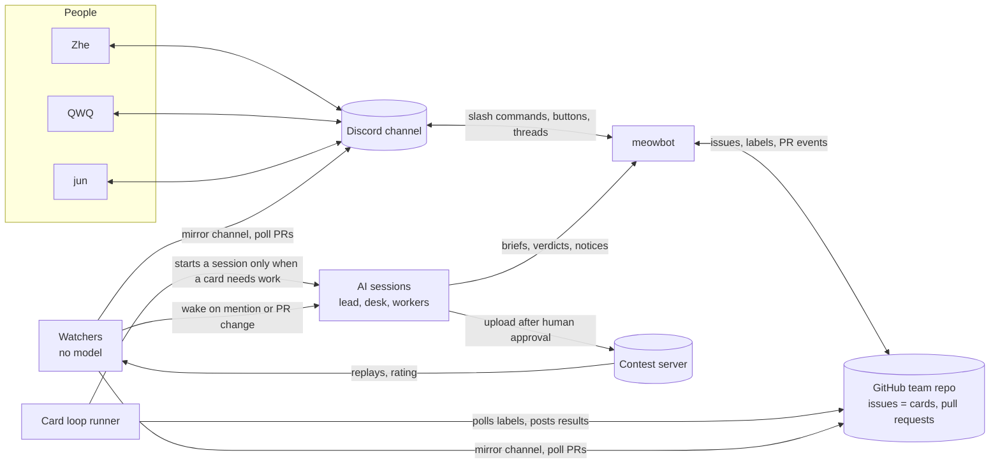
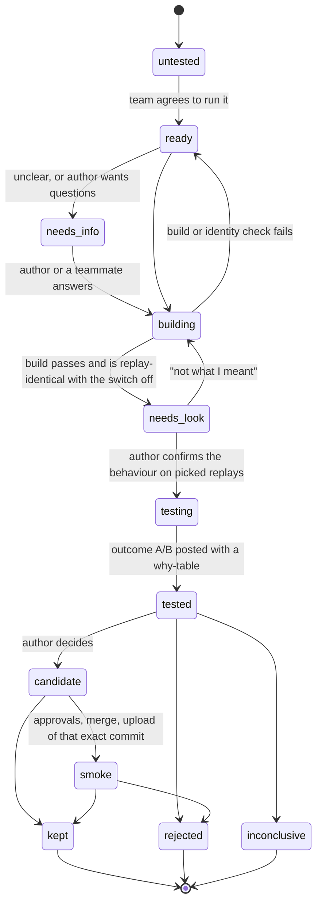
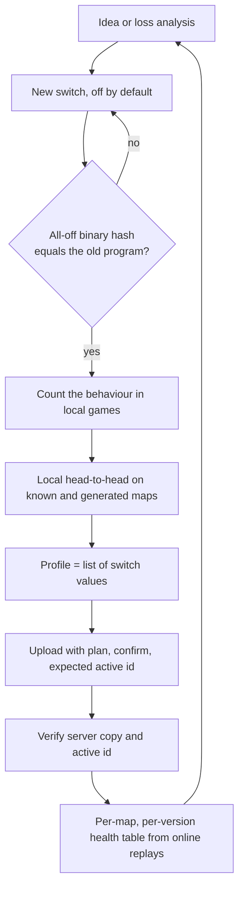
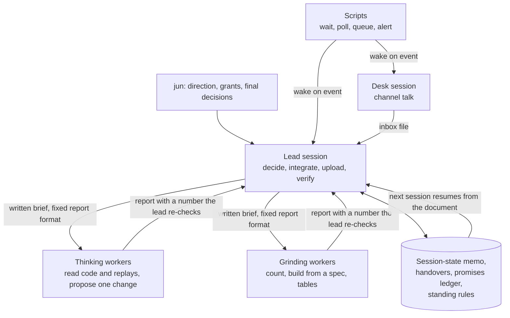

# Architecture overview

Three systems carried the work. This page shows how each was put together and where its source is.

## 1. The collaboration environment

Three people shared one bot from three time zones, up to nine hours apart. The design goal was that nobody had to be
awake for someone else's work to move, and that every decision stayed with a person.

| Piece | Source | Job |
|---|---|---|
| meowbot | [`workbench/tools/meowbot.py`](../workbench/tools/meowbot.py) | Posts PRs and idea cards, ten slash commands (`/hypo`, `/hypo-max`, `/board`, `/board-edit`, `/task`, `/loop`, `/status`, `/answer`, `/submit`, `/meow`), candidate approval buttons limited to members |
| Chat session | [`meow_chat.py`](../workbench/tools/meow_chat.py), [`meow_guard.py`](../workbench/tools/meow_guard.py) | A read-only AI session per thread behind a fail-closed tool policy; any action is a plan the requester must confirm |
| Channel mirror | [`discord_sync.py`](../workbench/tools/discord_sync.py) | Mirrors the channel to local files so sessions read text, not an API |
| Team watch | [`team_watch.py`](../workbench/tools/team_watch.py) | New messages plus new GitHub events; first action of every working turn |
| Wake-up watchers | [`mention_watch.py`](../workbench/tools/mention_watch.py), [`loop_watch.py`](../workbench/tools/loop_watch.py), [`jun_dm.py`](../workbench/tools/jun_dm.py) | Exit when something needs a model; cost nothing while waiting |
| Nudges | [`decision_nudge.py`](../workbench/tools/decision_nudge.py), [`snooze.py`](../workbench/tools/snooze.py), [`tasks.py`](../workbench/tools/tasks.py) | Remind a card's author within their configured hours; snooze; per-person task list |
| Desk session | [`workbench/docs/DISCORD-DESK.md`](../workbench/docs/DISCORD-DESK.md) | A cheap model session that owns channel talk and passes work to the lead through a file |

Design rules that held:

- **Scripts wait, models think.** Polling, queues and long waits never run inside a model session.
- **People approve, tools execute.** Uploads and merges need a member's click; every vote has a visible force path
  with a reason, so a sleeping teammate cannot block the others and responsibility stays explicit.
- **Everything spends through a plan.** A tool that uses a scarce resource (test tickets, uploads, the live bot)
  prints its plan and does nothing without `--confirm`, and refuses when the live bot is not the expected one.

## 2. The card loop

One GitHub issue per idea. Exactly one `status:*` label is the card's state, so the runner can resume from the label
alone after a restart.

| Piece | Source |
|---|---|
| Specification | [`card-loop/docs/LOOP.md`](../card-loop/docs/LOOP.md), [`WORKFLOW.md`](../card-loop/docs/WORKFLOW.md) |
| Runner | [`card-loop/work/loop/runner.py`](../card-loop/work/loop/runner.py) |
| Detached job supervisor with leases | [`card-loop/work/loop/jobs.py`](../card-loop/work/loop/jobs.py) |
| Hook that restricts what a card session may do | [`card-loop/work/loop/guard.py`](../card-loop/work/loop/guard.py) |
| Prompts per step | [`card-loop/work/loop/prompts/`](../card-loop/work/loop/prompts) |
| Board commands | [`card-loop/work/board.py`](../card-loop/work/board.py) |
| Fair rotation across authors | [`card-loop/work/fair_queue.py`](../card-loop/work/fair_queue.py) |
| Per-card completion checks | `card-loop/work/card_*_check.py` |

## 3. Build, test, ship

| Stage | Source |
|---|---|
| Variant builder | [`local-rig/solo/tools/mkbots.py`](../local-rig/solo/tools/mkbots.py) |
| Local launcher and slot limit | [`local-rig/play.sh`](../local-rig/play.sh), [`local-rig/engine/run_game.py`](../local-rig/engine/run_game.py) |
| Generated map families | [`workbench/tools/mapgen/`](../workbench/tools/mapgen), [`local-rig/maps/`](../local-rig/maps) |
| Upload and online tests | [`workbench/tools/submit.js`](../workbench/tools/submit.js), [`smoke.py`](../workbench/tools/smoke.py), [`pair_report.py`](../workbench/tools/pair_report.py) |
| Replay reader and ladder study | [`workbench/tools/ladder_replay.py`](../workbench/tools/ladder_replay.py), [`workbench/data/analysis/ladder/`](../workbench/data/analysis/ladder) |
| Rating ratchet and weak-loss alarm | [`park_watch.py`](../workbench/tools/park_watch.py), [`weak_watch.py`](../workbench/tools/weak_watch.py) |
| Last day's scripts and switch lists | [`workbench/archive/final-session-scripts/`](../workbench/archive/final-session-scripts) |

## 4. AI session operations

The record of how this arrangement was reached, one revision at a time, is in
[write-up chapter 05](../writeup/05-ai-workforce.md).
