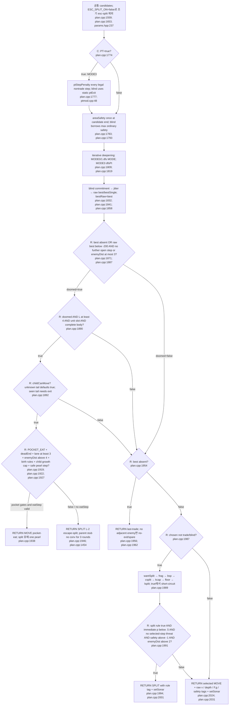
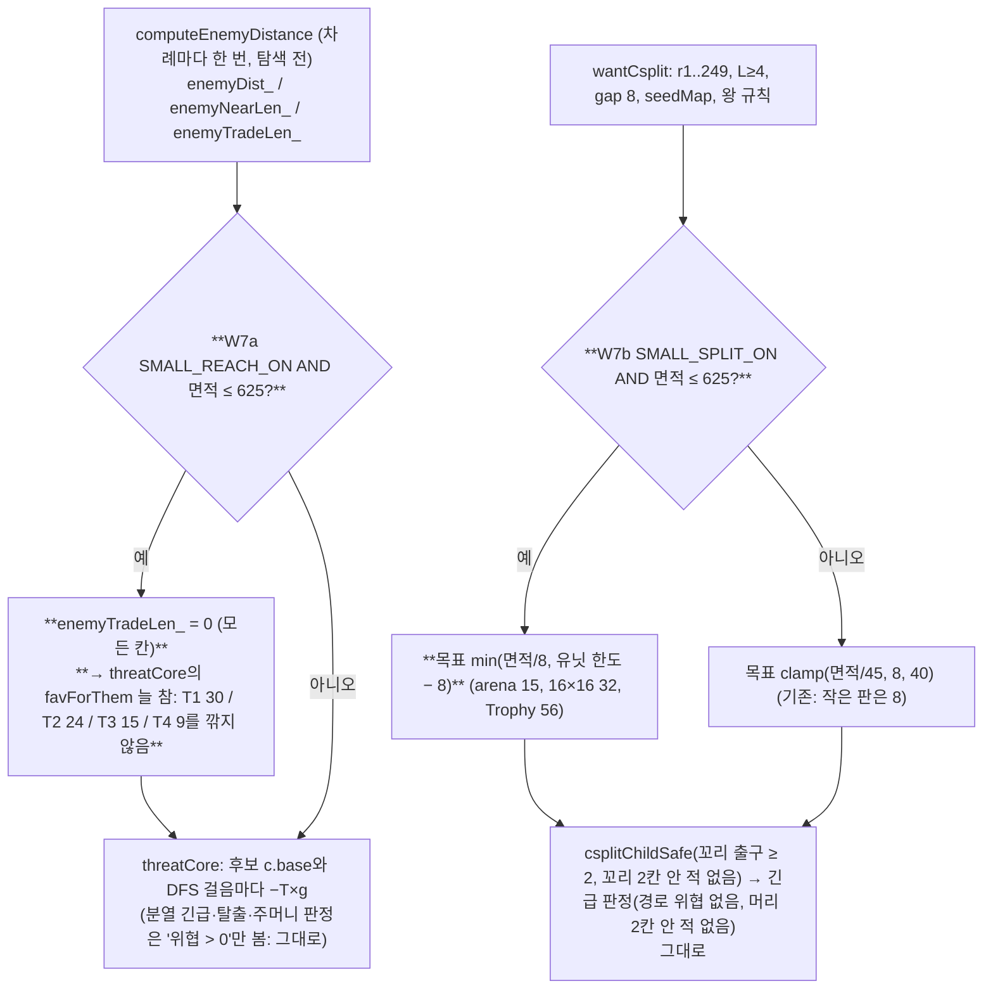
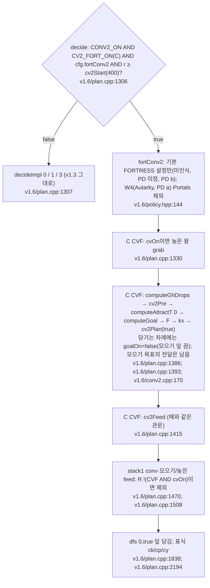

# FORTRESS와 Portals 세부 흐름

기준 줄 번호는 `versions/v1.3/bot/`다. `C`는 `if constexpr`로 나누는 인스턴스, `K`는 인스턴스의 상수식으로 불가능한 경로, `R`은 런타임 gate다. FORTRESS에는 MODE=0과 W4 MODE=1, Portals MODE=3이 있다. Portals 정책 행도 `Engine::FORTRESS`이고 태그는 E=F다(`policy.hpp:70`, `policy.hpp:139`, `plan.cpp:1302`, `main.cpp:81`).

| 정책 행 | MODE / 태그 | 차이 | 근거 |
|---|---|---|---|
| 미인식 / unknown / map=none, PD family undecided, PD b | 0 / F | 기본 FORTRESS_CONFIG | `policy.hpp:67`, `policy.hpp:69`, `policy.hpp:91`, `engcfg.hpp:53` |
| Autarky, PD a | 1 / W | FORT_W4_ON=true; csplit/F/cov/claims/fc/kcap/floor/lsplit 제외 | `policy.hpp:135`, `plan.cpp:1377`, `plan.cpp:1989`, `plan.cpp:356` |
| Portals family | 3 / F | PT_ON=true; 길이 기억 / 목표 / feed / penalty / DFS 변경 | `policy.hpp:139`, `world.cpp:120`, `plan.cpp:1375`, `plan.cpp:1774`, `plan.cpp:1819` |

## 목표 계산과 feed

```mermaid
flowchart TD
  E["decideImpl 0 / 1 / 3; SW=false<br/>plan.cpp:1302; plan.cpp:1307"]
  D{"R: parsedOk AND headT valid AND tiles nonempty?<br/>plan.cpp:1328"}
  DR["RETURN MOVE degraded<br/>plan.cpp:1334"]
  SET["homeT / seedMap / bodyIndex; enemy → frontier → softPenalty<br/>plan.cpp:1339; plan.cpp:1354"]
  FIELD["C: SW else → computeGhDrops → computeAttractT MODE<br/>plan.cpp:1373"]
  PT{"C: PT=true?<br/>plan.cpp:1375"}
  GP["computeGoalPt: news r300; gather r340; r430 endgame removes unit/length floors<br/>ptmod.cpp:85; ptmod.cpp:106"]
  G["computeGoal: news r300; gather r340, units at least 4, L at least 4; GX time slack<br/>plan.cpp:1155; plan.cpp:1176; plan.cpp:1192"]
  W{"C: W4=true?<br/>plan.cpp:1377"}
  WN["F flags/target cleared; gathering goal는 유지<br/>plan.cpp:1377"]
  F["computeFountainGoal: gathering 없을 때만 F/F2, F2p false<br/>plan.cpp:1008; plan.cpp:1010; plan.cpp:1075"]
  KX["computeKingAway: KX_ON + map gate + r300 + king L at least 8<br/>plan.cpp:1244"]
  CONV{"R: CONV_ON + r300 + L at most 4 + units at least 3 + no enemy heads + body at least 2 + no fresh stub/newborn?<br/>plan.cpp:1389; plan.cpp:1453"}
  REC["visible recipient L at least max 8,own L+4; free/body-aware path distance at most 3; nearer then longer<br/>plan.cpp:1456; plan.cpp:1475"]
  CR["RETURN neck MOVE feed ... conv; setSonar 미호출<br/>plan.cpp:1478"]
  FE{"R: r430 or gathering r340, enough units, head enemyDist above 4, body at least 2?<br/>plan.cpp:1487; plan.cpp:1491"}
  FR["feed recipient: longer visible ally; r430 전 kingLen-2 이상 및 recipient enemy within 3 제외<br/>plan.cpp:1499; plan.cpp:1511; plan.cpp:1513"]
  PG["PT memory length 보강; r430 뒤 feedMinUnits=2, slack10, PT_ENDFEED king-class timing 우회<br/>plan.cpp:1490; plan.cpp:1509; plan.cpp:1540"]
  NOW{"R: feedTo valid AND lateWindow OR ptEndFeed OR gathering units at least 4 and L at least 4?<br/>plan.cpp:1541"}
  FER["RETURN neck MOVE feed; setSonar 미호출<br/>plan.cpp:1547"]
  CAND["single/blind/2-step → optional short-head escape split → escape sprint → kill paths<br/>plan.cpp:1559; plan.cpp:1635; plan.cpp:1736"]
  E --> D
  D -->|"false"| DR
  D -->|"true"| SET
  SET --> FIELD --> PT
  PT -->|"true: MODE3"| GP
  PT -->|"false: MODE0/1"| G
  GP --> W
  G --> W
  W -->|"true: MODE1"| WN
  W -->|"false: MODE0/3"| F
  WN --> KX
  F --> KX --> CONV
  CONV -->|"true"| REC
  CONV -->|"false"| FE
  REC -->|"valid recipient found"| CR
  REC -->|"no valid recipient"| FE
  FE -->|"true"| FR
  FE -->|"false"| CAND
  FR --> PG --> NOW
  NOW -->|"true"| FER
  NOW -->|"false"| CAND
```



Portals 보강 노드는 PT가 false면 K no-op이다. r430 이후 `PT_ENDFEED`만 보면 무조건 feed로 오해할 수 있다. 외부의 units≥2, enemyDist>4, visible longer recipient, path≤5 등의 gate와 recipient `kingLen−2` 조건은 유지된다(`plan.cpp:1490`, `plan.cpp:1491`, `plan.cpp:1510`, `plan.cpp:1540`). `PT_ENDGAME_ON`은 `computeGoalPt`의 unit/length floor 제거에만 걸린다. feedMinUnits/슬랙/강한 end gather weight는 이 토글과 별개다(`ptmod.cpp:106`, `plan.cpp:1490`, `plan.cpp:1536`, `plan.cpp:592`).

## F / F2와 gathering의 우선순위

```mermaid
flowchart TD
  G["computeGoal 또는 computeGoalPt reset 후 king news 선택<br/>plan.cpp:1156; ptmod.cpp:86"]
  KING{"R: gatherKing OR no goalT?<br/>plan.cpp:1175; ptmod.cpp:104"}
  NO["goalOn=false; king는 자체 섭취<br/>plan.cpp:1175"]
  CLK{"R: gather clock reached AND unit/length floors AND reachable AND distance+5 less than rounds left?<br/>plan.cpp:1176; plan.cpp:1189; plan.cpp:1192"]
  YES["goalOn=true; GATHER_W .12, GH_HOLD3; PT r430 뒤 .4<br/>plan.cpp:537; plan.cpp:592"]
  FG{"R: FGUARD_ON AND no goalOn AND r less than 340 AND units at least 3 AND not king L at least 8 AND sym/home known?<br/>plan.cpp:1010; plan.cpp:1012"}
  FN["F 목표 제거 또는 선택 안 함<br/>plan.cpp:1010; plan.cpp:1012"]
  TABLE["F2 table mapFountAt/mapTerrAt; unknown이면 observed/mirrored fountain와 ourSide<br/>plan.cpp:1016; plan.cpp:1017"]
  KEEP{"R: held F target distance at most 9, fountain/side valid, no better guarding ally?<br/>plan.cpp:1045"}
  KT["held fTarget 우선<br/>plan.cpp:1045"]
  NT["new target: distance at most 6, no ally guard/nearer nonking; nearest headDist then tile iteration<br/>plan.cpp:1035; plan.cpp:1048"]
  BF["group sources within Manhattan3 → BFS goalOn=fGoal; FG_HOLD2<br/>plan.cpp:1061; plan.cpp:1073"]
  PAUSE{"R: F2P_ON AND live outside-zone claim still ours?<br/>plan.cpp:1075"}
  PN["goalOn=fGoal=false, fTarget 유지; Fp tag; 현재 F2P_ON=false<br/>plan.cpp:1079; params.hpp:426"]
  END["goal field 완료; W4는 F 전체 C 제외<br/>plan.cpp:1377"]
  G --> KING
  KING -->|"true"| NO
  KING -->|"false"| CLK
  CLK -->|"true"| YES
  CLK -->|"false"| NO
  YES --> FG
  NO --> FG
  FG -->|"false"| FN
  FG -->|"true; W4=false"| TABLE
  TABLE --> KEEP
  KEEP -->|"true"| KT
  KEEP -->|"false"| NT
  KT --> BF
  NT -->|"target found"| BF
  NT -->|"target missing"| FN
  BF --> PAUSE
  PAUSE -->|"true"| PN
  PAUSE -->|"false"| END
  PN --> END
  FN --> END
```

F2가 `mapFountAt=-1`이라 **F 전체가 꺼지는 것은 아니다**. 관측 fountain과 symmetry 기반 side로 계속 후보를 찾는다. 반면 symmetry가 불명확하면 표가 있어도 F는 그보다 앞 gate에서 멈춘다(`plan.cpp:1012`, `plan.cpp:1016`). gathering 시간이 왔으나 gathering goal이 없어도 F는 r340 gate로 중단된다(`plan.cpp:1010`).

## candidate → search → doom → legacy split



## split 사슬의 세부 gate

모두 위 마지막 urgency gate를 통과해야 실제 행동이 된다. doom split은 이 표보다 먼저이고 정책 caps·분열 간격·king 규칙을 읽지 않는다(`plan.cpp:1890`, `plan.cpp:1987`).

| 순서 / rule | R gate와 size | MODE0 / MODE1 / MODE3 | 근거 |
|---|---|---|---|
| 1 `wantSplit` | r≤450, r≥340이면 units=1만; map-scaled cap 기본3/rich5. lone L≥5(300칸 미만 지도는 L≥8), child2; multi L≥8, fresh ally 있으면 king 제외, child3. childSafe 필요 | 모두 존재 | `plan.cpp:759`, `params.hpp:95` |
| 2 `wantFrag` | r250..420, L≥7, gap15, longerAllyKnown, child2; cap=clamp(tiles/130,6,16); fc면 clamp(tiles/45,8,40)로 확장 | 모두 존재, MODE1 `fc=false` | `plan.cpp:817`, `plan.cpp:1989`, `params.hpp:170` |
| 3 `wantBSplit` | Schooltime b 인식, r≤166, L4..9, units<16, child2, childSafe | 함수는 모두 남으나 현재 F/PT 행에서는 지도 gate 불충족 | `plan.cpp:837`, `policy.hpp:81` |
| 4 `wantCsplit` | r1..249, L≥4, gap8, seedMap이면 r≥50; target clamp(tiles/45,8,40); L≥8이면 longer ally; child2, tailDist2/exits2 | MODE1 K 제외; MODE0/3 존재 | `plan.cpp:867`, `plan.cpp:903`, `plan.cpp:1990` |
| 5 `wantKcap` | r<250, king L≥7, units<6, family gate; child2, tailDist2/exits1 | MODE1 K 제외; 현재 F/PT family들은 map gate false | `plan.cpp:935`, `plan.cpp:941` |
| 6 `wantFloor` | r30..450, L≥4, units≤3, family gate; r340 이후 lone L≥5 또는 not king; child2, tailDist2/exits1 | MODE1 K 제외; 현재 F/PT family들은 map gate false | `plan.cpp:930`, `plan.cpp:957` |
| 7 `wantLsplit` | r250..339, L4..6, gap8, units<clamp(tiles/45,8,40); child2, tailDist2/exits2 | MODE1 K 제외; MODE0/3 존재 | `plan.cpp:973` |

`BSPLIT/FLOOR/KCAP_ON=true`만 보고 현재 FORTRESS 행에서 발동한다고 판단하면 안 된다. Schooltime 등은 인식 즉시 SWARM으로 가서 legacy 사슬을 사용하지 않고, 미인식 동안에는 legacy map gate가 false다(`policy.hpp:75`, `policy.hpp:160`, `plan.cpp:1988`, `plan.cpp:930`).

## Portals의 가격과 기억 경계

- MODE3의 candidate penalty는 nontrade에만 적용된다. DEAD 왕 −40/step, POCKET 모든 dragon −40/step, 왕 unprobed blind crossing −12(현재 head가 ROOM이면 면제), 비왕 unseen exit near fresh king −12다. 왕 DEAD와 POCKET이 겹치면 −80이다(`plan.cpp:1776`, `ptmod.cpp:54`, `ptmod.cpp:55`, `ptmod.cpp:58`, `ptmod.cpp:62`, `ptmod.cpp:78`).
- `dfsPt`는 미래 step마다 DEAD/POCKET 가격을 할인해 더하지만 crossing의 −12를 다시 매기는 `ptStepPenalty`는 호출하지 않는다. 공통 `portalPenalty`는 남는다(`plan.cpp:621`, `plan.cpp:624`, `plan.cpp:625`).
- 왕의 late grab 해제는 MODE3에서 `PT_KING_GRAB_ON=true`가 다시 켠다(`plan.cpp:1321`, `plan.cpp:1325`).
- C2는 Portals에서 false; `ptLenActive`가 별도 기억을 적용한다. `ptUpdateLens`는 현재 신선한 관측만 순회하는 것이 아니라 모든 remembered allies의 `estLen/minLen`을 순회한다. `ev>=remembered length`이면 evidence round를 현재로 바꾸므로 함수 설명의 “20라운드 기억”만으로 정확한 만료를 추정하면 안 된다. 결정용 fresh 집계의 20라운드 gate는 별도로 남는다(`world.cpp:113`, `world.cpp:120`, `ptmod.cpp:15`, `ptmod.cpp:21`, `world.cpp:459`).

호출 교차 확인: `computeGhDrops/computeGoal/computeFountainGoal/computeKingAway`는 `plan.cpp:1373/1376/1378/1379`, `computeGoalPt`는 `plan.cpp:1375`, `ptStepPenalty`는 `plan.cpp:1777/1779`, `dfsPt`는 `plan.cpp:1819`와 `plan.cpp:628` 재귀다. 모든 legacy split의 결정 호출은 `plan.cpp:1989`에 모인다.

## v1.7 W7 꽂을 자리 (사전 등록 2026-10-01 16:02 KST, `versions/v1.7/VERSION.md` 3절; 둘 다 기본 꺼짐, 면적 ≤ 625에서만 발동)



- **세기(`terms.md` near threat 줄):** 작은 판에서 "unfavorable d1 −13.5, d2 −4.8"이 "favorable d1 −30, d2 −24"가 된다.
- **덮어쓰기:** 없다. 할인은 위협 0을 0 아닌 값으로 만들지 않는다. 그래서 '위협 > 0'으로 거르는 규칙(분열 긴급, 탈출, 주머니 먹기)의 발동은 그대로다.

## v1.6g G5: decideImpl<5> 요새 후반 CONV2 (`versions/v1.6/bot`; 출시 빌드에서는 꺼짐)

줄 번호는 `versions/v1.6/bot/`이다. `CV2_FORT_ON`(컴파일 상수)이 출시 v1.6에서 false라 아래 경로는 컴파일에서 빠지고, 모든 요새 행은 v1.3과 사건이 같다(VERSION.md §9.1, 동일성 45/45). 켠 시험(VERSION.md §8.5 (c), §9.4)에서는 넓은 지도에서 먹이가 정확해지고 좁은 요새형에서는 먹이 수가 줄어 꺼 두었다.



- **덮어쓰는 것(켰을 때):** r400부터 stack1 conv, 모으기 먹이, 늦은 먹이(FE), 그리고 당기는 차례의 모으기 잎 당김(.12/칸)이다.
- **덮어쓰이는 것:** degraded RETURN, 위협·함정 점수, doom·탈출 분열(v1.3 그대로)이다.
- **v1.6h(`exp/v16/bot-h`, 출시 안 함):**
  - 배정에 프로세스별 퍼짐 관문 `spreadGate()`를 더한다. 이 프로세스가 아는 먼 질량이 40% 초과이고 24 이상이면 열리고, 계속 열려 있다. 표식은 " sg"다.
  - 측정: big_empty r400+ 차례의 47%에서 열렸고, 인식 끈 Autarky·Devil·Portals·PD에서는 0%였다(VERSION.md §11.5).
