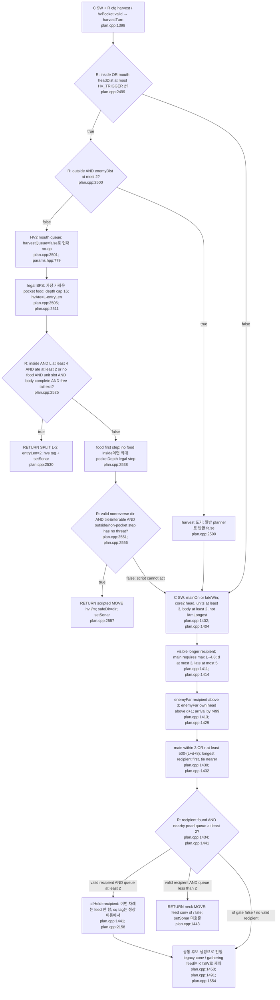
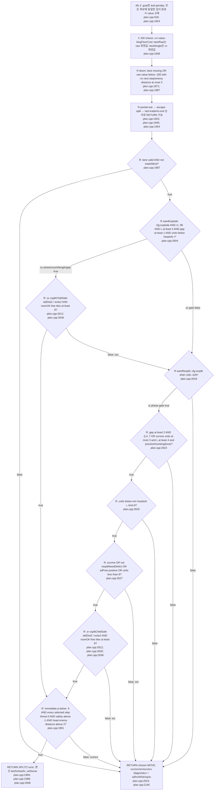
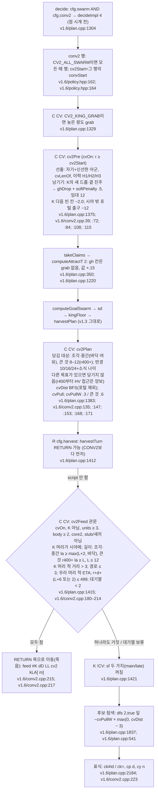

# SWARM 세부 흐름: decideImpl<2>

줄 번호의 기본 경로는 `versions/v1.3/bot/`이다. `v1.4/...`는 `versions/v1.4/bot/...`다. `C`는 `if constexpr`로 분리된 코드, `K`는 상수식 조건(`SW`, `!SW`, `!W4`)으로 해당 인스턴스에서 불가능한 경로, `R`은 차례마다 판정하는 조건이다. 최적화 후 바이너리의 제거 여부를 따로 측정한 것은 아니다(`plan.cpp:1307`). 공통 입력/출력은 [flow-turn.md](flow-turn.md), 점수 계산은 [terms.md](terms.md)를 따른다.

## 준비 → sd → harvest 목표

```mermaid
flowchart TD
  E["SWARM row → cfg.swarm=true → decideImpl 2<br/>policy.hpp:144; plan.cpp:1302"]
  G{"R: parsedOk AND headT valid AND tiles nonempty?<br/>plan.cpp:1328"}
  BAD["RETURN MOVE degraded<br/>plan.cpp:1334"]
  B["공통 상태 / homeT / seedMap / bodyIndex; enemy → frontier → softPenalty<br/>plan.cpp:1339; plan.cpp:1354"]
  C["C: if constexpr SW → ensureCore2 / updateSide; ghOn=kxOn=false<br/>plan.cpp:1358; plan.cpp:1364"]
  SC{"R: cfg.spawnClear?<br/>plan.cpp:1363"}
  SCY["addSpawnClear: round+2..round+min L,8 spawn의 softPenalty += .5<br/>plan.cpp:2581; plan.cpp:2597"]
  CL{"R: cfg.claimSonar?<br/>plan.cpp:1366"}
  CLY["takeClaims: TTL 4, 새 빈 claim은 해제, allies.hotT=-1<br/>plan.cpp:2211"]
  A["computeAttractT 2: grab / cl / cov 강화는 core2 안만; 일반 먹이 source는 core 밖도 남음<br/>plan.cpp:336; plan.cpp:350; plan.cpp:368"]
  RG["computeGoalSwarm: goalOn=false; fresh king 소식 relay만 준비<br/>plan.cpp:2566"]
  SDG{"R: cfg.disperse?<br/>plan.cpp:1369"}
  SD["computeDisperseGoal 시작: F / sd 상태 reset<br/>plan.cpp:2248"]
  SDN["fGoal=false / fTarget=-1 / fPause=-1<br/>plan.cpp:1369"]
  EL{"R: goalOn OR round at least max convStart,430 OR units less than 3 OR no home/family OR longest L at least 8?<br/>plan.cpp:2250"}
  OFF["sdAnchor=-1; 목표 없음<br/>plan.cpp:2251"]
  FL["core2 spawn flow=1/mean gap; g=-1이면 관측 fountain으로 대체<br/>plan.cpp:2255; plan.cpp:2268"]
  FRONT{"R: cfg.front nonnull AND sideChar 1 or 2?<br/>plan.cpp:2288"}
  DEF["fresh allies: live claim의 bin 또는 head bin; deficit=share*.01*(known+1)-have<br/>plan.cpp:2291; plan.cpp:2298"]
  OWN["ours t,hyst: enemy ETA → ally path/old Manhattan → id tie → claims ETA → frontier veto<br/>plan.cpp:2300"]
  LEASE{"R: held anchor has flow/reach AND age less than 4 or frontier commitment less than 30 AND ours with hyst=2?<br/>plan.cpp:2335"}
  KEEP["held target 유지; 새 최고 deficit보다 먼저<br/>plan.cpp:2336; plan.cpp:2366"]
  RANK["owned groups: value at least .004; positive deficit → yield/(1+assigned) → smaller headDist<br/>plan.cpp:2323; plan.cpp:2347"]
  PICK["target=valid held anchor, else new best; sdTaken/sdSince 갱신<br/>plan.cpp:2366; plan.cpp:2368"]
  FREE["sdFree: 선택 목표에서 Manhattan 6 초과인 owned group 있으면 1<br/>plan.cpp:2371"]
  CLOCK{"R: target valid AND round less than cfg.convStart?<br/>plan.cpp:2372"}
  PULL["group BFS → goalOn=fGoal=true; FG_W_FRONT .4 outside FG_HOLD 2<br/>plan.cpp:2373; plan.cpp:537"]
  NOPULL["anchor/deficit는 남을 수 있으나 당김과 broadcast claim 없음<br/>plan.cpp:2372; plan.cpp:1121"]
  KF["computeKingFloor: kingClass + cfg.kingFloor이면 enemy distance field<br/>plan.cpp:2399"]
  HVG{"R: cfg.harvest?<br/>plan.cpp:1371"}
  HVP["harvestPlan: sd 뒤 pocket mouth goal로 교체 가능<br/>plan.cpp:2434; plan.cpp:2477"]
  HVN["hvPocket=-1 / hvPhase=0<br/>plan.cpp:1371"]
  NEXT["harvest script → sf → 공통 candidates/search<br/>plan.cpp:1398; plan.cpp:1401; plan.cpp:1554"]
  E --> G
  G -->|"false"| BAD
  G -->|"true"| B
  B --> C --> SC
  SC -->|"true"| SCY
  SC -->|"false"| CL
  SCY --> CL
  CL -->|"true"| CLY
  CL -->|"false"| A
  CLY --> A --> RG --> SDG
  SDG -->|"true"| SD
  SDG -->|"false"| SDN
  SD --> EL
  EL -->|"any exclusion true"| OFF
  EL -->|"all exclusions false"| FL
  FL --> FRONT
  FRONT -->|"front=true"| DEF
  FRONT -->|"front=false: legacy enemy tie rule"| OWN
  DEF --> OWN --> LEASE
  LEASE -->|"true"| KEEP
  LEASE -->|"false"| RANK
  KEEP --> RANK --> PICK --> FREE --> CLOCK
  CLOCK -->|"true"| PULL
  CLOCK -->|"false"| NOPULL
  OFF --> KF
  SDN --> KF
  PULL --> KF
  NOPULL --> KF
  KF --> HVG
  HVG -->|"true: Trauma or Slithery family"| HVP
  HVG -->|"false"| HVN
  HVP --> NEXT
  HVN --> NEXT
```

새 목표 후보는 **SD_MAX_DIST=16을 직접 읽지 않는다**. `headDist`의 BFS 한도 `ATTRACT_RADIUS+6=22`가 실제 도달 범위다(`plan.cpp:305`, `plan.cpp:2339`, `params.hpp:651`). `mapSpawnGap`은 후보 표의 평균 gap을 평균내며, 후보 사이 값이 다른 것만으로 -1이 되지 않는다. 어느 후보에서든 never-spawn이면 0이다(`mapid.cpp:203`).

front=true일 때 `SD_CONTEST_TIES=false`가 적 동률을 내주게 만들지는 않는다. enemy ETA+1(held는 +2)과 `vetoAt`가 활성 규칙이다. front=false일 때만 옛 `enemyFar+hyst<=mine` 배제가 동률을 내준다(`plan.cpp:2302`, `plan.cpp:2305`, `plan.cpp:2321`). `vetoAt`는 목표 위치에서 자기까지 포함해 계산하며, 교환 함수의 `lntVeto(enemyId)`와 달리 kint 예외나 r495 만료가 없다(`plan.cpp:2279`, `plan.cpp:694`).

## harvest와 conversion의 조기 반환

harvest 신규 선택은 L≤3, 왕 부류 아님, r<480, unitCount<limit−1, fountain pocket, 예상 진주≥2, 여유 시간≥ETA+depth+6, enemy mouth ETA>우리 ETA+1, 아군 head/claim 없음이 필요하다. 가장 많은 food, 동률은 작은 ETA가 이긴다. 밖에서 held pocket이 유효해도 `round-hvSince<=hvEta0+10`까지만 유지한다(`plan.cpp:2436`, `plan.cpp:2443`, `plan.cpp:2463`, `plan.cpp:2465`, `plan.cpp:2469`). 이미 안에 있으면 새 food/claim/여유 조건을 재검사하기 전에 반환하므로 내부 script가 계속된다. 단 kingClass와 r480 gate는 먼저 검사한다(`plan.cpp:2436`, `plan.cpp:2438`).

## 탐색 → doom → sx/sr

공통 후보 생성 순서는 single/blind/2-step → ram escape(조기 `esc-split` 토글 false) → escape sprint → kill paths → flood fill → iterative DFS → blind commitment → jitter다. MODE=2에서 Portals penalty/`dfsPt`는 C로 제외된다(`plan.cpp:1559`, `plan.cpp:1635`, `plan.cpp:1736`, `plan.cpp:1774`, `plan.cpp:1819`, `plan.cpp:1841`).

`wantExplode`는 왕도 분열하며 E1 start block을 읽지 않는다. `wantResplit` 일반 L4..7 branch에도 직접 king 금지는 없다. survive branch의 예외와 길이 범위가 실제 제한이다(`plan.cpp:2608`, `plan.cpp:2623`). headsAt는 policy 곡선을 정수 선형 보간하고 cap≤min(56,limit−8)이다. `headTarget/headTargetB` 필드가 따로 있어도 분열은 `headsAt`를 읽는다(`engcfg.hpp:45`, `policy.hpp:145`, `plan.cpp:2606`, `plan.cpp:2625`).

## 제외 경로와 v1.4 추가 경로

| 기능 | MODE=2에서 상태 | 근거 |
|---|---|---|
| `computeGoal`, `computeFountainGoal`, `computeGoalPt`, `computeKingAway`, `computeGhDrops` | C: `if constexpr(SW)`의 else를 제외; `ghOn/kxOn`을 명시적으로 false | `plan.cpp:1358`, `plan.cpp:1365`, `plan.cpp:1372` |
| `wantSplit/frag/bsp/csplit/kcap/floor/lsplit` | K: `SW ? sx/sr : legacy`로 조회되지 않음 | `plan.cpp:1988` |
| stack1 `conv`, gathering/late legacy `feed` | K: `!SW` false; sf가 담당 | `plan.cpp:1453`, `plan.cpp:1487`, `plan.cpp:1491` |
| `ptStepPenalty/dfsPt/pt tags` | C: PT=false | `plan.cpp:1774`, `plan.cpp:1819`, `plan.cpp:2167` |
| F2P/cl/ce/cov | F2P·ce는 전역 false; cl·cov는 true이고 core2 강화 제한. SW라 모든 claims가 꺼지는 것은 아님 | `params.hpp:426`, `params.hpp:438`, `params.hpp:439`, `plan.cpp:356`, `plan.cpp:362` |
| sonar hotspot attraction | R cfg.claimSonar=true이면 `takeClaims`가 hotT를 지워서 source 없음 | `plan.cpp:2228`, `plan.cpp:386`, `policy.hpp:151` |
| 왕 태그 `sk` | R `iAmLongest AND (L≥8 OR round≥convStart)`; 동률 최장도 왕 | `plan.cpp:2394`, `world.hpp:178` |

v1.4 SW에서는 side 다음 `opUpdate`, sd 다음 optional `opMidHold`, DFS leaf의 `opPull` 대체, choice의 `OP_STEP`, doom 다음 optional `opMidDoom`, 일반 split 사슬 첫 `opWantSplit`, `opHoldSplits`에 의한 sx/sr 대기가 추가된다. opening을 위해 feed/doom을 뛰어넘는 RETURN은 없다(`v1.4/plan.cpp:1354`, `v1.4/plan.cpp:1362`, `v1.4/plan.cpp:538`, `v1.4/plan.cpp:1841`, `v1.4/plan.cpp:1883`, `v1.4/plan.cpp:1983`). `OPENING_ON=true`, `OP_HOLD_ON=false`, `OP_HOLD_ALL=false`가 읽은 코드의 값이다(`v1.4/params.hpp:761`, `v1.4/params.hpp:774`). v1.3에는 opening 함수와 스위치 자체가 없다(`plan.hpp:192`, `params.hpp:762`).

호출 교차 확인: `takeClaims/addSpawnClear/computeDisperseGoal/computeGoalSwarm/computeKingFloor/harvestPlan/harvestTurn`의 결정 경로 호출은 `plan.cpp:1363`, `plan.cpp:1366`, `plan.cpp:1368`, `plan.cpp:1369`, `plan.cpp:1370`, `plan.cpp:1371`, `plan.cpp:1399`이다. `wantExplode/wantResplit`은 `plan.cpp:1988`, `kingFloorCost`는 `plan.cpp:1850`에서 소비한다.

## v1.6 CONV2: decideImpl<4> (`versions/v1.6/bot`, v1.6g)

이 절의 줄 번호는 `versions/v1.6/bot/`(v1.6g, 커밋 1b19950)이다. 위 절들(v1.3)과 섞지 않도록 `v1.6/`을 붙였다. 결정 근거와 측정은 `versions/v1.6/VERSION.md` §1–9에 있다. conv2 행은 자기 인스턴스 `decideImpl<4>`로 돈다. 그 밖의 행은 v1.3의 `decideImpl<2>`가 그대로다. 배정은 점 시계 전에 하므로 동일성이 유지된다.

- **CONV2가 덮어쓰는 것:** sf의 받는 쪽 고르기(k8 포함)와 두 가지(main/late) 먹이 전부. 전달은 v1.3의 것을 쓴다(CV2_RELAY_K=false, `v1.6/conv2.cpp:144`).
- **CONV2를 덮어쓰는 것:**
  - 먼저 RETURN하는 degraded와 HV 대본이다(`v1.6/plan.cpp:1412`).
  - 다른 목표(sd·HV)가 켜진 차례에는 당기지 않는다. 단 r400부터 주머니 접근은 당김에 양보한다(`v1.6/conv2.cpp:147–148`).
  - 점수에서는 위협(인접 −30, 왕 −45)과 함정이 당김(칸당 .3/.6)보다 훨씬 크다.
  - 탐색 뒤 doom·탈출 분열과 sx/sr은 v1.3 그대로다.
- **알려진 실패(VERSION.md §9.5, §11):**
  - 넓은 지도에서는 최장이 떼와 멀다. big_empty r400에서 다른 질량 중 24칸 안은 38%다.
  - 합치기 한도 12 때문에 L13–32는 남는다.
  - 시야 가장자리의 질주 추정(estLen ≥ 4)으로 L2를 K로 믿고 먹였다. (d) 행 27%였고, v1.6g+H0(§12)에서 0/89가 됐다.
    - `cvLenOf`가 minLen을 읽고, 작은 길이의 오래된 증거는 보이는 칸 수로 줄인다(`v1.6/conv2.cpp:22–39`).

