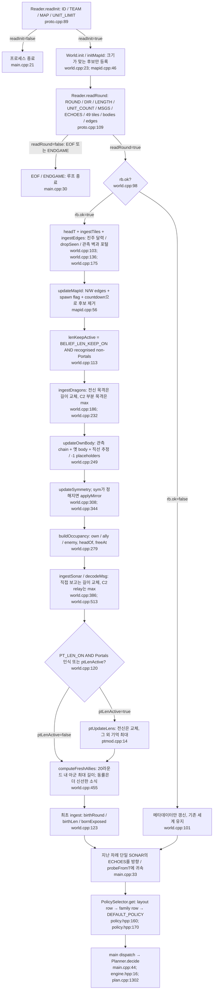
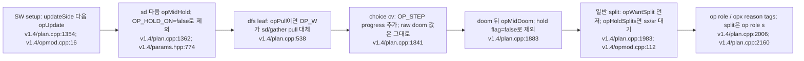

# 한 드래곤 프로세스의 차례: v1.3

기준은 `versions/v1.3/bot`이다. 아래 `main.cpp:31` 같은 표기는 모두 그 디렉터리의 파일과 실제 줄 번호다. `v1.4/...`는 `versions/v1.4/bot/...`를 뜻한다. 주석의 과거 `decideImpl<false/true>` 설명보다 실행 코드의 정수 `MODE`를 따른다(`plan.cpp:1302`, `plan.cpp:1307`). 개발 절차는 [README.md](README.md), 엔진 세부 흐름은 [flow-swarm.md](flow-swarm.md)·[flow-fortress.md](flow-fortress.md), 점수는 [terms.md](terms.md), 우선순위는 [overrides.md](overrides.md), 스위치는 [flags.md](flags.md), 처음 보는 지도는 [unknown-maps.md](unknown-maps.md)를 함께 읽는다.

## 입력과 세계 갱신

지도 인식은 목표 계산보다 앞서며, **그 차례의 관측으로 인식하면 같은 차례에 엔진이 바뀐다**(`world.cpp:110`, `main.cpp:42`). 각 자식은 새 `World`와 `Planner`로 시작한다(`main.cpp:22`, `world.cpp:23`). 모든 기억이 팀 전체 공유 메모리인 것은 아니다(`world.hpp:50`, `main.cpp:24`).

`computeFreshAllies` 호출은 `BELIEF_FIX_ON=true`일 때다. 만료 아군을 `dragons`에서 삭제하지 않고 결정용 최장 집계에서 제외한다. C2의 부분 목격 기억 자체를 지우는 별도 만료 작업도 없다(`world.cpp:122`, `world.cpp:455`, `world.hpp:60`). 인식 전에는 C2가 꺼지며 길이 근거가 10라운드보다 오래되면 부분 목격으로 초기화할 수 있다(`world.cpp:113`, `world.cpp:238`). Portals의 `ptLenActive`는 한번 켜지면 인식 모순 후에도 유지된다(`world.cpp:120`).

## 엔진과 결정 순서

아래 `RETURN`은 `Planner`에서 `main`으로 반환한다. 정상 목표 계산 → feed → 후보 생성 → 탐색 → doom → 일반 split 순서다. **doom이 모든 규칙보다 먼저인 구조가 아니다**(`plan.cpp:1358`, `plan.cpp:1398`, `plan.cpp:1867`, `plan.cpp:1987`).

```mermaid
flowchart TD
  D{"Planner.decide: cfg 우선순위<br/>plan.cpp:1302"}
  S["SWARM: decideImpl 2, E=S<br/>plan.cpp:1307; main.cpp:81"]
  W["FORTRESS W4: decideImpl 1, E=W<br/>policy.hpp:135; plan.cpp:1302"]
  PT["Portals mode: decideImpl 3, E=F<br/>policy.hpp:139; plan.cpp:1302"]
  F["FORTRESS: decideImpl 0, E=F<br/>policy.hpp:91; plan.cpp:1302"]
  INIT["시간 예산 / late / ahead / kingSafe / grabOn<br/>plan.cpp:1308; plan.cpp:1316"]
  DEG{"parsedOk AND headT valid AND tiles nonempty?<br/>plan.cpp:1328"}
  DG["RETURN MOVE: degraded<br/>plan.cpp:1329"]
  SET["homeT / seedMap / bodyIndex<br/>plan.cpp:1339; plan.cpp:1350"]
  FIELD["computeEnemyDistance → computeFrontier → computeSoftPenalty<br/>plan.cpp:1354"]
  MODE{"if constexpr SW?<br/>plan.cpp:1358"}
  SG["core2 / side / sc / claims → attract 2 → relay only → sd → kingFloor → harvestPlan<br/>plan.cpp:1361; plan.cpp:1371"]
  NF["ghDrops → attract MODE<br/>plan.cpp:1373; plan.cpp:1374"]
  PTG{"if constexpr PT?<br/>plan.cpp:1375"}
  NG["computeGoal: gathering<br/>plan.cpp:1376"]
  FG["W4 clears F; else computeFountainGoal → computeKingAway<br/>plan.cpp:1377; plan.cpp:1379"]
  PG["Portals: computeGoalPt replaces computeGoal; late king keeps grab<br/>plan.cpp:1325; plan.cpp:1375; ptmod.cpp:85"]
  HV{"SW AND cfg.harvest AND hvPocket valid AND harvestTurn returns true?<br/>plan.cpp:1398"}
  HR["RETURN scripted MOVE hv / SPLIT hvs<br/>plan.cpp:2525; plan.cpp:2557"]
  SF{"SW: sf recipient valid AND pickup queue less than 2?<br/>plan.cpp:1402; plan.cpp:1441"}
  SFR["RETURN neck MOVE: feed ... conv sf / late<br/>plan.cpp:1443"]
  CV{"not SW AND CONV_ON AND conv gates AND visible recipient?<br/>plan.cpp:1453; plan.cpp:1477"}
  CVR["RETURN neck MOVE: feed ... conv<br/>plan.cpp:1478"]
  FE{"not SW AND feed gates AND feedNow?<br/>plan.cpp:1491; plan.cpp:1541"}
  FER["RETURN neck MOVE: feed<br/>plan.cpp:1547"]
  CAND["한 걸음 / 2-step sprint / blind portal candidates<br/>plan.cpp:1559"]
  ES{"escapeOn AND allSinglesThreatened AND no cleanSprint AND ESC_SPLIT_ON AND safe tail?<br/>plan.cpp:1635; plan.cpp:1653"}
  ESR["RETURN SPLIT L-2: esc-split; v1.3 flag=false<br/>plan.cpp:1687; params.hpp:237"]
  EX["escape 2/3-step sprints 추가 → kill paths<br/>plan.cpp:1696; plan.cpp:1736"]
  PEN["PT: ptStepPenalty on legal non-trades; all: areaSafety / blind reference<br/>plan.cpp:1774; plan.cpp:1783"]
  DFS["iterative depth 3..7; dfs MODE or dfsPt; aborted depth discarded<br/>plan.cpp:1809; plan.cpp:1819; plan.cpp:1824"]
  CH["blind commitment → JITTER → best / bestSingle / bestRaw; SW uses value-kingFloorCost<br/>plan.cpp:1832; plan.cpp:1841; plan.cpp:1848"]
  DOOM{"best missing OR raw value below -200 AND no further step or enemy distance at most 3?<br/>plan.cpp:1871; plan.cpp:1873; plan.cpp:1887"}
  PE{"doomed AND splittable AND childCanMove AND pocketOk AND eatStep valid?<br/>plan.cpp:1890; plan.cpp:1922; plan.cpp:1936"}
  PER["RETURN MOVE: pocket-eat<br/>plan.cpp:1938"]
  DS{"doomed AND L at least 4 AND unit slot AND complete body AND childCanMove?<br/>plan.cpp:1890; plan.cpp:1945"}
  DSR["RETURN SPLIT L-2: escape-split; independent of ESC_SPLIT_ON<br/>plan.cpp:1946"]
  NONE{"best missing?<br/>plan.cpp:1954"}
  LAST["RETURN adjacent enemy MOVE last-trade; otherwise no-exit / no-exit s<br/>plan.cpp:1956; plan.cpp:1972"]
  SP{"best is neither trade nor blind AND split policy true?<br/>plan.cpp:1987"}
  RULE["SW: sx → sr; F/PT: wantSplit → frag → bsp → csplit → kcap → floor → lsplit; W4 omits later rules<br/>plan.cpp:1988; plan.cpp:1990"]
  URG{"immediate pearl below .5 AND no threat AND safety above -1 AND head enemy distance above 2?<br/>plan.cpp:1991; plan.cpp:1993"}
  SPR["RETURN SPLIT: split / sx / sr / frag / bsp / csplit / kcap / floor / lsplit<br/>plan.cpp:1994; plan.cpp:2001"]
  MOVE["RETURN selected MOVE + setSonar + indicator<br/>plan.cpp:2024; plan.cpp:2031; plan.cpp:2181"]
  OUT["main: fallback MOVE → intended MOVE or legal SPLIT → SONAR → map tag / E tag → INDICATOR → PROTOCOL 3 / ENDTURN<br/>main.cpp:47; main.cpp:56; main.cpp:75; proto.cpp:176"]
  D -->|"cfg.swarm"| S
  D -->|"!swarm AND econW4"| W
  D -->|"!swarm AND !econW4 AND portals"| PT
  D -->|"all three false"| F
  S --> INIT
  W --> INIT
  PT --> INIT
  F --> INIT
  INIT --> DEG
  DEG -->|"false"| DG
  DEG -->|"true"| SET
  SET --> FIELD
  FIELD --> MODE
  MODE -->|"SW=true"| SG
  MODE -->|"SW=false"| NF
  NF --> PTG
  PTG -->|"PT=true"| PG
  PTG -->|"PT=false"| NG
  PG --> FG
  NG --> FG
  SG --> HV
  FG --> HV
  HV -->|"true"| HR
  HV -->|"false or compiled out"| SF
  SF -->|"recipient found AND queued below SF_QUEUE_MAX"| SFR
  SF -->|"gate false / no recipient / sq hold / not SW"| CV
  CV -->|"true"| CVR
  CV -->|"false or SW"| FE
  FE -->|"true"| FER
  FE -->|"false or SW"| CAND
  CAND --> ES
  ES -->|"true; currently compiled constant false"| ESR
  ES -->|"false"| EX
  EX --> PEN --> DFS --> CH --> DOOM
  DOOM -->|"doomed=true"| PE
  DOOM -->|"doomed=false"| NONE
  PE -->|"eatStep valid"| PER
  PE -->|"pocket gates false / no eatStep"| DS
  DS -->|"true"| DSR
  DS -->|"false"| NONE
  NONE -->|"best less than 0"| LAST
  NONE -->|"best at least 0"| SP
  SP -->|"gate true"| RULE
  SP -->|"gate false"| MOVE
  RULE --> URG
  URG -->|"true"| SPR
  URG -->|"false: movement urgent"| MOVE
  DG --> OUT
  HR --> OUT
  SFR --> OUT
  CVR --> OUT
  FER --> OUT
  ESR --> OUT
  PER --> OUT
  DSR --> OUT
  LAST --> OUT
  SPR --> OUT
  MOVE --> OUT
```

일반 split 사슬은 `||` 단락 평가다. 앞 규칙이 true면 뒤 규칙을 조회하지 않으며, 최종 urgency gate가 false라고 해서 다음 split 규칙을 재시도하지 않는다(`plan.cpp:1987`). Portals에는 독립 `ptTurn` 조기 반환이 없다. `computeGoalPt`, feed 조건, candidate penalty, `dfsPt`가 여러 자리에 들어간다(`plan.cpp:1375`, `plan.cpp:1490`, `plan.cpp:1774`, `plan.cpp:1819`).

## v1.4 opening의 실제 걸이

v1.4는 v1.2 기반 분기이며, **현재 v1.3의 HV/포켓 벌점을 함께 실행하지 않는다**. `v1.4/policy.hpp:154`는 harvest를 설정하지 않고, `v1.4/plan.cpp:1374` 뒤에는 HV 조기 반환이 없다. 따라서 “harvest가 opening split을 선점한다”는 검토 대상인 v1.3/v1.4 각각의 실행 경로에는 없는 호출 관계다. 둘을 앞으로 합치면서 기존 위치를 유지하면 HV RETURN이 opening split에 앞서게 된다는 정적 삽입 위험이다(`plan.cpp:1398`, `v1.4/plan.cpp:1983`).

## 출력과 태그를 읽는 기준

- 정상 이동의 `v`는 `value[best]`이다. SW의 `kingFloorCost`, v1.4의 `OP_STEP`가 빠진 raw 점수라 최종 순위 점수로 해석하면 안 된다(`plan.cpp:1850`, `plan.cpp:2031`, `v1.4/plan.cpp:1843`).
- `ptd/ptb/ptq/ptk`는 어느 후보 또는 look-ahead에서 가격이 매겨졌다는 비트다. 선택한 이동이 그 가격을 냈다는 보장이 없다(`ptmod.cpp:56`, `ptmod.cpp:78`, `plan.cpp:2167`).
- `F/sd/hva`는 목표 또는 접근 상태, `sxx/srx`는 split 규칙이 true여도 urgency gate가 막았다는 상태다(`plan.cpp:2014`, `plan.cpp:2035`, `plan.cpp:2146`).
- 조기 반환은 일반 태그 조립 구간을 건너뛴다. feed / degraded / last-trade / no-exit은 `setSonar`도 호출하지 않는다. HV MOVE는 별도 belief tag를 달고 HV SPLIT은 그렇지 않다(`plan.cpp:1335`, `plan.cpp:1448`, `plan.cpp:1958`, `plan.cpp:2531`, `plan.cpp:2561`). `main`의 map 변경 태그와 engine 태그는 모든 반환 뒤에 공통으로 붙는다(`main.cpp:75`, `main.cpp:81`).
- SPLIT은 출력 시 `size>=2 AND L-size>=2 AND units<limit`로 다시 검사한다. fallback MOVE가 먼저 있어도 유효한 intended action이 뒤에서 덮는다(`main.cpp:47`, `main.cpp:49`). `safeDir`의 safe는 선택 가능한 일반 한 걸음이라는 뜻이며 무위협·무사망을 보증하는 검사는 없다(`plan.cpp:1855`, `plan.cpp:1865`).

## 호출 지점 교차 확인

`World.ingest`는 `main.cpp:31`, policy 조회는 `main.cpp:42`, `EngineSwarm.decide`는 `main.cpp:44`, `Planner.decide`는 `main.cpp:45`와 `engine.hpp:16`에서 호출된다. `decideImpl` 인스턴스 선택은 `plan.cpp:1302` 한 곳이다. `harvestPlan/harvestTurn`은 `plan.cpp:1371/1399`, `computeGoalPt/dfsPt/ptStepPenalty`는 `plan.cpp:1375/1819/1777`, opening의 각 걸이는 위 그림의 v1.4 줄 번호에서 확인했다. 전체 함수 조회 목록은 [overrides.md](overrides.md)의 검증 부록에 있다.
