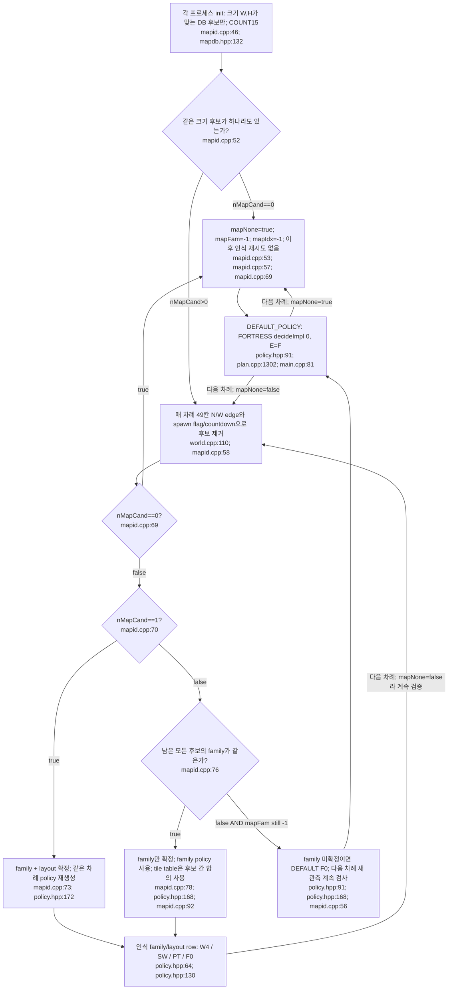
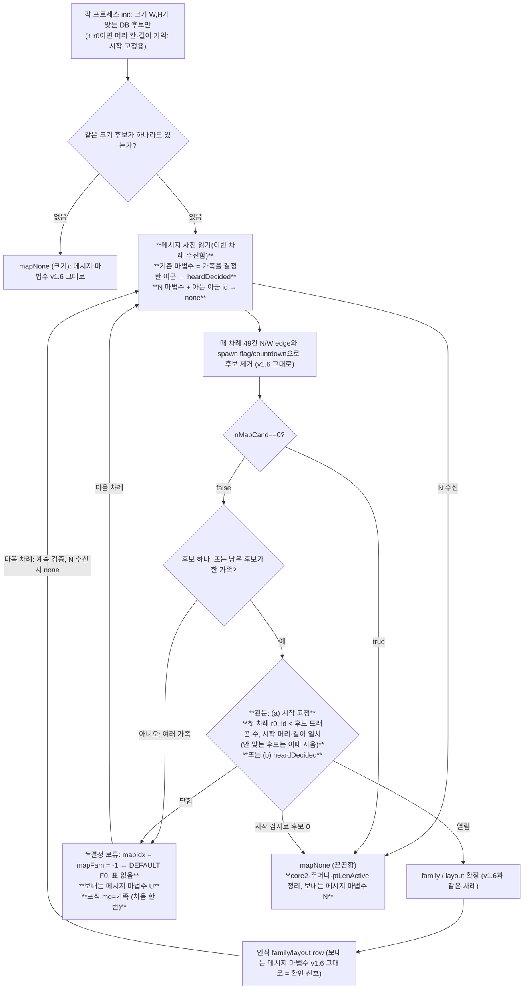

# 처음 보는 지도: 인식 실패 시 실행 경로

기본 경로는 `versions/v1.3/bot/`다. 미인식 여부는 프로세스별 `mapFam/mapIdx/mapNone` 상태다. 처음 보는 지도라도 관측이 DB 후보와 잠시 같으면 family를 인식했다고 판단할 수 있다. **지도 이름이 새롭다는 사실 자체를 검사하는 코드는 없다**(`mapid.cpp:46`, `mapid.cpp:56`, `main.cpp:22`).

## 입력부터 차례별 상태 전이

첫 정상 ingest에서 49개 검사가 들어가므로 동일 크기라면 첫 차례에도 인식 또는 mapNone을 결정할 수 있다. 모든 프로세스가 동시에 동일하게 인식한다는 보장은 없다(`mapid.cpp:58`, `mapid.cpp:66`, `mapid.cpp:68`, `main.cpp:22`). family/layout를 일단 인식해도 매 차례 계속 후보를 검증하고 모순이면 mapNone으로 영구 전환한다. 기존 `Planner`의 목표/쿨다운 기억을 전체 reset하는 hook은 없다(`mapid.cpp:57`, `mapid.cpp:69`, `main.cpp:24`, `policy.hpp:172`).

미확정 several-family 경로는 즉시 return이어서 기존 mapFam 값을 직접 지우지 않는다. 정상적인 후보 제거만으로 이미 한 family였던 집합이 여러 family로 늘어나지는 않는다(`mapid.cpp:62`, `mapid.cpp:77`). tableFits는 spawn 유무를 검사하며, 여러 layout이 없는 family에서는 숫자 countdown 검사를 생략한다. 관측 일부만으로 다른 지도에 잘못 대응할 가능성을 완전히 배제하지 않는다(`mapid.cpp:36`, `mapid.cpp:39`).

## 인식되지 않은 동안의 실제 스케줄

다음은 `mapFam<0` 또는 `mapNone=true`가 계속되는 경우다. round는 input 값이며, 각 차례는 관측과 early RETURN gate에 따라 달라진다. 특정 round에서 반드시 split/feed한다는 뜻은 아니다(`world.cpp:98`, `plan.cpp:1306`).

| 시기 | 엔진 / 작동 경로 | 작동하지 않는 지도 전용 경로 | 근거 |
|---|---|---|---|
| 모든 차례 | F0 MODE0. vision, symmetry/mirror, occupancy, sonar, BELIEF_FIX fresh 집계, threat/soft/frontier, attraction, areaSafety, DFS, doom은 유지 | W4/SW/PT로 자동 전환 없음. C2 lenKeepActive=false. PT latch도 처음부터 미인식이면 false | `policy.hpp:91`, `plan.cpp:1302`, `world.cpp:108`, `world.cpp:113`, `world.cpp:120`, `world.cpp:122`, `plan.cpp:1354` |
| 첫 차례 / r0 | ingest 직후에도 family 미확정이면 F0. homeT/seedMap을 초기화하고 일반 탐색/doom 뒤 wantSplit은 r0에도 가능. king L≥8이면 r0의 beacon 네 방향 sonar 가능 | csplit은 r≥1부터; sx/sr/HV 없음 | `world.cpp:123`, `main.cpp:42`, `plan.cpp:1339`, `plan.cpp:759`, `plan.cpp:868`, `plan.cpp:1135` |
| 초기~r299 | 중앙 gather 없음. FGUARD/F2는 r<340, units≥3, king L8 제외, symmetry가 정해지면 observed/symmetry fountains를 목표화 가능 | mapFountAt/mapTerrAt 사전 지식 없음; SW sd/frontier allocation/kingFloor/harvest 없음 | `plan.cpp:1157`, `plan.cpp:1010`, `plan.cpp:1012`, `plan.cpp:1016`, `plan.cpp:1358` |
| r1..249 | 일반 wantSplit와 csplit gate 사용. csplit은 seed-map 판정이면 r50까지 E1 block; child safety·urgency는 그대로 | map-gated bsp/kcap/floor false, SW sx/sr 없음. csplit의 map unit table은 UTAB_ON=false | `plan.cpp:759`, `plan.cpp:867`, `plan.cpp:871`, `plan.cpp:837`, `plan.cpp:930`, `plan.cpp:1988`, `params.hpp:532` |
| r250..339 | frag(L≥7,r≤420), lsplit(L4..6,r<340), wantSplit 보험 계속 gate 평가 | map 전용 cap/floor 없음. frag는 longerAllyKnown 없으면 불발 | `plan.cpp:817`, `plan.cpp:973`, `plan.cpp:774`, `plan.cpp:828` |
| r300부터 | non-SW local conv, GH drop ceding, longest sonar goal, 일반 sonarAll broadcast 가능. F fountain 목표는 r339까지 | SW map별 convClock/claims 경제 없음. map-gated KX도 false | `plan.cpp:1453`, `plan.cpp:1197`, `plan.cpp:1157`, `plan.cpp:1123`, `engcfg.hpp:22`, `plan.cpp:1235` |
| r340부터 | F goal 종료. 중앙 gather는 units≥4,L≥4,reachable,longer ally 등 gate 통과 시. early conv/feed가 search보다 먼저 | 일반 wantSplit은 units≥2이면 종료; lone 보험만 가능. lsplit 종료, frag는 r420까지 가능 | `plan.cpp:1010`, `plan.cpp:1176`, `plan.cpp:1177`, `plan.cpp:1178`, `plan.cpp:1541`, `plan.cpp:761`, `plan.cpp:819` |
| r430부터 | legacy late feed: units≥3, 안전 head, 거리≤5 visible recipient, `r≥500-(L+d+8)` lateWindow 또는 gather feed gate | PT units2/endfeed/length memory/gather weight .4 없음 | `plan.cpp:1490`, `plan.cpp:1491`, `plan.cpp:1534`, `plan.cpp:1536`, `plan.cpp:1541` |
| r450부터 | king 마지막50라운드 grab boost 비활성; 일반 wantSplit는 r450까지 포함, 그 이후 false | PT_KING_GRAB 재활성 없음; KS/KS2 모두 false | `plan.cpp:1321`, `plan.cpp:1325`, `plan.cpp:760`, `params.hpp:158`, `params.hpp:209` |
| r470부터 | late=true: regular2-step/kill path 생성 중단; threatened escape2/3는 별도 조건으로 생성 가능; frontier timeF=0 | KS_ON=false라도 `late` 자체는 작동 | `plan.cpp:1316`, `plan.cpp:1603`, `plan.cpp:1696`, `plan.cpp:1736`, `plan.cpp:288` |
| r495부터 / 종료 | trade veto 해제, nonking vs longer enemy의 late trade 가능. input ENDGAME/EOF에서 종료 | SW vetoAt/hold는 애초 호출 경로 없음 | `plan.cpp:695`, `plan.cpp:747`, `proto.cpp:114`, `proto.cpp:115` |

많은 종료 계산은 input의 게임 총 길이를 읽는 대신 literal500을 사용한다. unseen 지도가 다른 종료 길이를 갖는 경우에 대한 적응 분기는 확인하지 못했다(`plan.cpp:1316`, `plan.cpp:1431`, `plan.cpp:1536`). 초기 소수 왕도 **doom escape-split**은 별도로 가능하며, 이는 일반 보험 분열 round gate와 ESC_SPLIT_ON=false에 묶이지 않는다(`plan.cpp:1890`, `plan.cpp:1945`).

## table와 함수의 fallback

| table/function | 인식 없음의 정확한 반환 / 호출 여부 | 이어지는 동작 | 근거 |
|---|---|---|---|
| `mapdb` / `updateMapId` | 크기 후보0 또는 관측 모순이면 mapNone; 이후 no-op | policy default F0, map=none 변경 tag | `mapid.cpp:52`, `mapid.cpp:57`, `mapid.cpp:69`, `mapid.cpp:211`, `main.cpp:75` |
| `mapFountAt` | -1 | F2는 observed isFountain 또는 unseen mirror의 fountain으로 fallback; fountain target 자체는 symmetry 필수 | `mapid.cpp:93`, `plan.cpp:1012`, `plan.cpp:1016`, `world.hpp:168` |
| `mapTerrAt` / `terrdb` | -1 | covSide/FG는 own home와 mirrored home의 strict 거리 비교 사용. 대칭도 없으면 side 불명 | `mapid.cpp:104`, `plan.cpp:997`, `plan.cpp:1017`, `plan.cpp:988` |
| `mapTerrChar` | '?' | SW sideOf는 -1. F0에서는 updateSide를 호출하지 않음 | `mapid.cpp:118`, `plan.cpp:1362`, `plan.cpp:2202` |
| `mapFrontBin` / `frontdb` | -1 | FRONT_POLICY pointer도 DEFAULT nullptr. SW sd allocation을 F0에서 대신 실행하지 않음 | `mapid.cpp:126`, `engcfg.hpp:34`, `policy.hpp:140`, `plan.cpp:1369` |
| `mapSpawnGap` | -1.0 | SW flow 함수 자체가 mapFam gate로 return. 별도 observed fountain fallback은 그 함수 내부지만 unknown F0에 호출되지 않음 | `mapid.cpp:204`, `plan.cpp:2250`, `plan.cpp:2263` |
| 후보 여러 layout의 spawnGap | family 확정 시 gap 평균을 반환; 하나라도 never-spawn이면0. **서로 다르다고 -1을 반환하지 않음** | 후보간 합의 필요한 mapFountAt/territory와 다른 규칙 | `mapid.cpp:206`, `mapid.cpp:207`, `mapid.cpp:98`, `mapid.cpp:111` |
| `ensureCore2` / `inCore2` | unknown ensure는 no-op; 새 process의 empty core2는 inCore2=true | F0에서 SW core2 restriction 없음. 인식 후 mapNone 전환 시 기존 core2 vector를 자동 clear하지 않음 | `mapid.cpp:135`, `world.hpp:148`, `plan.cpp:1361` |
| `ensurePockets` | 직접 호출하면 key 변화 때 pocket vectors clear 후 unknown return | F0 cfg.harvest=false라 harvestPlan/Turn 미호출 | `mapid.cpp:165`, `mapid.cpp:168`, `mapid.cpp:169`, `policy.hpp:140`, `plan.cpp:1371` |
| `ptmap` | unknown policy portals=false라 DEAD/POCKET/ROOM/EXIT 테이블 경로 미호출 | 일반 World.across와 generic portal/frontier/sonar probe는 계속 작동 | `policy.hpp:139`, `plan.cpp:1774`, `plan.cpp:1819`, `world.cpp:76`, `plan.cpp:1092` |
| `ptExit`의 크기 fallback | W,H가 ptmap32×16과 다를 때만 World.across. **ptmap 전체에 unknown-map 검사나 safe null table이 있는 것은 아님** | 수동으로 cfg.portals 강제하면 다른 static array 접근을 ptExit가 보호하지 않음; 현재 policy에는 해당 경로 없음 | `ptmap.hpp:8`, `ptmod.cpp:35`, `ptmod.cpp:40`, `ptmod.cpp:77` |
| `opdb` in v1.3 | 파일/호출 없음 | opening 학습 fallback 없음 | `plan.cpp:1358`, `plan.cpp:1988`, `plan.hpp:192` |
| `opdb` in v1.4 | 기본 F0에는 opUpdate 호출 없음. SW로 들어가도 !mapNone/family/home 필요; 미지원 family script lookup은 null | family만 확정·layout '?'일 때 'a'를 사용하므로 아직 layout 미인식 상태에서도 script 선택 가능 | `v1.4/plan.cpp:1354`, `v1.4/opmod.cpp:27`, `v1.4/opmod.cpp:28`, `v1.4/opmod.cpp:29`, `v1.4/opmod.cpp:41` |

## 관측 기반 기능은 남는다

EDGE_UNKNOWN을 World.across는 보통 torus 인접 칸으로 취급하며 이동 점수에 −.3을 매긴다. endpoint가 아직 모르는 **portal**은 별도로 −2를 반환하고 blind candidate/probe/commit 규칙을 사용한다. `map=none`이 “모든 edge가 blocked”인 상태는 아니다(`world.cpp:76`, `world.cpp:92`, `plan.cpp:1564`, `plan.cpp:1599`, `plan.cpp:1837`). goal/headDist/king 거리 BFS도 World.across를 쓰므로 EDGE_UNKNOWN을 항상 제외하는 것은 아니다. 직접 portal 쌍 관측과 symmetry mirror는 ptmap이 없어도 작동한다(`plan.cpp:307`, `plan.cpp:1068`, `plan.cpp:2411`, `world.cpp:175`, `world.cpp:344`).

진주 calendar·empirical prior·dropSeen도 DB와 무관하게 갱신된다. F2 table이 -1이어도 관측 fountain은 식별 가능하며, symmetry는 단일 후보 증거12 또는 round≥40의 최다 증거30으로 확정할 수 있다(`world.cpp:136`, `world.cpp:164`, `world.hpp:168`, `world.cpp:308`, `world.cpp:337`). 결정용 ally freshness와 direct/relay sonar는 유지하지만 C2는 미인식에서 꺼지고, 부분 재목격 시 10라운드 오래된 길이를 초기화할 수 있다(`world.cpp:113`, `world.cpp:238`, `world.cpp:386`, `world.cpp:455`).

따라서 qualifier unseen 지도에서의 실제 기본선은 **관측 기반 FORTRESS**다. 사전 map family가 있어야 하는 SW 경제 곡선·sd/frontdb·HV·PT 가격·v1.4 opening은 unseen이라고 해서 자동 추론되어 켜지지 않는다(`policy.hpp:91`, `policy.hpp:160`, `plan.cpp:1358`, `policy.hpp:154`, `policy.hpp:139`, `v1.4/plan.cpp:1354`).

인식했던 Portals가 나중에 mapNone으로 바뀐 경우는 처음부터 미인식인 경우와 다르다. dispatch는 F0로 바뀌지만 ptLenActive는 꺼지지 않아 World fresh 집계에는 PT 길이 기억이 계속 들어갈 수 있다(`mapid.cpp:69`, `policy.hpp:172`, `world.cpp:120`, `world.cpp:461`).

## v1.6.1(W2) 변경: 꽂은 자리 (사전 등록 2026-10-01 13:45 KST, `versions/v1.6.1/VERSION.md`)

**바뀌는 마디는 굵게** 표시했다. 나머지 흐름은 위 그림(v1.3 = v1.6)과 같다. 스위치는 `MAPID2_ON`이다. 끄면 위 그림 그대로다.

**덮어쓰기 관계(`overrides.md`에 더할 것):**
- 관문이 v1.6의 "창 하나 → 결정"을 덮어쓴다. 새끼와 다시 시작한 프로세스는 결정한 아군의 메시지 없이는 결정하지 않는다. 시작 드래곤은 시작 위치가 맞는 후보로만 결정한다.
- N 메시지가 결정 상태를 덮어쓴다(끈끈한 none). 아는 지도에서는 모순 none이 0이므로(1절 근거) 퍼질 것이 없다.
- 결정 보류 중에는 DEFAULT F0이다. 즉 처음 보는 지도와 같은 경로다(위 "인식되지 않은 동안의 실제 스케줄").

**아는 지도에 미치는 것:** 시작 드래곤의 결정 차례는 그대로다(참 지도는 늘 시작이 맞고, 지우기는 결정 순간에만 한다). 새끼는 결정한 아군의 메시지를 받을 때까지(첫 차례 약 65%, 2차례 안 약 90%) F0으로 돈다.

**측정(2026-10-01 15:07, `versions/v1.6.1/VERSION.md` 5절):**
- **예상대로:**
  - stronghold에서 잘못 인식이 v1.6 8/8판(46 프로세스)에서 v1.6.1 0/8판이 됐다.
  - 시작 드래곤은 v1.6과 같은 차례에 결정한다.
  - 크기가 맞는 표 지도가 없는 처음 보는 지도는 사건까지 같다. big_empty는 정적 자료 배치 때문에 갈라질 수 있다.
- **예상보다 나빴던 것:** 아는 지도에서 새끼의 첫 차례 확인은 55%였다(예상 약 65%).
  - FORTRESS 행은 r340 전까지 차례당 광선이 하나다.
  - Trauma처럼 켈프 방·주머니가 많은 지도에서는 새끼가 고립된다. 늦은 새끼의 보류 중앙값이 7차례, p90이 51차례다.
  - 보류 중 F0이 HV·CONV2를 대신한다. 그래서 Trauma 끝 최장이 −8.2다.
