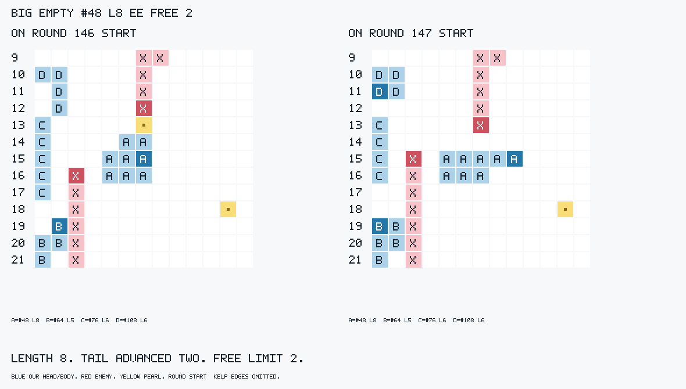
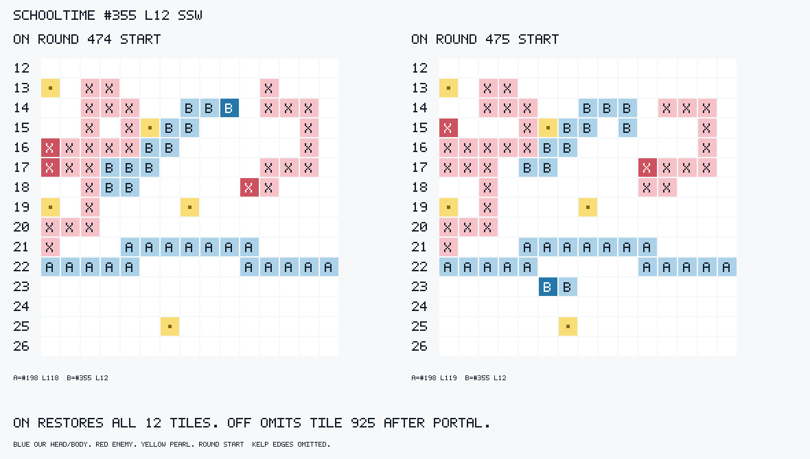

# BODYMEM2 ANALYSIS — 2026-10-02 13:36:09 KST

부분 적용 제안 **ON**. 목적 방향은 개선했고 새 위해·identity/CPU/오류 게이트는 통과했다. 엄격한 전체 배열 drift0 항목은 기존 포털 반례 1건 때문에 FAIL로 그대로 남긴다. 이 제안은 모든 몸 기억 문제가 해결됐다는 판정이 아니다. 스위치/봇/params는 변경하지 않았다.

## 발동·지급·실제 판면

이번 default A/hunter #14 r188의 같은 몸 `[775,774]`에서 ON `N`은 `[891,775]`로 완주, OFF `NW`는 첫 미관측 진주가 없어 두 번째 선지급에서 A 사망한다. 양 원본 이력 및 기존 BODYX 실패 이력의 강제 재생에서 같은 ON/OFF 선택과 즉시 oracle 결과를 확인했다. ON `bodymem2r` 거절 합 70은 발동 하한 문맥이며 채택 게이트가 아니다. raw A 전수는 ON 0건, OFF 이 1건뿐이다; invalid split/무출력/timeout 사인은 0이다. trade/조기 반환은 태그 누락으로 공개하고 독립 ledger의 지급 검사에서 새 A 사망이 없음을 확인했다.

big_empty A/king #48: r146 EE, L8→8, 실제 배열 `[997,1061,1060,1059,995,996,932,933]`→`[999,998,997,1061,1060,1059,995,996]`; 정상 꼬리가 2칸 전진했다. 라운드 시작 그림의 문자 a가 #48이다.

schooltime B/hunter #355: r474 SSW, L12 무료 한도3, 실제/ON 다음 배열 `[1401,1402,925,865,864,863,923,922,982,981,1041,1040]`. 같은 과거 행동의 OFF는 `[1401,1402,865,864,863,923,922,982,981,1041,1040,1039]`로 원격 중간 머리925를 놓친다. 그림의 b가 #355다. r477의 같은 첫 변경 차례에서 이 기억 차이가 S→E 선택으로 이어지고 두 선택 모두 즉시 완주/k3 생존한다.

추가 실제 판면: [L14 전](board-L14-before.txt)·[후](board-L14-after.txt), [미관측 성장 전](board-growth-before.txt)·[후](board-growth-after.txt), [default 지급 관문](board-payment.txt). L14의 ceil(14/4) 무료 **한도는4**이며 사전 등록의 ‘무료3’은 이번 NNN의 사용 걸음3으로 읽었다: big_empty #115 r306→307, 길이14 유지/꼬리3칸 전진. Portals A/king #27 r412 WS는 미관측 진주2개로 L12→14; ON 직후 보수 예측12는 다음 실제 LENGTH에서 `[306,274,173,174,206,238,270,302,303,335,367,399,398,397]` 전체14칸으로 복원된다. 시작·매 걸음 head/tail·끝 배열은 독립123 oracle와 검산했다. 처음 보는 bundled/generated 및 인식 끈 online/sprint의 대표 무료·유료·완주 배열은 [review-analysis.json](review-analysis.json), 같은 이력 양 World의 시작/직후/다음 배열은 [audit-summary.json](audit-summary.json)·audit/*.snapshots.json에 있다.

## 공통 태그·전체 배열·판정

| 사전 등록 항목 | 값 / N | 판정 |
|---|---|---|
| 1 합성 exact123 전이·제거·다음 LENGTH | ON drift 0/2133, OFF 1802/2133; 지급 2138검사, 가격 변경 0 | PASS |
| 1 단일/분열·아군 범위 보존 | 단일 no-op/원격 경로 fixture 통과; 아군 direct/relay/occupancy/fresh 4/4 동일; 분열 분기·소나·관측/캐시 소스 보존 | PASS(분열은 소스 확인) |
| 1 공통 bodyx 시작 drift 감소 | ON 114/3552(3.209%), OFF 121/3513(3.444%); 84키/arm | PASS(방향) |
| 1 완전 추적 가능한 시작 뒤 다음 관측 전체 배열 drift 0 | 같은 이력 양 World의 공통 exact 시작 다중 이동→다음 관측 621건: ON 1, OFF 3 | **FAIL(엄격한 0)**; ON 1건은 OFF도 같은 입력에서 실패하는 기존 포털 연결 |
| 2 첫 변경 용 k=3 harm <= help | 0 <= 1; N=5; both 2/neither 2/censored 0 | PASS |
| 2 여왕 k=50 harm <= help | 0 <= 0; N=5; both 4/neither 1/censored 0; 갈림 전 양쪽 사망 3, 생존 분모 2 | PASS(위해 게이트; help 0) |
| 2 모든 harm 설명·동일 물리 입력 | harm 0/5; 첫 차례/시작/geometry/facing 불일치 0/5, 직전 소나 차이 0/5; 누락/오류 0/84 | PASS; harm 판면/원인 요구 N=0 |
| 3 지급 사망·오류·의도한 실제 변화 | 지급 사망/oversprint ON 0/84, OFF 1/84; 오류/no reply/timeout 0/192; L8/3걸음 L14/미관측 성장·무료/유료 판면과 배열 확인 | PASS |
| 4 OFF/base 동일성 | WASM 530752 bytes·SHA 동일(1/1); 사건·이동·분열·사망·진주·메시지/소나 12/12 동일 | PASS |
| 4 CPU·누락·탐색 | 192/192 CPU 있음, 최대 32.4M <80M; missing/error 0/192; 공통 round:id 깊이 lower/same/higher 40/469491/26, N=469557 | PASS; 갈림 뒤 깊이 차이는 순수 CPU 효과 아님 |

| 양 arm 공통 측정 | ON (84키) | OFF (84키) |
|---|---:|---:|
| 다중 시도(사망 포함) | 3677 | 3638 |
| 완주 | 3548 | 3504 |
| 시작 bodyx 태그 있음 | 3552 | 3513 |
| 태그 누락(trade/조기 반환; 성공으로 세지 않음) | 125 | 125 |
| 시작 hash drift | 114 | 121 |
| 끝 예측 drift / 완주 | 98/3548 | 104/3504 |
| 끝 drift 중 시작부터 틀림 / 시작 정확·미관측 경로 | 97 / 1 | 103 / 1 |
| unknown 시작 슬롯 태그 / 미관측 경로 태그 | 32 / 17 | 33 / 23 |
| 독립 전체 전이 / 매 걸음 head-tail 검산 불일치 | 0 / 0 | 0 / 0 |

hash만으로 배열 동일을 확정하지 않았다. 모든 drift 키, 부분 시야 성장/포털 및 네 지도군 대표를 양 원본 arm에서 같은 관측·소나·echo·과거 행동으로 강제 재생했다(48키×양 이력=96 replay, 47874 실제 차례; 두 World에 각각 입력). [drift-review.json](drift-review.json)의 114/121 시작 drift 전부 native 배열 hash가 production 태그와 일치했고 실제 전체 배열은 다르다. ON 102/114, OFF 106/121은 첫 관측부터 native 몸이 틀린 id에서 발생했다(초기 긴 몸/직선 추정/unknown과 중첩). 현 차례 unknown 슬롯이 있는 drift는 32/33이며 초기 틀림과 중복되는 범주다.

공통 exact 시작 뒤 다음 관측 621건 중 실제 ON 이력306건은 ON/OFF drift0/1, 실제 OFF 이력315건은1/2다. 두 원본에서 같은 전이를 중복 점검한 진단 분모이며 독립 표본621개로 주장하지 않는다. 남은 1건: OFF Colosseum B/hunter #81 r370 ENN→r371. 두 모델의 시작은 정확하고 ON 직후 몸도 실제17칸과 같으나, 다음 ingest의 기존 자기 관측 chain이 포털 뒤 `[199,215,214,213,229,245,...]`로 재정렬한다. OFF도 같은 입력에서 같은 순서 오류를 낸다. `ingestDragons`의 기존 geo.stepIdx 연결과 `updateOwnBody`의 chain 우선 병합 경로가 보존되어 있어 새 전이 직후 정답을 다시 덮는다. [전 판면](board-legacy-before.txt)·[후 판면](board-legacy-after.txt)와 audit-summary의 전수 배열을 남겼다. 이 반례를 지워 엄격한 drift0을 PASS로 만들지 않았다.

보수적 미관측 섭취 때문에 ON 직후 실제 끝과 다른 5/621건도 남겼다(Portals #27 양 이력, Australia #235 양 이력, OFF #159의 ES). 다섯 건 모두 다음 LENGTH의 전체 배열은 복원된다. 이것은 ON 전용 태그가 아닌 같은 입력 두 World 배열 점검이다. 합성 fixture의2133 전이/2138 지급 검사는 [fixture-check.json](fixture-check.json), 단일 no-op 및 아군4개 동일 snapshot·단일/분열·소나/캐시 소스 보존은 [validation.json](validation.json)에 있다. validation의 `unmeasured`/`realGameCausalGateMeasured:false`는 BUILD 시점 메타데이터이며 이번 실제 측정은 analysis/firstdiv/이 보고서다.

## 첫 변경 결정·즉시 oracle·위해

firstdiv matched5/84, no_divergence79/84. 시작 geometry/몸/진주/facing·첫 실제 차례 모두5/5 동일; 앞선 소나 차이0, start/first-turn mismatch0, 오류/누락0. k=3과 k=50 harm 모두0이므로 harm별 판면·한 줄 원인 요구 대상 N=0(의도적 먹이기 harm도0). k=1과 k=10 용도 harm0/help1이다. 첫 용5개와 같은 R의 추가 용1개를 빠짐없이 아래에 공개한다. k=3은 R+3 시작, k=50은 R+50 시작이며 censored를 생존으로 바꾸지 않는다. 여왕50은 이후 정책 전체 효과다.

| 키 (seed1) | R/id | ON / OFF 선택 | 같은 실제 차례 | ON 즉시 / OFF 즉시 oracle | k1/k3 ON : OFF | 선택 경로 |
|---|---|---|---|---|---|---|
| hunter Colosseum A | 224/#81 | N / NW | 동일 | 둘 다 첫걸음 O(#80 아군 몸) | dead:dead / dead:dead | `bodymem2r3` 지급 관문; 첫 N은 같아 새 사망이 아님 |
| hunter Colosseum B | 106/#25 | E / EN | 동일 | 둘 다 첫걸음 O(#49 아군 몸) | dead:dead / dead:dead | `bodymem2r1` 지급 관문; 첫 E는 같아 새 사망이 아님 |
| hunter default A | 188/#14 | N / NW | 동일 | ON 완주 / OFF 두 번째 지급 A, 남은 `[891,775]` | alive:dead / alive:dead | `bodymem2r3`; 보지 못한 첫 진주에 의존한 지급 제거 |
| hunter schooltime B | 477/#355 | E / S | 동일 | 둘 다 완주 | alive:alive / alive:alive | r474 SSW 원격 중간 머리925 기억 복원 |
| king australia B | 350/#159 | N / ES | 동일 | 둘 다 완주; 실제 ES 첫 원격 진주는 있음 | alive:alive / alive:alive | `bodymem2r1`; 관측 밖 진주에 의존한 후보의 보수 거절 |
| king australia B (추가) | 350/#332 | S / N | **불일치** | 각 실제 판면에서는 둘 다 완주 | alive:alive / alive:alive | #159 뒤 같은 R의 정책/기억 변화; 최초 동일 입력 게이트 분모에 넣지 않음 |

old/new 표식·모든 실제 차례의 몸/진주·완주 몸/사망 걸음·사인 및 k1/k3 fate는 [review-analysis.json](review-analysis.json)의12행(6용×양 이력), raw death/상대 행동/아군 몸은 [firstdiv.json](firstdiv.json)에 있다. 첫 용5개의 선택은 양 원본 이력 각각에 두 native 모델을 적용했을 때20/20 재현된다. 추가 #332는 양 실제 차례가 이미 다르고 native 재현도2/4뿐이므로 같은 입력의 선택 이유는 미확인이다. 첫 즉시 사망2건은 OFF도 동일 첫걸음에서 동일 아군 몸에 O 사망; feeding 표식은 없다. 이 둘을 새 위해로 세거나 생존으로 숨기지 않았다.

## 원시 사망·여왕 수명: 문맥만

| 원시 사인 (84키/arm) | ON | OFF |
|---|---:|---:|
| S | 1597 | 1591 |
| W | 5434 | 5421 |
| O | 1352 | 1349 |
| H | 715 | 717 |
| A | 0 | 1 |

| 기제 사인 (84키/arm) | ON | OFF |
|---|---:|---:|
| sac | 1599 | 1592 |
| trap | 6776 | 6758 |
| rammed | 299 | 301 |
| ram | 270 | 268 |
| allyHead | 146 | 148 |
| enemyBody | 8 | 11 |
| sprintDeath | 0 | 1 |
| fault | 0 | 0 |

여왕 수명 ON longer/shorter/same=0/0/84, 차이 합/최소/최대=0/0/0. 양쪽 사망69/84, 관측 종료 생존15/84; 생존은 마지막 round+1의 관측 하한이다. raw 사망 증가나 이후 조기 사망·수명/승패/총길이를 채택 게이트로 쓰지 않았다. 모든84키의 raw/기제 사인과 양쪽 여왕 수명·censoring은 [keywise.tsv](keywise.tsv)에 있다. 아래 수명은 양 방향 전수 문맥이며 `*`는 관측 종료 생존이다.

| 키 | ON 여왕 수명 | OFF 여왕 수명 | 방향 |
|---|---:|---:|---|
| proxy4_king:arena:A:1 | 17 | 17 | same |
| proxy4_king:arena:B:1 | 30 | 30 | same |
| proxy4_king:big_empty:A:1 | 500* | 500* | same |
| proxy4_king:big_empty:B:1 | 500* | 500* | same |
| proxy4_king:Colosseum:A:1 | 53 | 53 | same |
| proxy4_king:Colosseum:B:1 | 23 | 23 | same |
| proxy4_king:default_small:A:1 | 94 | 94 | same |
| proxy4_king:default_small:B:1 | 58 | 58 | same |
| proxy4_king:stronghold:A:1 | 500* | 500* | same |
| proxy4_king:stronghold:B:1 | 500* | 500* | same |
| bot-hunter:arena:A:1 | 62* | 62* | same |
| bot-hunter:arena:B:1 | 40 | 40 | same |
| bot-hunter:big_empty:A:1 | 85 | 85 | same |
| bot-hunter:big_empty:B:1 | 500* | 500* | same |
| bot-hunter:Colosseum:A:1 | 107 | 107 | same |
| bot-hunter:Colosseum:B:1 | 37 | 37 | same |
| bot-hunter:default_small:A:1 | 35 | 35 | same |
| bot-hunter:default_small:B:1 | 123 | 123 | same |
| bot-hunter:stronghold:A:1 | 500* | 500* | same |
| bot-hunter:stronghold:B:1 | 246 | 246 | same |
| proxy4_king:default:A:1 | 500* | 500* | same |
| proxy4_king:default:B:1 | 304 | 304 | same |
| proxy4_king:schooltime:A:1 | 199 | 199 | same |
| proxy4_king:schooltime:B:1 | 107 | 107 | same |
| proxy4_king:trophy:A:1 | 214 | 214 | same |
| proxy4_king:trophy:B:1 | 130 | 130 | same |
| proxy4_king:portals:A:1 | 119 | 119 | same |
| proxy4_king:portals:B:1 | 182 | 182 | same |
| proxy4_king:slithery_fight:A:1 | 3 | 3 | same |
| proxy4_king:slithery_fight:B:1 | 3 | 3 | same |
| proxy4_king:autarky:A:1 | 4 | 4 | same |
| proxy4_king:autarky:B:1 | 4 | 4 | same |
| proxy4_king:prisoners_dilemma:A:1 | 3 | 3 | same |
| proxy4_king:prisoners_dilemma:B:1 | 3 | 3 | same |
| bot-hunter:default:A:1 | 195 | 195 | same |
| bot-hunter:default:B:1 | 202 | 202 | same |
| bot-hunter:schooltime:A:1 | 190 | 190 | same |
| bot-hunter:schooltime:B:1 | 245 | 245 | same |
| bot-hunter:trophy:A:1 | 303 | 303 | same |
| bot-hunter:trophy:B:1 | 88 | 88 | same |
| bot-hunter:portals:A:1 | 197 | 197 | same |
| bot-hunter:portals:B:1 | 253 | 253 | same |
| bot-hunter:slithery_fight:A:1 | 3 | 3 | same |
| bot-hunter:slithery_fight:B:1 | 3 | 3 | same |
| bot-hunter:autarky:A:1 | 4 | 4 | same |
| bot-hunter:autarky:B:1 | 4 | 4 | same |
| bot-hunter:prisoners_dilemma:A:1 | 3 | 3 | same |
| bot-hunter:prisoners_dilemma:B:1 | 3 | 3 | same |
| proxy4_king:around_unsw:A:1 | 204 | 204 | same |
| proxy4_king:around_unsw:B:1 | 6 | 6 | same |
| proxy4_king:australia:A:1 | 500* | 500* | same |
| proxy4_king:australia:B:1 | 500* | 500* | same |
| proxy4_king:stripes:A:1 | 95 | 95 | same |
| proxy4_king:stripes:B:1 | 209 | 209 | same |
| bot-hunter:around_unsw:A:1 | 281 | 281 | same |
| bot-hunter:around_unsw:B:1 | 6 | 6 | same |
| bot-hunter:australia:A:1 | 500* | 500* | same |
| bot-hunter:australia:B:1 | 500* | 500* | same |
| bot-hunter:stripes:A:1 | 120 | 120 | same |
| bot-hunter:stripes:B:1 | 247 | 247 | same |
| proxy4_king:gen_L_03:A:1 | 349 | 349 | same |
| proxy4_king:gen_L_03:B:1 | 500* | 500* | same |
| proxy4_king:gen_X_07:A:1 | 125 | 125 | same |
| proxy4_king:gen_X_07:B:1 | 160 | 160 | same |
| proxy4_king:gen_S_03:A:1 | 3 | 3 | same |
| proxy4_king:gen_S_03:B:1 | 3 | 3 | same |
| proxy4_king:gen_M_07:A:1 | 32 | 32 | same |
| proxy4_king:gen_M_07:B:1 | 27* | 27* | same |
| proxy4_king:gen_R_01:A:1 | 2 | 2 | same |
| proxy4_king:gen_R_01:B:1 | 2 | 2 | same |
| proxy4_king:gen_L_02:A:1 | 3 | 3 | same |
| proxy4_king:gen_L_02:B:1 | 3 | 3 | same |
| bot-hunter:gen_L_03:A:1 | 500* | 500* | same |
| bot-hunter:gen_L_03:B:1 | 421 | 421 | same |
| bot-hunter:gen_X_07:A:1 | 126 | 126 | same |
| bot-hunter:gen_X_07:B:1 | 87 | 87 | same |
| bot-hunter:gen_S_03:A:1 | 3 | 3 | same |
| bot-hunter:gen_S_03:B:1 | 3 | 3 | same |
| bot-hunter:gen_M_07:A:1 | 32 | 32 | same |
| bot-hunter:gen_M_07:B:1 | 32 | 32 | same |
| bot-hunter:gen_R_01:A:1 | 2 | 2 | same |
| bot-hunter:gen_R_01:B:1 | 2 | 2 | same |
| bot-hunter:gen_L_02:A:1 | 3 | 3 | same |
| bot-hunter:gen_L_02:B:1 | 3 | 3 | same |

## 동일성·CPU·오류

OFF/base WASM SHA-256 `57afd1216ab3b50e0e1d35431e2502ee1e3e332f0fe3d1dcd3bce605fd1dde19`와530752 bytes 동일; Trophy/Around UNSW/M_07 × A/B × king/hunter 사건·소나12/12 동일. 명세192/192의 마지막 clean row 및 기보 있음, 실행 실패 이력/중복/누락/오류0. 독립 ledger10항 모두0(192기보). 우리 팀 CPU192/192 측정·최대32.4M, 한도80M 경보/100M 미만. 실제 같은 round:id 깊이 lower/same/higher=40/469491/26(N469557), 갈림 이후 비교는 순수 비용 효과로 해석하지 않았다.

같은 관측·강제 과거 action의 native 깊이는 lower/same/higher=0/47324/0(N47324), 태그 없는550차례는 분모 밖이다. native clock/벽시계를 judge points로 쓰지 않았고 같은 입력 production points는 미측정이다. native 입력의 raw `missingCountdown`1154769는 [audit-input-check.json](audit-input-check.json)에서 전부 spawn maxGap0인 정상 `-1`로 대조됐다; 실제 spawning countdown 누락/모호한 facing0. bot·params·spec 동결 source 해시 보존, 게임 실행/커밋/네트워크0. 분석 및 보드에는 UNSW_RULES=123을 적용했다. nice10은 setpriority 거부로 미적용됐다.

**제안: ON — 부분 적용 규칙.** 양 arm 공통 태그 시작 drift 감소와 같은 입력의 지급 실패 회피/원격 머리 복원이 의도한 방향으로 움직였다. 동일성·CPU·오류 통과, 첫 동일 판면에서 용k3 harm0<=help1 및 여왕k50 harm0<=help0이고 새 즉시 사망이 없다. 엄격한 배열0 FAIL은 두 코드 모두 같은 입력에서 실패하는 기존 포털 반례이며 숨기지 않는다. 스위치 채택/변경은 조정자가 한다.
