# 첫 갈림 인과 점검 — 2026-10-02 12:05:24 KST

기존 328짝(656기보)을 검사했다. 행동이 갈린 203키 모두 R 시작의 모든 용 몸·진주·지도·방향이 같고, 첫 변경 용의 실제 차례 판면도 같다. 상대를 포함한 첫 action 차이 역시 그 용의 R 행동이다. 상태 불일치 키 0, 입력/ledger 오류 0이다. 행동 변화가 없는 125키는 표의 분모에서 제외했다.

키별 원자료: [BODYMEM](bodymem.json), [BODYX](bodyx.json), [FREECOST](freecost.json), [QSIGHT](qsight.json).

**가장 짧은 비교:** BODYMEM k=3 harm/help 3/0(그중 harm 2건은 의도적 먹이기), BODYX 0/3, FREECOST 0/2, QSIGHT 0/1. 여왕 k=50은 각각 2/3, 1/5, 1/5, 0/1이다. 이는 첫 갈림만의 행동 점검이며 스위치 채택 판정이나 전체 변경 결정의 안전 증명은 아니다.

## 측정 정의와 인과 범위

- R은 우리 action `(dragon id, move 경로/split 크기/no action)`가 처음 다른 라운드다. 같은 R의 변경 용을 모두 JSON에 남겼고 표는 차례 순서상 첫 용을 1키로 센다. 지시 표식·소나만의 차이는 action 차이로 세지 않았다.
- R+k는 **그 라운드 시작**이다. R부터 R+k−1까지 죽으면 dead, R+k 시작까지 실제 관측되면 alive다. 게임이 먼저 끝났고 용이 살아 있으면 `censored`; 생존으로 대체하지 않는다.
- harm=on dead/off alive, help=off dead/on alive, both=양쪽 dead, neither=양쪽 alive다. 여왕은 각 팀의 초기 최저 id(0/1)다. R 전에 양쪽 죽은 여왕은 both에 남기고 아래에 별도 분모를 공개한다; 창 안의 새 사망으로 해석하지 않는다.
- R 이후에는 스위치가 계속 켜져 있고 다른 용의 선택도 달라질 수 있다. 특히 여왕 50라운드 결과는 실제 두 정책의 후속 결과이며 첫 행동 하나만 고정한 개입 효과가 아니다. BODYMEM의 즉시 `feed` 사망도 합계에 그대로 두되 목적을 표시했다.
- 행동 전 물리 판면은 같지만 소나까지 포함한 사건 이력은 BODYMEM 44키, BODYX 0키, FREECOST 7키, QSIGHT 27키에서 먼저 갈렸다. 따라서 “첫 action 전 모든 입력·기억까지 동일”이라는 가정은 성립하지 않는다. 최초 소나 차이는 각 JSON의 `prefixDifference`와 summary에 남겼다.
- 파서는 `tools/replay.js`, 몸·사인 검산은 `tools/mass_ledger.js`의 `rules:123`, 그림은 `UNSW_RULES=123 exp/v16/board.js`다. raw dragonUpdate/head/tail로 별도 재구성한 판면과 ledger의 실제 차례 판면, 최종 결과를 대조했다. 10개 ledger 검사 항은 모두 0이다.

## BODYMEM

| 대상 | k | N | harm | help | both | neither | censored |
|---|---:|---:|---:|---:|---:|---:|---:|
| 첫 변경 용 | 1 | 65 | 4 | 0 | 0 | 61 | 0 |
| 첫 변경 용 | 3 | 65 | 3 | 0 | 2 | 60 | 0 |
| 첫 변경 용 | 10 | 65 | 2 | 1 | 5 | 57 | 0 |
| 여왕 | 10 | 65 | 0 | 0 | 21 | 44 | 0 |
| 여왕 | 50 | 65 | 2 | 3 | 24 | 36 | 0 |

65/84키에서 행동이 갈렸다(나머지 19 동일). k=1 harm 4건은 모두 `feed`로 자기 목을 치는 의도적 희생이다. k=3의 3건은 `feed` 2건과 gen_M_07 A의 W/trap 1건이다. k=10은 `feed` 1건과 gen_M_07 B의 W/trap 1건이다. 목적에 맞는 희생을 일반 경로 실패와 섞어 무해함/유해함으로 단정하지 않았다.

**기억 차이의 위치:** harm 8키 모두 변경 용의 자기 몸 배열은 on/off 동일하다. 동일 관측 이력으로 만든 native World에서 아군 꼬리·길이·머리/몸 연결 기억이 달랐고, 그 차이가 점유 해제 및 최장 아군 캐시로 전달됐다. 두 실제 이력 각각에 대해 ON 코드·Planner·과거 강제 action은 유지하고 OFF의 Dragon 기억 필드와 파생 캐시를 넣자 16/16회 첫 선택이 OFF로 돌아갔다. 먹이기 4건은 Dragon 필드만 바꿔도 8/8회 돌아간다. 나머지 4건은 파생 캐시까지 바꿔야 돌아간다. `bodymemr`의 지급 거절이나 자기 몸 배열 변경이 이 harm들의 직접 원인은 아니다.

## BODYX

| 대상 | k | N | harm | help | both | neither | censored |
|---|---:|---:|---:|---:|---:|---:|---:|
| 첫 변경 용 | 1 | 60 | 0 | 3 | 0 | 57 | 0 |
| 첫 변경 용 | 3 | 60 | 0 | 3 | 0 | 57 | 0 |
| 첫 변경 용 | 10 | 60 | 0 | 5 | 1 | 54 | 0 |
| 여왕 | 10 | 60 | 0 | 2 | 19 | 39 | 0 |
| 여왕 | 50 | 60 | 1 | 5 | 25 | 28 | 1 |

60/84키에서 행동이 갈렸다(24 동일). 첫 변경 용의 k=1·3·10 harm은 0이다. 단기 help는 k=3에서 3건이다. default_small A/king r52의 NNW→N은 그중 하나다. 여왕 k=50 harm 1건은 default_small B/king r27 EN vs EE이며 사망은 r58 vs r167이다.

이 검사에서는 BODYX ON 결정에 대한 3라운드 새 사망 반례가 없다. 여왕의 장기 반례는 남는다. 이전 보고서의 첫 갈림 뒤 원시 사망 증가를 같은 입력의 반례로 쓰는 판정은 이 결과와 구분해야 한다. 첫 갈림 뒤에만 발생한 지급 실패(default A/hunter #14 r188)와 몸 기억 drift는 이 도구의 범위 밖이며, 이번 0 harm으로 면제하지 않는다.

## FREECOST

| 대상 | k | N | harm | help | both | neither | censored |
|---|---:|---:|---:|---:|---:|---:|---:|
| 첫 변경 용 | 1 | 51 | 0 | 1 | 0 | 50 | 0 |
| 첫 변경 용 | 3 | 51 | 0 | 2 | 0 | 49 | 0 |
| 첫 변경 용 | 10 | 51 | 0 | 3 | 5 | 43 | 0 |
| 여왕 | 10 | 51 | 0 | 2 | 11 | 38 | 0 |
| 여왕 | 50 | 51 | 1 | 5 | 16 | 28 | 1 |

51/68키에서 행동이 갈렸다(17 동일). 여왕 harm 1건은 Trophy B/hunter r12 S→W이며 on r50, off r88에 죽는다. 동일 World의 native 재현에서 스위치만 바꾸어도 두 행동이 나온다. 당시 L3·한 걸음은 즉시 무료 가격 차이가 없어서 이 사례를 “무료 다중 이동의 직접 실패”라고 부를 수는 없다.

## QSIGHT

| 대상 | k | N | harm | help | both | neither | censored |
|---|---:|---:|---:|---:|---:|---:|---:|
| 첫 변경 용 | 1 | 27 | 0 | 0 | 0 | 27 | 0 |
| 첫 변경 용 | 3 | 27 | 0 | 1 | 1 | 25 | 0 |
| 첫 변경 용 | 10 | 27 | 1 | 0 | 3 | 23 | 0 |
| 여왕 | 10 | 27 | 0 | 0 | 10 | 17 | 0 |
| 여왕 | 50 | 27 | 0 | 1 | 15 | 11 | 0 |

27/92키에서 행동이 갈렸다(65 동일). 원 22지도 88키와 생성 gen_M_07 4키를 함께 집계했다. 생성 4키는 모두 행동 차이가 없다. k=10 harm 1건은 maze B/king의 비여왕 #352이며, 현재 차례 QSIGHT 가격장을 on/off 해도 같은 선택이므로 직접 회피 항의 실패로 귀속하지 않았다. 앞선 소나 이력에 따라 World 기억과 선택이 달라지는 간접 경로다.

## 여왕이 갈림 때 살아 있던 키만

이미 죽은 여왕을 제외하면 창 안의 새 사망 분모는 다음과 같다. 위 표의 harm/help는 변하지 않고 both에서만 R 이전 사망이 빠진다.

| 세트 | R 이전 양쪽 여왕 사망 | 여왕 생존 분모 | k | harm | help | both | neither | censored |
|---|---:|---:|---:|---:|---:|---:|---:|---:|
| BODYMEM | 19 | 46 | 10 | 0 | 0 | 2 | 44 | 0 |
| BODYMEM | 19 | 46 | 50 | 2 | 3 | 5 | 36 | 0 |
| BODYX | 18 | 42 | 10 | 0 | 2 | 1 | 39 | 0 |
| BODYX | 18 | 42 | 50 | 1 | 5 | 7 | 28 | 1 |
| FREECOST | 8 | 43 | 10 | 0 | 2 | 3 | 38 | 0 |
| FREECOST | 8 | 43 | 50 | 1 | 5 | 8 | 28 | 1 |
| QSIGHT | 8 | 19 | 10 | 0 | 0 | 2 | 17 | 0 |
| QSIGHT | 8 | 19 | 50 | 0 | 1 | 7 | 11 | 0 |

BODYX arena A/hunter(R22, on 종료62/off 종료41)와 FREECOST arena A/hunter(R12, 종료32/41)의 여왕 k=50은 양쪽 alive로 관측 종료되어 censored다. 승리로 먼저 끝났더라도 이후 생존을 추측하지 않았다.

## harm 사례 판면과 선택 원인

아래 11키는 변경 용 k=1/3/10 또는 여왕 k=10/50에서 한 번이라도 harm인 키의 합집합이다. 각 그림은 위가 R, 아래가 R+1, 왼쪽 ON, 오른쪽 OFF다. 캡션의 action은 **R에서 갈린 행동**이며 아래 라운드의 새 명령이 아니다. 판면은 라운드 시작이고 켈프선은 생략한다. 문자와 id의 대응은 각 패널 범례를 따르며 용이 죽거나 태어나면 문자가 달라질 수 있다. 짙은 칸이 머리, 옅은 칸이 몸이다.

### BODYMEM · `bot-hunter:big_empty:A:1`

R=436, 첫 변경 #212: ON `W` / OFF `E`. 용 k=1.

예 — 아군 #160의 tailSeen true→false가 `feed`를 발동시켰다; 기억 OFF 개입 W→E, 자기 몸 배열 차이 없음. 의도적 먹이기이며 off도 r438에 먹이기로 죽는다.

변경 용: ON r436 S/sac / OFF r438 S/sac; R+1 사망/생존, R+3 사망/사망, R+10 사망/사망.

여왕 #0: ON r85 H/rammed / OFF r85 H/rammed; R+10 사망/사망, R+50 사망/사망.

표식: ON `feed #160 d3 L11 E=F` / OFF `E v8.2 d6 L11 g17 E=F`.

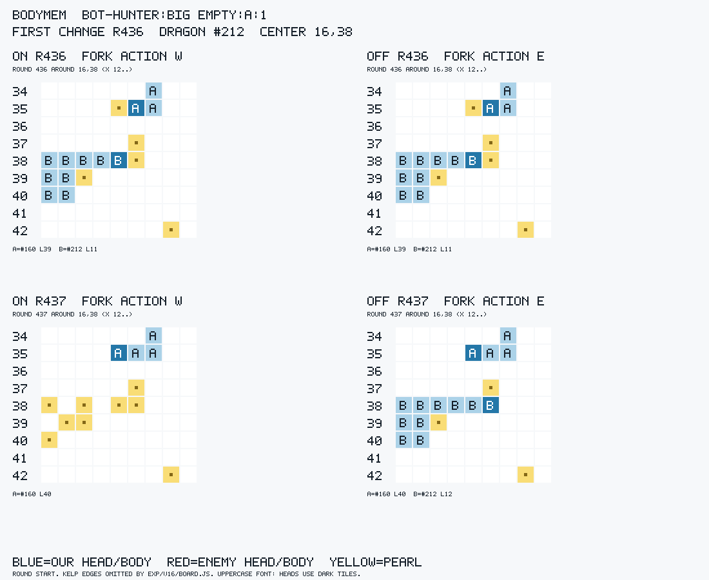

[원래 ASCII 판면](boards/bodymem/bot-hunter_big_empty_A_1.txt)

### BODYMEM · `bot-hunter:big_empty:B:1`

R=356, 첫 변경 #68: ON `E` / OFF `W`. 용 k=1, 용 k=3.

예 — 아군 #66의 꼬리 판정이 true→false로 바뀌어 `feed` E가 발동했다; 기억 OFF 개입 E→W, 자기 몸 배열 차이 없음.

변경 용: ON r356 S/sac / OFF r362 O/trap; R+1 사망/생존, R+3 사망/생존, R+10 사망/사망.

여왕 #1: ON r458 H/rammed / OFF 관측 종료까지 생존; R+10 생존/생존, R+50 생존/생존.

표식: ON `feed #66 d3 L21 E=F` / OFF `W v0.9 d7 L21 g39 E=F`.

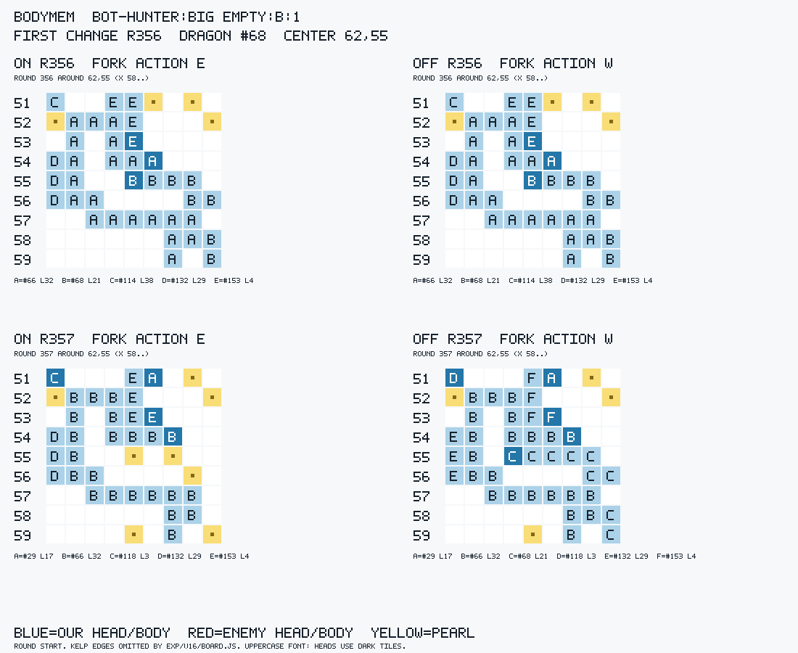

[원래 ASCII 판면](boards/bodymem/bot-hunter_big_empty_B_1.txt)

### BODYMEM · `bot-hunter:gen_L_03:A:1`

R=364, 첫 변경 #39: ON `W` / OFF `N`. 용 k=1.

예 — 아군 #38의 꼬리 판정 true→false가 `feed` W를 발동시켰다; 기억 OFF 개입 W→N, 자기 몸 배열 차이 없음. off도 다음 r365에 먹이기로 죽는다.

변경 용: ON r364 S/sac / OFF r365 S/sac; R+1 사망/생존, R+3 사망/사망, R+10 사망/사망.

여왕 #0: ON 관측 종료까지 생존 / OFF 관측 종료까지 생존; R+10 생존/생존, R+50 생존/생존.

표식: ON `feed #38 d3 L5 E=F` / OFF `N v4.9 d7 L5 g40 E=F`.

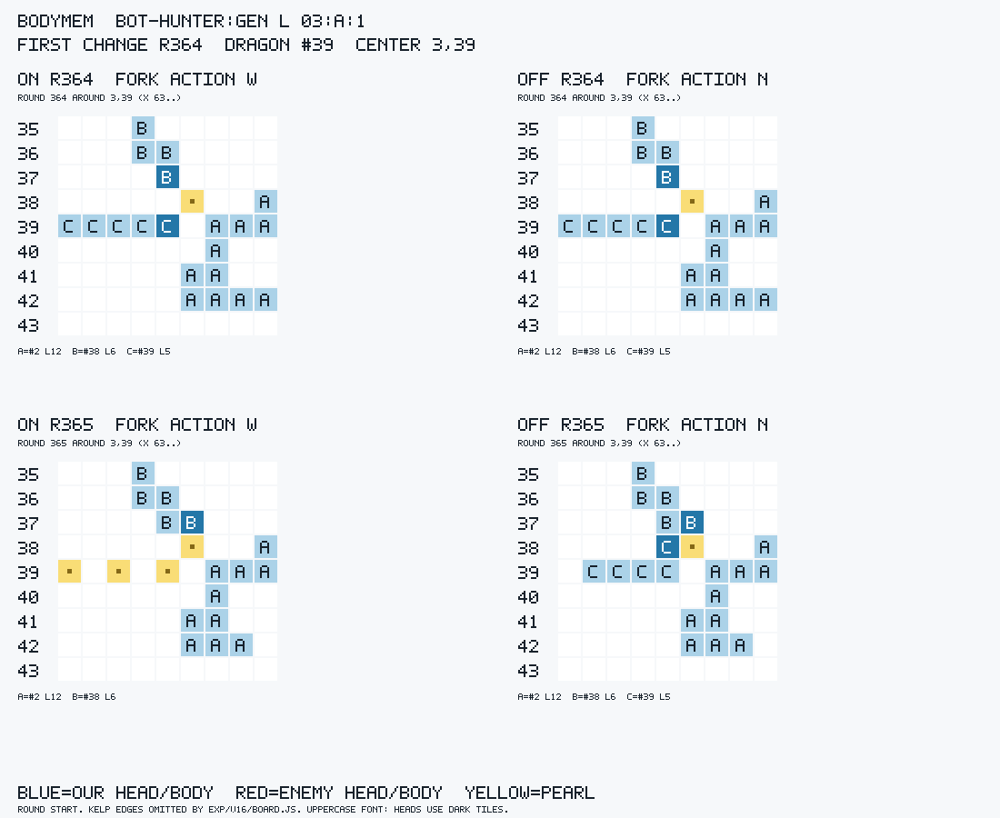

[원래 ASCII 판면](boards/bodymem/bot-hunter_gen_L_03_A_1.txt)

### BODYMEM · `bot-hunter:gen_L_03:B:1`

R=308, 첫 변경 #10: ON `W` / OFF `N`. 용 k=1, 용 k=3, 용 k=10.

예 — 여왕 #1의 꼬리 판정 true→false가 `feed #1 ... conv` W를 발동시켰다; 기억 OFF 개입 W→N, 자기 몸 배열 차이 없음.

변경 용: ON r308 S/sac / OFF r331 S/sac; R+1 사망/생존, R+3 사망/생존, R+10 사망/생존.

여왕 #1: ON 관측 종료까지 생존 / OFF r421 H/rammed; R+10 생존/생존, R+50 생존/생존.

표식: ON `feed #1 d2 L3 conv E=F` / OFF `N v6.5 d7 L3 qb3 ghd@53,60 E=F`.

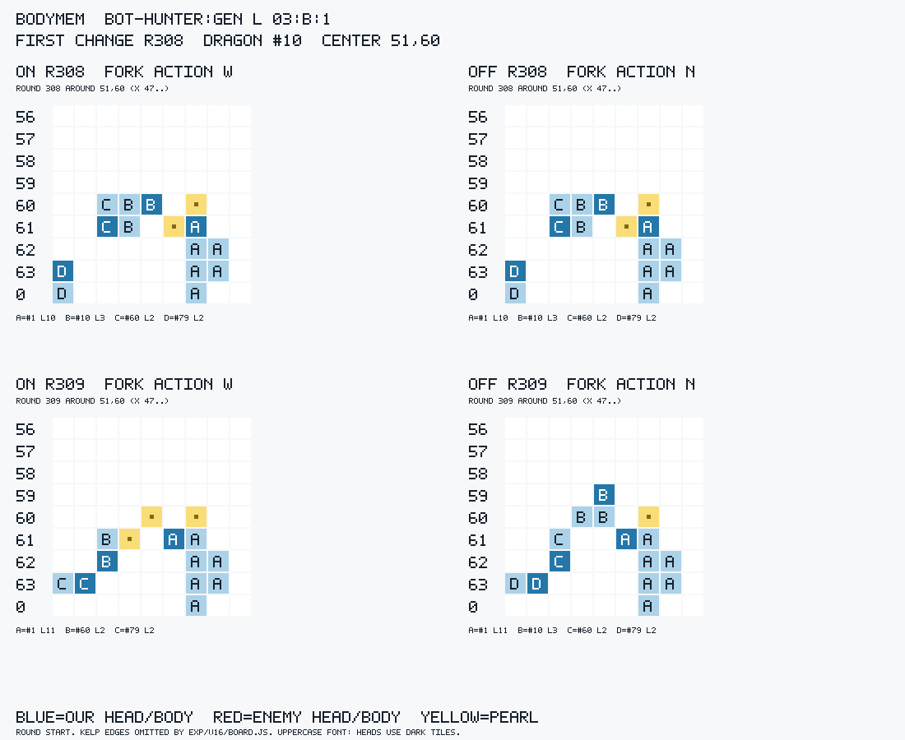

[원래 ASCII 판면](boards/bodymem/bot-hunter_gen_L_03_B_1.txt)

### BODYMEM · `bot-hunter:gen_M_07:A:1`

R=157, 첫 변경 #58: ON `S` / OFF `W`. 용 k=3.

예 — 아군 #19/#56의 꼬리 기억 및 점유 해제 4칸 차이가 W→S를 만들었다; 기억·캐시 OFF 개입 S→W, 자기 몸 배열 차이 없음. #58은 R157의 동일한 부모 #56 분열 뒤 태어나 위 R 판면에는 없고, 첫 차례 상태 동일성은 별도로 확인했다; r159 W/trap으로 죽는다.

변경 용: ON r159 W/trap / OFF r161 W/trap; R+1 생존/생존, R+3 사망/생존, R+10 사망/사망.

여왕 #0: ON r32 W/trap / OFF r32 W/trap; R+10 사망/사망, R+50 사망/사망.

표식: ON `S v-974.9 d7 L2 map=none E=F` / OFF `W v-695.3 d7 L2 map=none E=F`.

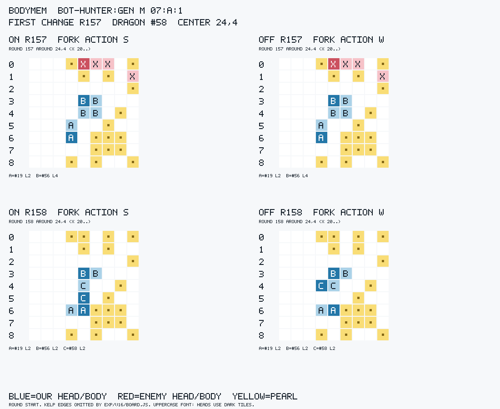

[원래 ASCII 판면](boards/bodymem/bot-hunter_gen_M_07_A_1.txt)

### BODYMEM · `bot-hunter:gen_M_07:B:1`

R=225, 첫 변경 #131: ON `N` / OFF `S`. 용 k=10.

예 — 아군 #138/#158의 꼬리·추정 길이 및 점유 3칸 차이가 S→N을 만들었다; 기억·캐시 OFF 개입 N→S, 자기 몸 배열 차이 없음. r230 W/trap으로 죽는다.

변경 용: ON r230 W/trap / OFF r248 W/trap; R+1 생존/생존, R+3 생존/생존, R+10 사망/생존.

여왕 #1: ON r32 W/trap / OFF r32 W/trap; R+10 사망/사망, R+50 사망/사망.

표식: ON `N v-801.7 d7 L8 bl4@37,19 k1 E=F` / OFF `S v8.1 d7 L8 bl4@35,7 k1 E=F`.

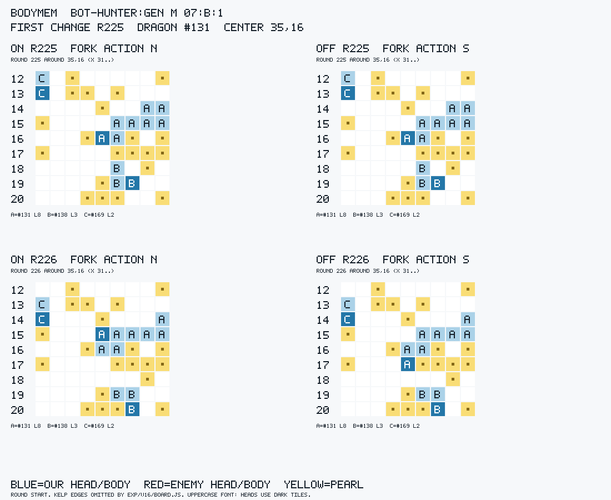

[원래 ASCII 판면](boards/bodymem/bot-hunter_gen_M_07_B_1.txt)

### BODYMEM · `proxy4_king:default_small:A:1`

R=34, 첫 변경 #8: ON `W` / OFF `E`. 여왕 k=50.

예 — 아군 #4의 추정 L2→4, 최장 아군 및 점유 2칸 차이가 E→W를 만들었다; 기억·캐시 OFF 개입 W→E, 자기 몸 배열 차이 없음. 여왕 harm은 49라운드 뒤다.

변경 용: ON r193 H/rammed / OFF r144 W/trap; R+1 생존/생존, R+3 생존/생존, R+10 생존/생존.

여왕 #0: ON r83 S/trap / OFF r94 H/rammed; R+10 생존/생존, R+50 사망/생존.

표식: ON `W v7.3 d7 L2 kbr E=F` / OFF `E v7.4 d7 L2 E=F`.

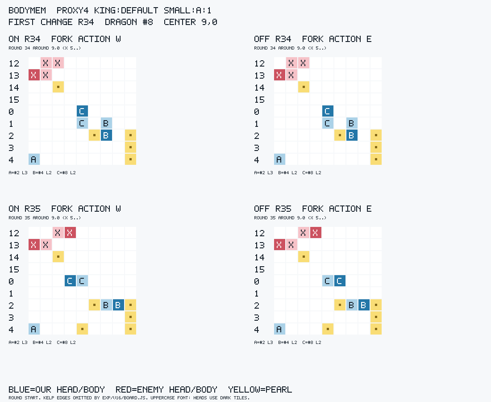

[원래 ASCII 판면](boards/bodymem/proxy4_king_default_small_A_1.txt)

### BODYMEM · `proxy4_king:trophy:A:1`

R=135, 첫 변경 #12: ON `W` / OFF `E`. 여왕 k=50.

예 — 아군 #21의 추정 L2→4, 최장 아군 및 점유 2칸 차이가 E→W를 만들었다; 기억·캐시 OFF 개입 W→E, 자기 몸 배열 차이 없음. 여왕 harm은 29라운드 뒤다.

변경 용: ON r179 H/rammed / OFF r145 H/rammed; R+1 생존/생존, R+3 생존/생존, R+10 생존/생존.

여왕 #0: ON r164 H/rammed / OFF r214 H/rammed; R+10 생존/생존, R+50 사망/생존.

표식: ON `W v4.2 d7 L2 tg bl4@6,6 k0 E=F` / OFF `E v4.8 d7 L2 tg bl2@6,6 k1 E=F`.

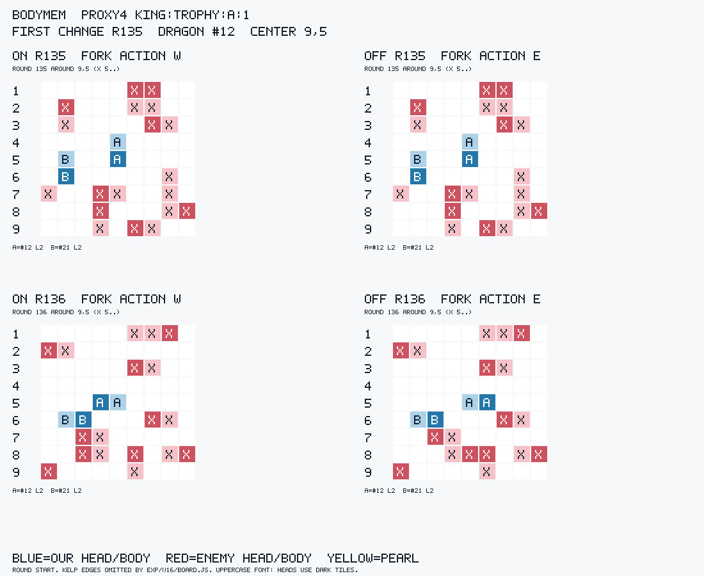

[원래 ASCII 판면](boards/bodymem/proxy4_king_trophy_A_1.txt)

### BODYX · `proxy4_king:default_small:B:1`

R=27, 첫 변경 #1: ON `EN` / OFF `EE`. 여왕 k=50.

예 — 동일 World에서 BODYX만으로 EE→EN이 재현된다; `bodyxr` 없는 전이·탐색 선택 변화이고 기억 차이는 없다. 여왕의 r58 H/rammed는 31라운드 뒤다.

변경 용: ON r58 H/rammed / OFF r167 H/rammed; R+1 생존/생존, R+3 생존/생존, R+10 생존/생존.

여왕 #1: ON r58 H/rammed / OFF r167 H/rammed; R+10 생존/생존, R+50 사망/생존.

표식: ON `EN v5.0 d7 L5 bodyx2,0,5,0,1276095228,4198293597,0 E=F` / OFF `EE v5.0 d7 L5 E=F`.

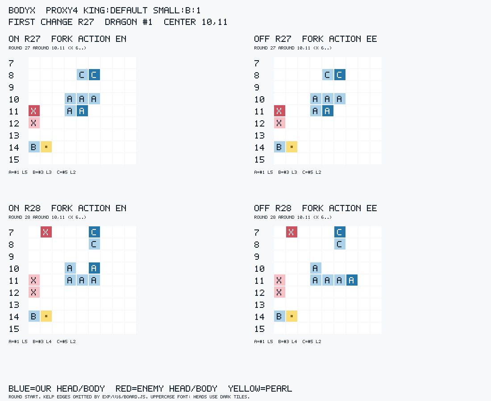

[원래 ASCII 판면](boards/bodyx/proxy4_king_default_small_B_1.txt)

### FREECOST · `bot-hunter:trophy:B:1`

R=12, 첫 변경 #1: ON `W` / OFF `S`. 여왕 k=50.

예 — 동일 World에서 FREECOST만으로 S→W가 재현된다; L3 한 걸음의 즉시 지급은 양쪽 0이므로 무료 다중 이동 가격의 직접 사례는 아니다. threat/DFS 내부 항은 분리하지 않았다; 여왕 사망은 38라운드 뒤다.

변경 용: ON r50 H/rammed / OFF r88 H/rammed; R+1 생존/생존, R+3 생존/생존, R+10 생존/생존.

여왕 #1: ON r50 H/rammed / OFF r88 H/rammed; R+10 생존/생존, R+50 사망/생존.

표식: ON `W v6.1 d7 L3 fc1,0,3,0,4064958989 E=F` / OFF `S v6.3 d7 L3 E=F`.

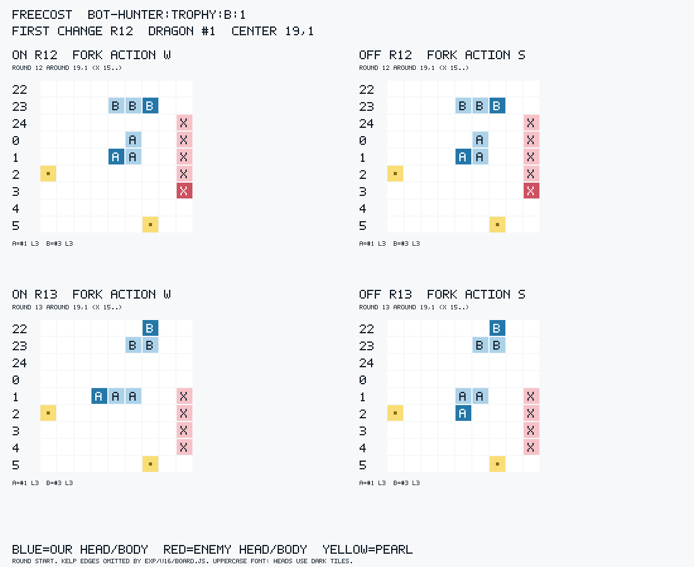

[원래 ASCII 판면](boards/freecost/bot-hunter_trophy_B_1.txt)

### QSIGHT · `proxy4_king:maze:B:1`

R=290, 첫 변경 #352: ON `N` / OFF `W`. 용 k=10.

아니오(현재 차례의 직접 회피 가격장) — #352는 비여왕이며 같은 이력의 QSIGHT on/off는 모두 N 또는 모두 W다; 앞선 소나 이력으로 아군 #285의 머리 기억이 712 vs 616으로 달라져 갈렸다.

변경 용: ON r296 O/trap / OFF r347 S/sac; R+1 생존/생존, R+3 생존/생존, R+10 사망/생존.

여왕 #1: ON r278 H/rammed / OFF r278 H/rammed; R+10 사망/사망, R+50 사망/사망.

표식: ON `N v7.7 d7 L2 bl5@44,9 k0 E=F` / OFF `W v7.0 d7 L2 cl@36,9 bl5@44,9 k0 E=F`.

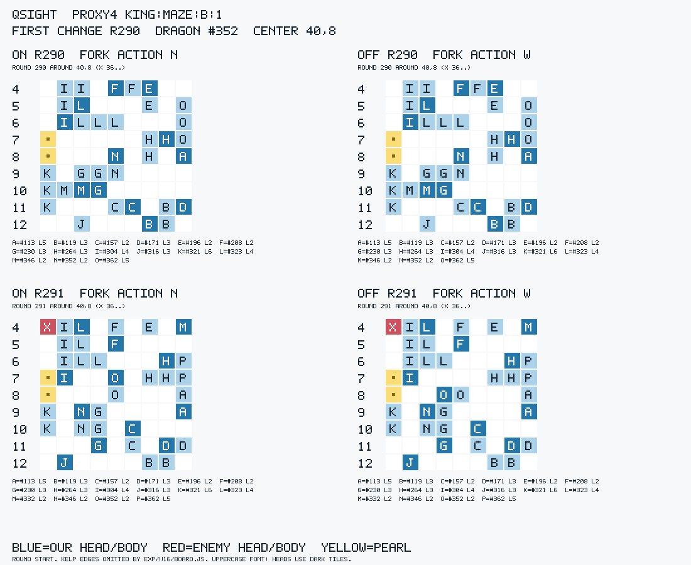

[원래 ASCII 판면](boards/qsight/proxy4_king_maze_B_1.txt)

## 재현과 검증

```sh
node tools/firstdiv.js --self-test
UNSW_RULES=123 node tools/firstdiv.js exp/bodymem/on exp/bodymem/off --out exp/firstdiv/bodymem.json
UNSW_RULES=123 node tools/firstdiv.js exp/bodyx/on exp/bodyx/off --out exp/firstdiv/bodyx.json
UNSW_RULES=123 node tools/firstdiv.js exp/freecost/on exp/freecost/off --out exp/firstdiv/freecost.json
UNSW_RULES=123 node tools/firstdiv.js exp/qsight/on exp/qsight/off --out exp/firstdiv/qsight.json
UNSW_RULES=123 node exp/firstdiv/verify.js
```

`tools/firstdiv.js`는 일반 runq의 `rows.jsonl`·`games/<key>/game.replay[.gz]`를 입력으로 받는다. `--key`로 한 키만 분석할 수 있고, `--out`을 생략하면 전체 JSON을 stdout에 쓴다. 실패 이력·중복 행·누락·상태 불일치는 감추지 않고 보고한다. 각 JSON에는 전체 키, R, id, 양쪽 action/표식, 같은 R의 모든 변경 용, 시작 판면/해시, 실제 차례 판면 동일성, 원시/기제 사인, 모든 시점의 fate, 여왕, 최초 사건·전체 팀 action 차이가 남는다.

선택 원인은 `native-review.json`, 기억 개입은 `memory-ablation.json`·`memory-cache-ablation.json`에 있다. 해당 native C++ 소스는 기존 봇 파일을 읽어 링크한 분석 하네스다. 11키×실제 두 arm의 끝 선택 22/22를 재현했다. 과거 native 선택은 1604/1608 일치했으며 4건 불일치도 숨기지 않았다; 과거 action은 모두 실제 기록을 강제했다. 양 arm의 관측 이력 각각에서 스위치를 바꿔 비교했다. native clock은 judge CPU clock과 다르므로 이를 공식 전체 Planner 상태 재현이나 50라운드 단일 행동 개입의 증거로 확대하지 않는다.

독립 검산: 명세 키와 원시 action/death 이벤트를 별도 순회해 328키·3512 fate checkpoint를 재계산했다. 오류 0건. 집계 및 검산 항목은 `verification.json`에 있다.

새 게임·봇/params 변경·커밋·네트워크는 없다. 쓰기는 `tools/firstdiv.js`와 `exp/firstdiv/**`에 한정했다. 분석에 `nice -n 10`을 요청했으나 환경의 setpriority 거부로 우선순위는 적용되지 않았다. 세트별 처음 보는 지도·양편·두 상대·시드1의 기존 표본 범위다.
