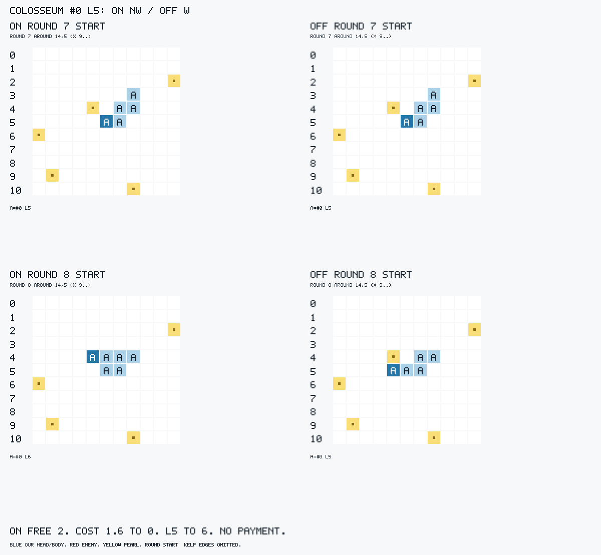
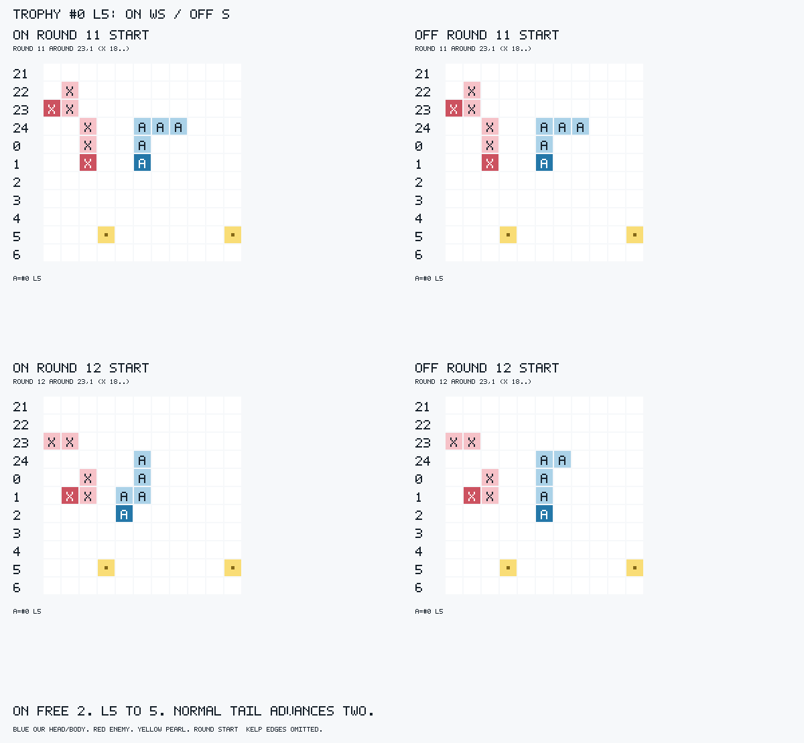
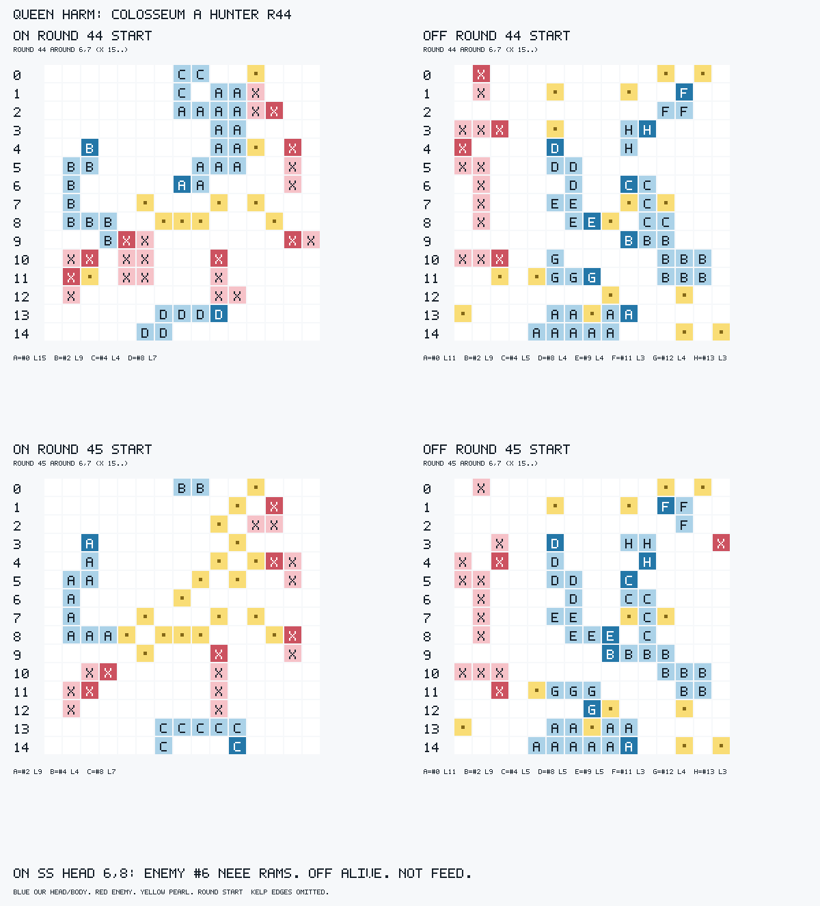

# FREECOST2 ANALYSIS — 2026-10-02 14:28:41 KST

**제안 ON.** 목적 개선과 사전 등록 위해·동일성·CPU·오류 게이트 PASS. 17지도×A/B×king/hunter×seed1의68짝과 identity12키, 기존160판만 사용했다. 승패/최종길이/갈림 뒤 원시 사망 증가로 판정하지 않았다.

| 사전 등록 항목 | 값 / N | 판정 |
|---|---|---|
| 1 시작 L의 실제 Planner 가격·도달·후보/몸 보존 | 가격5080·capped reach125·몸/지급762 **각 arm** 합성 재검사 일치; validator 후보 생성/몸 소스 보존; 같은 강제 입력20125차례의 양 World 시작/후속 몸 차이0 | PASS |
| 1 무료 다중 MOVE 몫 증가 | ON10206/115448=8.8403%, OFF1790/124326=1.4398%; 68키/arm; 완주10187/10206 대1778/1790 | PASS |
| 1 실제 가격·꼬리·길이 판면 | 첫 변경48용 모두 L>=5 무료2 대단일, 새 가격 이득+1.6; Colosseum L5→6/꼬리1, Trophy L5→5/꼬리2; 무료/유료 실제 전이114개(126관측·재검12) 불일치0 | PASS(실제 전이); native 선택47/48키 재현, 1키 미확인 |
| 2 첫 변경 용 k=3 harm<=help | 0<=0; N48, neither48/both0/censored0; 무변경20/68 | PASS; 생존 개선 help0 |
| 2 여왕 k=50 harm<=help | 1<=6; N48, both12/neither28/censored1; 갈림 전 사망7/48, 당시 생존41/48 | PASS |
| 2 동일 최초 입력·즉시 oracle·모든 harm 설명 | geometry/시작/facing/실제 첫 차례/첫 전체 action 불일치0/48; 앞선 사건·소나 차이0/48; 강제 과거/관측 입력 차이0/48; old/new 즉시 완주48/48씩, 새 선택만 즉시 사망0/48; harm 설명1/1·먹이기0 | PASS; native188/192 선택만 재현, 불재현4개는 증거로 세지 않음 |
| 3 ON 지급/oversprint 사망·raw A | ON/OFF 지급 사망0/68씩, raw A0/68씩(분류 대상N0) | PASS |
| 3 ledger·오류/timeout/no reply·누락 | 160/160기보, ledger10항 모두0; 오류/실패 이력/중복/예상밖/누락/turnActionGap/TLE/no-action 모두0 | PASS |
| 4 OFF/base WASM·현재v1.8 소스·사건/소나 identity | 536250 bytes·SHA 동일1/1; validator 현재소스 일치; 사건/소나12/12 동일(24판) | PASS |
| 4 production CPU<80M·깊이 | CPU160/160 있음, ON69M/OFF32.3M/identity32.2M; 갈림 전11432·첫 용48 깊이 모두동일; 이후 lower/same/higher2044/99572/2226 | PASS; native clock은 judge clock 아님 |

## 무료 다중 몫과 분모

모든 action을 포함한 시작 L>=5 차례가 분모다. 시도는 사망 시도도 포함한다. ON/OFF 무료다중 완주 비율은 99.8138%/99.3296%; 전체다중 시도/완주는11614/11482 대3611/3483이다. [keywise.tsv](keywise.tsv)는68키 모두의 시도/기회/몫과 양방향 여왕·raw 사인이다. [summary.json](summary.json)의 groups.key에는 완주 및 전체다중 분모도 있다.

| L구간 | ON 차례/무료시도/완주 | OFF 차례/무료시도/완주 |
|---|---|---|
| L2-4 | 255663/0/0 | 260225/0/0 |
| L5-8 | 44570/3064/3057 | 51984/676/673 |
| L9-12 | 24391/1905/1902 | 24969/428/424 |
| L13+ | 46487/5237/5228 | 47373/686/681 |

| 지도 | ON 시도/기회(몫), 완주 | OFF 시도/기회(몫), 완주 |
|---|---|---|
| arena | 57/169(33.7278%), 55 | 9/101(8.9109%), 9 |
| big_empty | 4372/47667(9.1720%), 4369 | 658/51818(1.2698%), 653 |
| Colosseum | 157/599(26.2104%), 152 | 105/1970(5.3299%), 103 |
| default_small | 161/1589(10.1322%), 161 | 70/1809(3.8695%), 69 |
| stronghold | 377/4017(9.3851%), 377 | 20/4651(0.4300%), 20 |
| trophy | 302/2653(11.3833%), 302 | 39/2742(1.4223%), 39 |
| portals | 403/7761(5.1926%), 401 | 18/6701(0.2686%), 18 |
| slithery_fight | 646/10000(6.4600%), 645 | 165/11812(1.3969%), 165 |
| around_unsw | 314/5683(5.5253%), 314 | 97/11171(0.8683%), 97 |
| australia | 544/8216(6.6212%), 544 | 62/7091(0.8743%), 62 |
| stripes | 64/1097(5.8341%), 62 | 1/222(0.4505%), 1 |
| gen_S_03 | 0/33(0.0000%), 0 | 0/33(0.0000%), 0 |
| gen_M_03 | 1422/11194(12.7032%), 1418 | 407/11134(3.6555%), 404 |
| gen_M_07 | 172/2623(6.5574%), 172 | 6/2168(0.2768%), 6 |
| gen_L_02 | 0/0(기회0), 0 | 0/0(기회0), 0 |
| gen_R_01 | 0/0(기회0), 0 | 0/0(기회0), 0 |
| gen_X_07 | 1215/12147(10.0025%), 1215 | 133/10903(1.2198%), 132 |

| 편 | ON 시도/기회(몫), 완주 | OFF 시도/기회(몫), 완주 |
|---|---|---|
| A | 4991/58581(8.5198%), 4983 | 925/63098(1.4660%), 920 |
| B | 5215/56867(9.1705%), 5204 | 865/61228(1.4128%), 858 |

| 상대 | ON 시도/기회(몫), 완주 | OFF 시도/기회(몫), 완주 |
|---|---|---|
| proxy4_king | 2782/37690(7.3813%), 2779 | 575/39434(1.4581%), 573 |
| bot-hunter | 7424/77758(9.5476%), 7408 | 1215/84892(1.4312%), 1205 |

L_02/R_01은 기회0, S_03은0/33으로 지도별 개선 미확인이다. 전체 몫의 사전 게이트를 다른 지도별 gate로 바꾸지 않았다.

## 의도한 판면과 독립 전이

Colosseum A/hunter #0 r7: 시작몸[94,95,79,64,48], 무료한도2. ON NW의 N은94→78, 정상꼬리48 제거; W는78→77의 진주를 먹어 추가 제거0, 끝몸[77,78,94,95,79,64] L6. OFF W는94→93, 끝몸[93,94,95,79,64] L5. NW 가격1.6→0(+1.6), W는0→0. 같은 입력 native의 새/옛 선택 점수9.12406/8.98757, 양쪽 즉시 oracle 완주. 진주77은 r7 시작 뒤 차례 전에 생겨 상단 시작 그림에는 없다.

Trophy A/hunter #0 r11: 시작[48,23,623,624,600], ON WS 머리48→47→72, 진주0/지급0, 정상꼬리600·624 제거, 끝[72,47,48,23,623] L5. OFF S는48→73, 꼬리600만 제거, L5. 가격차+1.6; raw 양쪽d6·즉시완주/k3생존이다. native는양쪽d7/E라 이 키의 선택 원인 재현은 **미확인**, raw 물리 전이 검산과 구분한다.

유료 보조: Colosseum A #2 ONr17/OFFr18의 시작[38,37] L2 SW, 무료한도1. 두 진주54·53을 먹어 L4가 되나 action 무료한도는 그대로1, 두 번째 걸음에서 꼬리37을 지급해[53,54,38] L3으로 완주한다. 가격은양쪽1.6. 갈림 뒤 서로 다른 차례를 같은 입력 실험으로 세지 않았다. 매 걸음 배열은 [decision-details.json](decision-details.json)과 [supplemental-details.json](supplemental-details.json); 112+14차례 oracle/실제 전이 불일치0.

공통 bodyx 태그 ON/OFF11496/3488, 태그누락118/123(다중시도11614/3611), unknown323/31, unseen65/14. 시작 drift994/11496 대123/3488, 끝 drift941/11482 대103/3483. 시작부터 drift인 끝 예측921/102와 시작 정확·미관측 경로20/1을 분리했다. native 같은 강제 입력20125에서 두 World의 시작/후속 배열 차이0; 첫 입력 actual 몸96/96 exact. drift 증가를 새 위해 gate로 쓰거나0으로 숨기지 않는다.

## 첫 변경 인과·즉시 oracle 전수

matched48/68, no divergence20; 물리 geometry/시작/facing/첫 차례 불일치0/48, 첫 전체 action 차이가 다른 용인 사례0/48, 첫 의미있는 prefix 사건이 다른 action/소나인 사례0/48. native의 첫 용 강제과거/관측 입력도48/48 같은데, 선택 재현은47/48키(188/192조합)다. 실제 old/new 즉시 oracle 완주48/48씩, 새 선택만즉시사망0. 즉시 ledger 전이를독립123 oracle로 재계산했다. 같은 이력 양방향 반복은 별도 실험N으로 늘리지 않는다.

| 대상/k | N | harm | help | both | neither | censored |
|---|---:|---:|---:|---:|---:|---:|
| 첫 용/1 | 48 | 0 | 0 | 0 | 48 | 0 |
| 첫 용/3 | 48 | 0 | 0 | 0 | 48 | 0 |
| 첫 용/10 | 48 | 0 | 0 | 4 | 44 | 0 |
| 여왕/10 | 48 | 0 | 0 | 9 | 39 | 0 |
| 여왕/50 | 48 | 1 | 6 | 12 | 28 | 1 |

갈림 전에 여왕 사망7키는both에 남겼다. 그7키를 빼면 여왕50 N41, harm/help/both/neither/censored=1/6/5/28/1. arena A/hunter R12에서 게임종료ON32/OFF62, 여왕50 ON이 censored이므로 생존으로 채우지 않았다. k는R+k 시작이며 사망R..R+k-1을 센다. 여왕50은 후속 전체 정책 효과다.

| 키 | R/#/L | 새/옛 선택 | 새/옛 즉시 oracle | native 두 이력·두 스위치 |
|---|---|---|---|---|
| bot-hunter:Colosseum:A:1 | 7/#0/L5 | NW/W | 완주/완주 | 4/4재현 |
| bot-hunter:Colosseum:B:1 | 18/#1/L5 | EN/E | 완주/완주 | 4/4재현 |
| bot-hunter:arena:A:1 | 12/#0/L5 | NN/N | 완주/완주 | 4/4재현 |
| bot-hunter:arena:B:1 | 14/#1/L8 | WN/W | 완주/완주 | 4/4재현 |
| bot-hunter:around_unsw:A:1 | 4/#22/L6 | WN/W | 완주/완주 | 4/4재현 |
| bot-hunter:around_unsw:B:1 | 4/#23/L6 | ES/E | 완주/완주 | 4/4재현 |
| bot-hunter:australia:A:1 | 21/#0/L5 | WS/W | 완주/완주 | 4/4재현 |
| bot-hunter:australia:B:1 | 49/#3/L5 | ES/E | 완주/완주 | 4/4재현 |
| bot-hunter:big_empty:A:1 | 22/#0/L8 | WS/W | 완주/완주 | 4/4재현 |
| bot-hunter:big_empty:B:1 | 14/#1/L8 | WN/N | 완주/완주 | 4/4재현 |
| bot-hunter:default_small:A:1 | 214/#41/L5 | ES/E | 완주/완주 | 4/4재현 |
| bot-hunter:default_small:B:1 | 43/#3/L5 | WN/N | 완주/완주 | 4/4재현 |
| bot-hunter:gen_M_03:A:1 | 65/#0/L6 | NN/N | 완주/완주 | 4/4재현 |
| bot-hunter:gen_M_03:B:1 | 80/#1/L5 | SS/S | 완주/완주 | 4/4재현 |
| bot-hunter:gen_M_07:A:1 | 176/#77/L6 | WW/W | 완주/완주 | 4/4재현 |
| bot-hunter:gen_M_07:B:1 | 133/#32/L5 | WN/W | 완주/완주 | 4/4재현 |
| bot-hunter:gen_X_07:A:1 | 50/#0/L5 | WW/W | 완주/완주 | 4/4재현 |
| bot-hunter:gen_X_07:B:1 | 53/#1/L5 | NN/N | 완주/완주 | 4/4재현 |
| bot-hunter:portals:A:1 | 61/#14/L5 | SE/S | 완주/완주 | 4/4재현 |
| bot-hunter:portals:B:1 | 44/#13/L5 | WS/W | 완주/완주 | 4/4재현 |
| bot-hunter:slithery_fight:A:1 | 20/#14/L23 | SS/S | 완주/완주 | 4/4재현 |
| bot-hunter:slithery_fight:B:1 | 17/#25/L5 | WS/W | 완주/완주 | 4/4재현 |
| bot-hunter:stripes:A:1 | 26/#0/L5 | WS/W | 완주/완주 | 4/4재현 |
| bot-hunter:stripes:B:1 | 28/#1/L5 | NW/W | 완주/완주 | 4/4재현 |
| bot-hunter:stronghold:A:1 | 12/#0/L5 | SS/S | 완주/완주 | 4/4재현 |
| bot-hunter:stronghold:B:1 | 19/#1/L5 | NW/N | 완주/완주 | 4/4재현 |
| bot-hunter:trophy:A:1 | 11/#0/L5 | WS/S | 완주/완주 | 미확인(native E/E, d7) |
| bot-hunter:trophy:B:1 | 28/#1/L5 | WW/W | 완주/완주 | 4/4재현 |
| proxy4_king:Colosseum:A:1 | 14/#0/L5 | SS/S | 완주/완주 | 4/4재현 |
| proxy4_king:arena:B:1 | 15/#1/L5 | NE/N | 완주/완주 | 4/4재현 |
| proxy4_king:around_unsw:A:1 | 6/#23/L6 | EE/E | 완주/완주 | 4/4재현 |
| proxy4_king:around_unsw:B:1 | 4/#26/L6 | WW/W | 완주/완주 | 4/4재현 |
| proxy4_king:australia:A:1 | 21/#0/L5 | WS/W | 완주/완주 | 4/4재현 |
| proxy4_king:australia:B:1 | 71/#1/L5 | EN/E | 완주/완주 | 4/4재현 |
| proxy4_king:big_empty:A:1 | 22/#0/L8 | WS/W | 완주/완주 | 4/4재현 |
| proxy4_king:big_empty:B:1 | 21/#5/L6 | NN/N | 완주/완주 | 4/4재현 |
| proxy4_king:default_small:A:1 | 46/#0/L5 | WW/W | 완주/완주 | 4/4재현 |
| proxy4_king:default_small:B:1 | 43/#3/L5 | WN/N | 완주/완주 | 4/4재현 |
| proxy4_king:gen_M_03:B:1 | 79/#1/L5 | EN/E | 완주/완주 | 4/4재현 |
| proxy4_king:gen_X_07:A:1 | 43/#0/L5 | WS/S | 완주/완주 | 4/4재현 |
| proxy4_king:gen_X_07:B:1 | 96/#18/L5 | WS/W | 완주/완주 | 4/4재현 |
| proxy4_king:portals:A:1 | 17/#2/L5 | WN/W | 완주/완주 | 4/4재현 |
| proxy4_king:portals:B:1 | 19/#3/L5 | ES/E | 완주/완주 | 4/4재현 |
| proxy4_king:slithery_fight:A:1 | 20/#16/L23 | SE/E | 완주/완주 | 4/4재현 |
| proxy4_king:slithery_fight:B:1 | 20/#16/L23 | NN/N | 완주/완주 | 4/4재현 |
| proxy4_king:stronghold:A:1 | 11/#0/L6 | WW/W | 완주/완주 | 4/4재현 |
| proxy4_king:stronghold:B:1 | 12/#1/L5 | NN/N | 완주/완주 | 4/4재현 |
| proxy4_king:trophy:B:1 | 26/#3/L5 | SE/S | 완주/완주 | 4/4재현 |

같은 R의 추가 변경 용은3개다: big_empty A/hunter 및A/king r22 #4 W/N, default_small B/king r43 #9 W/N. 모두 first 용 변경 뒤 실제 차례 판면이 다르며, 각 실제 이력에서는 native 두 스위치가같은 선택을 낸다. 3개전부 k3/k10 neither이며 첫 용 분모48에 중복하지 않았다. [summary.json](summary.json) extraChanged와 [audit-summary.json](audit-summary.json) extraDecisions에 전수 원자료가 있다.

## 모든 harm: Colosseum A/hunter 여왕 #0 (1/1)

**원인 한 줄:** 무료가격으로 r7 W→NW, 이어 r44 S→SS가 진주(6,8)에 여왕 머리를 놓아 상대#6 NEEE의네번째걸음에 H/rammed; 의도적 feed 아님.

r7 old/new 이유와 즉시 전이는 첫 판면에 있다. 양쪽 즉시완주/k3·k10생존이며 여왕 harm은37라운드뒤다. 실제ON r44 L15 무료한도4에서 SS는102(6,6)→118(6,7)→134(6,8): 첫걸음꼬리38 제거, 둘째진주134 성장, L16. native 같은 ON 입력에서 ON SS 점수11.2352, OFF S 점수10.8027, SS의가격1.6→0(+1.6); threat/SA/DFS도양쪽 보존되어 최종후속평가와함께 SS를고른다. 각 내부항의 개별기여를분해했다고주장하지않는다.

상대#6의시작147(3,9), NEEE는131(3,8)→132(4,8)→133(5,8,진주,유료1)→134(6,8,여왕머리). 네번째걸음에서머리충돌하여우리#0이rammed로죽는다. 지급실패가아니다. 여왕 사망OFF는r107 O/sac; R+50시점OFF는살아있다. 같은 ON r44에서 대안S는즉시oracle완주, 머리118/몸에134없음으로 **기록된 NEEE** 공격경로를피한다. 대안선택후상대가다르게반응하는결과나50라운드생존은미측정이다. r8뒤에도후속행동이계속갈려첫 r7행동하나만의장기인과로확대하지않는다.

그림은라운드시작; r44의 SS직후/공격직전 몸[134,118,102,103,87,88,89,73,72,56,57,41,25,24,40,39]와사망전후이벤트는 decision-details.json·firstdiv.json에있다. 켈프선은그림에서생략했으나oracle는실제kelp/portal graph를사용한다.

## 지급·오류·동일성·CPU

raw A/oversprint/sprintDeath ON/OFF0/68씩, identity양쪽0/12씩. raw A분류대상N0, malformed/no-action/illegal split도0. 모든160기보ledger10항0, 입력행누락/오류/TLE/no-action/turnActionGap0. rows historyErrors/duplicates/unexpected도0. OFF/base 공식WASM536250bytes SHA256 `1363a4b2c686cca0f66f696e367fea3812757521df001329820a0fe729b831fe`, 현재v1.8/off소스일치; [identity.txt](identity.txt) 사건·소나12/12같다.

CPU160/160있음, ON69M/OFF32.3M/identity32.2M(<80M). production 완료깊이태그 ON359146/OFF373234, 태그없는11965/11317은주로feed/trade등이며CPU누락이아니다. 갈림전11432 및첫변경용48개깊이모두같음; R전체공통316같음에는갈림뒤추가용이포함된다. 무변경20키깊이4599같음. 갈림뒤같은 round:id lower/same/higher2044/99572/2226은달라진입력의문맥이다.

native96이력/20125차례의기록선택재현20015/20125(110불재현), 같은입력깊이lower/same/higher1/19712/0(N19713), 태그없음412. 첫선택188/192재현이며Trophy A 4조합은재현되지않았다. 첫선택 World몸96/96정확; 두모델같은강제입력배열차이0/20125. native는production clock이아니며같은입력production points는미측정이다. countdown raw경고467553은전부지도spawn maxGap0의정상-1; 실제spawning countdown누락/facing모호함0. [audit-input-check.json](audit-input-check.json)으로대조했다.

## 양방향 문맥 — gate로 쓰지 않음

raw S/W/O/H/A ON1287/3639/1361/570/0, OFF1335/3296/1318/621/0. 기제sac/trap/rammed/ram/enemyBody/allyHead/fault/sprintDeath ON1271/5007/272/208/9/90/0/0, OFF1335/4608/254/249/6/118/0/0. 여왕longer/shorter/same19/11/38(N68), delta합1377/최소-152/최대254, 종료생존ON14/OFF12. 사망라운드또는게임종료생존이면마지막round+1로수명을기록하고조기종료를r500생존으로바꾸지않았다. [context.tsv](context.tsv)의68키모두양쪽여왕수명·censoring·raw/기제사인을공개했다.

분석·판면 UNSW_RULES=123, nice10은환경setpriority거부로미적용. 게임·봇/params수정·네트워크·커밋0. 목적무료몫이늘고고정위해·identity·CPU·오류게이트를통과하여 **부분적용 switch ON 제안**. 스위치를실제로켜지는않았다.
