# Cutlery의 지도 무관 원칙과 섭취 격차

[해석] **Cutlery에서 가져올 후보는 작은 조각의 재생산, 관측된 우세에서의 능동 교환, 행동을 끝낸 뒤의 안전과 먹이 회수 연결이다.** [사실] 주 온라인 자료는 알려진 지도 Cutlery 2,089경기(승 1,152·패 937), 우리 1,260경기이며, 실제 스프린트 맞춤 지도 Cutlery 42경기는 별도 검증 집단이다. 전체 지도 풀의 조각당 섭취는 우리 329,481/3,526,420turn=.09343이 Cutlery의 정지 제외 자료 1,513,669/17,421,905turn=.08688보다 높다. 반면 Trophy의 unsafe-only 인접 진주 회피는 Cutlery 914/3,296기회=27.73%, 우리 220/299=73.58%이고, 먹이를 먹는 turn의 양과 사체 회수도 다르다. [해석] 따라서 격차를 하나의 “먹이 선호 부족”으로 줄이거나 단순 군집 당김으로 해결하는 가설은 지지하지 않는다. 과거 승리판 Cutlery의 원 여왕 사망은 1,114/1,152경기=96.70%지만, 이것은 새 규칙의 예상 패배율이 아니다. 새 규칙으로 옮길 가설은 원 여왕을 값싼 교환·분열·희생에서 보호하고, 집중되는 질량의 목적지를 원 여왕으로 다시 정의해야 한다. ([최종 통합 표](../../exp/cutlery/tables.json): `metadata.scopes`, `A.source_primary`, `B.pooled`, `B.perMap.Trophy`, `independentVerification.originalQueen`)

## 전수 17,125경기를 먼저 계산하고, 분류 뒤 실제 판면을 읽었다

[사실] 모집단은 2026-10-02 00:16 KST에 동결한 재생 가능한 고유 경기 24,697개다. 요청 집단 라벨이 있는 17,125경기를 전수 재생했고 누락 0·오류 0이다. 라벨이 없는 7,572경기는 요청 집단의 행동 평균에 넣지 않았다. 통합 표는 보고서보다 먼저 2026-10-02 02:45:38 KST에 작성됐다. 전체 표는 A 행동, B 섭취, C 일반화, D 패배, E 격차, 독립 검증, 판면 registry로 나뉜다. 표의 수백만 turn은 독립 경기 수가 아니며, 모든 지표의 게임·기회·검열 분모를 구분한다. ([모집단 계보](../../exp/cutlery/manifest.json), [메타데이터](../../exp/cutlery/audit/master-metadata.json))

| 자료 경계 | 경기 N과 계보 | 이 보고서의 사용 |
|---|---|---|
| Cutlery 주 자료 | top 2,054 + elite 알려진 지도 40 − 중복 5 = 2,089; 승 1,152·패 937 | A·C·D의 주 자료 |
| 중복 ID | 790844–790848, N5 | 합집합에서 한 번만 셈 |
| B 정지 제외 Cutlery | 주 2,089 − 정지 휴리스틱 11 = 2,078 | 섭취·경주·시야 창 주 자료 |
| Cutlery 확대 민감도 | 주 알려진 지도 2,089 + 온라인에만 존재 180 = 2,269 | 계보 선택에 따른 민감도 |
| Cutlery 맞춤 지도 | 7개 실제 스프린트 지도 × 6 = 42; 승 28·패 14 | 알려진 지도와 분리한 외부 검증 |
| Cutlery 전체 출현 | 2,269 + 42 = 2,311 | 전수 계보 확인 |
| 우리 온라인 | W0–W12의 반복 세트 15 × 70 = 1,050 + v1의 세 웨이브 210 = 1,260 | 요청된 역사적 후보·버전들의 합; 현재 v1.7과 동일하지 않음 |
| UnderTheC | A 원 집단 196; B 정지 제외 189 | 우리 1,260에 더하지 않는 별도 비교 |
| 다른 상위권 | 수집 시 보관 rank≤10인 동적 집단; 관측 이름 N30 | 현재 고정 아홉 상대나 경기 시작 시점 순위로 부르지 않음 |
| 맞춤 지도 전체 보관 | 전체 모집단 476; 요청 라벨 70; Cutlery 42 | 모집단과 요청 코호트 분모를 구분 |
| 기존 로컬 | 재생 기보 438 | 기제가 있는지 보는 참고; 승패로 채택하지 않음 |

[사실] 다른 상위권 자격은 전체 top/elite non-Cutlery side 44,743개 중 보관 rank 1–10인 19,471side에만 붙였다. 순위 누락·비양수 2,525side와 rank>10인 22,747side는 추정해서 채우지 않았다. A의 one-free·알려진 지도·정지 포함 다른 승자 N10,585와 B의 정지 제외·이동모델 혼합 다른 승자 N10,699는 서로 다른 분모다. 같은 수치를 비교할 때 source·지도·결과·이동모델·phase를 맞춘다. ([A 계보](../../exp/cutlery/profile/tables.json): `rankProvenance`, `source_primary.groups`; [B 정의](../../exp/cutlery/intake/tables.json): `population`, `byMapAndRules`)

[사실] **1단계**는 `population.js`로 중복과 출처를 동결하고 `extract.js`/`aggregate.js` 및 섭취 pass로 모든 원시 행동과 분모를 계산했다. **2단계**는 전멸 시기, 공급·머릿수 열세, 노출, 교환, 집중 등 크기가 있는 집단을 만든 것이다. **3단계**는 그 집단 평균·중심에 가까운 gameId를 고른 뒤 `eval/board.js`로 실제 라운드 판면을 읽었다. 그림 24/24장은 시각 검토 표시가 있고, 초기에 확대 집단으로 고른 그림은 주 자료로 재가중한 뒤에도 사례로만 유지했다. 맞춤 지도 성공 그림 한 장은 명시적인 설명용 선택이다. 그림은 전체 통계를 대신하지 않는다. ([추출 코드](../../exp/cutlery/profile/extract.js), [집계 코드](../../exp/cutlery/profile/aggregate.js), [판면 선택·검토](../../exp/cutlery/boards/index.json))

[사실] 우선 집단의 독립 raw 재계수는 3,391경기·라벨 side 4,904개에서 turn/MOVE/섭취/자연섭취/분열과 실제 도달 checkpoint 머릿수 불일치 0이었다. 별도의 전체 raw-body 재구성 17,125경기에서는 r25/50/100/250/500 머릿수·총 길이·최장·원 여왕 불일치 0·오류 0이다. Actor 1/3/5 창은 전수 캐시 histogram 산술 불일치 0이며, 632309·586367·800039의 원시 시간선은 캐시/ledger와 독립 재구성하여 outcome·lag·stratum 불일치 0이었다. 후자는 전수 Q5 raw 두 번째 측정이라는 뜻이 아니다. ([A 재계수](../../exp/cutlery/profile/recount.json), [checkpoint 검증](../../exp/cutlery/audit/checkpoint-mass.json), [actor 산술](../../exp/cutlery/audit/actor-horizons.json), [actor raw](../../exp/cutlery/audit/actor-visibility-raw.json))

### 정확한 물리 재생과 제한된 행동 모형을 구분한다

[사실] 몸 재생은 원시 사건과 최종 길이를 대조했다. `110/123`은 각각 one-free/quarter-free 이동 **적합 모형**이다. Cutlery 전체 N2,311은 one-free 몸 적합 오차 0이지만, 긴 multi-step이 없으면 두 모형은 같은 궤적을 만들 수 있다. 따라서 모든 경기의 공식 엔진 버전을 독점 식별했다는 주장은 하지 않는다. 원 여왕은 팀의 최초 initial minimum ID로 고정하고, 현재 살아 있는 최장 드래곤인 “왕”과 분리했다. ([물리 정의](../../exp/cutlery/profile/tables.json): `definitions`, `checks`; [원 여왕](../../exp/cutlery/audit/original-queen.json))

| 지표 | 정확히 센 것 | 추론하면 안 되는 것 |
|---|---|---|
| 머릿수 곡선 | 전체 경기 N; 전멸 뒤 0, 조기 종료 생존 팀은 최종 상태 이월 | 끝난 경기의 이후 가상 플레이·성장 |
| 도달 시점 뭉치기 | 실제 checkpoint까지 진행된 경기만, N 별도 | 전체 경기 이월 곡선과 같은 분모 |
| 아군 거리 | turn 시작 토러스 Manhattan, 상한 20; 아군 없음 별도 | 지형 최단거리·무상한 평균 |
| L2–3 위치 | 최장·원 여왕·적·샘까지 거리 상한 30, 근처·시야 비율 | 목적적인 정찰·정보 전달의 증명 |
| king/queen 압력 | 각 라운드 Manhattan 3/5/8 안 실제 적 머리 | 벽·포털을 고려한 공격 도달·봇이 아는 위험 |
| 램 기회 | 실제 enemy length와 전판 cap6 정적 점유 BFS, 적 머리마다 N1 | 봇의 perceived length·인지한 기회·거절 의도 |
| 노출 forced/avoidable | 적 예산 최대 6, 고정 몸, 우리 1/2걸음 대안 | 모든 합법 action에 대한 정확 강제성; split·동적 꼬리·진주 연장 포함 |
| 아군 봉쇄·boxing | 성공 MOVE 끝에서 아군 빈 출구가 0/≤1 | 미래 꼬리 비움·sprint까지 막는 확정 봉쇄 |
| 주머니 | 포털 포함 무방향 지형 graph의 2-core 밖 | 한 입구의 순환 굴까지 모두 찾은 완전 주머니 |
| 샘 | 검증 layout의 meanGap≤12인 생성 타일 | 처음 보는 지도에서 초기부터 아는 숨은 주기 |

[사실] 포털 지도에서는 토러스 근처 적만 추리는 구 W7 필터가 먼 공격자를 놓칠 수 있어 portal-aware 모형을 별도로 계산했다. 구 compatibility 지표와 새 모형을 섞지 않는다. A의 reach 뒤 ram 비율은 마지막 생존 머리 수를 검열 상한으로 제공하지만 정확한 노출 이동별 검열 N은 저장하지 않았다. B의 food 최종 노출은 다음 자기 turnStart까지 추적하고 종료 검열을 분모에서 뺀다. 예산 잘림은 actor만 보고 판단하면 안 된다. 주 Cutlery actor-turn 17,421,905개 중 전판 어딘가의 적 예산>6이 존재한 turn은 5,508,304이고, 적 head-turn 532,524,798개 중 예산>6은 14,861,965다. 우리는 각각 1,462,437/3,526,420turn, 8,029,734/131,096,782적 head-turn이다. 이것은 모형 경계의 존재량이며 누락 공격의 확정 개수는 아니다. ([reach 정의·보강](../../exp/cutlery/intake/tables.json): `definitions`, `raceCaptureActions`; [독립 W7](../../exp/cutlery/audit/source-primary.json))

## A: Cutlery는 초기에 질량을 나누지만 집중 비중 상승 전부가 전환은 아니다

[사실] 아래 표는 source-primary·알려진 지도·one-free fit·정지 포함 풀이다. 셀은 원시 분자/분모이며 열마다 경기 N이 다르다. 분열의 eligible은 L≥4인 turn으로 법적 자식 공간까지 모두 포함한 기회가 아니다. 평균 길이·길이 분위수는 dragon-turn 가중이다. ([A 원표](../../exp/cutlery/profile/tables.json): `source_primary.groups.<집단>|ALL|110|all|known`)

|집단|경기 N|turn N|MOVE N|섭취/turn|자연/turn|분열/eligible|평균 L; Q10/25/50/75/90|
|---|---:|---:|---:|---|---|---|---|
|Cutlery|2,089|17,476,173|16,577,347|1,517,433/17,476,173=0.08683|808,110/17,476,173=0.04624|521,593/3,352,339=15.56%|3.491; 2/2/2/3/5|
|Cutlery 승자|1,152|11,655,078|11,073,661|996,863/11,655,078=0.08553|535,994/11,655,078=0.04599|338,328/2,278,721=14.85%|3.539; 2/2/2/3/5|
|Cutlery 패자|937|5,821,095|5,503,686|520,570/5,821,095=0.08943|272,116/5,821,095=0.04675|183,265/1,073,618=17.07%|3.395; 2/2/2/3/5|
|다른 승자|10,585|109,215,036|105,874,135|8,346,029/109,215,036=0.07642|4,420,957/109,215,036=0.04048|2,892,535/16,984,426=17.03%|3.224; 2/2/2/3/4|
|다른 패자|8,478|63,881,618|61,581,121|5,591,061/63,881,618=0.08752|2,866,658/63,881,618=0.04487|1,948,356/10,064,750=19.36%|3.155; 2/2/2/3/4|
|우리|1,260|3,526,420|3,427,441|329,481/3,526,420=0.09343|166,153/3,526,420=0.04712|98,979/1,124,501=8.80%|5.034; 2/2/3/5/12|
|UnderTheC|136|827,145|785,607|65,156/827,145=0.07877|32,563/827,145=0.03937|24,662/95,026=25.95%|3.008; 2/2/2/3/4|

[사실] 전체 경기 분모의 평균 머릿수는 다음과 같다. r500은 최종 상태다. 실제 해당 시점까지 진행된 `reachedN`과 머릿수는 원표에 별도 있다. 조기 종료 이월을 남은 라운드를 계속 뛰었다는 뜻으로 읽지 않는다.

|집단|경기 N|r25|r50|r100|r250|r500|
|---|---:|---:|---:|---:|---:|---:|
|Cutlery|2,089|9.272|13.944|22.285|29.822|14.398|
|Cutlery 승자|1,152|10.113|16.165|27.538|40.006|23.641|
|Cutlery 패자|937|8.238|11.212|15.826|17.302|3.033|
|다른 승자|10,585|9.426|15.033|26.023|40.406|26.158|
|다른 패자|8,478|9.017|12.498|17.639|19.873|4.978|
|우리|1,260|4.958|5.976|7.153|6.910|1.724|
|UnderTheC|136|7.250|10.669|17.309|25.956|16.221|

[사실] 알려진 지도별 주 Cutlery 분모와 곡선을 모두 남긴다. 머릿수 목표는 지도에 따라 크게 달라서 고정 head-count를 복사하는 결론으로 이어지지 않는다.

|지도|경기 N|r25|r50|r100|r250|r500|실제 r100 도달 경기 N|
|---|---:|---:|---:|---:|---:|---:|---:|
|Autarky|218|15.10|18.22|23.97|37.66|22.18|218|
|Prisoners Dilemma|201|5.95|5.79|6.18|6.90|6.11|114|
|Schooltime|218|5.67|10.17|32.18|47.56|22.21|218|
|Slithery Fight|203|29.51|46.58|58.38|62.73|12.69|202|
|Queen Of Spades|214|3.93|6.46|9.91|15.47|12.27|206|
|Default|223|7.45|10.61|16.31|26.71|19.21|217|
|Trophy|186|5.10|12.20|22.88|29.58|28.73|162|
|Trauma|207|4.80|8.08|18.82|33.70|6.37|207|
|Portals|222|8.20|12.36|20.27|20.80|2.81|222|
|Devil|197|7.05|9.58|14.26|16.45|12.19|186|

[사실] 지도별 섭취·길이·분열 역시 다음처럼 다르다. 분모의 turn 가중 풀과 뒤의 C에서 쓰는 경기당 평균의 지도 평균은 별개다.

|지도|turn N|섭취/MOVE N|자연/turn N|split/eligible N|평균 L|L2–3 share|
|---|---:|---|---|---|---:|---:|
|Autarky|2,115,887|141,750/2,026,428|72,648/2,115,887|55,942/172,463|2.786|91.85%|
|Prisoners Dilemma|180,945|16,891/168,276|8,742/180,945|7,886/14,805|2.769|91.82%|
|Schooltime|3,388,395|252,549/3,284,239|147,312/3,388,395|68,917/992,608|4.173|70.71%|
|Slithery Fight|4,826,684|580,644/4,456,208|300,084/4,826,684|193,963/1,401,428|3.900|70.96%|
|Queen Of Spades|613,075|43,877/588,885|23,943/613,075|16,424/54,323|2.779|91.14%|
|Default|1,314,749|75,139/1,281,447|42,035/1,314,749|26,844/123,339|2.911|90.62%|
|Trophy|653,524|44,578/635,191|27,414/653,524|16,303/29,396|2.503|95.50%|
|Trauma|2,118,742|137,868/2,022,890|73,618/2,118,742|52,267/258,424|3.097|87.80%|
|Portals|1,631,253|155,010/1,525,455|77,353/1,631,253|55,773/256,632|3.834|84.27%|
|Devil|632,919|69,127/588,328|34,961/632,919|27,274/48,921|2.627|92.27%|

[사실] 분열 시기와 섭취를 phase별로 보아야 한다. 주 Cutlery의 split은 아래처럼 후기로 갈수록 줄지만, 이 풀만으로 고정 전환 시계를 식별할 수 없다. 원표는 집단×지도×phase의 섭취·자연·사체를 제공한다.

|phase|Cutlery split/turn N|우리 split/turn N|
|---|---|---|
|0-49|52,184/1,027,302=0.05080|10,908/329,190=0.03314|
|50-99|74,808/1,934,257=0.03868|11,332/440,784=0.02571|
|100-249|232,191/7,769,717=0.02988|32,624/1,340,571=0.02434|
|250-349|108,383/4,277,346=0.02534|20,932/785,054=0.02666|
|350-500|54,027/2,467,551=0.02189|23,183/630,821=0.03675|

[사실] 램 분모는 실제 전체 길이 차이와 현재 머리 균형별 cap6 적 머리 기회다. 다음은 Cutlery N2,089경기와 우리 N1,260경기의 요청 MOVE에서 선택 램/기회다. 여기의 ahead는 시야 7×7 머리 수에서 자신을 포함한 아군 우세다. shorter/longer는 **우리 길이**가 적보다 짧음/김이다. 적 길이는 봇의 추정 길이가 아니다.

|우리 실제 길이 vs 적|현지 머리 균형|Cutlery chosen/opportunity N|우리 chosen/opportunity N|
|---|---|---|---|
|shorter|적 우세|1,092/7,529=14.50%|292/2,465=11.85%|
|shorter|동수|2,858/7,661=37.31%|276/3,184=8.67%|
|shorter|아군 우세|6,005/11,630=51.63%|323/4,008=8.06%|
|equal|적 우세|1,869/26,703=7.00%|321/8,330=3.85%|
|equal|동수|4,822/14,072=34.27%|108/3,448=3.13%|
|equal|아군 우세|12,493/18,208=68.61%|215/3,482=6.17%|
|longer|적 우세|990/80,902=1.22%|141/27,696=0.51%|
|longer|동수|1,820/71,587=2.54%|49/26,084=0.19%|
|longer|아군 우세|14,496/106,063=13.67%|114/26,480=0.43%|

[해석] 동수·우세의 작은 조각 교환은 강한 행동 차이 후보다. 그러나 전판 BFS의 모든 기회를 봇이 보았다고 가정해 “우리 봇이 의도적으로 거절했다”라고 쓰지 않는다. 직접 시야에 적 머리가 보인 실제 교환을 뒤의 판면에서 따로 확인한다.

[사실] 노출·봉쇄·죽음은 아래 별도 분모로 정리했다. reach 뒤 ram은 A 검열 상한만 있는 기술 통계이며 B의 완전 추적 food 조건부 ram과 다르다. 봉쇄 풀은 우리가 더 낮으므로 “우리의 전반적 아군 봉쇄 과다”라는 설명은 지지하지 않는다.

|항목|Cutlery: 경기 N2,089|우리: 경기 N1,260|
|---|---|---|
|적 cap6 도달 끝점/성공MOVE|231,824/16,500,807=1.40%|118,324/3,335,988=3.55%|
|모형상 회피가능/성공MOVE|152,159/16,500,807=0.92%|50,849/3,335,988=1.52%|
|모형상 강제/성공MOVE|79,665/16,500,807=0.48%|67,475/3,335,988=2.02%|
|노출 끝점 뒤 ram/노출MOVE; 우측검열 미보정|33,491/231,824=14.45%|8,260/118,324=6.98%|
|아군 출구0/성공MOVE|81,339/16,500,807=0.49%|13,549/3,335,988=0.41%|
|아군 출구≤1/성공MOVE|434,731/16,500,807=2.63%|89,462/3,335,988=2.68%|

[사실] 사망의 분모는 모든 사망 사건이다. trap/사유 `A`는 NoValidAction과 정적 출구 proxy이며, `sac` 전체도 의도적 급식이 아니다.

|원장 사망 분류|Cutlery 사건/전체 사망 N|우리 사건/전체 사망 N|
|---|---|---|
|ram|57,131/499,063=11.45%|1,888/101,333=1.86%|
|rammed|39,786/499,063=7.97%|9,174/101,333=9.05%|
|trap|326,109/499,063=65.34%|83,163/101,333=82.07%|
|sac|63,916/499,063=12.81%|5,653/101,333=5.58%|
|enemyBody|1,112/499,063=0.22%|39/101,333=0.04%|
|allyHead|11,008/499,063=2.21%|1,412/101,333=1.39%|
|fault|1/499,063=0.00%|0/101,333=0.00%|
|sprintDeath|0/499,063=0.00%|4/101,333=0.00%|

[사실] 최장 주변과 원 여왕 주변의 적 머리 압력은 서로 다른 대상을 센다. 아래는 적 머리 합/해당 대상이 살아 있는 라운드 관측 N이며, 지형 공격 거리로 바꾸지 않았다.

|대상·반경|Cutlery 적 머리 합/관측 N|우리 적 머리 합/관측 N|
|---|---|---|
|최장 d3|189,754/763,921=0.248|169,076/481,069=0.351|
|최장 d5|568,083/763,921=0.744|561,650/481,069=1.168|
|최장 d8|1,617,815/763,921=2.118|1,614,146/481,069=3.355|
|원 여왕 d3|19,333/131,369=0.147|28,883/129,421=0.223|
|원 여왕 d5|54,445/131,369=0.414|104,031/129,421=0.804|
|원 여왕 d8|158,880/131,369=1.209|296,037/129,421=2.287|

[사실] 주머니·샘과 L2–3 위치는 공급 및 위험의 대리 지표다. 원 여왕이 없는 경우 scoutQueenDist의 높은 값에는 cap30/부재 규칙이 섞이므로 여왕과 의도적인 거리를 뒀다고 읽지 않는다. 샘을 지원하는 turn·자연 진주 분모는 layout 결측을 뺀다.

|항목|Cutlery: 경기 N2,089|우리: 경기 N1,260|
|---|---|---|
|주머니 turn/전체 turn|638,907/17,476,173=3.66%|322,184/3,526,420=9.14%|
|주머니 자연/자연 N|191,572/808,110=23.71%|69,389/166,153=41.76%|
|샘 turn/지원 turn|1,210,839/17,472,031=6.93%|302,058/3,526,420=8.57%|
|샘 near3/지원 turn|4,248,739/17,472,031=24.32%|858,250/3,526,420=24.34%|
|샘 자연/지원 자연|482,548/807,718=59.74%|111,339/166,153=67.01%|
|L2–3 near최장3/조각turn|639,237/14,123,834=4.53%|266,258/2,401,919=11.09%|
|L2–3 near적3/조각turn|1,912,457/14,123,834=13.54%|527,780/2,401,919=21.97%|
|L2–3 적 head 가시/조각turn|3,575,205/14,123,834=25.31%|1,065,506/2,401,919=44.36%|
|L2–3 near샘3/샘지원조각turn|3,180,052/10,761,903=29.55%|398,738/1,917,026=20.80%|
|L2–3 최장 거리, cap30|226,433,737/14,123,834=16.032칸|32,843,516/2,401,919=13.674칸|
|L2–3 원 여왕 거리, cap30|396,015,022/14,123,834=28.039칸|60,411,702/2,401,919=25.151칸|
|L2–3 적 거리, cap30|128,934,249/14,123,834=9.129칸|15,130,684/2,401,919=6.299칸|
|L2–3 샘 거리, cap30|128,162,187/10,761,903=11.909칸|23,806,326/1,917,026=12.418칸|

[사실] 후기 집중 onset은 r≥100, 최장 비중≥.5, 20라운드 안의 앞선 비중보다≥.2 증가, 세 번의 10라운드 checkpoint 동안≥.5 유지라는 **서술적 proxy**다. Cutlery 541/2,089경기에서 나타났고, 최장 성장+다른 조각 감소 362, 최장 성장 없이 다른 조각 감소 178, 최장만 성장 1이다. 승자 1,152경기의 onset 153에서는 성장+감소 148·순수 감소 5이며, 145/153은 앞선 20r의 당시 최장이 ally-self-death-drop을 먹은 것과 함께 나타났다. 패자 937경기의 onset 388은 성장+감소 214·순수 감소 173·최장만 성장 1이다. 우리 onset 574/1,260은 성장+감소 281·순수 감소 284·최장만 성장 9였다. **비중 상승을 전부 급식·전환 성공으로 부르지 않는다.** ([A 집중](../../exp/cutlery/profile/tables.json): `source_primary.groups.CutleryWinner|ALL|110|all|known.conversion`, `trace`, `flows`)

[사실] Cutlery onset N541의 평균 시각은 311.28r이고, 승자 onset N153은 368.6r, 다른 승자 onset N821은 421.8r이다. 같은 Cutlery onset N541에서 split 중단 95, 머릿수≤3인 상태 360, 당시 최장의 우리 사체 섭취 372·적 사체 69·자연 섭취 229가 함께 나타났다. 이 flags는 중첩하므로 합산하지 않는다. ([A onset](../../exp/cutlery/profile/tables.json): `source_primary.groups`, `conversion.flowFlags`)

[해석] 초기 분산과 후기 성장의 연결은 일반 원칙 후보지만, 이 자료는 정책의 명령을 읽지 못한다. 새 queen-first에서는 arbitrary longest의 비중보다 원 여왕 길이·여왕 생존·실제로 그 계보에 도달한 질량을 따로 사전 등록해야 한다. 해당 새 규칙 정책의 검증 N은 0이다.

## B: 섭취 격차는 공급·경주·교전·생존을 함께 나눠야 보인다

### 질문 1: 전체 평균의 방향과 Trophy의 방향은 다르다

[사실] B 주 자료는 Cutlery 정지 제외 N2,078, 우리 N1,260, UnderTheC N189다. 다른 승자 N10,699·패자 N8,363은 Cutlery 제외이며 quarter-fit도 포함한다. 아래 pooled는 그 이동모델 혼합을 그대로 보존한 기술 통계다. 엄격한 one-free 비교는 뒤의 D에 따로 제시한다. visible-turn은 현재 진주가 시야에 하나라도 있는 turn이고, visible observations는 turn마다 보이는 진주를 합친 중복 관측 수다. ([B 풀](../../exp/cutlery/intake/tables.json): `pooled`, `actorVisibility.sourcePrimary`)

|집단|경기 N|진주/turn N|진주/MOVE N|실제 성공 steps/진주 N|진주 있는 시야 turn/전체 turn N|시야 진주 중복 관측 N|
|---|---:|---|---|---|---|---:|
|Cutlery|2,078|1,513,669/17,421,905=0.08688|1,513,669/16,525,631=0.09160|16,558,261/1,513,669=10.94|11,204,018/17,421,905|48,476,749|
|Cutlery 승자|1,141|993,099/11,600,810=0.08561|993,099/11,021,945=0.09010|11,043,504/993,099=11.12|7,211,292/11,600,810|29,952,995|
|Cutlery 패자|937|520,570/5,821,095=0.08943|520,570/5,503,686=0.09459|5,514,757/520,570=10.59|3,992,726/5,821,095|18,523,754|
|다른 승자|10,699|8,583,768/112,001,179=0.07664|8,583,768/108,572,909=0.07906|107,008,315/8,583,768=12.47|69,053,940/112,001,179|309,763,061|
|다른 패자|8,363|5,715,788/65,414,575=0.08738|5,715,788/63,064,219=0.09063|62,011,319/5,715,788=10.85|44,350,590/65,414,575|225,439,397|
|우리|1,260|329,481/3,526,420=0.09343|329,481/3,427,441=0.09613|3,354,959/329,481=10.18|2,209,841/3,526,420|10,881,538|
|UnderTheC|189|121,267/1,406,482=0.08622|121,267/1,326,078=0.09145|1,322,341/121,267=10.90|868,940/1,406,482|4,105,370|

[사실] gross intake에는 자연, 우리 사체, 적 사체를 모두 넣는다. 우리 사체 섭취는 기존 팀 질량의 회수이며 새 질량 생성이 아니다. `oSac/oTrap/oRammed/oRam/oOther` 및 대응 e 계열은 사망 출처 분류다. 아래 표는 모든 게임에서 살아 있던 actor-turn을 합친 분모다.

|집단|경기 N|자연/turn N|우리 사체/turn N|적 사체/turn N|
|---|---:|---|---|---|
|Cutlery|2,078|805,869/17,421,905|629,266/17,421,905|78,534/17,421,905|
|다른 승자|10,699|4,542,004/112,001,179|3,584,591/112,001,179|457,173/112,001,179|
|다른 패자|8,363|2,928,523/65,414,575|2,490,417/65,414,575|296,848/65,414,575|
|우리|1,260|166,153/3,526,420|155,959/3,526,420|7,369/3,526,420|
|UnderTheC|189|59,857/1,406,482|55,631/1,406,482|5,779/1,406,482|

[사실] Trophy에서는 Cutlery N186경기의 섭취 44,578/653,524turn=.06821, 우리 N126경기 4,131/79,626turn=.05188다. 경기당 양의 비 **7.310 = turn 양의 비 5.560 × turn당 섭취 비 1.315**다. 이 등식은 많은 머리가 살아 있을 때 더 많은 actor-turn이 만들어졌다는 회계 분해이며, 재생산의 인과 효과 추정은 아니다. ([섭취 분해](../../exp/cutlery/intake/tables.json): `decomposition.Trophy.Cutlery`)

[사실] Trophy 평생 구간의 자연/우리 사체/적 사체는 Cutlery 27,414/11,779/5,385진주(N653,524turn), 우리 3,281/747/103(N79,626turn)이다. .016332/turn 격차 중 자연은 .000743=4.55%, 두 사체는 합 95.45%다. 그러나 r0–99를 맞추면 자연 13,417/2,917·우리 사체 3,192/398·적 사체 1,742/50, turn은 212,992/58,189이며, 이 .028329/turn 차이의 자연 몫은 45.41%다. r100–249의 자연 몫은 65.41%이고, r250–349의 우리는 N2경기·52turn만 남았다. 후기 생존 구성과 공급 성분의 관계를 원인으로 읽지 않는다. ([독립 phase·출처](../../exp/cutlery/audit/drop-sources.json), [B phase](../../exp/cutlery/intake/tables.json): `phaseSourcePerMap`, `phaseSourceGapPerMap`)

[사실] 완료 food trip은 출생 또는 직전 식사 MOVE 뒤부터 다음 식사 MOVE 종료까지의 성공 칸 합이다. 주 Cutlery N1,498,871trip의 합은 12,252,976칸, 우리 N328,634의 합은 2,383,939칸이다. 미완료 여행과 마지막까지 못 먹고 죽은 이동은 완료 trip에서 빠지므로 전체 효율은 위 표의 총 steps/eaten을 사용한다. 한 MOVE에서 여러 진주를 먹어도 trip은 하나다. ([여행 분해](../../exp/cutlery/intake/tables.json): `raceCaptureActions`, `pooled`)

### 위험한 옆 진주 회피는 크지만 모든 이동에서 흔한 기회는 아니다

[사실] turnStart 직전 진주를 기준으로 **unsafe-only**는 합법 한 걸음 옆 진주가 있고, 그중 적 cap6 도달 밖의 안전한 진주는 하나도 없는 MOVE다. “도달 가능한 진주가 옆에만 있다”는 뜻이 아니다. 선택 행동에서 아무 진주도 먹지 않으면 skip으로 센다. 자연·사체를 모두 포함한다.

|Trophy 집단|경기 N|unsafe-only skip/기회 N|safe-adjacent skip/기회 N|
|---|---:|---|---|
|Cutlery|186|914/3,296=27.73%|4,413/45,826=9.63%|
|다른 승자, 모델 혼합|948|3,903/17,123=22.79%|51,832/327,027=15.85%|
|우리|126|220/299=73.58%|906/4,840=18.72%|

[사실] 원래 brief의 19.8%는 처음 300경기 부분집합(우리 온라인 126+top 174)에서 승자에 Cutlery를 포함한 640/3,234=19.7897%로 독립 재현됐다. 우리 220/299=73.5786%도 동일했다. 실제 당시 command 로그는 없어 그 명령 실행을 증명하지 않는다. 최종 주 Cutlery 전수 914/3,296과 같은 집단으로 부르지 않는다. ([구 부분집합](../../exp/cutlery/audit/legacy-subset.json), [현재 분모](../../exp/cutlery/audit/source-primary.json))

[사실] 우리 Trophy unsafe-only 기회는 299/78,406MOVE=.381%다. Cutlery skip율을 대입하고 바뀐 기회마다 진주 하나씩 얻는다고 가정한 산술은 추가 약 137.09진주=.001722/turn이며, lifetime gap의 10.54%다. safe-adjacent까지 합친 산술은 .007246/turn=gap의 44.37%다. 이후 ram·paid step·복수 진주·생존·선택 의도는 계산하지 않았다. 따라서 **73.58% 조건부 회피를 전체 turn의 손실량으로 바꾸면 안 된다.** ([B 대입 산술](../../exp/cutlery/intake/tables.json): `decomposition.Trophy.Cutlery`)

### 질문 2: 먹은 중간 칸보다 행동 종료 뒤의 머리를 추적한다

[사실] `ramAfterFood`는 먹고 최종 머리가 적 static cap6 도달에 남은 성공 MOVE다. 먹은 칸 중 하나가 행동 전 도달 범위였다는 `ramAfterExposedPearl`은 별도이며, 종료 뒤 safe/exposed/fatal과 single/sprint를 나눈다. 한 action 전체가 id 순서로 끝나므로 적이 sprint 중간에 끼어든다고 모델링하지 않는다. cause2 피해자가 다음 자기 turnStart 전에 되는 사건을 rammed로 세고, 직접 공격 사망·다른 죽음·경기 종료 검열을 나눴다.

|Trophy 집단|경기 N|rammed/추적 완료 노출 food MOVE N|경기 끝 검열 N|
|---|---:|---|---:|
|Cutlery|186|423/1,650=25.64%|0|
|다른 승자, 모델 혼합|948|3,602/11,454=31.45%|17|
|우리|126|38/88=43.18%|0|

[사실] 원래 질문의 “적이 도달하는 식사 칸을 먹었다”에 직접 대응하는 정의는 `ramAfterExposedPearl`이다. 다음은 알려진 지도·one-free 주 Cutlery N2,078경기와 우리 N1,260경기에서, **먹은 칸이 행동 전 적 cap6 reach였던 MOVE**를 끝점과 action으로 나눈 결과다. 비치명 행은 다음 자기 차례 전 rammed/추적 완료 N, 종료 검열 N, ram 이외 사망 N이다. fatal 행은 같은 action에서 이미 죽었으므로 다음 차례 전 ram 확률의 표본으로 해석하지 않는다. ([식사 칸 노출 분해](../../exp/cutlery/intake/tables.json): `derived.pooled.<집단>.ramAfterExposedPearl`)

|끝점·행동|Cutlery: 경기 N2,078|우리: 경기 N1,260|
|---|---|---|
|모형 safe 끝점·sprint|19/3,311=0.57%; 종료 검열4; 다른 사망1|5/262=1.91%; 종료 검열0; 다른 사망0|
|모형 exposed 끝점·single|4,157/20,721=20.06%; 종료 검열33; 다른 사망2|329/3,658=8.99%; 종료 검열6; 다른 사망0|
|모형 exposed 끝점·sprint|201/751=26.76%; 종료 검열2; 다른 사망0|132/498=26.51%; 종료 검열0; 다른 사망0|
|같은 행동 fatal·sprint|행동 내 사망 12,760; 다음 차례 ram 분모 해당 없음|행동 내 사망 85; 다음 차례 ram 분모 해당 없음|

[해석] 식사 칸이 reach 안에 있어도 같은 sprint의 끝점은 모형상 safe일 수 있다. 실제 safe 행의 ram이0이 아니라는 점은 frozen-body cap6·적 경로 선택이 모든 미래 공격을 증명하지 못함을 보여 준다. fatal capture도 많이 있어 식사 성공만으로 위험을 정당화하지 않는다. 이 구분은 현재 planner의 기존 2-step 열거를 유지하면서 endpoint 평가를 점검하는 가설과 연결된다.

[사실] 지도 전체에서는 Cutlery 4,382/21,534=20.35%, 우리 461/4,191=11.00%로 방향이 바뀐다(경기 N2,078/N1,260). Trophy Cutlery의 d3 우세/동수/열세는 각각 153/905=16.91%, 177/551=32.12%, 93/194=47.94%; 우리는 5/33=15.15%, 13/24=54.17%, 20/31=64.52%다. d8 열세 구성은 우리 73/88=82.95%, Cutlery 547/1,650=33.15%다. Cutlery의 d3 ram율에 우리 구성만 대입하면 31.99%이며 우리 실제 43.18%와 다르다. 이는 기술 표준화이고 길이·적 예산까지 교란을 제거한 효과가 아니다. ([조건부 ram](../../exp/cutlery/intake/tables.json): `derived.perMap.Trophy`, `perMap.Trophy.<집단>.ramAfterFood`)

[사실] 다음은 Trophy의 길이 차이와 적 초기 예산별 주변 분포다. 셀은 rammed/검열 제외 관측 N이며 위와 동일한 최종 노출 조건이다. 주 Cutlery 경기 N186, 우리 N126이다. 모든 길이×d3×d8×예산×경로 칸 수 교차 셀은 원표의 `ramAfterFood`에 남아 있다. 낮은 N의 주변 비율을 모든 교차 조건의 안전도라고 확장하지 않는다.

|조건|Cutlery rammed/N|우리 rammed/N|
|---|---|---|
|우리 길이 shorter|240/1257 (종료 검열 0)|10/46 (종료 검열 0)|
|우리 길이 equal|138/286 (종료 검열 0)|14/18 (종료 검열 0)|
|우리 길이 longer|45/107 (종료 검열 0)|14/24 (종료 검열 0)|
|적 초기 예산(cap6) 1|111/202 (종료 검열 0)|15/20 (종료 검열 0)|
|적 초기 예산(cap6) 2|247/668 (종료 검열 0)|19/30 (종료 검열 0)|
|적 초기 예산(cap6) 3|59/519 (종료 검열 0)|3/25 (종료 검열 0)|
|적 초기 예산(cap6) 4|4/74 (종료 검열 0)|1/6 (종료 검열 0)|
|적 초기 예산(cap6) 5|1/47 (종료 검열 0)|0/4 (종료 검열 0)|
|적 초기 예산(cap6) 6|1/140 (종료 검열 0)|0/3 (종료 검열 0)|

[해석] 우세한 곳에서 먹는 구성 차이가 크며, 우리가 d3 우세에서 더 잘 rammed된다는 증거는 N33 대 N905에서 없다. d8와 전체 실제 적 길이는 oracle 분석 정보이므로 실행 규칙은 시야 d3·보이는 적 몸·신선한 아군 소식으로 바꿔야 한다. 길이 차이·예산 표는 “Cutlery는 모든 위협을 무시한다”를 지지하지 않는다.

### 질문 3: 현재 자기 행동으로 먹을 수 있는 경주와 나중의 포착을 구분한다

[사실] 팀의 첫 sight에서 양 팀이 현재 몸을 고정한 합법 경로≤6로 같은 진주에 닿는 episode를 `both`로 잡는다. 같은 진주를 두 팀의 첫 관측에서 각각 세며, 자체 경로가 7×7 시야 밖으로 나갈 수도 있다. Trophy Cutlery N748episode에서 자기 포착 376·적 369·미섭취 3, 다른 승자 N3,030에서 자기 1,799·적 1,193·미섭취 38, 우리 N182에서 자기 20·적 161·미섭취 1이다(게임 N186/948/126). 전체 지도는 자기 포착 Cutlery 5,619/12,553, 우리 1,410/4,152다. 최종 적 포착은 결과이며 관찰자가 의도적으로 포기했다는 증거가 아니다. ([경주 전수](../../exp/cutlery/intake/tables.json): `derived.*.firstTeamSightingRace`, `raceCaptureActions`)

[사실] 실제 capture action을 조인한 pass는 요청 경기 17,125개의 both N·결과·turn·성공 MOVE·식사 MOVE 차이 0이다. Trophy Cutlery 전체의 자기 포착 376은 single 224·sprint 152이고 같은 action fatal 90이다. 승자 Cutlery 경기 N109의 경주 N399는 자기 218(single129·sprint89)·적178·미섭취3이고 자기 capture fatal59다. 다른 승자 N948의 자기1,799는 single1,312·sprint487·fatal275다. **먹었다는 결과를 무사한 경주 승리로 부르지 않는다.** ([포착 행동](../../exp/cutlery/intake/tables.json): `raceCaptureActions.perMap`, `perMapFittedPolicies`)

[사실] 자체 경로가 완전히 첫 시야 안에 있고 선택된 적 전체 몸이 보이는 Trophy 경주는 Cutlery 승자 N228에서 자기124·적103·미섭취1, 다른 승자 모델 혼합 N1,850에서 자기1,098·적747·미섭취5, 우리 N97에서 자기12·적84·미섭취1이다. 이 관측 조건도 적의 모든 도달 경로가 시야 안이라는 뜻은 아니다. one-free로 맞춘 다른 승자는 N1,794로 줄며 자기1,069·적720·미섭취5다. ([관측 가능 경주](../../exp/cutlery/intake/tables.json): `raceCaptureActions.perMapFittedPolicies.Trophy.110`)

[사실] 실행 순서 strata는 첫 관찰자 id와 선택 도달 적 id의 비교다. 뒤에 포착한 아군 id 순서가 아니다. `Angle16`은 양쪽 head→pearl 벡터의 부호 있는 각도를 16구간으로 나눈 값이며 지도별 방향 대본이 아니다. 1/3/5/10라운드 포착·검열과 id/각도/관측 경로 strata의 분자·분모는 전수 표에 있다. [해석] 현재 자기 차례에 먹을 수 있는 행동은 적의 다음 행동 전에 완전히 끝난다는 시간이 핵심이며, 적 ETA가 작다는 이유 하나로 이미 가능한 행동을 낮게 평가할 가설을 점검할 수 있다. 선행 id 하나만으로 최종 안전이나 후속 생존이 보장되지는 않는다.

[사실] id 순서와 접근 각도도 크기가 있는 경주 집단으로 나눴다. 아래 Trophy·source-primary·one-free fit 경기 N은 Cutlery186, 다른 승자936, 다른 패자724, 우리126이다. 셀은 **자기 팀 포착/양팀 도달 episode N; 같은 포착 행동 fatal N**이다. 두 order 행은 전체 양팀 도달 경주의 분할이고 Angle16 네 행은 고정한 대표 각도 구간으로 전체 각도 표본이 아니다. bin0는[−180,−157.5), bin4는[−90,−67.5), bin8은[0,22.5), bin12는[90,112.5)도다. 각도는 첫 observer와 선택 enemy의 wrapped head→pearl 벡터 사이 값이다. ([실행순서·각도 전표](../../exp/cutlery/intake/tables.json): `raceCaptureActions.perMapFittedPolicies.Trophy.110`; [각도 정의](../../exp/cutlery/intake/race_tables.js))

|첫 observer 대비 선택 적 차례·각도|Cutlery: 경기 N186|다른 승자: N936|다른 패자: N724|우리: N126|
|---|---|---|---|---|
|적이 이번 라운드 뒤에 행동|211/412; fatal57|1,000/1,782; fatal158|588/1,440; fatal59|12/144; fatal0|
|적의 다음 행동은 다음 라운드|165/336; fatal33|718/1,088; fatal107|879/1,604; fatal97|8/38; fatal1|
|Angle16 bin0|48/88; fatal13|186/281; fatal40|153/314; fatal30|2/12; fatal0|
|Angle16 bin4|72/125; fatal21|311/497; fatal65|238/494; fatal26|6/30; fatal1|
|Angle16 bin8|관측 N0; 포착률 미정의|12/19; fatal0|8/24; fatal0|0/4; fatal0|
|Angle16 bin12|57/113; fatal20|292/497; fatal49|285/533; fatal32|4/29; fatal0|

[해석] 두 order 클래스 모두 자기 팀과 적이 먹은 사례를 포함한다. 실제 먹은 아군의 id, 이후 body 변화·sprint·낙하가 달라질 수 있어 첫 observer의 선후 관계가 곧 포착 원인은 아니다. 각도 셀은 특히 우리의 N이 작고 실제 길이·현지 균형·시야 밖 경로를 통제하지 않아 특정 각도 대본이나 고의 race 포기를 식별하지 못한다. 같은 action fatal을 따로 적어 포착과 무사한 생존을 분리한다.

### 질문 4: countdown 기다림은 식별할 수 없고 생성 커버리지는 측정할 수 있다

[사실] bot 입력에는 `pearlIn` countdown이 있지만 replay의 raw countdown 관측은 요청 경기 N17,125에서 0건이다. 실패한 spawn attempt도 기록되지 않는다. 따라서 곧 생성될 칸에 기다렸는지 직접 식별할 수 없다. 대신 성공 natural spawn 시점, 1/3라운드 전 head의 graph-distance≤3, 이후 1/3/5/10라운드 포착을 측정했다. 초기 진주와 r0 spawn은 사전 배치에서 제외했다. ([규칙·프로토콜](../../rules/ALL.md), [생성 대리 지표](../../exp/cutlery/intake/tables.json): `actorVisibility.prepositionPrimary`, `prepositionPerMap`)

[사실] 알려진 지도 N17,055경기 중 variant가 식별된 것은 17,048이고 7경기는 a/b spawn-support 동률로 샘 간격 결측이다. Cutlery 주 자료의 결측은 game658880의 4,142turn이며, 요청 맞춤 지도 N70도 샘 gap 결측이다. 결측을 샘 0으로 채우지 않았다. 알려진 layout은 15개, 맞춤 지형 7개로 inventory N22다. ([간격 coverage](../../exp/cutlery/intake/tables.json): `actorVisibility.gapCoverage`; [inventory](../../exp/cutlery/geometry/inventory.json))

[사실] 샘 near3 turn은 Cutlery 4,237,459/17,417,763=24.328%, 우리 858,250/3,526,420=24.338%로 비슷하다(게임 N2,078/1,260, Cutlery 결측 1). 성공 샘 spawn 때 팀 head near3는 Cutlery 348,884/991,298=35.19%, 우리70,195/462,081=15.19%다. 1라운드 전은 429,742/991,298 대84,706/462,081이다. near3였던 spawn의 5라운드 안 자기 팀 포착은 264,092/348,157 대59,100/70,165다. Trophy는 정적 샘 N0이며 일반 생성 칸 near3 turn은 모든 turn(653,524/653,524 대79,626/79,626)인데 성공 spawn 커버리지는25,100/53,641=46.79% 대2,742/24,004=11.42%다. ([샘·배치 전수](../../exp/cutlery/intake/tables.json): `actorVisibility.fountainPrimary`, `prepositionPrimary`, `prepositionPerMap.Trophy`)

[해석] 샘 당김을 전체적으로 늘릴 근거는 약하다. 같은 near3 체류율에서도 머릿수·공간 분산·생존 때문에 성공 생성의 커버리지는 다를 수 있다. body가 생성 칸을 막은 시점은 성공 spawn 집단에서 빠지므로 조건부 편향도 있다. 현 실행에서는 관측 countdown 또는 반복 재생에서 얻은 불확실한 추정을 써야 하며 숨은 meanGap 표를 사용할 수 없다.

### 질문 5: actor의 1/3/5차례와 팀 합집합의 라운드 창은 다르다

[사실] actor 관측은 한 dragon이 한 pearl episode를 처음 본 사건 N1이다. 같은 진주를 여러 dragon이 처음 보면 각각 관측이며 반복 시야 turn은 다시 세지 않는다. 창 1/3/5는 첫 자기 차례를 포함하고 그 dragon의 N+1번째 turnStart 직전에 닫는다. 먼저 죽거나 경기가 끝나면 death/end 검열로 분리한다. crowded는 첫 시야 head≥5이고, 균형은 첫 관측에서 동결된다. 아래 Trophy 게임 N186/N948/N126의 각 창 분모다. ([actor 정의](../../exp/cutlery/intake/tables.json): `actorVisibility.definition`, `perMap.Trophy`)

|집단|첫 관측 N|자기 차례 창|자기+아군 포착/추적 가능 N|적 포착/추적 가능 N|death/end 검열 N|
|---|---:|---:|---|---|---|
|Cutlery|187,526|1|59,073/182,631=32.35%|8,425/182,631|3,505/1,390|
|Cutlery|187,526|3|114,023/177,762=64.14%|19,572/177,762|7,629/2,135|
|Cutlery|187,526|5|132,063/175,597=75.21%|24,338/175,597|9,376/2,553|
|다른 승자|1,327,830|1|384,142/1,294,720=29.67%|45,335/1,294,720|21,388/11,722|
|다른 승자|1,327,830|3|803,751/1,260,104=63.78%|104,715/1,260,104|48,394/19,332|
|다른 승자|1,327,830|5|955,368/1,245,618=76.70%|128,162/1,245,618|59,512/22,700|
|우리|18,914|1|3,172/18,563=17.09%|2,039/18,563|351/0|
|우리|18,914|3|6,471/18,150=35.65%|4,742/18,150|764/0|
|우리|18,914|5|8,034/17,964=44.72%|6,017/17,964|950/0|

[사실] crowding·현지 균형에는 아래 조건부 결과로 답한다. 알려진 10지도·source-primary·one-free fit·정지 제외를 맞춘 경기 N은 Cutlery2,078, 다른 승자10,460, 다른 패자8,224, 우리1,260이다. 셀은 **5 actor차례 자기+아군 포착/추적 가능 N (비율); 첫 관측 N; death+end 검열 N**이다. crowd 두 행과 d3 세 행은 같은 관측의 서로 다른 분류이므로 합산하지 않는다. d3는 첫 시야의 자신 포함 아군과 적 머리 균형이며 crowded는 head≥5다. ([모델 맞춘 actor strata](../../exp/cutlery/intake/tables.json): `actorVisibility.actorByMapFittedPolicies.<지도>.110.<집단>`)

|첫 관측 조건|Cutlery: 경기 N2,078|다른 승자: N10,460|다른 패자: N8,224|우리: N1,260|
|---|---|---|---|---|
|crowded|2,745,046/5,125,893 (53.55%); 첫N6,244,878; 검열1,118,985|13,586,794/30,160,186 (45.05%); 첫N36,901,712; 검열6,741,526|9,678,568/22,833,722 (42.39%); 첫N28,347,893; 검열5,514,171|163,660/433,114 (37.79%); 첫N537,835; 검열104,721|
|uncrowded|1,968,636/4,564,190 (43.13%); 첫N5,245,779; 검열681,589|10,402,001/25,154,984 (41.35%); 첫N29,152,458; 검열3,997,474|6,334,399/16,734,342 (37.85%); 첫N19,790,307; 검열3,055,965|393,173/1,236,187 (31.81%); 첫N1,494,479; 검열258,292|
|d3 아군 우세|4,493,265/8,969,421 (50.10%); 첫N10,467,245; 검열1,497,824|22,496,307/50,848,110 (44.24%); 첫N59,364,410; 검열8,516,300|14,785,422/35,859,343 (41.23%); 첫N42,510,400; 검열6,651,057|448,953/1,333,958 (33.66%); 첫N1,565,771; 검열231,813|
|d3 동수|142,473/473,399 (30.10%); 첫N617,613; 검열144,214|784,421/2,573,148 (30.48%); 첫N3,456,151; 검열883,003|642,679/2,135,671 (30.09%); 첫N2,920,575; 검열784,904|73,947/229,200 (32.26%); 첫N305,705; 검열76,505|
|d3 적 우세|77,944/247,263 (31.52%); 첫N405,799; 검열158,536|708,067/1,893,912 (37.39%); 첫N3,233,609; 검열1,339,697|584,866/1,573,050 (37.18%); 첫N2,707,225; 검열1,134,175|33,933/106,143 (31.97%); 첫N160,838; 검열54,695|

[해석] crowded와 아군 우세에서 Cutlery의 팀 포착이 우리보다 높지만 d3 동수·열세에서는 우리의 관측 비율이 약간 높아 방향이 바뀐다. 팀 포착은 동료가 대신 먹는 경로를 포함한다. 머릿수·공급 위치·생존이 이 조건을 만들었을 수 있으므로 crowding을 늘리는 명령의 효과라고 읽지 않는다. 열세에서도 생존 관찰자만 창의 분모에 남는 검열 선택이 있다. 이 표는 모형을 맞춘 전체 지도 조건부 결과이며 Trophy 창 표와 다른 가중이다.

[사실] 아래는 **팀 합집합의 첫 sight episode**이며, 각 horizon은 actor 차례가 아닌 라운드다. 시야 중복 actor 관측과 N을 합치거나 같은 성공률로 비교하지 않는다. 알려진 지도 Cutlery N2,078경기와 우리 N1,260경기의 모든 첫 sight 상태(oursOnly/enemyOnly/both/neither)를 합쳤다.

|집단|팀 첫 sight episode N|라운드 창|팀 포착/추적 가능 N|적 포착/추적 가능 N|창 검열 N|
|---|---:|---:|---|---|---:|
|Cutlery|2,219,212|1|536,166/2,215,941|158,537/2,215,941|3,271|
|Cutlery|2,219,212|3|898,275/2,212,239|300,054/2,212,239|6,973|
|Cutlery|2,219,212|5|1,117,363/2,209,490|392,250/2,209,490|9,722|
|Cutlery|2,219,212|10|1,298,586/2,205,133|496,619/2,205,133|14,079|
|우리|654,304|1|144,179/653,793|63,371/653,793|511|
|우리|654,304|3|235,663/652,787|119,380/652,787|1,517|
|우리|654,304|5|264,763/652,102|162,310/652,102|2,202|
|우리|654,304|10|285,776/650,834|216,297/650,834|3,470|

[사실] 전체 지도 actor 5차례의 자기 포착은 우리281,054/1,669,301=16.84%가 Cutlery1,202,238/9,690,083=12.41%보다 높고, 아군 포착은275,779/1,669,301=16.52% 대3,511,444/9,690,083=36.24%다(게임N1,260/2,078). 출처별 자기+아군 포착은 자연 Cutlery2,517,864/5,475,451=45.99% 대우리270,794/996,639=27.17%, 우리 사체2,034,392/3,129,171=65.01% 대277,332/385,520=71.94%, 적 사체161,426/1,085,461=14.87% 대8,707/287,142=3.03%다. 초기 관측 N은 자연6,472,890/1,187,922, 우리 사체3,682,790/471,001, 적 사체1,334,977/373,391이며 각각 추적 검열로 줄었다. **우리 사체 회수가 모든 지도에서 나쁘다는 주장은 성립하지 않는다.** ([출처별 actor 창](../../exp/cutlery/intake/tables.json): `actorVisibility.sourcePrimary`, `sourceVisibilityStrata`, `sourceGap`)

[해석] 개인 식사 결정뿐 아니라 다른 아군이 보인 자원을 회수하는 연결과 적 사체에 닿는 흐름을 봐야 한다. actor 관측의 독립성·검열·머릿수 구성과 생존 결과의 선택이 남는다. 질문 6의 일반 규칙은 마지막 표에서 전부 가설로 제시한다.

### 실제 음식 행동은 현재 코드에 없는 열거를 증명하지 않는다

[사실] game586367 Autarky A r90 id125의 L2 head(1,12)는 W로(0,12)의 자연 진주를 먹고 같은 action의 S로(0,13)에 끝났다(N1행동). 적 id80 L3는 r90 W를 마친(0,11)에 있으며, 식사 뒤 자기 neck(0,12)이 직접 S,S head 공격을 막는다. id125는 다음 r91에도 살아서 E를 했다. 자연 섭취가 paid sprint를 가능하게 했으나 끝 길이는 L2였다. 이 원장·전후 그림은 기제 사례이지 모든 미래 적 합법 action 안전의 증명은 아니다.

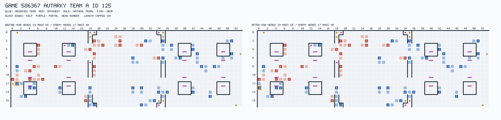

[사실] game632309 Trophy A r38 id8 L3 head(23,19)의 N 한 칸(23,18)에 자연 진주가 있었고, 적 id10 L3 head(0,18)는 wrap W,W로 닿을 수 있었다(d3 1:1·d8 2:2, N1행동). 우리는 S→(23,20), 적은 r38 W→(24,18), r39 W로 진주를 먹었다. 회피 뒤 적 포착을 실제로 연결한 사례지만 N을 먹었다면 안전했다는 반사실 증거는 아니다.

[사실] 보충 action 판면에는 game586370 PD A r53 id8의 E,E,S에서 사체 진주(15,11),(16,11) 두 개를 먹는 N1행동과 game588760 Slithery Fight B r264 id574의 W,S,E에서 사체 진주(31,3)를 먹는 N1행동도 있다. 자연·사체 기제를 구분해 읽었으며 낙하 기원을 자연 공급으로 합치지 않았다. ([586370 전후](../../exp/cutlery/boards/intake-pearl-sprint-pd.png), [588760 전후](../../exp/cutlery/boards/intake-pearl-sprint-sf.png), [원 action registry](../../exp/cutlery/boards/index.json))

[사실] 현재 v1.7은 `myLen+첫 진주≥3`이면 L2의 식사 뒤 2-step을 열거하고, common 2-step은 첫 foodstep 위협을 반복해서 빼지 않는다. SMALL_SPLIT_ON과 SMALL_ALLYBOX_ON도 이미 켜져 있다. 따라서 586367을 “eat-then-sprint 후보가 없음”의 증거로 쓰거나 역사적 우리 온라인 격차를 현재 후보의 동일 결함으로 선언하지 않는다. [가설] 남은 점검 대상은 행동 후 자기 몸을 반영한 endpoint 위협 가격이다. 현재 v1.7에 대한 해당 새 가설의 구현·검증 N은 0이다. ([현재 코드](../../versions/v1.7/bot/plan.cpp), [현재 설정](../../versions/v1.7/bot/params.hpp), [점수 항](../../docs/arch/terms.md))

[사실] 기존 로컬 N438기보에서 s17-base N80의 unsafe-only skip159/210=75.71%, intake1,302/37,518turn=.03470; 생성 소형 v17c-gen N10은51/74=68.92%,412/20,691=.01991이다. 이전 mapgen N48은 지도 인식 끄기 전 smoke이며 오인식15경기가 있어 현재 qualifier 빌드로 부르지 않았다. 로컬 수치는 온라인 상황이 시험 도구에도 있는지의 기제 참고이며 승패·길이·섭취율로 후보 채택하지 않는다. 새 로컬 판은 이 연구에서 N0이다. ([기존 로컬 분리](../../exp/cutlery/intake/tables.json): `localMechanism`)

## C: 안정적인 행동은 후보이며 기하 회귀의 성공과 실패를 함께 봐야 한다

[사실] C는 경기별 scalar side N23,150·고유 경기 N17,125를 보존하며, 각 A family의 10지도 N·평균·SD·CV·범위를 저장했다. 지표별로 기회가 없어 정의되지 않는 게임은 제외하고 해당 gameN을 남겼다. turn 풀, 경기 평균, 지도 균등평균을 섞지 않는다. 다른 팀 비교는 결과·one-free fit·정지 제외를 맞춘 Cutlery 승자 N1,141이며, 아래는 최소 8지도 coverage를 가진 팀 중앙값과 Cutlery의 모든 matched map에서 각 N≥10/N≥50인 팀의 중앙값이다. 작은 표본 C--(id852)의 전체 N10·지도당 N1을 같은 신뢰도의 안정성 근거로 쓰지 않는다. ([C 전표](../../exp/cutlery/geometry/tables.json): `spread`, `outcomeMatchedSpreadComparison`; [팀 계보](../../exp/cutlery/geometry/team-cohort.json))

|승자 지표|Cutlery 경기 N/지도 N; CV|다른 ≥8지도 팀 N; CV 중앙값|모든 matched 지도 N≥10인 팀 N; 중앙값|N≥50 팀 N; 중앙값|
|---|---|---|---|---|
|heads50Carry|1141/10; 0.742|25; 0.705|11; 0.736|5; 0.808|
|splitEligible|1141/10; 0.587|25; 0.618|11; 0.603|5; 0.614|
|pieceMeanLength|1141/10; 0.226|25; 0.156|11; 0.152|5; 0.154|
|pieceL2Share|1141/10; 0.124|25; 0.097|11; 0.097|5; 0.102|
|intakePerMove|1141/10; 0.334|25; 0.396|11; 0.391|5; 0.396|
|naturalPerTurn|1141/10; 0.261|25; 0.320|11; 0.318|5; 0.318|
|allyNearestUncapped50Reached|1124/10; 0.336|24; 0.351|11; 0.356|5; 0.353|
|ramRate/equal\|ahead|988/9; 0.103|21; 0.145|11; 0.139|5; 0.123|
|exposureForcedApprox|1141/10; 0.495|25; 0.695|11; 0.604|5; 0.580|
|sealAlly|1141/10; 1.183|25; 1.101|11; 1.152|5; 1.317|
|pocketNaturalShare|1141/10; 1.157|25; 1.243|11; 1.257|5; 1.243|
|scoutVisibleEnemyFraction|1141/10; 0.590|25; 0.582|11; 0.582|5; 0.565|
|kingEnemyHeads8|1141/10; 0.721|25; 0.864|11; 0.827|5; 1.020|
|concentrationRoundConditional|151/9; 0.100|2; 0.081|0; 결측|0; 결측|

[해석] 동수·우세의 램 CV가 비교팀보다 작다는 것은 일반 교환 원칙의 후보 증거다. L2 share의 안정성은 다른 팀에도 있으므로 Cutlery 고유 비법이 아니다. 머릿수·분열·봉쇄·왕 위험의 CV를 한 개 골라 보편성을 주장하지 않는다. 집중 onset은 승자 조건에서 일부 팀만 8지도 이상의 유효 N을 갖고, 엄격한 모든 지도 N≥10 비교팀은 0이다. 안정성의 낮은 검출력도 결과다.

[사실] 기하 특징은 면적, 주머니 비중, 샘 면적 비중, corridor width, 시작 머리 간 graph 거리다. width는 타일을 지나는 가로·세로 열린 직선 길이 중 작은 값으로, 진짜 bottleneck 폭은 아니다. 포털을 직선 중단으로 보는 민감도도 있다. 주머니는 무방향 2-core이고 startDistance는 방향·포털의 영향을 받는다. Portals의 끊긴 startDistance는 null이며 완전 사례 회귀에서 제외한다. known LOOMO는 한 지도를 빼고 학습·검증하며 inner feature 선택과 outer map 검증을 분리했다. metric마다 남는 지도 N8–10과 생략 사유가 원표에 있다. ([기하 정의·민감도](../../exp/cutlery/geometry/inventory.json), [분석 코드](../../exp/cutlery/geometry/analyse.py), [coverage](../../exp/cutlery/geometry/tables.json): `modelCoverage`)

[사실] 아래는 주 Cutlery의 일부 known 모델과 **실제 7개 맞춤 지도** 외부 검증이다. known은 샘을 포함한 5-feature 후보, custom은 샘 간격 결측 때문에 4-feature 후보를 known에서 선택한 뒤 재적합 없이 적용했다. 상수 baseline의 MAE도 함께 남겼다. custom 승패는 설명용 집단 조건이며 이 회귀의 채택 판정은 아니다.

|지표|known 완전 지도 N; nested MAE/상수 MAE|custom 지도/경기 N; 선택 특징|custom MAE/상수 MAE|
|---|---|---|---|
|intakePerTurn|9; 0.01075/0.01924|7/42; corridorWidthMean|0.01650/0.01762|
|splitEligible|9; 0.18008/0.25119|7/42; area|0.34516/0.24697|
|pieceL2Share|9; 0.08364/0.05817|7/42; area|0.07257/0.09086|
|ramRate/equal\|ahead|9; 0.06351/0.07102|7/40; area|0.17225/0.13900|
|kingEnemyHeads8|9; 1.17559/0.93556|7/42; pocketShare|1.32934/0.81338|

[해석] custom에서는 intake와 L2 share만 이 표의 상수보다 낫고, split·equal ahead ram·king 압력은 더 나쁘다. 작은 선형 모델의 잔차는 지도별 비밀 코드의 증거가 아니다. 상대 구성·공급 시계·몸과 꼬리 변화·정보 시점이 남는다. 면적만으로 머릿수/분열률을 정하는 공식을 복사하지 않는다. 기하 조건 후보는 전체 지형이 실제로 발견·공유된 증거가 생긴 뒤에만 열어야 한다. 샘은 countdown/반복 관측으로 추정해야 하고, retrospective 전판 graph를 spawn 순간의 봇 지식으로 쓰면 안 된다.

[사실] 아군 거리는 머릿수를 통제하면 차이가 거의 사라진다. 지도×r50×머릿수 구간을 맞춘 무상한 최근접 거리는 Cutlery N1,427/우리 N870·18셀·9지도에서 차이 −.0416칸, g+.0177이다. 같은 비교의 r25는+.888칸(N1,433/821·13셀·9지도), r100+.331(N1,228/840·23셀·10지도), r250−.132(N890/465·20셀·8지도)다. [해석] 아군 당김 증가의 근거로 raw cap20 gap을 쓰지 않는다. ([밀도 통제](../../exp/cutlery/audit/cohesion-control.json), [독립 무상한 원계수](../../exp/cutlery/audit/cohesion.json))

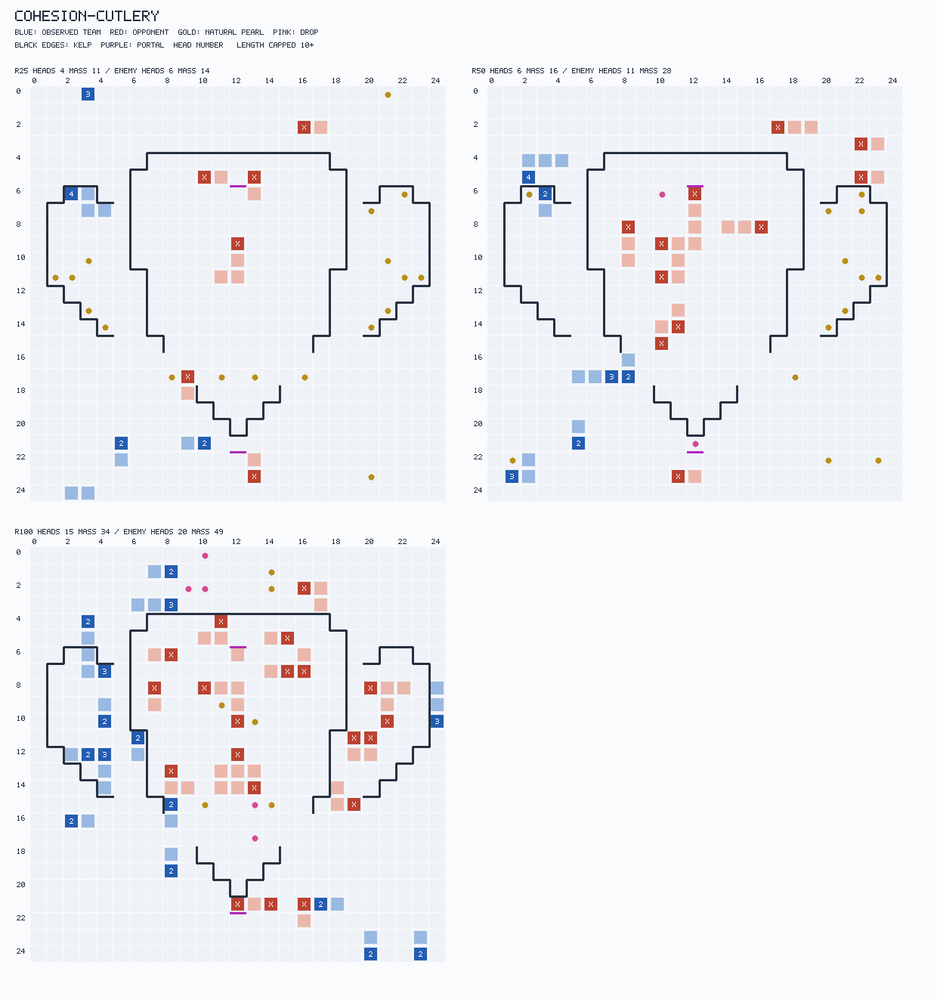

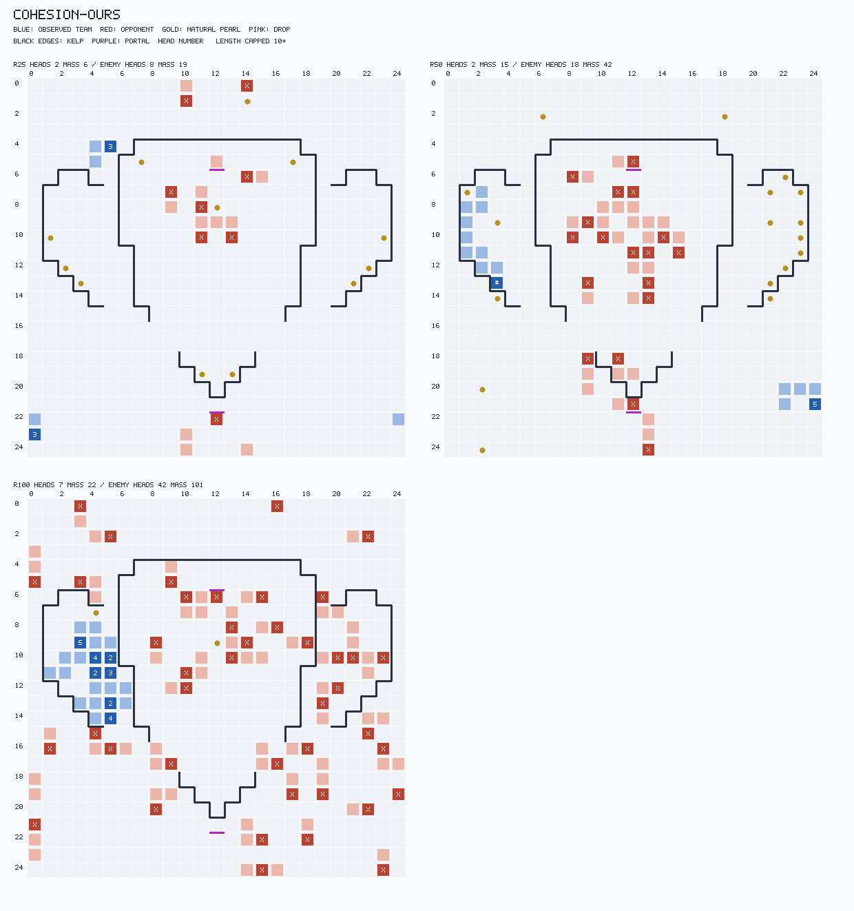

## D: 같은 승자끼리 비교해도 모든 지표에서 Cutlery가 앞서지는 않는다

[사실] source·Trophy·one-free fit·승자를 맞추면 Cutlery N109경기, 다른 승자 N936경기다. 모델 혼합 다른 승자 N948 중 quarter-fit 12경기를 뺐다. 모든 행은 같은 경기 범위이고, 이벤트별 분모는 달라진다. ([엄격 비교](../../exp/cutlery/intake/tables.json): `byMapAndRules.Trophy.110`, `actorVisibility.actorByMapFittedPolicies`, `raceCaptureActions.perMapFittedPolicies`)

|엄격 Trophy 승자 지표|Cutlery: 경기 N109|다른 승자: 경기 N936|
|---|---|---|
|unsafe-only skip/기회|424/1,911=22.19%|3,764/16,538=22.76%|
|양팀 물리 경주 자기 포착/episode|218/399=54.64%|1,718/2,870=59.86%|
|자기 경주 포착 single/sprint/fatal|129/89/59; 포착 N218|1,245/473/265; 포착 N1,718|
|먹고 최종 노출 뒤 ram/추적 N|236/1,057=22.33%|3,486/10,998=31.70%|
|5 actor차례 팀 포착/추적 N|109,691/139,081=78.87%|935,154/1,217,175=76.83%|
|gross intake/turn|34,339/542,239=.06333|285,553/4,908,844=.05817|
|r0–99 intake/turn|13,759/161,409=.08524|110,276/1,335,965=.08254|
|r100–249 intake/turn|16,419/321,290=.05110|139,612/2,852,632=.04894|
|r250–499 intake/turn|4,161/59,540=.06989|35,665/720,247=.04952|

[해석] Cutlery 승자는 다른 승자보다 경주 포착률이 높지 않다. sprint 포착을 자주 쓰지만 포착 뒤 같은 action fatal도 포함한다. pooled의 좋은 수치로 모든 행동을 정당화하지 않고 결과·지도·phase 조건과 실제 판면을 함께 확인한다.

### 패배 937경기는 공급 붕괴와 생존 점수패로 나뉜다

[사실] 주 Cutlery 2,089경기는 승1,152·패937·무0이다. 패937의 배타적 class는 생존 점수패499, r≤100 전멸51, 101–250 전멸240, 251r 이후 전멸147이다. 파일의 `extinct_before100/extinct_100_249/extinct_250plus` 이름은 범위 이름이며 실제 분류 경계는 종료 라운드 기준으로 확인한다. 겹치는 진단은 r50 질량 열세665, 머릿수 열세648, trap proxy 사망 비중≥50%367, head-contact 중 passive≥75%83, 자연 capture 양팀 몫<40%601이다. r50 진단은 도달 경기 조건이며 class를 합산하거나 원인으로 확정하지 않는다. ([패배 분류](../../exp/cutlery/audit/loss-classes.json): `groups.source-primary/*`; [분류 코드](../../exp/cutlery/audit/loss_classes.py))

[사실] top만의 N2,054에서는 패927 중 전멸433·생존494다. 지도별 분모는 아래와 같고 주 source-primary와 혼합하지 않는다. 지도별 승패는 어떤 판면을 읽을지의 조건이다.

|top 지도|전체 경기 N|패 N|전멸 패 N|생존 점수패 N|
|---|---:|---:|---:|---:|
|Devil|194|127|110|17|
|Prisoners Dilemma|197|117|116|1|
|Trophy|183|75|73|2|
|Portals|216|91|0|91|
|Slithery Fight|201|77|0|77|
|Trauma|205|106|1|105|
|Autarky|213|67|18|49|
|Queen Of Spades|211|104|69|35|
|Schooltime|214|69|11|58|
|Default|220|94|35|59|

[사실] 상대별 패배 수가 많은 top 상대는 다음과 같다. 상대 강도·지도 구성·버전 시기와 혼합되므로 해당 이름에 전용 대응을 만들 근거가 아니다. 전체 상대 표는 원표에 있다. ([상대별 표](../../exp/cutlery/audit/losses.json): `groups.top/opponent/*`)

|상대|전체 경기 N|패 N|전멸/생존 패 N|
|---|---:|---:|---|
|forgot to mention|310|174|97/77|
|3.14159265|272|126|58/68|
|Cache me outside|170|92|32/60|
|calc|153|78|40/38|
|Peanut Butter|110|49|24/25|
|Stockfish|100|45|21/24|

[사실] class 중심에 가까운 실제 판면은 Trauma705670 A r50/100/250/499(N1경기, 주 생존 class499), PD733348 B r25/50/65(N1, 초기 전멸 class51), Devil673533 A r25/50/100/150(N1, 중기 class240), Devil707620 B r50/100/250(N1, 후기 class147)이다. 초기 그림 선택 registry에는 top-only class494/236/146가 남아 있으므로 그 선택 N을 주 자료 class N과 바꾸지 않는다. 아래 실제 판면은 공급·머릿수와 긴 조각의 결과를 나눠 보는 사례이며 각각 N1이다.

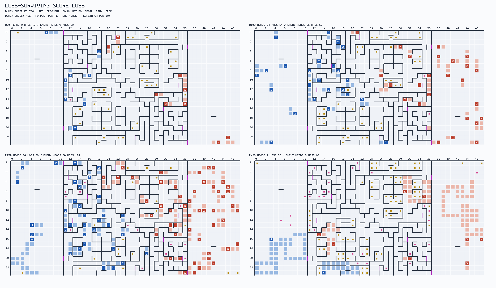

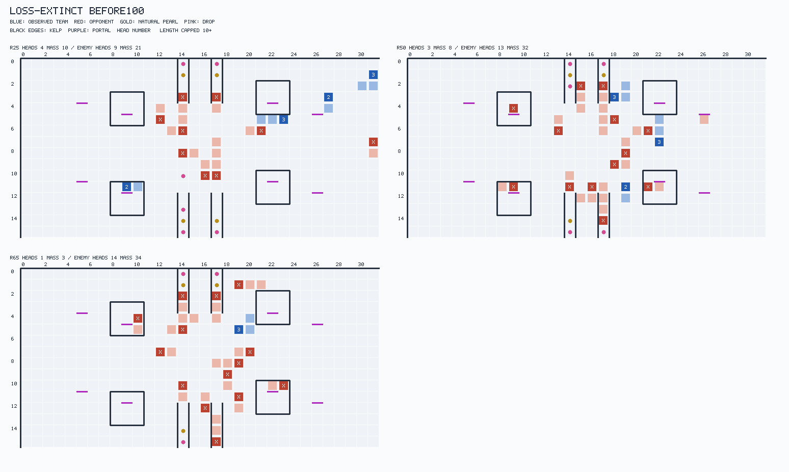

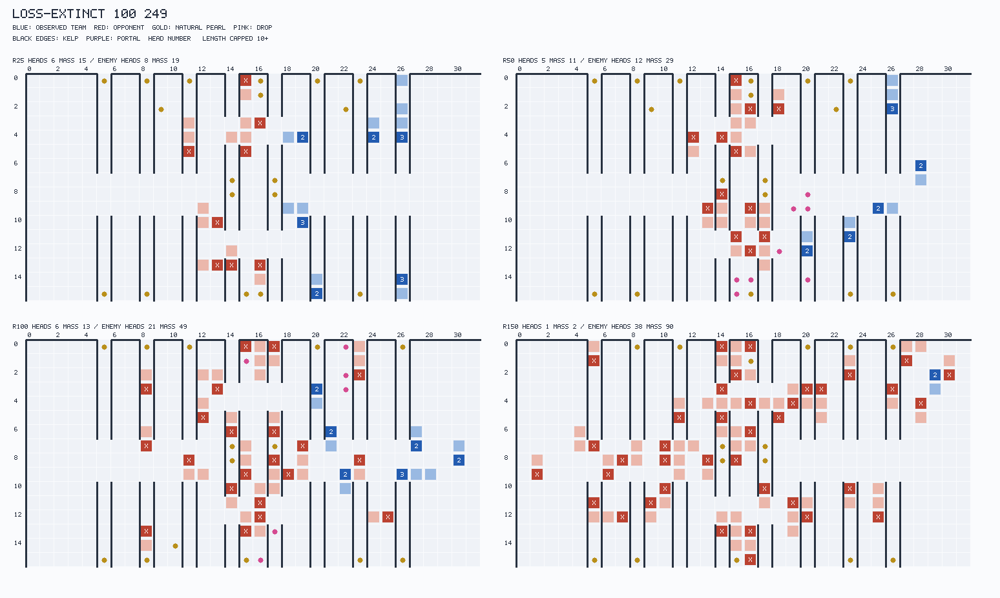

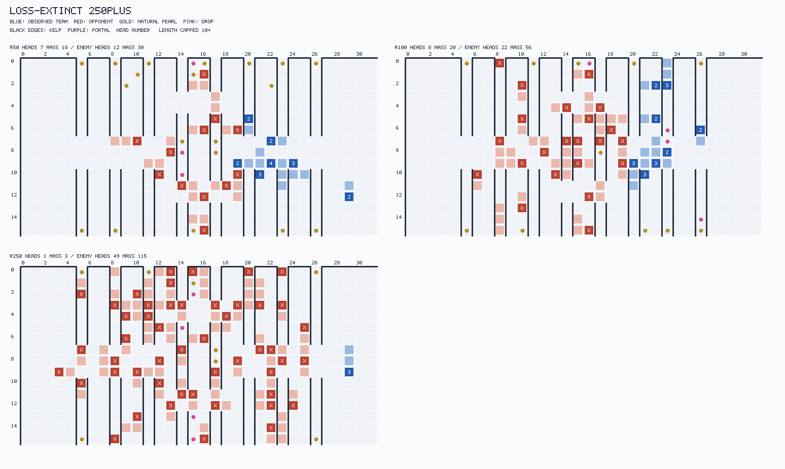

[사실] 실제 sprint custom42는 Australia/Islands/Maze/Stripes/Tower Defense/Around UNSW/weakhold 각 N6이며 기록 승은4/5/5/6/2/5/1이다. 패14 중 전멸5·생존 점수패9다. Tower Defense의 패4는 모두 전멸, weakhold 패5는 모두 생존 점수패다. Tower806972 A vs calc는 r100 머리3/17·질량8/46, r150 2/40·6/92, r190 1/50·2/119 뒤 r196 전멸했다(N1). weakhold806806 A vs Deer Park는 r499 머리5/1·총질량35/26인데 최장 점수에서 졌다(N1). Stripes806579 A vs wawow830은 r50 머리11/3·질량29/8, r10015/9·38/23의 성공 사례(N1)다. 이 그림은 실제 존재 라운드만 포함하며 성공 그림의 r250/499는 조기 종료 뒤 실제 snapshot이 아니다. ([custom metadata·분류](../../exp/cutlery/audit/losses.json), [registry](../../exp/cutlery/boards/index.json))

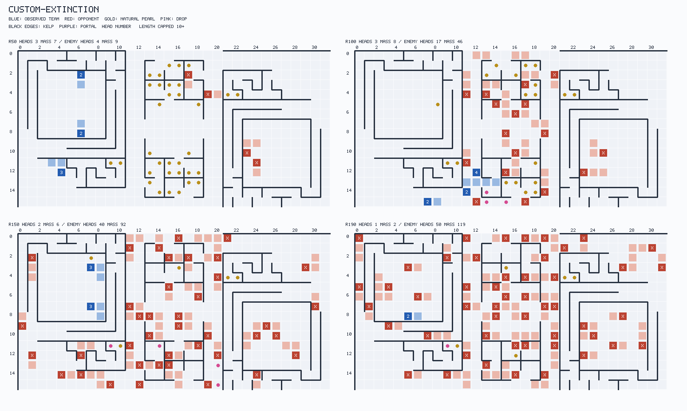

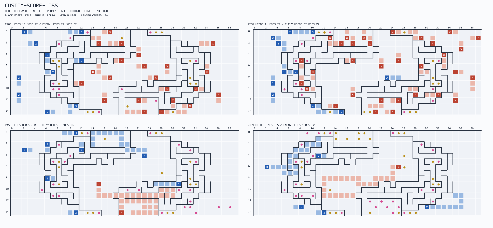

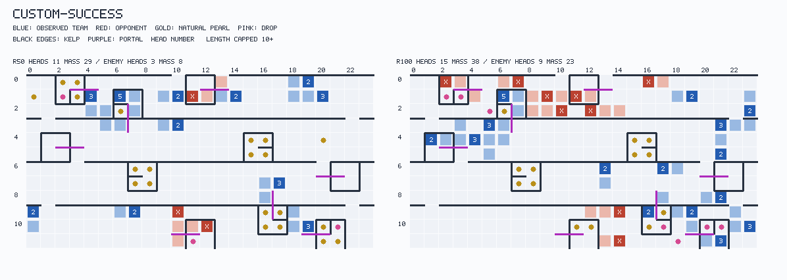

### 원 여왕 사망 96.70%를 새 규칙 패배 예측으로 바꾸지 않는다

[사실] 독립 raw-body N17,125의 원 여왕 식별·checkpoint 대조 결과, 주 Cutlery N2,089의 최종 원 여왕 사망은2,051·생존38이다. 승자1,152 중1,114사망=96.70%, 패937 중937사망이다. custom42 중40사망, custom 승28 중26사망이다. 현재 queen-first 점수를 동일한 역사적 최종 판면에 대입하면 primary 결과가 뒤집히는 사례는5/2,089(game616632/628731/710726/713429/729185), broad all은9/2,311이다. 양쪽 여왕이0이면 최장·총질량 tie-break가 남기 때문이다. ([원 여왕 독립 표](../../exp/cutlery/audit/original-queen.json), [현재 규칙](../../rules/ALL.md))

[해석] 이 재점수는 무료걸음 변경이 궤적에 미치는 효과를 모사하지 않는다. 현재 규칙의 첫 ceil(L/4) free prefix와 미래 상대의 여왕 보존 행동을 검증한 N은0이다. 필요한 전이 조건은 값싼 nonqueen 교환·재생산과 원 여왕 보존을 분리하고 arbitrary longest로의 집중 대신 원 여왕에게 실제 질량이 도달하는지를 측정하는 것이다. 과거96.70%는 그 조건의 중요성을 보여 주며 현재 예상 손실률은 아니다.

## E: 큰 행동 차이 다섯 가족과 반박된 아군 당김

[사실] E는 주 nonstall Cutlery N2,078/우리 N1,260의 경기별 Hedges g를 지도마다 같은 가중으로 평균했다. 지도별 그룹 N≥10, 유효 지도≥5를 요구하고, 사전 나열한 가족 안에서 절대 g가 가장 큰 metric을 고른 **탐색적 순위**다. 상관·가족 최대값 선택·승패 선택이 남는다. 원 rank5인 아군 간격은 위의 무상한 머릿수 통제로 반박되어 제안 다섯째에서 제외하고 원 rank6인 왕 주변을 약한 근거로 넣는다. 재생산의 머릿수와 초기 최장 비중은 하나의 가족으로 묶는다. ([E 원순위·지도 cells](../../exp/cutlery/audit/gaps.json), [머릿수 통제](../../exp/cutlery/audit/cohesion-control.json))

|제안 가족|metric|Cutlery/우리 유효 경기 N; 지도 N|지도 균등 g|지도 균등 절대차|주 차이 방향 지도 N/전체|
|---|---|---|---:|---:|---|
|능동 교환|ramRate/equal\|ahead|1716/607; 9|+3.008|+0.6460|9/9|
|재생산·초반 질량 분산|longestShare25|2078/1260; 10|-2.933|-0.1850|10/10|
|정찰 배치|scoutVisibleEnemyFraction|2078/1259; 10|-1.643|-0.2098|9/10|
|섭취|skipOnlyReachAdjacentCompatibility|1790/753; 9|-1.510|-0.3365|9/9|
|왕 주변|kingEnemyHeads8|2078/1260; 10|-1.196|-1.3428|9/10|

[사실] 이 표의 방향 수는 원 `cells.difference`의 부호를 직접 세었다. 재생산의 초기 최장 비중 차이는 10/10지도에서 같은 부호다. 작은 조각의 적 가시 비율은 Portals가 전체 평균과 반대여서 9/10지도다. 어느 경우도 고정된 전지도 분열률을 식별하지 않는다. 패자끼리도 ram g+2.623(경기N728/574·9지도), splitEligible+2.453(N936/1,110·10), unsafe skip−1.200(N811/709·9), 작은 조각 enemy-visible−1.059(N937/1,110·10), 왕 주변−.645가 있다. 우리 승자 N148은 지도 N 조건을 충족하는 5지도 이상 승자간 가족이0이므로 승자 대조의 검출력이 부족하다. ([패자 비교](../../exp/cutlery/audit/gaps-losses.json), [승자 한계](../../exp/cutlery/audit/gaps-wins.json))

[해석] g는 행동 차이 크기다. 기대 승률·기제 효과·최적 계수·구현 우선순위가 아니다. intake/move g+1.147에도 지도 절대차 균등평균은−.00988이며 Autarky/PD는 반대 방향이다. natural/turn g+.188, safe-adjacent skip g−.096은 큰 일반 섭취 부족 설명을 지지하지 않는다. cap20 아군 거리 g−1.411(N2,078/1,260·10지도)은 머릿수 통제를 통과하지 않았고, 봉쇄 원순위의 방향도 우리 전반적 과다 봉쇄를 지지하지 않는다. ([모든 metric](../../exp/cutlery/audit/gaps.json): `allCandidateMetrics`)

### 실제 판면 다섯 쌍은 차이가 생기는 상태를 보여 준다

[사실] 아래 그림은 각 지도 평균 가까운 기보를 고른 후 읽은 것이다. 첫 줄의 viewer `game`은 `dirname(replay)`의 container battleId이고, 여기의 ID는 replay basename과 battle.json.games로 대조한 실제 gameId다. registry에는 이 구분과 실제 snapshot 라운드를 보강했다. 따라서 그림 헤더의 다른 숫자를 실제 경기 ID로 교체해 해석하지 않는다. ([viewer 코드](../../eval/board.js), [registry](../../exp/cutlery/boards/index.json))

[사실] 재생산의 실제 사례는 592400 B r25/50/100(N1경기)와 우리677083 A r25/50(N1)다. Cutlery는 r25 머리6·질량14, r50 14·37이고 우리는3·7,4·9다. 우리의 r100은 실제 snapshot이 없으므로 해당 판면을 본 것으로 세지 않았다. 이 사례는 섭취·생존·현 공간의 결합이며 분열 명령만 바꾸면 같은 수가 된다는 증거는 아니다.

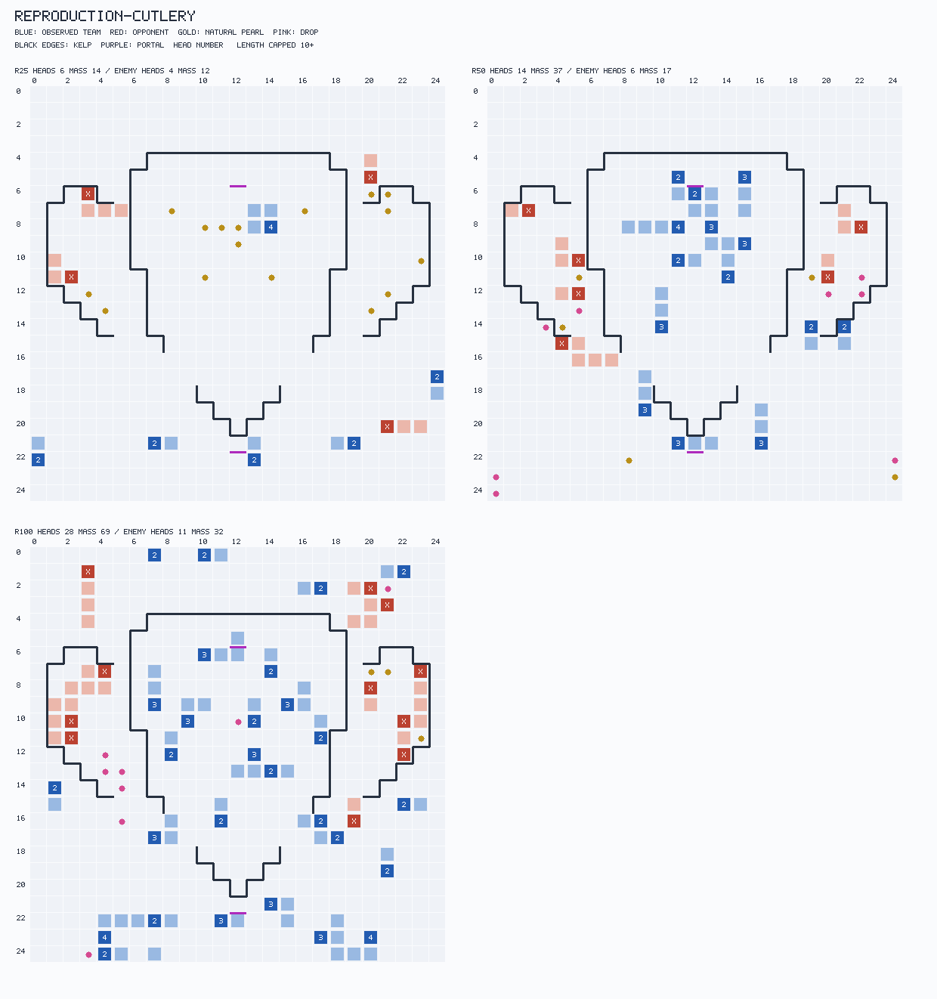

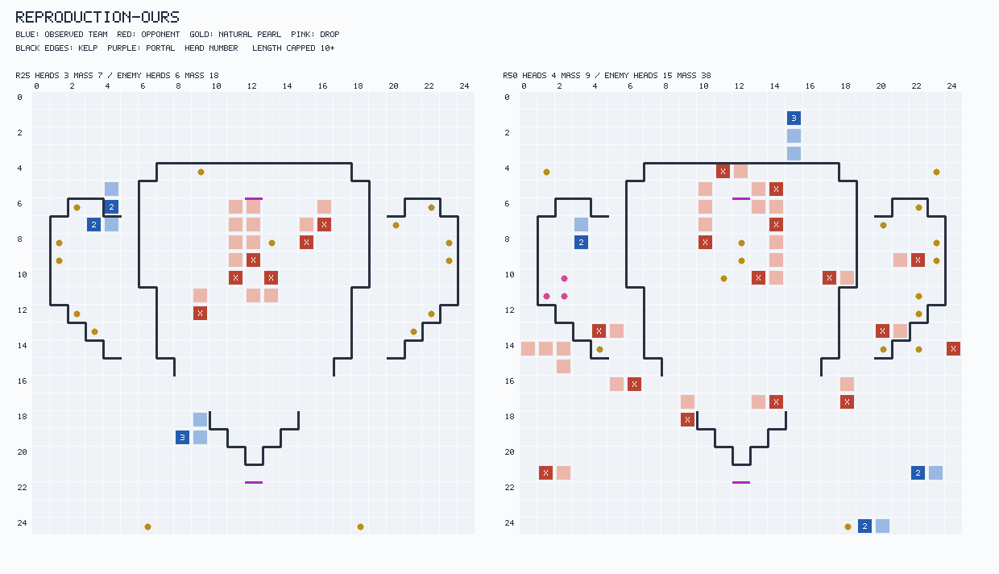

[사실] 능동 교환은 689737 A r50/72/100(N1)와 우리748855 A r50/100/185(N1)다. 직접 시야에서689737 r72 id20 L2(23,13)가 적38 L2(24,13)로 E를 택해 둘이 죽었다(N1행동). 팀 머리23→22·질량52→50, 적14→13·31→29이며 사체 낙하를 남긴다. 원 여왕의 cheap ram으로 일반화하지 않는다.

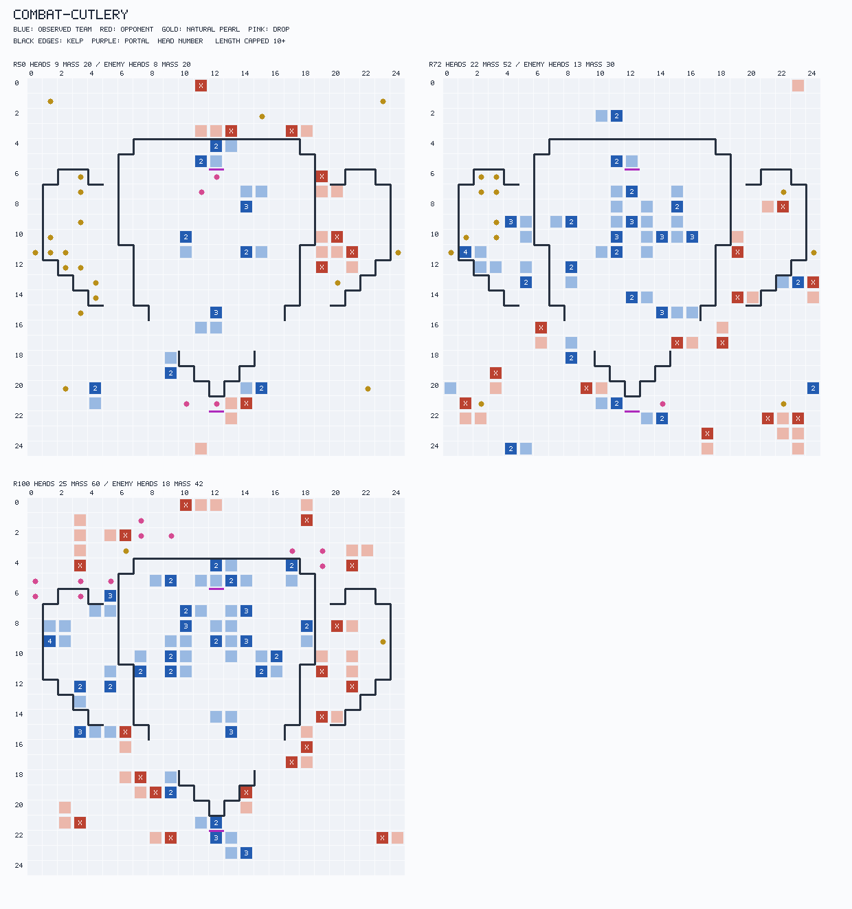

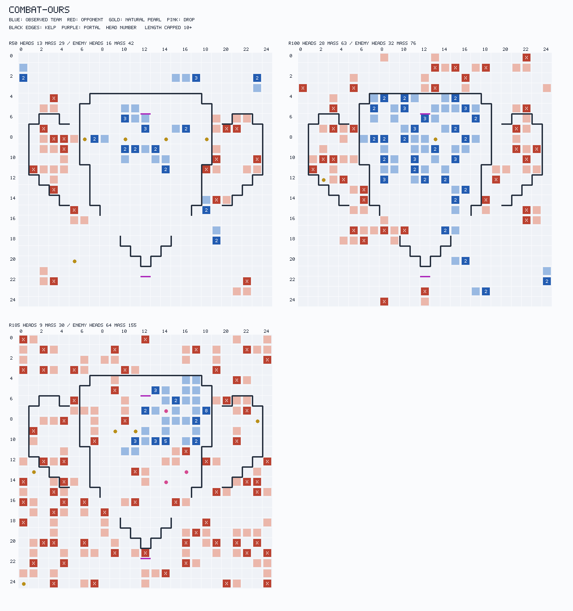

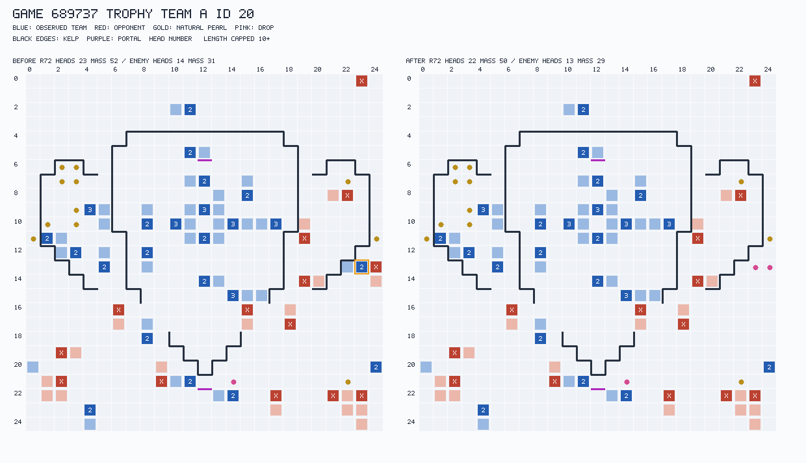

[사실] 작은 조각 배치의752457 A와 우리724088 A는 각각 실제 r50/100(N1경기씩)이며 r250 snapshot은 없다. r50 Cutlery 머리8·질량19 vs 적21·51, 우리는5·14 vs 적12·32다. 이 차이는 적 visibility·공급·머릿수 밀도의 결합이다. 의도적인 scouting이 측정됐다고 부르지 않는다.

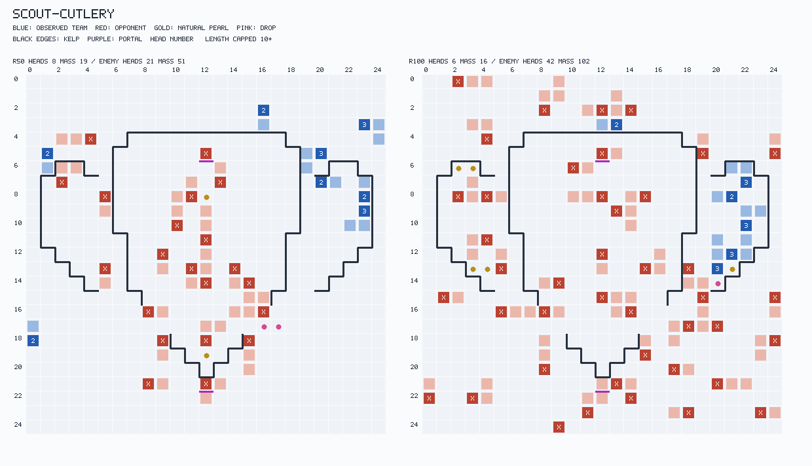

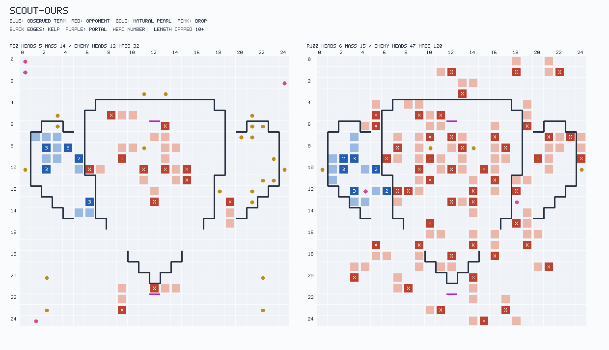

[사실] intake 가족 그림은661410 B의 실제 r50/100/250(N1)와 우리666204 A의 실제 r50(N1)이다. 개별 음식의 사전·사후 판면은 앞의586367/632309 N1행동을 함께 읽는다. 666204의 r100/250은 없는 snapshot이며 살아 있었다고 가정해 보충하지 않는다.

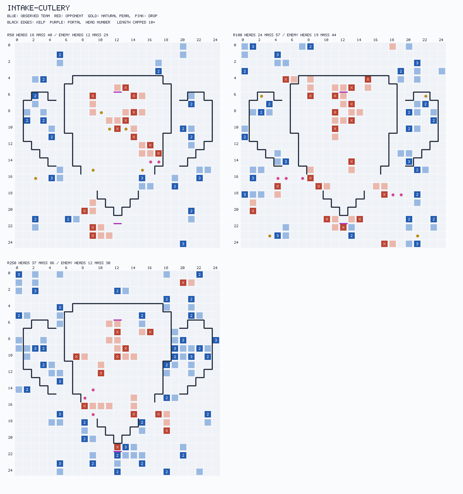

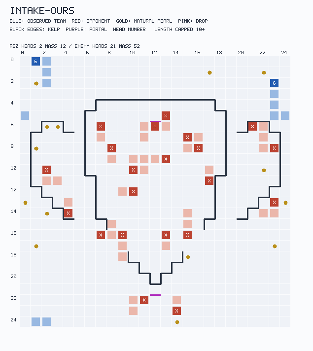

[사실] 왕 주변의687911 A는 실제 r50(N1), 우리724133 A는 r50/100(N1)이다. 전자는 r50 머리1·질량2 vs 적12·32, 후자는10·26 vs 적15·37이다. 작은 생존 집단의 최장 주변 Manhattan 압력이 낮다는 결과를 여왕 안전 전략의 인과 증거로 쓰기 어렵다. 이 다섯째 가족은 coefficient 증대보다 관측 대상·접근성·정보 신선도 검사의 약한 가설로만 남긴다.

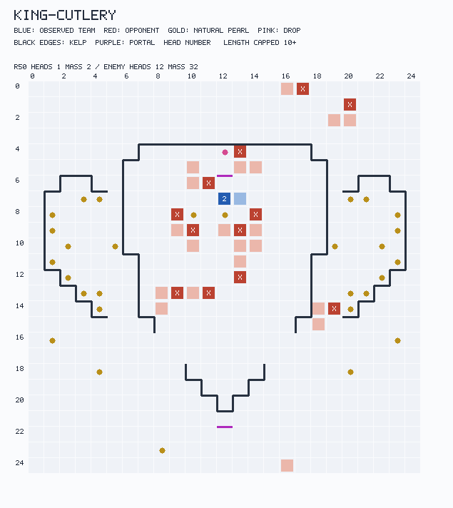

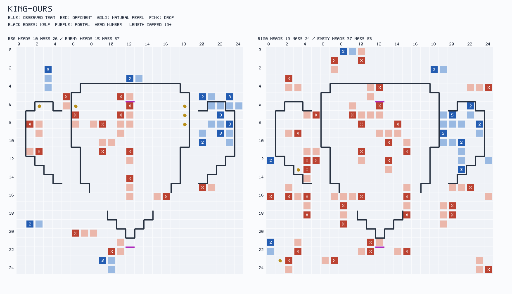

## A·C의 전체 지표를 함께 보면 고정 상수 복사를 피할 수 있다

[사실] 다음은 주 Cutlery known N2,089의 **경기별 지표를 먼저 평균한 지도 평균**의 분산이다. A의 event-pool 평균과 다르다. 각 행의 경기 N은 metric이 정의된 유효 경기, 지도 N은 유효 지도 수다. 평균±SD는 지도에 같은 가중을 둔 값이고 범위는 지도 평균의 min–max다. CV는 SD/mean으로 mean0인 지표는 결측이다. 모든 행의 10지도별 N·평균·SD는 `C.spread.CutleryPrimary.<metric>.maps`에 있고, 경기별 이벤트 분모는 압축 raw 캐시와 A/B 원표에 있다. 도달-only와 최종 이월은 metric 이름에 구분했고, uncapped CP는 앞의 독립 raw 보강이다. ([전체 spread](../../exp/cutlery/geometry/tables.json): `spread.CutleryPrimary`, [A 사건 분모](../../exp/cutlery/profile/tables.json): `source_primary.groups`)

[사실] 마지막 열은 해당 지표를 같은 5개 기하 후보에서 nested feature 선택한 known LOOMO의 MAE/상수 MAE 및 완전 사례 지도 N이다. 포털 startDistance null 등 생략 지도와 fitting 이유는 `modelCoverage.CutleryPrimary.<metric>`에 있다. 이 비교는 전판 연구 기하를 사용한 서술 모델이며 runtime 가용성이나 인과 정책 효과를 증명하지 않는다. 다른 팀 winner/loser의 **같은 모든 지표** spread·min10/min50 비교는 `outcomeMatchedSpreadComparison`에 보존해 놓았으며, 위 표는 가족별 핵심 사례다. ([모든 모델·coverage](../../exp/cutlery/geometry/tables.json): `models.CutleryPrimary`, `modelCoverage`, `outcomeMatchedSpreadComparison`)

|지표|경기 N/지도 N|지도 평균±SD|지도 평균 범위; CV|known LOOMO MAE/상수; 완전 지도 N|
|---|---|---|---|---|
|intakePerTurn|2,089/10|0.08191±0.02022|0.05801–0.1205; 0.247|0.01075/0.01924; 9|
|intakePerMove|2,089/10|0.08677±0.02317|0.05955–0.1306; 0.267|0.01235/0.0223; 9|
|naturalPerTurn|2,089/10|0.04472±0.00963|0.0332–0.06229; 0.215|0.008271/0.00973; 9|
|splitEligible|2,088/10|0.4491±0.2638|0.1414–0.8098; 0.587|0.1801/0.2512; 9|
|pieceMeanLength|2,089/10|3.072±0.6248|2.468–4.138; 0.203|0.2428/0.4701; 9|
|pieceL2Share|2,089/10|0.5601±0.06864|0.4257–0.6742; 0.123|0.08364/0.05817; 9|
|pieceL23Share|2,089/10|0.8774±0.08232|0.7099–0.9597; 0.094|0.04735/0.07295; 9|
|allyNear3|2,089/10|0.5316±0.1419|0.3425–0.7435; 0.267|0.1209/0.1332; 9|
|allyDistanceConditional|2,089/10|4.15±0.9685|2.946–5.763; 0.233|0.8862/0.9309; 9|
|aloneShare|2,089/10|0.014±0.02129|0–0.0688; 1.521|0.01882/0.01724; 9|
|exposureReach|2,089/10|0.01989±0.01154|0–0.03329; 0.580|0.01531/0.008341; 9|
|exposureAvoidable|2,089/10|0.01274±0.007593|0–0.02235; 0.596|0.008229/0.005187; 9|
|exposureForcedApprox|2,089/10|0.007149±0.004352|0–0.01315; 0.609|0.007036/0.003396; 9|
|ramAfterReach|1,860/9|0.2025±0.06201|0.1254–0.3007; 0.306|0.07117/0.05541; 9|
|sealAlly|2,089/10|0.004293±0.004071|0.0003804–0.01306; 0.948|0.003062/0.003085; 9|
|boxAlly|2,089/10|0.02044±0.01366|0.003761–0.04666; 0.668|0.008452/0.008751; 9|
|pocketTurnsShare|2,089/10|0.0405±0.04874|0–0.1457; 1.204|0.03756/0.042; 9|
|pocketNaturalShare|2,088/10|0.2646±0.3109|0–0.8499; 1.175|0.3446/0.2914; 9|
|fountainTurnsShare|2,089/10|0.05072±0.0498|0–0.1498; 0.982|0.0203/0.04436; 9|
|fountainNear3Share|2,089/10|0.1946±0.2426|0–0.7589; 1.247|0.05333/0.1383; 9|
|fountainNaturalShare|2,088/10|0.4676±0.4108|0–1; 0.878|0.3785/0.3879; 9|
|scoutKingDist|2,089/10|13.25±4.533|7.536–22.11; 0.342|1.366/4.121; 9|
|scoutQueenDist|2,089/10|26.59±2.462|22.54–29.95; 0.093|2.823/2.256; 9|
|scoutEnemyDist|2,089/10|8.189±1.813|4.726–10.45; 0.221|1.393/1.316; 9|
|scoutFountainDist|2,088/10|17.58±11.74|2.621–30; 0.668|10.36/11.56; 9|
|scoutNearKing3|2,089/10|0.105±0.07888|0.01677–0.2381; 0.751|0.1192/0.08025; 9|
|scoutNearEnemy3|2,089/10|0.1827±0.09713|0.07454–0.3812; 0.532|0.06734/0.05896; 9|
|scoutNearFountain3|2,088/10|0.1838±0.2386|0–0.7518; 1.298|0.03841/0.1246; 9|
|budgetAbove6Share|2,089/10|0.03352±0.02889|0.001972–0.08551; 0.862|0.00827/0.02542; 9|
|concentrationObserved|2,089/10|0.256±0.1794|0.01478–0.6126; 0.701|0.2392/0.1234; 9|
|heads25Carry|2,089/10|9.276±7.766|3.93–29.51; 0.837|5.871/6.454; 9|
|heads25Reached|2,087/10|9.275±7.766|3.934–29.51; 0.837|5.873/6.455; 9|
|longestShare25|2,089/10|0.2135±0.07516|0.1025–0.3379; 0.352|0.07023/0.06951; 9|
|mass25Carry|2,089/10|23.36±21.46|10.17–80.19; 0.919|16.22/17.52; 9|
|queenLength25Carry|2,089/10|1.487±1.089|0–2.678; 0.733|0.9012/1.027; 9|
|heads50Carry|2,089/10|14±11.97|5.786–46.58; 0.855|15.36/9.106; 9|
|longestShare50|2,089/10|0.1723±0.08072|0.06941–0.3525; 0.469|0.07089/0.06677; 9|
|mass50Carry|2,089/10|35.21±32.18|14.66–123.3; 0.914|28.11/24.22; 9|
|queenLength50Carry|2,089/10|1.111±0.869|0–2.115; 0.782|0.8706/0.861; 9|
|heads100Carry|2,089/10|22.32±14.66|6.179–58.38; 0.657|18.73/11.81; 9|
|longestShare100|2,089/10|0.1352±0.08684|0.05154–0.3473; 0.642|0.112/0.0745; 9|
|mass100Carry|2,089/10|57.3±42.73|15.46–165.7; 0.746|53.73/33.86; 9|
|queenLength100Carry|2,089/10|0.6476±0.6254|0–1.763; 0.966|0.6916/0.5586; 9|
|heads250Carry|2,089/10|29.75±16.59|6.896–62.73; 0.557|23.03/14.66; 9|
|longestShare250|2,089/10|0.1072±0.06542|0.05184–0.2809; 0.610|0.02673/0.02228; 9|
|mass250Carry|2,089/10|87.99±63.54|17.28–223.2; 0.722|41.11/55.09; 9|
|queenLength250Carry|2,089/10|0.08869±0.09474|0–0.2634; 1.068|0.09283/0.07646; 9|
|heads500Carry|2,089/10|14.48±8.367|2.806–28.73; 0.578|8.098/7.31; 9|
|longestShare500|2,089/10|0.3±0.2273|0.04444–0.8074; 0.758|0.2125/0.1332; 9|
|mass500Carry|2,089/10|84±64.21|16.91–208.8; 0.764|26.79/55.72; 9|
|queenLength500Carry|2,089/10|0.04886±0.08375|0–0.2634; 1.714|0.083/0.06798; 9|
|splitPerTurn/0-49|2,089/10|0.04309±0.01394|0.02509–0.07365; 0.323|0.01224/0.01149; 9|
|intakePerTurn/0-49|2,089/10|0.09±0.03097|0.04726–0.156; 0.344|0.03225/0.0268; 9|
|deathShare/ram|2,089/10|0.1986±0.1341|0–0.4573; 0.675|0.09668/0.09501; 9|
|deathShare/trap|2,089/10|0.5019±0.2159|0.1481–0.8054; 0.430|0.1813/0.1788; 9|
|scoutVisibleEnemyFraction|2,089/10|0.322±0.1432|0.1538–0.6175; 0.445|0.09763/0.08534; 9|
|pieceLengthQ10|2,089/10|2±0|2–2; 0.000|0/0; 9|
|pieceLengthQ25|2,089/10|2.005±0.01002|2–2.028; 0.005|0.01316/0.008962; 9|
|pieceLengthQ50|2,089/10|2.239±0.318|2–2.99; 0.142|0.413/0.2862; 9|
|pieceLengthQ75|2,089/10|3.18±0.4008|2.868–3.945; 0.126|0.1856/0.3703; 9|
|pieceLengthQ90|2,089/10|4.287±1.364|3.016–6.482; 0.318|0.4329/1.107; 9|
|deathShare/sac|2,089/10|0.1006±0.07282|0.008081–0.2264; 0.724|0.1/0.05937; 9|
|deathShare/rammed|2,089/10|0.1638±0.109|0–0.3259; 0.666|0.1347/0.08558; 9|
|deathShare/enemyBody|2,089/10|0.003474±0.006461|0–0.01889; 1.860|0.005829/0.005624; 9|
|deathShare/allyHead|2,089/10|0.03169±0.03636|0–0.1213; 1.147|0.03397/0.02988; 9|
|deathShare/fault|2,089/10|4.75e-07±1.502e-06|0–4.75e-06; 3.162|1.102e-06/1.056e-06; 9|
|deathShare/sprintDeath|2,089/10|0±0|0–0; 결측|0/0; 9|
|ramOpportunityPerTurn/longer\|outnumbered|2,089/10|0.006616±0.004525|0–0.01385; 0.684|0.004257/0.003694; 9|
|ramOpportunityPerTurn/longer\|even|2,089/10|0.004115±0.003014|0–0.009572; 0.732|0.002518/0.002708; 9|
|ramOpportunityPerTurn/longer\|ahead|2,089/10|0.004299±0.003399|0–0.01257; 0.791|0.00237/0.002431; 9|
|ramRate/equal|1,846/9|0.396±0.04209|0.3424–0.4802; 0.106|0.028/0.03397; 9|
|ramRate/equal\|outnumbered|1,688/9|0.09515±0.04739|0.04272–0.1762; 0.498|0.03554/0.04441; 9|
|ramOpportunityPerTurn/equal\|outnumbered|2,089/10|0.0048±0.004684|0–0.01378; 0.976|0.005039/0.004018; 9|
|ramOpportunityPerTurn/equal\|even|2,089/10|0.001799±0.001399|0–0.003993; 0.778|0.001586/0.001174; 9|
|ramOpportunityPerTurn/equal\|ahead|2,089/10|0.001549±0.000946|0–0.002599; 0.611|0.0003679/0.0007607; 9|
|ramRate/shorter|1,728/9|0.514±0.08143|0.3716–0.6212; 0.158|0.04093/0.06684; 9|
|ramOpportunityPerTurn/shorter\|outnumbered|2,089/10|0.0009345±0.0008352|0–0.002308; 0.894|0.00117/0.0007576; 9|
|ramOpportunityPerTurn/shorter\|even|2,089/10|0.0005708±0.0003202|0–0.0009587; 0.561|0.0002754/0.0002467; 9|
|ramRate/shorter\|ahead|1,497/9|0.7133±0.1635|0.4409–0.9683; 0.229|0.07885/0.1421; 9|
|ramOpportunityPerTurn/shorter\|ahead|2,089/10|0.0007144±0.0003476|0–0.001148; 0.487|0.000229/0.0002267; 9|
|kingEnemyHeads3|2,089/10|0.2664±0.1839|0.06607–0.6345; 0.690|0.1409/0.1237; 9|
|queenEnemyHeads3|2,089/10|0.1742±0.17|0–0.4748; 0.976|0.1826/0.147; 9|
|kingEnemyHeads5|2,089/10|0.7925±0.4582|0.2399–1.592; 0.578|0.5685/0.3539; 9|
|queenEnemyHeads5|2,089/10|0.4445±0.4019|0–1.299; 0.904|0.3747/0.343; 9|
|kingEnemyHeads8|2,089/10|2.205±1.184|0.8188–4.309; 0.537|1.176/0.9356; 9|
|queenEnemyHeads8|2,089/10|1.163±0.9781|0.02874–3.124; 0.841|0.7689/0.8472; 9|
|allyNearestUncapped25Reached|2,085/10|6.251±2.687|3.258–12.35; 0.430|2.226/2.217; 9|
|allyNear3At25Reached|2,087/10|0.3178±0.1786|0.05806–0.6344; 0.562|0.1286/0.1523; 9|
|aloneHeadShareAt25Reached|2,087/10|0.001038±0.002189|0–0.005376; 2.110|0.00197/0.002018; 9|
|allyNearestUncapped500Reached|1,474/10|6.381±2.233|2.943–9.331; 0.350|1.77/2.145; 9|
|allyNear3At500Reached|1,651/10|0.3496±0.2092|0.1013–0.7517; 0.598|0.1667/0.1778; 9|
|aloneHeadShareAt500Reached|1,651/10|0.09904±0.1173|0–0.3919; 1.184|0.05867/0.05956; 9|
|skipOnlyReachAdjacentCompatibility|1,798/9|0.2545±0.03228|0.2043–0.2978; 0.127|0.03201/0.02987; 9|
|skipSafeAdjacent|2,089/10|0.1761±0.1399|0.02107–0.4691; 0.794|0.09259/0.1008; 9|
|ownDropPerTurn|2,089/10|0.03087±0.01242|0.01821–0.05488; 0.402|0.002811/0.009941; 9|
|ownDropPerMove|2,089/10|0.0328±0.01379|0.01875–0.05948; 0.421|0.003317/0.01125; 9|
|enemyDropPerTurn|2,089/10|0.006321±0.003956|0–0.01412; 0.626|0.004491/0.002726; 9|
|enemyDropPerMove|2,089/10|0.006676±0.004284|0–0.01546; 0.642|0.004867/0.002983; 9|
|heads50Reached|2,065/10|14.02±11.97|5.789–46.58; 0.854|15.38/9.096; 9|
|heads100Reached|1,952/10|22.22±14.7|5.57–58.36; 0.662|18.73/11.8; 9|
|splitPerTurn/50-99|2,065/10|0.03356±0.008071|0.02442–0.0517; 0.241|0.003185/0.006752; 9|
|intakePerTurn/50-99|2,065/10|0.08256±0.02095|0.0604–0.1272; 0.254|0.01895/0.01745; 9|
|splitPerTurn/100-249|1,952/10|0.02854±0.006329|0.02143–0.03954; 0.222|0.003171/0.005366; 9|
|intakePerTurn/100-249|1,952/10|0.07449±0.02186|0.04851–0.1206; 0.293|0.01613/0.01804; 9|
|ramRate/longer|1,833/9|0.175±0.06503|0.06944–0.256; 0.372|0.04228/0.06053; 9|
|ramRate/longer\|outnumbered|1,693/9|0.02941±0.02228|0.01194–0.07509; 0.758|0.03182/0.01899; 9|
|ramRate/longer\|even|1,735/9|0.07585±0.05109|0.02384–0.159; 0.674|0.07607/0.04638; 9|
|ramRate/longer\|ahead|1,709/9|0.3981±0.1735|0.1295–0.6434; 0.436|0.1328/0.16; 9|
|ramRate/equal\|even|1,706/9|0.382±0.0436|0.2874–0.4319; 0.114|0.07812/0.03495; 9|
|ramRate/equal\|ahead|1,720/9|0.7394±0.07311|0.6308–0.8124; 0.099|0.06351/0.07102; 9|
|ramRate/shorter\|outnumbered|1,275/9|0.1793±0.07995|0.1033–0.357; 0.446|0.05816/0.06673; 9|
|ramRate/shorter\|even|1,381/9|0.5412±0.1268|0.2766–0.7055; 0.234|0.1249/0.1054; 9|
|allyNearestUncapped50Reached|2,044/10|4.994±1.673|2.746–8.512; 0.335|1.79/1.42; 9|
|allyNear3At50Reached|2,065/10|0.3984±0.1737|0.1454–0.7634; 0.436|0.1454/0.1489; 9|
|aloneHeadShareAt50Reached|2,065/10|0.01116±0.02699|0–0.08649; 2.418|0.02066/0.01896; 9|
|allyNearestUncapped100Reached|1,895/10|4.278±1.197|2.7–6.21; 0.280|1.185/1.093; 9|
|allyNear3At100Reached|1,952/10|0.4963±0.1795|0.2333–0.7773; 0.362|0.15/0.1486; 9|
|aloneHeadShareAt100Reached|1,952/10|0.0447±0.1149|0–0.3684; 2.569|0.09805/0.07969; 9|
|heads250Reached|1,431/10|28.68±16.31|14.07–62.72; 0.569|10.61/15.41; 9|
|splitPerTurn/250-349|1,430/10|0.02344±0.006701|0.0167–0.0356; 0.286|0.004111/0.004421; 9|
|intakePerTurn/250-349|1,430/10|0.07344±0.02289|0.03978–0.1147; 0.312|0.01731/0.01561; 9|
|splitPerTurn/350-500|1,215/10|0.0196±0.006461|0.01154–0.02985; 0.330|0.004538/0.006244; 9|
|intakePerTurn/350-500|1,215/10|0.0963±0.03162|0.07123–0.1726; 0.328|0.02584/0.0276; 9|
|allyNearestUncapped250Reached|1,396/10|3.819±0.8675|2.76–5.038; 0.227|0.8428/0.8932; 9|
|allyNear3At250Reached|1,431/10|0.5512±0.1334|0.3638–0.7757; 0.242|0.1029/0.1324; 9|
|aloneHeadShareAt250Reached|1,431/10|0.07798±0.1267|0–0.4; 1.625|0.1377/0.1077; 9|
|concentrationRoundConditional|541/10|323.2±91.15|159.5–450; 0.282|110.1/91.28; 9|

## 실행 중 일반 규칙은 계수 추정값이 아니라 기제 가설로 끝낸다

[가설] 아래 표는 처음 보는 지도에서 현 시야·자기 몸·신선한 아군 소식·발견된 지형으로 계산할 사전 등록 후보다. 모든 행의 새 규칙 구현·인과 대전 검증 N은0이며 승률 향상 주장이 아니다. 현재 설정과 이미 있는 열거·기능을 먼저 대조하고, 스위치 off 사건 동일성·오류·CPU·실제 판면의 상태 변화를 확인해야 한다. 기존 로컬 N438은 기제 참고이며 채택 근거는 아니다. ([개발·판정 원칙](../../AGENTS.md), [W16/W11/W10/W7 큐](../../docs/WORKQUEUE.md), [점수 항 정의](../../docs/arch/terms.md))

[사실] 크기 비교는 점수식의 정적 예시다. 확정 natural food는+1, TG/T1/T2는30/24 규모이고 long factor .2를 적용한24는4.8이다. queen/king floor의 d3→4 개선은+18, 목표 당김은 .4/칸이다. 아래 ±값은 이 정적 크기와 비교한 후보 범위이며 관측 데이터에서 추정한 최적 계수가 아니다. paid sprint의1.6→1.0은 지불 칸마다+.6이지만, 새 free prefix는 cost0으로 별도 계산해야 한다. 구 Cutlery 자료는 quarter-free에서의 최적 행동을 검증하지 않았다. ([정적 계산·적용 행](../../docs/arch/terms.md), [현재 이동 규칙](../../rules/ALL.md))

[해석] 이 연구가 남기는 선택 기준은 관측된 상태에서 발동하고 의도한 상태 변화가 실제 판면에 생기는지다. 초기 분산·교환·회수는 여왕 생존과 양립하는 형태로만 전이할 수 있다. 고정 지도 상수, 숨은 공급 표, 원 여왕 희생, 단순 집중 비중 상승은 처음 보는 지도의 일반 원칙으로 채택하지 않는다.

|원칙·모든 변경은 [가설]|증거와 N|지도 일반성 판정|planner 항·대략 변화|예상 **기제** 변화와 확인할 제한|
|---|---|---|---|---|
|보이는 작은 nonqueen의 동수·우세 교환|equal\|ahead g+3.008, 경기N1,716/607·9지도;689737 r72 L2대L2 직접 행동N1|지도 무관 후보, 시야·길이·현지 균형 조건|`tradeValue/KILL` diff≥3·ratio≥2 gate와 `SMALLRAM`을 대조; 관측된 equal target 기본0→상황부+4…12 후보, 불리한 LNT veto 유지|값싼 조각으로 적 머리 감소와 실제 적 사체 접근 확인. **원 여왕 제외**; 실제 전판 enemyLen을 봇 belief로 가져오지 않음|
|먹을 공간이 있는 초기 재생산|longestShare25 g−2.933, N2,078/1,260·10지도;592400/677083 각N1;custom split MAE .34516>.24697, N42|지도 무관 후보; area 하나의 고정 공식은 지지되지 않음|split은 MOVE override gate이므로 가산점 Δ0; cap·clock·child-room·공급 관문 점검; 현재 `SMALL_SPLIT_ON=true`와 중복하지 않음|살아 있는 food actor-turn 증가 여부, 자식 공간·원 여왕 길이 보존 확인. 원 여왕의 값싼 분열 제외; 현재 역사적 gap 잔존 검증N0|
|작은 조각의 공급 연결과 관측 임무 배치|enemy-visible g−1.643, N2,078/1,259·10지도;752457/724088 각N1;적사체 5actor창 C161,426/1,085,461·우리8,707/287,142|기하·관측 공급 조건; 정찰 의도는 지지되지 않음|발견된 공급 목표 leaf 거리 .1… .3/칸 후보; 이미 `grab` source1.5→2.0이면 p1·거리2에서 Δ+.3872; grab의 contest 생략은 기존 기능|임의 왕/전선 군집 대신 실제 음식·사체 회수로 이어지는 위치 확인. enemy-visible 감소 자체를 성공 판정으로 쓰지 않음|
|식사 뒤 안전 끝점의 자기 몸을 평가|unsafe skip g−1.510, N1,790/753·9지도;Trophy299/78,406기회;586367 자연 행동N1, exposed-pearl→safe ram19/3,311추적N|기하·행동 후 몸 조건|`threatAt/TG`에서 neck로 완전히 막힌 경로만30/24→0; 잔여 endpoint/future threat는 상황부1…3/.8…2 범위 후보. 현재 common2step 첫food 위협 생략은 이미 있음|있는 eat-then-sprint 후보의 가격을 실제 몸·id 순서와 맞춤. 전역 T1/T2 일괄 감소는 지지되지 않음; 원 여왕에는 별도 보수 관문|
|최장/원 여왕 압력은 접근 가능한 적으로 확인|kingEnemyHeads8 g−1.196, N2,078/1,260·10지도;패자 g−.645;687911/724133 각N1|약한 기하 조건 후보; 여왕 보존 상대 전이N0|기존 floor+18·king threat×1.5 규모 Δ0; 목표를 원 여왕으로 식별하고 graph 접근성·최신 정보 검사|Manhattan 가까움과 실제 공격 가능성을 분리. **원 여왕을 cheap ram/split/sac에서 제외하고 집중 질량의 목적지로 고정**|
|현재 자기 차례에 가능한 음식과 나중 ETA를 분리|Trophy 자기 시야 경로+적전체몸 C승N228·우리N97;엄격 C 경주218/399·다른1,718/2,870|지도 무관 실행순서 + 기하 조건|`CONTEST_ENEMY_CLOSER` .15→.9는 당장 완료 가능한 관측 경로에만; p1·거리3에서Δ+.5111, `ce` .3→.9이면Δ+.4089|serial-action에서 지금 획득 가능한 음식의 가격 회복. 먹고 끝난 위치의 ram 위험과 fatal capture를 별도 확인|
|실제 free/paid 걸음으로 sprint 가격 계산|one-free 적합 C주N2,089;Trophy paid segment C2,293·우리1,123;새 quarter transfer 검증N0|지도 무관 규칙·현재 L·경로 섭취 조건|`SPRINT_COST` paid1.6→1.0이면+.6/칸;ceil(L/4) free prefix 비용0, 행동 시작 L와 중간 식사 은행을 반영|무료 이동을 유료로 가격 매기는 문제 및 지불 소진을 점검. sprint 증가 자체를 경주 안전의 근거로 삼지 않음|
|샘 pull보다 생성 커버리지·body 차폐를 점검|near3 turn C4,237,459/17,417,763·우리858,250/3,526,420;성공샘spawn348,884/991,298 대70,195/462,081|관측 생성 타일·기하 조건; countdown 기다림은 식별불가|`FOUNTAIN_VALUE .9` 전체증대 Δ0;unknown F0에도 next-spawn body 차폐 `sc .5` 후보 −.5/추가칸, 여왕 식사 경로 예외 검증|중복 정착·생성 칸 차폐 감소와 head 커버리지 확인. 실패한 spawn이 안 보이는 성공 조건부 편향을 분리|
|후기 집중을 원 여왕의 실제 성장으로 측정|C승onset153/1,152 중성장+감소148·급식동반145;C패순수감소173/388;우리순수감소284/574|지도 무관 목표 후보; 고정 전환 라운드는 지지되지 않음|`CONV/feeding`의 대상·수신 확인 관문, 가산점Δ0;arbitrary longest 대신 원 여왕으로 경로/낙하 도달 확인|비중만 상승하는 다른 조각 붕괴와 여왕 실제 섭취·성장을 분리. 원 여왕은 희생 대상에서 제외|
|아군 거리 자체를 줄이는 attraction은 보류|r50 head-bin C1,427/우리870·18셀·9지도,거리−.0416·g+.0177|현재 근거로 지지되지 않음|cohesion attraction Δ0|머릿수 증가의 밀도 효과를 당김 정책 효과로 오인하지 않음|
