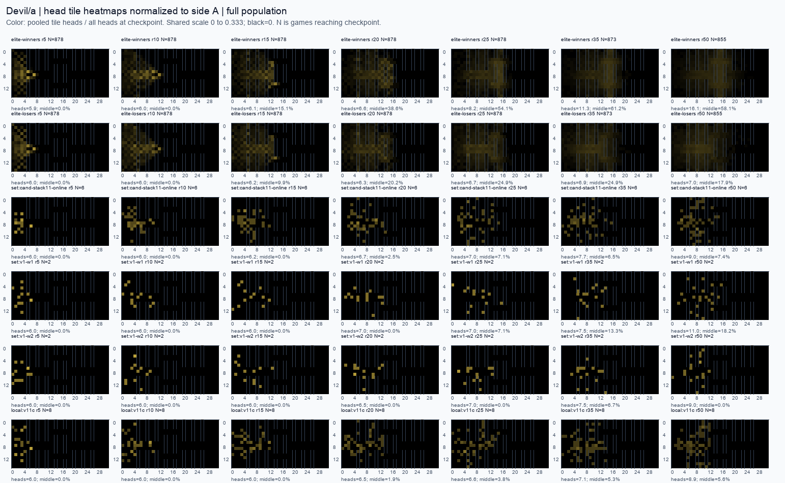
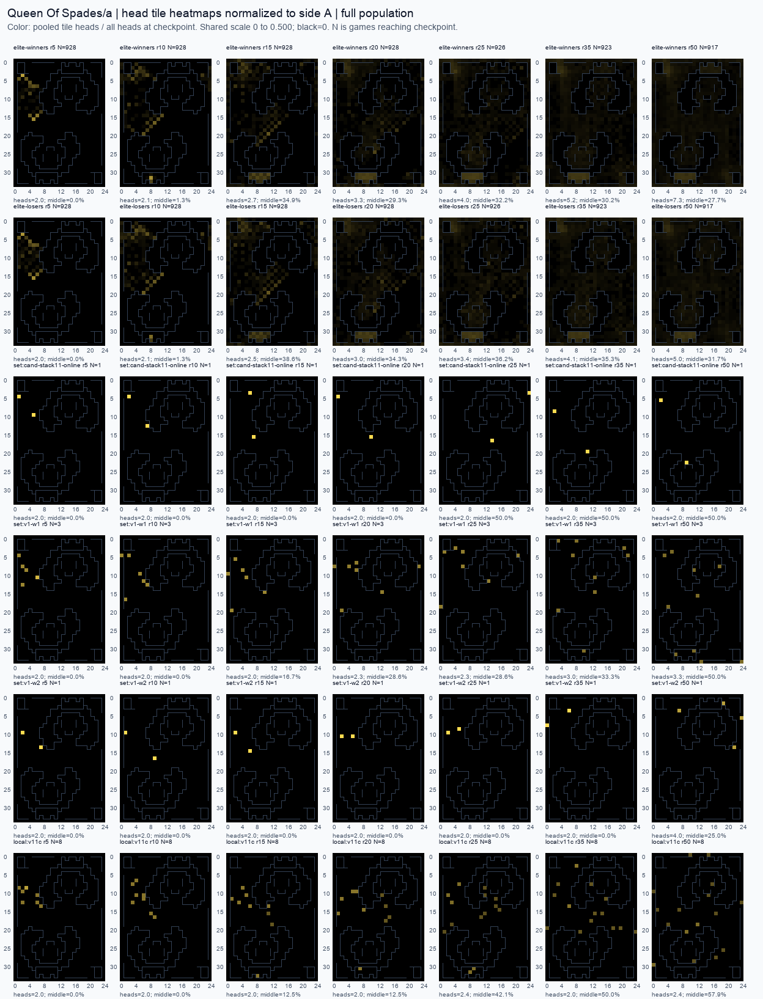
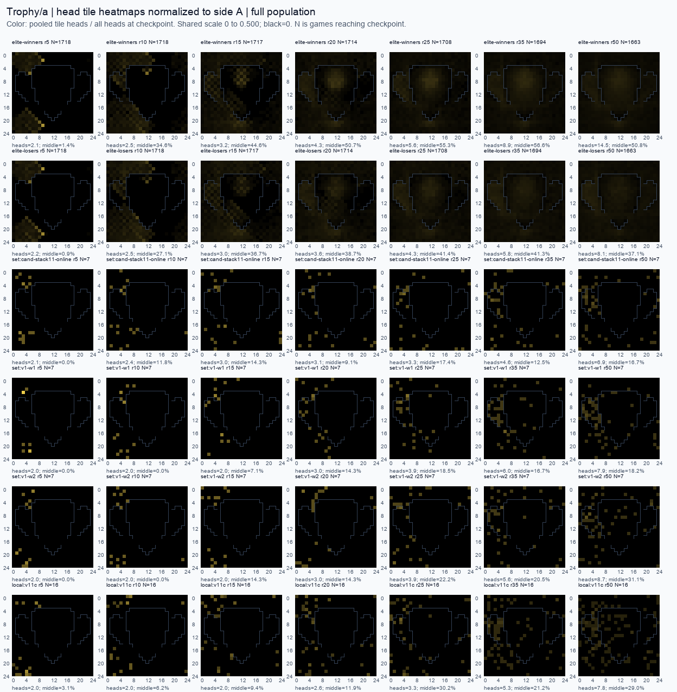
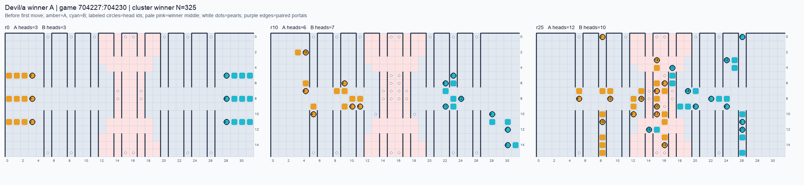
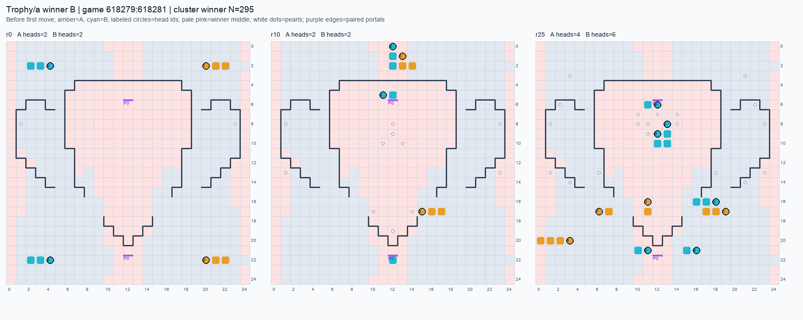

# 지도별 개막 기보: r0–50 분열과 중앙 도착

[사실] 동결 2026. 10. 1. 오전 6:38:04 KST. 요청 지도 원자료 **19,680판**(상위 13,714, 온라인 1,421, 로컬 고유 4,545)을 전부 읽었다. 멈춤 상위 192판을 제외했고, 판본 미확정 7판은 별도다. 누락 N=0. [tables.json](../../exp/opening/tables.json)을 2026. 10. 1. 오전 7:06:43 KST에 먼저 쓴 뒤 군집의 대표 기보와 이 보고서를 작성했다.

[해석] 다음 스크립트는 관측된 개막을 구현할 출발점이다. 승자의 중앙 점유와 빠른 도착은 결과·상대·진주 생성과 얽혀 있으므로, 이를 복사한 새 봇의 승률 효과로 읽지 않는다. 부모의 전진과 역방향 자식의 후속 서비스는 별도 역할로 다룬다.

## 핵심 관측과 구현 순서

[사실] **Devil/a**: 상위 승자 N=878, W12 N=6. r0–10 분열/판 2.97 대 3.00; 최초 중앙 도착 r 14.22 [N=878] 대 29.67 [N=3]; r25 중앙 몫 54.1% [N=878] 대 7.1% [N=6]. v1-w1/w2의 r25 중앙 몫은 7.1% [N=2] / 0.0% [N=2]다.

[사실] **Devil/b**: 상위 승자 N=861, W12 N=1. r0–10 분열/판 2.96 대 3.00; 최초 중앙 도착 r 13.75 [N=860] 대 – [N=0]; r25 중앙 몫 55.9% [N=861] 대 0.0% [N=1]. v1-w1/w2의 r25 중앙 몫은 0.0% [N=5] / 6.9% [N=5]다.

[사실] **Default/a**: 상위 승자 N=2105, W12 N=7. r0–10 분열/판 4.32 대 3.29; 최초 중앙 도착 r 1.28 [N=2105] 대 3.29 [N=7]; r25 중앙 몫 53.5% [N=2105] 대 24.5% [N=7]. v1-w1/w2의 r25 중앙 몫은 30.6% [N=7] / 25.5% [N=7]다.

[사실] **Trophy/a**: 상위 승자 N=1718, W12 N=7. r0–10 분열/판 0.66 대 0.57; 최초 중앙 도착 r 7.66 [N=1718] 대 15.29 [N=7]; r25 중앙 몫 55.3% [N=1708] 대 17.4% [N=7]. v1-w1/w2의 r25 중앙 몫은 18.5% [N=7] / 22.2% [N=7]다.

[사실] **Queen Of Spades/a**: 상위 승자 N=928, W12 N=1. r0–10 분열/판 0.20 대 0.00; 최초 중앙 도착 r 12.34 [N=927] 대 20.00 [N=1]; r25 중앙 몫 32.2% [N=926] 대 50.0% [N=1]. v1-w1/w2의 r25 중앙 몫은 28.6% [N=3] / 0.0% [N=1]다.

[사실] **Queen Of Spades/b**: 상위 승자 N=909, W12 N=6. r0–10 분열/판 0.36 대 0.50; 최초 중앙 도착 r 13.46 [N=909] 대 26.00 [N=4]; r25 중앙 몫 29.9% [N=909] 대 17.6% [N=6]. v1-w1/w2의 r25 중앙 몫은 18.2% [N=4] / 18.8% [N=6]다.

[사실] **Schooltime/b**: 상위 승자 N=1073, W12 N=4. r0–10 분열/판 3.00 대 3.00; 최초 중앙 도착 r 7.71 [N=1073] 대 9.75 [N=4]; r25 중앙 몫 39.4% [N=1073] 대 4.2% [N=4]. v1-w1/w2의 r25 중앙 몫은 5.6% [N=3] / 8.3% [N=4]다.

[사실] **Schooltime/a**: 상위 승자 N=1095, W12 N=3. r0–10 분열/판 2.99 대 3.00; 최초 중앙 도착 r 7.67 [N=1095] 대 3.00 [N=3]; r25 중앙 몫 45.7% [N=1095] 대 5.6% [N=3]. v1-w1/w2의 r25 중앙 몫은 4.2% [N=4] / 11.1% [N=3]다.

[사실] **Slithery Fight/a**: 상위 승자 N=970, W12 N=5. r0–10 분열/판 23.81 대 8.20; 최초 중앙 도착 r 6.42 [N=970] 대 6.60 [N=5]; r25 중앙 몫 17.5% [N=970] 대 18.0% [N=5]. v1-w1/w2의 r25 중앙 몫은 16.3% [N=3] / 16.9% [N=3]다.

[사실] **Slithery Fight/b**: 상위 승자 N=1028, W12 N=2. r0–10 분열/판 23.68 대 8.50; 최초 중앙 도착 r 6.54 [N=1028] 대 4.50 [N=2]; r25 중앙 몫 18.1% [N=1028] 대 15.0% [N=2]. v1-w1/w2의 r25 중앙 몫은 17.1% [N=4] / 17.9% [N=4]다.

[사실] **Trauma/a**: 상위 승자 N=1950, W12 N=7. r0–10 분열/판 1.78 대 2.00; 최초 중앙 도착 r 46.38 [N=145] 대 – [N=0]; r25 중앙 몫 0.0% [N=1950] 대 0.0% [N=7]. v1-w1/w2의 r25 중앙 몫은 0.0% [N=7] / 0.0% [N=7]다.

[해석] **Devil:** 개막의 4→2+2 세 번은 이미 우리에게 있다(실제 우리 대표는 r1). 주된 관측 격차는 분열 뒤 선두 부모의 중앙 진행 유지다. 앞선 2길이 부모를 먼저 보내고 옛 꼬리의 2길이 자식은 다른 통로로 후속 공급한다. 부모와 자식 모두 동시에 가장 가까운 진주로 돌아서면 분열 수가 같아도 전선이 늦는다.

[해석] **Trophy:** 시작 길이가 3이어서 r0 분열은 불법이다. 먼저 중앙 접근 통로를 걸어 길이 4를 만든 뒤 2+2를 놓는다. 우리 W12 대표처럼 승자 대표보다 더 일찍 분열해도 통로를 돌아다니면 도착은 느릴 수 있다. **Default:** 중앙까지 매우 가깝고 첫 접촉 중앙값이 r1이라, r25 이후 분산보다 r0 조각별 차례와 즉시 경로 선택부터 확인해야 한다.

[해석] **Queen Of Spades:** 승자가 r0부터 폭발 분열하거나 패자보다 중앙 몫이 높다는 공통 패턴은 없다. 길이 3 시작 조각이 먼저 이동·성장하고 r12–13 전후부터 나누는 개막을 지도 띠 서비스와 함께 사용한다. **Schooltime:** 초기 세 분열은 이미 같고, 처음 중앙을 지나간 사실만으로 점유가 보장되지 않는다. r25에 어떤 조각이 남아 수확하는지를 목표로 한다.

[해석] **Slithery:** 차이는 중앙 몫보다 생산 조각의 총수와 긴 역방향 자식의 연속 분열이다. 아래 정독에서 25→2+23 뒤 23길이 자식이 r0–1부터 다시 2를 떼며 생산하지만, 우리 v1의 같은 23길이 자식은 걷다가 나중에 나눈다. **Trauma:** r25 중앙 머리 0이 양쪽에 공통이며 중앙 r25 강제 목표를 두지 않는다. 긴 접근과 포켓 수확의 개막을 따로 둔다.

## 1. 전수 스크립트 → 크기를 붙인 군집 → 선택 정독

[사실] 1단계: [extract.js](../../exp/opening/extract.js)가 기존 공간 geometry·질량 장부 훅과 fast decoder를 재사용했다. 모든 요청 지도의 상위권 기보와 29개 온라인 세트, 구계통·v1·v1.1 계열 로컬 판을 처리했다. 로컬 동일 바이트 사본 594개는 [population.json](../../exp/opening/population.json)에 원본 키를 연결했다. 추가 디렉터리 점검도 같은 동결 시각 이전에 완성된 기보만 넣었다. 상대 흉내 봇 제작·진단 또는 지도/좌석 메타데이터가 없는 로컬 파일 801개는 이유를 적어 제외했다. 동결 뒤 완성된 로컬 판은 이번 모집단 밖이다.

| 지도/판본 | 상위 유지 N | 우리 온라인 N | 로컬 고유 N |
| --- | --- | --- | --- |
| Default/a | 2105 | 203 | 624 |
| Devil/a | 878 | 117 | 494 |
| Devil/b | 861 | 86 | 136 |
| Queen Of Spades/? | 1 | 0 | 0 |
| Queen Of Spades/a | 928 | 98 | 498 |
| Queen Of Spades/b | 909 | 105 | 136 |
| Schooltime/a | 1095 | 113 | 512 |
| Schooltime/b | 1073 | 90 | 184 |
| Slithery Fight/? | 6 | 0 | 0 |
| Slithery Fight/a | 970 | 99 | 532 |
| Slithery Fight/b | 1028 | 104 | 136 |
| Trauma/a | 1950 | 203 | 701 |
| Trophy/a | 1718 | 203 | 592 |

[사실] 온라인은 상대 306/70/20/801/264/46/545의 판만 포함했다. W0의 merge2 반복 세트, W6·W7의 stack6 반복 세트, 각 원래 set은 JSON에서 모두 분리된다. W12는 cand-stack11-online이다. bench-s11 세트는 별도이며 v1-w1/w2와 합치지 않았다. 이전 온라인 계열과 모든 로컬 가족도 classes에 각각 N을 남겼다.

| 온라인 세트 | 대상 지도 N |
| --- | --- |
| base-px8-online | 49 |
| base-px9d-online | 49 |
| baseline-r1 | 49 |
| baseline-r1b | 49 |
| baseline-r1c | 49 |
| bench-s11-1 | 49 |
| bench-s11-2 | 49 |
| bench-s11-3 | 49 |
| cand-avoid6-online | 49 |
| cand-merge2-online | 49 |
| cand-merge2-online-r2 | 49 |
| cand-merge2-online-r3 | 49 |
| cand-portal1-online | 49 |
| cand-stack1-online | 49 |
| cand-stack10-online | 49 |
| cand-stack11-online | 49 |
| cand-stack2-online | 49 |
| cand-stack3-online | 49 |
| cand-stack4-online | 49 |
| cand-stack5-online | 49 |
| cand-stack6-online | 49 |
| cand-stack6-online-r2 | 49 |
| cand-stack7-online | 49 |
| cand-stack8-online | 49 |
| cand-stack9-online | 49 |
| cand-swarm8-online | 49 |
| px-king-v2-online | 49 |
| v1-w1 | 49 |
| v1-w2 | 49 |

[사실] 2단계: 지도·판본마다 유지된 상위 팀-판 전부를 표준화한 개막 특징으로 K=5 군집화했다. 주 군집은 시작 조각별 r0 행동, r0–5/6–10 방향·분열 횟수/크기·성공 이동·행동 중단, r5/r10 중앙 거리, r2/5/10까지의 분열 수를 쓴다. r10까지 태어난 첫 길이 10 이상 자식의 첫 11행동도 넣어 역방향 큰 자식의 연속 분열을 구분했다. 별도 spaceClusters는 r50까지의 머리 수와 f-bin 분포로 공간 결과를 요약한다. 승패는 군집 입력에 쓰지 않았다. 군집마다 승자/패자 N, 좌석별 승자 N, 모든 기보 키와 팀 id를 저장했다. 첫 5라운드 시작 드래곤 행동의 완전 일치와 r0–50 모든 후손의 행동 완전 일치도 별도로 센다. 후자는 r50 행동까지 진행한 판만 포함한다.

[사실] 3단계: 각 좌석에서 승자 N이 가장 큰 군집을 고른 뒤 그 중심과 가장 가까운 실제 승자 1판을 정독했다. 우리 판은 해당 코호트 r25 f-bin 평균에 가장 가까운 1판을 골랐다. 정독 항목 N=88; 중복 기보는 역할별로 읽되 모집단에 추가하지 않았다. 선택 근거·부류 N·기보 id는 [deep-selection.json](../../exp/opening/deep-selection.json), 차례별 이동·분열·자식 경로는 deep JSON에 있다.

## 2. 정의와 독립 재집계

[사실] 라운드는 리플레이의 0부터 센다. r0–50은 행동 라운드 51개다. 머리 체크포인트는 해당 라운드 첫 turnStart, 이동 전이며 그 라운드까지 계속된 판만 분모에 넣는다. f=d_own/(d_own+d_enemy)는 양쪽 모든 시작 몸에서의 wrap/kelp/portal 경로 거리다. f-bin은 [0,.2), [.2,.4), [.4,.6), [.6,.8), [.8,1]이며 여섯째는 양쪽에서 도달 불가다. 아래 벡터는 앞 다섯 칸을 쓰고 여섯째 값은 JSON에 보존한다. 중앙 몫은 합산 중앙 머리/합산 모든 머리이고, 판별 몫 평균은 따로 저장했다.

[사실] 지도 파일 DRAGON 0의 시작 진영을 물리 좌석 A로, DRAGON 1을 B로 둔다. 리플레이의 팀 색 A/B는 이 좌석과 뒤바뀌기도 한다. 아래 :side 군집·스크립트는 물리 좌석이고 기보의 team/id는 원래 팀 색을 유지한다. 어느 팀 색이든 물리 A로 옮기는 좌표 정규화는 시작 몸 집합과 모든 통과 가능한 그래프 간선을 실제로 보존하는 반사/180도 회전이다. 타일 번호는 y×width+x. 첫 중앙 도착은 탄생 위치와 성공한 질주의 매 단계까지 포함한다. 시작 몸을 거리 seed로 쓰므로 초기 머리 자체의 f는 0이다. r0 도착은 그 라운드의 실제 성공 이동(같은 라운드 자식 행동 포함)에서 생길 수 있다. 지도별 시작 머리에서 중앙까지 거리가 다르므로 도착 r만으로 지도 사이 난도를 비교하지 않는다. 시작 왕은 최장 동률이면 작은 id를 고른 분석 표식이며, 실제 프로그램의 역할을 뜻하지 않는다.

[사실] 분열은 부모 차례의 이동을 대체한다. 자식은 옛 꼬리를 머리로 삼고 뒤쪽 몸을 뒤집어, 새 id로 같은 라운드 후반에 첫 행동을 한다. 차례는 id 오름차순이다. 따라서 같은 라운드의 “왕 먼저”는 프로그램의 우선순위와 id 순서가 섞인다. 최소 길이 2+2이며, 분열 크기보다 옛 꼬리 위치와 자식의 첫 출구가 도착 시간을 결정한다.

[사실] 독립 경로는 primary 훅을 호출하지 않고 dragonUpdate의 head/tail 및 dragonSplit의 몸을 따라갔다. 그래프도 이전 공간 연구의 별도 구현을 사용했다. 원자료 N=19,680판을 재집계하고, 멈춤을 제외한 N=19,488판에서 분열 튜플(라운드·부모/자식 id·전후 길이·자식 머리 칸) 불일치 0, r25 머리-bin 불일치 0다. 판본 배정과 fast decoder는 공유했다. 장부 점검 합은 {"sim":0,"splits":0,"drops":0,"eatTC":0,"ledger":0,"final":0,"lineage":0,"natBal":0,"dropBal":0,"unknownDeath":0}.

| 지도 | 코호트 | N | r0–50 분열 1차 / 독립 | r25 판 N | 중앙/전체 머리 1차 / 독립 | 몫 1차 / 독립 |
| --- | --- | --- | --- | --- | --- | --- |
| Default/a | 상위 승자 | 2105 | 23327 / 23327 | 2105 | 8428/15756 / 8428/15756 | 53.5% / 53.5% |
| Default/a | 상위 패자 | 2105 | 18690 / 18690 | 2105 | 7292/14512 / 7292/14512 | 50.2% / 50.2% |
| Default/a | W12 | 7 | 31 / 31 | 7 | 12/49 / 12/49 | 24.5% / 24.5% |
| Default/a | v1-w1 | 7 | 40 / 40 | 7 | 15/49 / 15/49 | 30.6% / 30.6% |
| Default/a | v1-w2 | 7 | 30 / 30 | 7 | 12/47 / 12/47 | 25.5% / 25.5% |
| Devil/a | 상위 승자 | 878 | 23414 / 23414 | 878 | 3891/7189 / 3891/7189 | 54.1% / 54.1% |
| Devil/a | 상위 패자 | 878 | 11276 / 11276 | 878 | 1465/5885 / 1465/5885 | 24.9% / 24.9% |
| Devil/a | W12 | 6 | 47 / 47 | 6 | 3/42 / 3/42 | 7.1% / 7.1% |
| Devil/a | v1-w1 | 2 | 21 / 21 | 2 | 1/14 / 1/14 | 7.1% / 7.1% |
| Devil/a | v1-w2 | 2 | 16 / 16 | 2 | 0/14 / 0/14 | 0.0% / 0.0% |
| Devil/b | 상위 승자 | 861 | 16770 / 16770 | 861 | 3414/6110 / 3414/6110 | 55.9% / 55.9% |
| Devil/b | 상위 패자 | 861 | 10077 / 10077 | 861 | 1889/5504 / 1889/5504 | 34.3% / 34.3% |
| Devil/b | W12 | 1 | 5 / 5 | 1 | 0/6 / 0/6 | 0.0% / 0.0% |
| Devil/b | v1-w1 | 5 | 30 / 30 | 5 | 0/30 / 0/30 | 0.0% / 0.0% |
| Devil/b | v1-w2 | 5 | 30 / 30 | 5 | 2/29 / 2/29 | 6.9% / 6.9% |
| Queen Of Spades/a | 상위 승자 | 928 | 8193 / 8193 | 926 | 1189/3698 / 1189/3698 | 32.2% / 32.2% |
| Queen Of Spades/a | 상위 패자 | 928 | 5695 / 5695 | 926 | 1136/3141 / 1136/3141 | 36.2% / 36.2% |
| Queen Of Spades/a | W12 | 1 | 0 / 0 | 1 | 1/2 / 1/2 | 50.0% / 50.0% |
| Queen Of Spades/a | v1-w1 | 3 | 4 / 4 | 3 | 2/7 / 2/7 | 28.6% / 28.6% |
| Queen Of Spades/a | v1-w2 | 1 | 2 / 2 | 1 | 0/2 / 0/2 | 0.0% / 0.0% |
| Queen Of Spades/b | 상위 승자 | 909 | 6920 / 6920 | 909 | 1045/3492 / 1045/3492 | 29.9% / 29.9% |
| Queen Of Spades/b | 상위 패자 | 909 | 4813 / 4813 | 909 | 1016/3086 / 1016/3086 | 32.9% / 32.9% |
| Queen Of Spades/b | W12 | 6 | 7 / 7 | 6 | 3/17 / 3/17 | 17.6% / 17.6% |
| Queen Of Spades/b | v1-w1 | 4 | 11 / 11 | 4 | 2/11 / 2/11 | 18.2% / 18.2% |
| Queen Of Spades/b | v1-w2 | 6 | 12 / 12 | 6 | 3/16 / 3/16 | 18.8% / 18.8% |
| Schooltime/a | 상위 승자 | 1095 | 14223 / 14223 | 1095 | 2988/6544 / 2988/6544 | 45.7% / 45.7% |
| Schooltime/a | 상위 패자 | 1095 | 14161 / 14161 | 1095 | 2816/6518 / 2816/6518 | 43.2% / 43.2% |
| Schooltime/a | W12 | 3 | 17 / 17 | 3 | 1/18 / 1/18 | 5.6% / 5.6% |
| Schooltime/a | v1-w1 | 4 | 28 / 28 | 4 | 1/24 / 1/24 | 4.2% / 4.2% |
| Schooltime/a | v1-w2 | 3 | 17 / 17 | 3 | 2/18 / 2/18 | 11.1% / 11.1% |
| Schooltime/b | 상위 승자 | 1073 | 6258 / 6258 | 1073 | 2487/6316 / 2487/6316 | 39.4% / 39.4% |
| Schooltime/b | 상위 패자 | 1073 | 5340 / 5340 | 1073 | 2261/6270 / 2261/6270 | 36.1% / 36.1% |
| Schooltime/b | W12 | 4 | 16 / 16 | 4 | 1/24 / 1/24 | 4.2% / 4.2% |
| Schooltime/b | v1-w1 | 3 | 14 / 14 | 3 | 1/18 / 1/18 | 5.6% / 5.6% |
| Schooltime/b | v1-w2 | 4 | 17 / 17 | 4 | 2/24 / 2/24 | 8.3% / 8.3% |
| Slithery Fight/a | 상위 승자 | 970 | 102970 / 102970 | 970 | 5285/30126 / 5285/30126 | 17.5% / 17.5% |
| Slithery Fight/a | 상위 패자 | 970 | 97514 / 97514 | 970 | 5192/29707 / 5192/29707 | 17.5% / 17.5% |
| Slithery Fight/a | W12 | 5 | 77 / 77 | 5 | 9/50 / 9/50 | 18.0% / 18.0% |
| Slithery Fight/a | v1-w1 | 3 | 98 / 98 | 3 | 8/49 / 8/49 | 16.3% / 16.3% |
| Slithery Fight/a | v1-w2 | 3 | 112 / 112 | 3 | 10/59 / 10/59 | 16.9% / 16.9% |
| Slithery Fight/b | 상위 승자 | 1028 | 105303 / 105303 | 1028 | 5589/30934 / 5589/30934 | 18.1% / 18.1% |
| Slithery Fight/b | 상위 패자 | 1028 | 100096 / 100096 | 1028 | 5656/30972 / 5656/30972 | 18.3% / 18.3% |
| Slithery Fight/b | W12 | 2 | 28 / 28 | 2 | 3/20 / 3/20 | 15.0% / 15.0% |
| Slithery Fight/b | v1-w1 | 4 | 120 / 120 | 4 | 12/70 / 12/70 | 17.1% / 17.1% |
| Slithery Fight/b | v1-w2 | 4 | 128 / 128 | 4 | 14/78 / 14/78 | 17.9% / 17.9% |
| Trauma/a | 상위 승자 | 1950 | 18800 / 18800 | 1950 | 0/8478 / 0/8478 | 0.0% / 0.0% |
| Trauma/a | 상위 패자 | 1950 | 14862 / 14862 | 1950 | 0/8398 / 0/8398 | 0.0% / 0.0% |
| Trauma/a | W12 | 7 | 21 / 21 | 7 | 0/29 / 0/29 | 0.0% / 0.0% |
| Trauma/a | v1-w1 | 7 | 21 / 21 | 7 | 0/28 / 0/28 | 0.0% / 0.0% |
| Trauma/a | v1-w2 | 7 | 23 / 23 | 7 | 0/28 / 0/28 | 0.0% / 0.0% |
| Trophy/a | 상위 승자 | 1718 | 27604 / 27604 | 1708 | 5281/9554 / 5281/9554 | 55.3% / 55.3% |
| Trophy/a | 상위 패자 | 1718 | 15826 / 15826 | 1708 | 3027/7315 / 3027/7315 | 41.4% / 41.4% |
| Trophy/a | W12 | 7 | 37 / 37 | 7 | 4/23 / 4/23 | 17.4% / 17.4% |
| Trophy/a | v1-w1 | 7 | 52 / 52 | 7 | 5/27 / 5/27 | 18.5% / 18.5% |
| Trophy/a | v1-w2 | 7 | 53 / 53 | 7 | 6/27 / 6/27 | 22.2% / 22.2% |

[사실] 무거운 추출은 두 worker, 정제·집계·정독은 한 프로세스씩 실행했고, 동시에 무거운 작업은 최대 두 프로세스였다. 메모리 가용률<10% 또는 디스크<21 GiB에서 배정을 중단하는 검사를 넣었다. nice 실행은 이 환경에서 setpriority가 거절되어 우선순위 하향을 주장하지 않는다. 캐시는 gzip이며 압축되지 않은 복사본을 남기지 않았다. 네트워크·업로드·새 게임·커밋은 사용하지 않았다.

## 3. 분열 일정과 시작 조각의 순서

[사실] 아래는 모든 실제 분열의 합이다. 분열 평균은 전체 팀-판 N을 분모로 쓰며, 첫 분열 라운드는 분열이 한 번 이상 있는 판만 포함한다. r별 51개 원수·진행 판 노출·길이·탄생 칸 분포와 판별 정확한 일정은 tables.json의 split/perGame에 있다.

| 지도 | 코호트 | N 판 | 첫 분열 평균 [분열 판 N] | r0–5 / 6–10 / 11–25 / 26–50 분열 N | 분열/판 | 첫 분열 왕/시작 조각/후손 N |
| --- | --- | --- | --- | --- | --- | --- |
| Default/a | 상위 승자 | 2105 | 0.02 [N=2105] | 8438 / 660 / 3150 / 11079 | 11.08 | 2003 / 102 / 0 |
| Default/a | 상위 패자 | 2105 | 0.04 [N=2098] | 8386 / 428 / 2223 / 7653 | 8.88 | 2017 / 81 / 0 |
| Default/a | W12 | 7 | 1.00 [N=7] | 23 / 0 / 1 / 7 | 4.43 | 7 / 0 / 0 |
| Default/a | v1-w1 | 7 | 1.00 [N=7] | 21 / 0 / 6 / 13 | 5.71 | 7 / 0 / 0 |
| Default/a | v1-w2 | 7 | 1.00 [N=7] | 21 / 0 / 4 / 5 | 4.29 | 7 / 0 / 0 |
| Devil/a | 상위 승자 | 878 | 0.10 [N=878] | 2580 / 30 / 3669 / 17135 | 26.67 | 860 / 18 / 0 |
| Devil/a | 상위 패자 | 878 | 0.08 [N=873] | 2603 / 30 / 2280 / 6363 | 12.84 | 867 / 6 / 0 |
| Devil/a | W12 | 6 | 1.00 [N=6] | 18 / 0 / 6 / 23 | 7.83 | 6 / 0 / 0 |
| Devil/a | v1-w1 | 2 | 1.00 [N=2] | 6 / 0 / 3 / 12 | 10.50 | 2 / 0 / 0 |
| Devil/a | v1-w2 | 2 | 1.00 [N=2] | 6 / 0 / 3 / 7 | 8.00 | 2 / 0 / 0 |
| Devil/b | 상위 승자 | 861 | 0.08 [N=861] | 2544 / 8 / 2260 / 11958 | 19.48 | 830 / 31 / 0 |
| Devil/b | 상위 패자 | 861 | 0.13 [N=854] | 2518 / 4 / 1831 / 5724 | 11.70 | 833 / 21 / 0 |
| Devil/b | W12 | 1 | 1.00 [N=1] | 3 / 0 / 0 / 2 | 5.00 | 1 / 0 / 0 |
| Devil/b | v1-w1 | 5 | 1.00 [N=5] | 15 / 0 / 1 / 14 | 6.00 | 5 / 0 / 0 |
| Devil/b | v1-w2 | 5 | 1.00 [N=5] | 15 / 0 / 2 / 13 | 6.00 | 5 / 0 / 0 |
| Queen Of Spades/a | 상위 승자 | 928 | 14.51 [N=925] | 0 / 190 / 2205 / 5798 | 8.83 | 87 / 838 / 0 |
| Queen Of Spades/a | 상위 패자 | 928 | 17.44 [N=896] | 0 / 146 / 1662 / 3887 | 6.14 | 185 / 711 / 0 |
| Queen Of Spades/a | W12 | 1 | – [N=0] | 0 / 0 / 0 / 0 | 0.00 | 0 / 0 / 0 |
| Queen Of Spades/a | v1-w1 | 3 | 22.00 [N=2] | 0 / 0 / 1 / 3 | 1.33 | 1 / 1 / 0 |
| Queen Of Spades/a | v1-w2 | 1 | 36.00 [N=1] | 0 / 0 / 0 / 2 | 2.00 | 0 / 1 / 0 |
| Queen Of Spades/b | 상위 승자 | 909 | 13.34 [N=907] | 89 / 242 / 1717 / 4872 | 7.61 | 242 / 665 / 0 |
| Queen Of Spades/b | 상위 패자 | 909 | 14.70 [N=883] | 82 / 231 / 1360 / 3140 | 5.29 | 299 / 584 / 0 |
| Queen Of Spades/b | W12 | 6 | 16.40 [N=5] | 2 / 1 / 2 / 2 | 1.17 | 5 / 0 / 0 |
| Queen Of Spades/b | v1-w1 | 4 | 20.00 [N=4] | 0 / 0 / 4 / 7 | 2.75 | 3 / 1 / 0 |
| Queen Of Spades/b | v1-w2 | 6 | 24.60 [N=5] | 0 / 0 / 6 / 6 | 2.00 | 4 / 1 / 0 |
| Schooltime/a | 상위 승자 | 1095 | 0.02 [N=1095] | 3151 / 121 / 201 / 10750 | 12.99 | 1089 / 6 / 0 |
| Schooltime/a | 상위 패자 | 1095 | 0.04 [N=1091] | 3240 / 33 / 177 / 10711 | 12.93 | 1089 / 2 / 0 |
| Schooltime/a | W12 | 3 | 1.00 [N=3] | 9 / 0 / 0 / 8 | 5.67 | 3 / 0 / 0 |
| Schooltime/a | v1-w1 | 4 | 1.00 [N=4] | 12 / 0 / 0 / 16 | 7.00 | 4 / 0 / 0 |
| Schooltime/a | v1-w2 | 3 | 1.00 [N=3] | 9 / 0 / 0 / 8 | 5.67 | 3 / 0 / 0 |
| Schooltime/b | 상위 승자 | 1073 | 0.40 [N=1073] | 3024 / 191 / 62 / 2981 | 5.83 | 1016 / 57 / 0 |
| Schooltime/b | 상위 패자 | 1073 | 0.17 [N=1072] | 3158 / 55 / 46 / 2081 | 4.98 | 1057 / 15 / 0 |
| Schooltime/b | W12 | 4 | 0.00 [N=4] | 12 / 0 / 0 / 4 | 4.00 | 4 / 0 / 0 |
| Schooltime/b | v1-w1 | 3 | 1.00 [N=3] | 9 / 0 / 0 / 5 | 4.67 | 3 / 0 / 0 |
| Schooltime/b | v1-w2 | 4 | 1.00 [N=4] | 12 / 0 / 0 / 5 | 4.25 | 4 / 0 / 0 |
| Slithery Fight/a | 상위 승자 | 970 | 0.00 [N=970] | 15375 / 7716 / 25599 / 54280 | 106.15 | 206 / 764 / 0 |
| Slithery Fight/a | 상위 패자 | 970 | 0.23 [N=963] | 15397 / 7323 / 23682 / 51112 | 100.53 | 291 / 672 / 0 |
| Slithery Fight/a | W12 | 5 | 0.00 [N=5] | 40 / 1 / 10 / 26 | 15.40 | 5 / 0 / 0 |
| Slithery Fight/a | v1-w1 | 3 | 0.00 [N=3] | 24 / 0 / 27 / 47 | 32.67 | 3 / 0 / 0 |
| Slithery Fight/a | v1-w2 | 3 | 0.00 [N=3] | 25 / 0 / 37 / 50 | 37.33 | 3 / 0 / 0 |
| Slithery Fight/b | 상위 승자 | 1028 | 0.00 [N=1027] | 16254 / 8093 / 25990 / 54966 | 102.43 | 243 / 784 / 0 |
| Slithery Fight/b | 상위 패자 | 1028 | 0.06 [N=1023] | 16760 / 7679 / 24117 / 51540 | 97.37 | 313 / 710 / 0 |
| Slithery Fight/b | W12 | 2 | 0.00 [N=2] | 16 / 1 / 3 / 8 | 14.00 | 2 / 0 / 0 |
| Slithery Fight/b | v1-w1 | 4 | 0.00 [N=4] | 33 / 1 / 38 / 48 | 30.00 | 4 / 0 / 0 |
| Slithery Fight/b | v1-w2 | 4 | 0.00 [N=4] | 32 / 3 / 46 / 47 | 32.00 | 4 / 0 / 0 |
| Trauma/a | 상위 승자 | 1950 | 1.21 [N=1950] | 3443 / 37 / 1597 / 13723 | 9.64 | 1664 / 286 / 0 |
| Trauma/a | 상위 패자 | 1950 | 1.54 [N=1946] | 3519 / 94 / 1265 / 9984 | 7.62 | 1791 / 155 / 0 |
| Trauma/a | W12 | 7 | 1.00 [N=7] | 14 / 0 / 1 / 6 | 3.00 | 7 / 0 / 0 |
| Trauma/a | v1-w1 | 7 | 1.00 [N=7] | 14 / 0 / 0 / 7 | 3.00 | 7 / 0 / 0 |
| Trauma/a | v1-w2 | 7 | 1.00 [N=7] | 14 / 0 / 0 / 9 | 3.29 | 7 / 0 / 0 |
| Trophy/a | 상위 승자 | 1718 | 9.81 [N=1718] | 379 / 752 / 6581 / 19892 | 16.07 | 787 / 931 / 0 |
| Trophy/a | 상위 패자 | 1718 | 10.79 [N=1699] | 403 / 734 / 4032 / 10657 | 9.21 | 854 / 845 / 0 |
| Trophy/a | W12 | 7 | 11.71 [N=7] | 2 / 2 / 7 / 26 | 5.29 | 2 / 5 / 0 |
| Trophy/a | v1-w1 | 7 | 15.29 [N=7] | 0 / 0 / 16 / 36 | 7.43 | 4 / 3 / 0 |
| Trophy/a | v1-w2 | 7 | 15.29 [N=7] | 0 / 0 / 14 / 39 | 7.57 | 6 / 1 / 0 |

[사실] 초기 부모가 같은 최대 길이인 지도에서는 가장 작은 id에만 왕 표식을 붙였다. “왕부터”를 하나의 전담 왕을 먼저 줄이는 전략으로 단정할 수 없다. 자식 탄생 칸은 부모의 현재 머리와 다르며 아래 경로·분열 비용 표가 이를 따로 잰다.

## 4. r5–50 머리 궤적: 전수 bin과 실제 칸

[사실] 셀은 “평균 머리 수 / 중앙 몫 [진행 판 N]”이다. 어느 판이 끝났는지에 따라 r50의 N은 줄어든다. 모든 머리 id·실제 칸·길이·f-bin은 perGame.headCheckpoints, 물리적 자식의 매 성공 이동은 games.jsonl.gz에 있다.

### Default/a

| 코호트 | 팀-판 N | r5 | r10 | r15 | r20 | r25 | r35 | r50 |
| --- | --- | --- | --- | --- | --- | --- | --- | --- |
| 상위 승자 | 2105 | 7.0 / 16.4% [2105] | 6.8 / 24.6% [2105] | 6.9 / 34.5% [2105] | 7.1 / 48.3% [2105] | 7.5 / 53.5% [2105] | 8.7 / 61.6% [2105] | 10.9 / 65.4% [2105] |
| 상위 패자 | 2105 | 7.0 / 15.6% [2105] | 6.7 / 23.2% [2105] | 6.7 / 32.5% [2105] | 6.7 / 44.8% [2105] | 6.9 / 50.2% [2105] | 7.6 / 58.6% [2105] | 8.7 / 63.2% [2105] |
| W12 | 7 | 7.3 / 7.8% [7] | 7.3 / 15.7% [7] | 7.0 / 18.4% [7] | 7.0 / 22.4% [7] | 7.0 / 24.5% [7] | 7.7 / 42.6% [7] | 8.1 / 43.9% [7] |
| v1-w1 | 7 | 6.9 / 4.2% [7] | 6.9 / 12.5% [7] | 7.0 / 16.3% [7] | 7.0 / 32.7% [7] | 7.0 / 30.6% [7] | 8.6 / 40.0% [7] | 8.9 / 50.0% [7] |
| v1-w2 | 7 | 7.0 / 2.0% [7] | 7.0 / 18.4% [7] | 7.0 / 18.4% [7] | 6.9 / 27.1% [7] | 6.7 / 25.5% [7] | 7.3 / 35.3% [7] | 7.4 / 32.7% [7] |

### Devil/a

| 코호트 | 팀-판 N | r5 | r10 | r15 | r20 | r25 | r35 | r50 |
| --- | --- | --- | --- | --- | --- | --- | --- | --- |
| 상위 승자 | 878 | 5.9 / 0.0% [878] | 6.0 / 0.0% [878] | 6.1 / 15.1% [878] | 6.6 / 38.6% [878] | 8.2 / 54.1% [878] | 11.3 / 61.2% [873] | 16.1 / 58.1% [855] |
| 상위 패자 | 878 | 6.0 / 0.0% [878] | 6.0 / 0.0% [878] | 6.2 / 9.9% [878] | 6.3 / 20.2% [878] | 6.7 / 24.9% [878] | 6.9 / 24.9% [873] | 7.0 / 17.9% [855] |
| W12 | 6 | 6.0 / 0.0% [6] | 6.0 / 0.0% [6] | 6.2 / 0.0% [6] | 6.7 / 2.5% [6] | 7.0 / 7.1% [6] | 7.7 / 6.5% [6] | 9.0 / 7.4% [6] |
| v1-w1 | 2 | 6.0 / 0.0% [2] | 6.0 / 0.0% [2] | 6.0 / 0.0% [2] | 7.0 / 0.0% [2] | 7.0 / 7.1% [2] | 7.5 / 13.3% [2] | 11.0 / 18.2% [2] |
| v1-w2 | 2 | 6.0 / 0.0% [2] | 6.0 / 0.0% [2] | 6.0 / 0.0% [2] | 6.5 / 0.0% [2] | 7.0 / 0.0% [2] | 7.5 / 6.7% [2] | 9.0 / 0.0% [2] |

### Devil/b

| 코호트 | 팀-판 N | r5 | r10 | r15 | r20 | r25 | r35 | r50 |
| --- | --- | --- | --- | --- | --- | --- | --- | --- |
| 상위 승자 | 861 | 6.0 / 0.0% [861] | 6.0 / 0.0% [861] | 6.1 / 15.9% [861] | 6.3 / 45.8% [861] | 7.1 / 55.9% [861] | 8.7 / 62.7% [860] | 11.8 / 60.1% [844] |
| 상위 패자 | 861 | 5.9 / 0.0% [861] | 5.9 / 0.0% [861] | 6.0 / 12.7% [861] | 6.2 / 30.6% [861] | 6.4 / 34.3% [861] | 6.4 / 34.8% [860] | 6.4 / 27.7% [844] |
| W12 | 1 | 6.0 / 0.0% [1] | 6.0 / 0.0% [1] | 6.0 / 0.0% [1] | 6.0 / 0.0% [1] | 6.0 / 0.0% [1] | 6.0 / 0.0% [1] | 5.0 / 0.0% [1] |
| v1-w1 | 5 | 6.0 / 0.0% [5] | 6.0 / 0.0% [5] | 6.0 / 0.0% [5] | 6.0 / 0.0% [5] | 6.0 / 0.0% [5] | 6.4 / 0.0% [5] | 8.0 / 0.0% [5] |
| v1-w2 | 5 | 6.0 / 0.0% [5] | 6.0 / 0.0% [5] | 6.0 / 0.0% [5] | 6.0 / 6.7% [5] | 5.8 / 6.9% [5] | 6.4 / 9.4% [5] | 7.8 / 5.1% [5] |

### Queen Of Spades/a

| 코호트 | 팀-판 N | r5 | r10 | r15 | r20 | r25 | r35 | r50 |
| --- | --- | --- | --- | --- | --- | --- | --- | --- |
| 상위 승자 | 928 | 2.0 / 0.0% [928] | 2.1 / 1.3% [928] | 2.7 / 34.9% [928] | 3.3 / 29.3% [928] | 4.0 / 32.2% [926] | 5.2 / 30.2% [923] | 7.3 / 27.7% [917] |
| 상위 패자 | 928 | 2.0 / 0.0% [928] | 2.1 / 1.3% [928] | 2.5 / 38.6% [928] | 3.0 / 34.3% [928] | 3.4 / 36.2% [926] | 4.1 / 35.3% [923] | 5.0 / 31.7% [917] |
| W12 | 1 | 2.0 / 0.0% [1] | 2.0 / 0.0% [1] | 2.0 / 0.0% [1] | 2.0 / 0.0% [1] | 2.0 / 50.0% [1] | 2.0 / 50.0% [1] | 2.0 / 50.0% [1] |
| v1-w1 | 3 | 2.0 / 0.0% [3] | 2.0 / 0.0% [3] | 2.0 / 16.7% [3] | 2.3 / 28.6% [3] | 2.3 / 28.6% [3] | 3.0 / 33.3% [3] | 3.3 / 50.0% [3] |
| v1-w2 | 1 | 2.0 / 0.0% [1] | 2.0 / 0.0% [1] | 2.0 / 0.0% [1] | 2.0 / 0.0% [1] | 2.0 / 0.0% [1] | 2.0 / 0.0% [1] | 4.0 / 25.0% [1] |

### Queen Of Spades/b

| 코호트 | 팀-판 N | r5 | r10 | r15 | r20 | r25 | r35 | r50 |
| --- | --- | --- | --- | --- | --- | --- | --- | --- |
| 상위 승자 | 909 | 2.1 / 0.0% [909] | 2.3 / 1.2% [909] | 2.9 / 29.3% [909] | 3.4 / 27.8% [909] | 3.8 / 29.9% [909] | 4.9 / 26.5% [908] | 6.8 / 24.5% [903] |
| 상위 패자 | 909 | 2.0 / 0.0% [909] | 2.3 / 1.0% [909] | 2.7 / 28.7% [909] | 3.1 / 31.0% [909] | 3.4 / 32.9% [909] | 4.0 / 30.0% [908] | 4.8 / 27.1% [903] |
| W12 | 6 | 2.2 / 0.0% [6] | 2.3 / 0.0% [6] | 2.7 / 6.3% [6] | 2.8 / 17.6% [6] | 2.8 / 17.6% [6] | 2.8 / 23.5% [6] | 3.2 / 15.8% [6] |
| v1-w1 | 4 | 2.0 / 0.0% [4] | 2.0 / 0.0% [4] | 2.0 / 0.0% [4] | 2.8 / 9.1% [4] | 2.8 / 18.2% [4] | 3.0 / 33.3% [4] | 4.0 / 43.8% [4] |
| v1-w2 | 6 | 2.0 / 0.0% [6] | 2.0 / 0.0% [6] | 2.0 / 0.0% [6] | 2.3 / 14.3% [6] | 2.7 / 18.8% [6] | 3.2 / 31.6% [6] | 3.8 / 30.4% [6] |

### Schooltime/a

| 코호트 | 팀-판 N | r5 | r10 | r15 | r20 | r25 | r35 | r50 |
| --- | --- | --- | --- | --- | --- | --- | --- | --- |
| 상위 승자 | 1095 | 5.9 / 4.8% [1095] | 6.0 / 10.2% [1095] | 6.0 / 23.1% [1095] | 5.9 / 40.2% [1095] | 6.0 / 45.7% [1095] | 7.4 / 50.3% [1095] | 13.6 / 62.8% [1095] |
| 상위 패자 | 1095 | 6.0 / 3.6% [1095] | 6.0 / 9.9% [1095] | 6.0 / 21.6% [1095] | 5.9 / 38.7% [1095] | 6.0 / 43.2% [1095] | 7.2 / 50.4% [1095] | 13.6 / 64.3% [1095] |
| W12 | 3 | 6.0 / 16.7% [3] | 6.0 / 0.0% [3] | 6.0 / 0.0% [3] | 6.0 / 0.0% [3] | 6.0 / 5.6% [3] | 6.3 / 0.0% [3] | 8.3 / 16.0% [3] |
| v1-w1 | 4 | 6.0 / 16.7% [4] | 6.0 / 4.2% [4] | 6.0 / 0.0% [4] | 6.0 / 0.0% [4] | 6.0 / 4.2% [4] | 6.3 / 8.0% [4] | 9.5 / 15.8% [4] |
| v1-w2 | 3 | 6.0 / 11.1% [3] | 6.0 / 5.6% [3] | 6.0 / 16.7% [3] | 6.0 / 0.0% [3] | 6.0 / 11.1% [3] | 6.7 / 10.0% [3] | 8.7 / 26.9% [3] |

### Schooltime/b

| 코호트 | 팀-판 N | r5 | r10 | r15 | r20 | r25 | r35 | r50 |
| --- | --- | --- | --- | --- | --- | --- | --- | --- |
| 상위 승자 | 1073 | 5.8 / 4.3% [1073] | 6.0 / 12.9% [1073] | 6.0 / 22.9% [1073] | 5.9 / 37.5% [1073] | 5.9 / 39.4% [1073] | 6.2 / 41.2% [1073] | 7.9 / 45.9% [1072] |
| 상위 패자 | 1073 | 5.9 / 4.3% [1073] | 6.0 / 11.6% [1073] | 6.0 / 19.9% [1073] | 5.9 / 36.8% [1073] | 5.8 / 36.1% [1073] | 6.0 / 39.2% [1073] | 7.0 / 47.1% [1072] |
| W12 | 4 | 6.0 / 8.3% [4] | 6.0 / 4.2% [4] | 6.0 / 16.7% [4] | 6.0 / 12.5% [4] | 6.0 / 4.2% [4] | 5.8 / 17.4% [4] | 6.5 / 19.2% [4] |
| v1-w1 | 3 | 6.0 / 0.0% [3] | 6.0 / 0.0% [3] | 6.0 / 5.6% [3] | 6.0 / 5.6% [3] | 6.0 / 5.6% [3] | 6.0 / 11.1% [3] | 7.0 / 23.8% [3] |
| v1-w2 | 4 | 6.0 / 0.0% [4] | 6.0 / 29.2% [4] | 6.0 / 12.5% [4] | 6.0 / 12.5% [4] | 6.0 / 8.3% [4] | 6.0 / 12.5% [4] | 6.5 / 19.2% [4] |

### Slithery Fight/a

| 코호트 | 팀-판 N | r5 | r10 | r15 | r20 | r25 | r35 | r50 |
| --- | --- | --- | --- | --- | --- | --- | --- | --- |
| 상위 승자 | 970 | 15.3 / 0.3% [970] | 19.3 / 3.2% [970] | 23.2 / 9.6% [970] | 26.6 / 15.4% [970] | 31.1 / 17.5% [970] | 38.6 / 19.9% [970] | 47.1 / 19.6% [970] |
| 상위 패자 | 970 | 15.6 / 0.3% [970] | 19.4 / 3.8% [970] | 23.3 / 10.2% [970] | 26.3 / 15.2% [970] | 30.6 / 17.5% [970] | 37.9 / 19.8% [970] | 45.2 / 19.6% [970] |
| W12 | 5 | 8.0 / 2.5% [5] | 8.2 / 7.3% [5] | 8.8 / 13.6% [5] | 9.4 / 14.9% [5] | 10.0 / 18.0% [5] | 11.4 / 15.8% [5] | 12.4 / 8.1% [5] |
| v1-w1 | 3 | 8.0 / 8.3% [3] | 8.0 / 4.2% [3] | 9.3 / 10.7% [3] | 13.0 / 17.9% [3] | 16.3 / 16.3% [3] | 21.7 / 12.3% [3] | 31.7 / 20.0% [3] |
| v1-w2 | 3 | 8.0 / 0.0% [3] | 8.3 / 0.0% [3] | 10.7 / 9.4% [3] | 15.0 / 17.8% [3] | 19.7 / 16.9% [3] | 26.3 / 20.3% [3] | 34.7 / 14.4% [3] |

### Slithery Fight/b

| 코호트 | 팀-판 N | r5 | r10 | r15 | r20 | r25 | r35 | r50 |
| --- | --- | --- | --- | --- | --- | --- | --- | --- |
| 상위 승자 | 1028 | 15.3 / 0.3% [1028] | 19.3 / 3.4% [1028] | 23.0 / 9.8% [1028] | 26.2 / 15.5% [1028] | 30.1 / 18.1% [1028] | 36.6 / 20.9% [1028] | 43.5 / 20.8% [1028] |
| 상위 패자 | 1028 | 15.9 / 0.3% [1028] | 19.8 / 4.1% [1028] | 23.5 / 11.2% [1028] | 26.3 / 16.0% [1028] | 30.1 / 18.3% [1028] | 36.3 / 20.8% [1028] | 42.2 / 21.0% [1028] |
| W12 | 2 | 8.0 / 0.0% [2] | 8.5 / 5.9% [2] | 9.0 / 11.1% [2] | 9.0 / 22.2% [2] | 10.0 / 15.0% [2] | 10.5 / 14.3% [2] | 13.0 / 7.7% [2] |
| v1-w1 | 4 | 8.0 / 12.5% [4] | 8.3 / 3.0% [4] | 9.0 / 0.0% [4] | 14.0 / 17.9% [4] | 17.5 / 17.1% [4] | 21.0 / 10.7% [4] | 28.0 / 24.1% [4] |
| v1-w2 | 4 | 8.0 / 3.1% [4] | 8.8 / 11.4% [4] | 10.0 / 7.5% [4] | 15.5 / 11.3% [4] | 19.5 / 17.9% [4] | 25.3 / 12.9% [4] | 29.8 / 11.8% [4] |

### Trauma/a

| 코호트 | 팀-판 N | r5 | r10 | r15 | r20 | r25 | r35 | r50 |
| --- | --- | --- | --- | --- | --- | --- | --- | --- |
| 상위 승자 | 1950 | 3.8 / 0.0% [1950] | 3.8 / 0.0% [1950] | 3.8 / 0.0% [1950] | 3.8 / 0.0% [1950] | 4.3 / 0.0% [1950] | 5.3 / 0.0% [1950] | 7.5 / 0.8% [1950] |
| 상위 패자 | 1950 | 3.8 / 0.0% [1950] | 3.8 / 0.0% [1950] | 3.9 / 0.0% [1950] | 3.9 / 0.0% [1950] | 4.3 / 0.0% [1950] | 4.9 / 0.0% [1950] | 6.3 / 1.0% [1950] |
| W12 | 7 | 4.0 / 0.0% [7] | 4.0 / 0.0% [7] | 4.0 / 0.0% [7] | 4.1 / 0.0% [7] | 4.1 / 0.0% [7] | 4.4 / 0.0% [7] | 4.9 / 0.0% [7] |
| v1-w1 | 7 | 4.0 / 0.0% [7] | 4.0 / 0.0% [7] | 4.0 / 0.0% [7] | 4.0 / 0.0% [7] | 4.0 / 0.0% [7] | 4.1 / 0.0% [7] | 4.6 / 0.0% [7] |
| v1-w2 | 7 | 4.0 / 0.0% [7] | 4.0 / 0.0% [7] | 4.0 / 0.0% [7] | 4.0 / 0.0% [7] | 4.0 / 0.0% [7] | 4.0 / 0.0% [7] | 4.7 / 0.0% [7] |

### Trophy/a

| 코호트 | 팀-판 N | r5 | r10 | r15 | r20 | r25 | r35 | r50 |
| --- | --- | --- | --- | --- | --- | --- | --- | --- |
| 상위 승자 | 1718 | 2.1 / 1.4% [1718] | 2.5 / 34.6% [1718] | 3.2 / 44.6% [1717] | 4.3 / 50.7% [1714] | 5.6 / 55.3% [1708] | 8.9 / 56.6% [1694] | 14.5 / 50.8% [1663] |
| 상위 패자 | 1718 | 2.2 / 0.9% [1718] | 2.5 / 27.1% [1718] | 3.0 / 36.7% [1717] | 3.6 / 38.7% [1714] | 4.3 / 41.4% [1708] | 5.8 / 41.3% [1694] | 8.1 / 37.1% [1663] |
| W12 | 7 | 2.1 / 0.0% [7] | 2.4 / 11.8% [7] | 3.0 / 14.3% [7] | 3.1 / 9.1% [7] | 3.3 / 17.4% [7] | 4.6 / 12.5% [7] | 6.9 / 16.7% [7] |
| v1-w1 | 7 | 2.0 / 0.0% [7] | 2.0 / 0.0% [7] | 2.0 / 7.1% [7] | 3.0 / 14.3% [7] | 3.9 / 18.5% [7] | 6.0 / 16.7% [7] | 7.9 / 18.2% [7] |
| v1-w2 | 7 | 2.0 / 0.0% [7] | 2.0 / 0.0% [7] | 2.0 / 14.3% [7] | 3.0 / 14.3% [7] | 3.9 / 22.2% [7] | 5.6 / 20.5% [7] | 8.7 / 31.1% [7] |

## 5. 분열의 이동 비용과 누가 먼저 중앙에 닿나

[사실] 꼬리 불리함은 “자식 탄생 칸의 정적 중앙 거리 − 분열 뒤 부모 머리의 정적 중앙 거리”다. 음수면 꼬리가 더 가깝다. 분열이 부모의 한 이동 차례를 쓰는 것은 규칙이며, 이 거리 차가 실제 지연의 인과 추정치는 아니다. 아래 early child는 r10까지 태어난 물리적 자식 전부이고, r50까지 도달하지 못한 사망·검열도 분모에 남겼다. 도착 경로의 detour는 성공 이동 수 − 탄생 칸의 정적 최단 거리다. 방향 전환은 도착 전 성공한 방향열에서 달라진 횟수다.

| 지도 | 코호트 | 판 N | 꼬리 거리 불리함 [분열 N] | r10 자식 도달/탄생 N | 첫 중앙 r [도달 N] | 탄생 뒤 라운드 [도달 N] | 우회 이동 수 [도달 N] | 방향 전환 [도달 N] | 후퇴 방향 이동/성공 이동 N |
| --- | --- | --- | --- | --- | --- | --- | --- | --- | --- |
| Default/a | 상위 승자 | 2105 | 0.11 [N=23327] | 8111/9098 (사망 899, 검열 88) | 11.15 [N=8111] | 10.48 [N=8111] | 6.94 [N=8111] | 3.92 [N=8111] | 164602/856064 (19.2%) |
| Default/a | 상위 패자 | 2105 | 0.10 [N=18690] | 7839/8814 (사망 879, 검열 96) | 11.40 [N=7839] | 10.93 [N=7839] | 7.36 [N=7839] | 4.39 [N=7839] | 157626/773618 (20.4%) |
| Default/a | W12 | 7 | 0.52 [N=31] | 21/23 (사망 0, 검열 2) | 18.19 [N=21] | 17.19 [N=21] | 13.29 [N=21] | 10.43 [N=21] | 658/2616 (25.2%) |
| Default/a | v1-w1 | 7 | 0.70 [N=40] | 18/21 (사망 1, 검열 2) | 16.39 [N=18] | 15.39 [N=18] | 11.33 [N=18] | 8.56 [N=18] | 699/2702 (25.9%) |
| Default/a | v1-w2 | 7 | 0.70 [N=30] | 19/21 (사망 0, 검열 2) | 21.05 [N=19] | 20.05 [N=19] | 15.63 [N=19] | 11.32 [N=19] | 652/2490 (26.2%) |
| Devil/a | 상위 승자 | 878 | 0.19 [N=23414] | 1619/2610 (사망 223, 검열 768) | 25.17 [N=1619] | 24.87 [N=1619] | 8.99 [N=1619] | 9.65 [N=1619] | 74719/400892 (18.6%) |
| Devil/a | 상위 패자 | 878 | 0.33 [N=11276] | 1159/2633 (사망 636, 검열 838) | 27.10 [N=1159] | 26.82 [N=1159] | 10.92 [N=1159] | 10.58 [N=1159] | 80659/283991 (28.4%) |
| Devil/a | W12 | 6 | 1.49 [N=47] | 1/18 (사망 2, 검열 15) | 24.00 [N=1] | 23.00 [N=1] | 9.00 [N=1] | 15.00 [N=1] | 872/2146 (40.6%) |
| Devil/a | v1-w1 | 2 | 0.81 [N=21] | 1/6 (사망 1, 검열 4) | 34.00 [N=1] | 33.00 [N=1] | 17.00 [N=1] | 24.00 [N=1] | 281/754 (37.3%) |
| Devil/a | v1-w2 | 2 | 0.38 [N=16] | 0/6 (사망 2, 검열 4) | – [N=0] | – [N=0] | – [N=0] | – [N=0] | 306/723 (42.3%) |
| Devil/b | 상위 승자 | 861 | 0.32 [N=16770] | 1829/2552 (사망 192, 검열 531) | 24.75 [N=1829] | 24.54 [N=1829] | 8.68 [N=1829] | 9.02 [N=1829] | 55588/329030 (16.9%) |
| Devil/b | 상위 패자 | 861 | 0.40 [N=10077] | 1309/2522 (사망 508, 검열 705) | 26.35 [N=1309] | 26.10 [N=1309] | 10.18 [N=1309] | 9.70 [N=1309] | 65779/265161 (24.8%) |
| Devil/b | W12 | 1 | 1.60 [N=5] | 0/3 (사망 1, 검열 2) | – [N=0] | – [N=0] | – [N=0] | – [N=0] | 126/303 (41.6%) |
| Devil/b | v1-w1 | 5 | 1.43 [N=30] | 0/15 (사망 0, 검열 15) | – [N=0] | – [N=0] | – [N=0] | – [N=0] | 709/1636 (43.3%) |
| Devil/b | v1-w2 | 5 | 1.23 [N=30] | 0/15 (사망 1, 검열 14) | – [N=0] | – [N=0] | – [N=0] | – [N=0] | 604/1613 (37.4%) |
| Queen Of Spades/a | 상위 승자 | 928 | -0.36 [N=8193] | 114/190 (사망 46, 검열 30) | 23.39 [N=114] | 14.08 [N=114] | 9.64 [N=114] | 5.45 [N=114] | 63254/192040 (32.9%) |
| Queen Of Spades/a | 상위 패자 | 928 | -0.36 [N=5695] | 88/146 (사망 44, 검열 14) | 23.51 [N=88] | 14.35 [N=88] | 9.95 [N=88] | 5.67 [N=88] | 47979/155968 (30.8%) |
| Queen Of Spades/a | W12 | 1 | – [N=0] | 0/0 (사망 0, 검열 0) | – [N=0] | – [N=0] | – [N=0] | – [N=0] | 33/103 (32.0%) |
| Queen Of Spades/a | v1-w1 | 3 | 0.25 [N=4] | 0/0 (사망 0, 검열 0) | – [N=0] | – [N=0] | – [N=0] | – [N=0] | 123/388 (31.7%) |
| Queen Of Spades/a | v1-w2 | 1 | 1.50 [N=2] | 0/0 (사망 0, 검열 0) | – [N=0] | – [N=0] | – [N=0] | – [N=0] | 40/124 (32.3%) |
| Queen Of Spades/b | 상위 승자 | 909 | -0.24 [N=6920] | 226/331 (사망 56, 검열 49) | 22.92 [N=226] | 15.42 [N=226] | 8.94 [N=226] | 6.46 [N=226] | 62048/182482 (34.0%) |
| Queen Of Spades/b | 상위 패자 | 909 | -0.28 [N=4813] | 205/313 (사망 74, 검열 34) | 22.47 [N=205] | 15.20 [N=205] | 8.64 [N=205] | 5.95 [N=205] | 49695/153350 (32.4%) |
| Queen Of Spades/b | W12 | 6 | 0.29 [N=7] | 0/3 (사망 0, 검열 3) | – [N=0] | – [N=0] | – [N=0] | – [N=0] | 317/820 (38.7%) |
| Queen Of Spades/b | v1-w1 | 4 | -0.91 [N=11] | 0/0 (사망 0, 검열 0) | – [N=0] | – [N=0] | – [N=0] | – [N=0] | 162/556 (29.1%) |
| Queen Of Spades/b | v1-w2 | 6 | 0.58 [N=12] | 0/0 (사망 0, 검열 0) | – [N=0] | – [N=0] | – [N=0] | – [N=0] | 251/827 (30.4%) |
| Schooltime/a | 상위 승자 | 1095 | -0.10 [N=14223] | 3003/3272 (사망 46, 검열 223) | 16.22 [N=3003] | 15.95 [N=3003] | 10.70 [N=3003] | 5.68 [N=3003] | 87476/406061 (21.5%) |
| Schooltime/a | 상위 패자 | 1095 | -0.13 [N=14161] | 2923/3273 (사망 54, 검열 296) | 16.84 [N=2923] | 16.74 [N=2923] | 11.52 [N=2923] | 5.97 [N=2923] | 87926/404444 (21.7%) |
| Schooltime/a | W12 | 3 | -0.76 [N=17] | 6/9 (사망 0, 검열 3) | 17.50 [N=6] | 16.50 [N=6] | 12.83 [N=6] | 10.83 [N=6] | 350/970 (36.1%) |
| Schooltime/a | v1-w1 | 4 | 0.04 [N=28] | 11/12 (사망 0, 검열 1) | 15.27 [N=11] | 14.27 [N=11] | 9.55 [N=11] | 8.64 [N=11] | 489/1337 (36.6%) |
| Schooltime/a | v1-w2 | 3 | -0.47 [N=17] | 7/9 (사망 0, 검열 2) | 14.71 [N=7] | 13.71 [N=7] | 10.14 [N=7] | 8.43 [N=7] | 343/981 (35.0%) |
| Schooltime/b | 상위 승자 | 1073 | -0.44 [N=6258] | 2934/3215 (사망 63, 검열 218) | 15.47 [N=2934] | 15.01 [N=2934] | 9.69 [N=2934] | 4.77 [N=2934] | 88123/337987 (26.1%) |
| Schooltime/b | 상위 패자 | 1073 | -0.55 [N=5340] | 2826/3213 (사망 77, 검열 310) | 16.63 [N=2826] | 16.44 [N=2826] | 11.19 [N=2826] | 5.62 [N=2826] | 87216/328049 (26.6%) |
| Schooltime/b | W12 | 4 | -0.94 [N=16] | 5/12 (사망 1, 검열 6) | 10.40 [N=5] | 10.40 [N=5] | 8.80 [N=5] | 7.00 [N=5] | 434/1223 (35.5%) |
| Schooltime/b | v1-w1 | 3 | -0.71 [N=14] | 8/9 (사망 0, 검열 1) | 20.25 [N=8] | 19.25 [N=8] | 14.63 [N=8] | 10.75 [N=8] | 342/924 (37.0%) |
| Schooltime/b | v1-w2 | 4 | -0.71 [N=17] | 10/12 (사망 0, 검열 2) | 10.50 [N=10] | 9.50 [N=10] | 5.30 [N=10] | 4.00 [N=10] | 451/1221 (36.9%) |
| Slithery Fight/a | 상위 승자 | 970 | -0.92 [N=102970] | 4837/23091 (사망 12895, 검열 5359) | 21.56 [N=4837] | 17.06 [N=4837] | 7.63 [N=4837] | 8.41 [N=4837] | 653026/1440249 (45.3%) |
| Slithery Fight/a | 상위 패자 | 970 | -0.87 [N=97514] | 4955/22720 (사망 11867, 검열 5898) | 21.08 [N=4955] | 16.72 [N=4955] | 7.59 [N=4955] | 8.31 [N=4955] | 637226/1418368 (44.9%) |
| Slithery Fight/a | W12 | 5 | -0.48 [N=77] | 6/41 (사망 16, 검열 19) | 9.83 [N=6] | 7.83 [N=6] | 6.67 [N=6] | 4.50 [N=6] | 1226/2600 (47.2%) |
| Slithery Fight/a | v1-w1 | 3 | 0.09 [N=98] | 4/24 (사망 9, 검열 11) | 16.50 [N=4] | 15.25 [N=4] | 12.00 [N=4] | 9.00 [N=4] | 1055/2551 (41.4%) |
| Slithery Fight/a | v1-w2 | 3 | 0.69 [N=112] | 7/25 (사망 9, 검열 9) | 33.43 [N=7] | 31.43 [N=7] | 26.00 [N=7] | 23.00 [N=7] | 1247/2989 (41.7%) |
| Slithery Fight/b | 상위 승자 | 1028 | -0.96 [N=105303] | 5054/24347 (사망 13919, 검열 5374) | 21.34 [N=5054] | 16.87 [N=5054] | 7.47 [N=5054] | 8.20 [N=5054] | 658159/1457473 (45.2%) |
| Slithery Fight/b | 상위 패자 | 1028 | -0.87 [N=100096] | 5257/24439 (사망 12959, 검열 6223) | 20.04 [N=5257] | 15.77 [N=5257] | 6.93 [N=5257] | 7.66 [N=5257] | 654380/1461501 (44.8%) |
| Slithery Fight/b | W12 | 2 | -0.25 [N=28] | 3/17 (사망 6, 검열 8) | 11.67 [N=3] | 8.00 [N=3] | 6.67 [N=3] | 5.67 [N=3] | 487/1013 (48.1%) |
| Slithery Fight/b | v1-w1 | 4 | 0.64 [N=120] | 6/34 (사망 13, 검열 15) | 13.00 [N=6] | 10.33 [N=6] | 8.17 [N=6] | 6.33 [N=6] | 1485/3376 (44.0%) |
| Slithery Fight/b | v1-w2 | 4 | 0.58 [N=128] | 8/35 (사망 12, 검열 15) | 16.88 [N=8] | 13.50 [N=8] | 9.00 [N=8] | 8.75 [N=8] | 1654/3733 (44.3%) |
| Trauma/a | 상위 승자 | 1950 | -0.43 [N=18800] | 54/3480 (사망 721, 검열 2705) | 47.65 [N=54] | 47.65 [N=54] | 5.63 [N=54] | 18.63 [N=54] | 168070/469611 (35.8%) |
| Trauma/a | 상위 패자 | 1950 | -0.31 [N=14862] | 58/3613 (사망 692, 검열 2863) | 46.90 [N=58] | 46.79 [N=58] | 4.90 [N=58] | 18.53 [N=58] | 159350/443479 (35.9%) |
| Trauma/a | W12 | 7 | 1.00 [N=21] | 0/14 (사망 0, 검열 14) | – [N=0] | – [N=0] | – [N=0] | – [N=0] | 701/1495 (46.9%) |
| Trauma/a | v1-w1 | 7 | 1.24 [N=21] | 0/14 (사망 0, 검열 14) | – [N=0] | – [N=0] | – [N=0] | – [N=0] | 680/1431 (47.5%) |
| Trauma/a | v1-w2 | 7 | -0.13 [N=23] | 0/14 (사망 2, 검열 12) | – [N=0] | – [N=0] | – [N=0] | – [N=0] | 636/1444 (44.0%) |
| Trophy/a | 상위 승자 | 1718 | 0.06 [N=27604] | 1007/1131 (사망 50, 검열 74) | 18.69 [N=1007] | 12.04 [N=1007] | 9.04 [N=1007] | 4.57 [N=1007] | 110019/563477 (19.5%) |
| Trophy/a | 상위 패자 | 1718 | 0.15 [N=15826] | 1011/1137 (사망 63, 검열 63) | 18.31 [N=1011] | 11.83 [N=1011] | 8.82 [N=1011] | 4.65 [N=1011] | 92212/389782 (23.7%) |
| Trophy/a | W12 | 7 | 0.41 [N=37] | 4/4 (사망 0, 검열 0) | 30.75 [N=4] | 24.00 [N=4] | 21.50 [N=4] | 15.50 [N=4] | 422/1372 (30.8%) |
| Trophy/a | v1-w1 | 7 | 0.40 [N=52] | 0/0 (사망 0, 검열 0) | – [N=0] | – [N=0] | – [N=0] | – [N=0] | 503/1572 (32.0%) |
| Trophy/a | v1-w2 | 7 | 0.62 [N=53] | 0/0 (사망 0, 검열 0) | – [N=0] | – [N=0] | – [N=0] | – [N=0] | 456/1574 (29.0%) |

| 지도 | 코호트 | 판 N | 시작 머리 최초 도착 r [도달 판 N] | 후손 최초 도착 r [도달 판 N] | 먼저/동시/나중/우리만/적만/둘 다 없음 판 N | 분열/이동/질주 차례 N | 거리 유지 이동/재방문/행동 없음 N |
| --- | --- | --- | --- | --- | --- | --- | --- |
| Default/a | 상위 승자 | 2105 | 2.99 [N=2104] | 2.31 [N=2105] | 954 / 201 / 950 / 0 / 0 / 0 | 23360 / 859218 / 1555 | 474972 / 91869 / 0 |
| Default/a | 상위 패자 | 2105 | 3.32 [N=2103] | 2.36 [N=2098] | 950 / 201 / 954 / 0 / 0 / 0 | 18719 / 776820 / 1067 | 407381 / 86841 / 0 |
| Default/a | W12 | 7 | 3.71 [N=7] | 8.00 [N=7] | 0 / 0 / 7 / 0 / 0 / 0 | 31 / 2608 / 9 | 1183 / 645 / 0 |
| Default/a | v1-w1 | 7 | 9.14 [N=7] | 6.57 [N=7] | 0 / 1 / 6 / 0 / 0 / 0 | 40 / 2687 / 18 | 1182 / 554 / 0 |
| Default/a | v1-w2 | 7 | 5.57 [N=7] | 14.57 [N=7] | 0 / 0 / 7 / 0 / 0 / 0 | 30 / 2484 / 6 | 1087 / 499 / 0 |
| Devil/a | 상위 승자 | 878 | 14.55 [N=869] | 18.80 [N=876] | 439 / 250 / 149 / 40 / 0 / 0 | 23552 / 406243 / 2770 | 189475 / 59771 / 0 |
| Devil/a | 상위 패자 | 878 | 16.56 [N=778] | 21.79 [N=790] | 149 / 250 / 439 / 0 / 40 / 0 | 11461 / 286282 / 1353 | 58264 / 37412 / 0 |
| Devil/a | W12 | 6 | 20.50 [N=2] | 32.67 [N=3] | 1 / 0 / 2 / 0 / 3 / 0 | 47 / 2145 / 9 | 249 / 656 / 0 |
| Devil/a | v1-w1 | 2 | 20.00 [N=1] | 40.00 [N=2] | 1 / 0 / 1 / 0 / 0 / 0 | 21 / 752 / 3 | 115 / 156 / 0 |
| Devil/a | v1-w2 | 2 | 30.00 [N=1] | – [N=0] | 0 / 0 / 1 / 0 / 1 / 0 | 16 / 725 / 0 | 67 / 138 / 0 |
| Devil/b | 상위 승자 | 861 | 13.97 [N=851] | 18.73 [N=860] | 328 / 336 / 176 / 20 / 1 / 0 | 16985 / 333251 / 1746 | 151869 / 42937 / 0 |
| Devil/b | 상위 패자 | 861 | 15.64 [N=801] | 20.08 [N=824] | 176 / 336 / 328 / 1 / 20 / 0 | 10283 / 268042 / 1012 | 70623 / 33585 / 0 |
| Devil/b | W12 | 1 | – [N=0] | – [N=0] | 0 / 0 / 0 / 0 / 1 / 0 | 5 / 306 / 0 | 24 / 94 / 0 |
| Devil/b | v1-w1 | 5 | 37.00 [N=1] | 27.00 [N=1] | 0 / 0 / 2 / 0 / 3 / 0 | 30 / 1635 / 3 | 132 / 399 / 0 |
| Devil/b | v1-w2 | 5 | 19.00 [N=4] | 22.00 [N=1] | 0 / 0 / 4 / 0 / 1 / 0 | 30 / 1611 / 4 | 229 / 383 / 0 |
| Queen Of Spades/a | 상위 승자 | 928 | 12.31 [N=899] | 24.37 [N=892] | 354 / 234 / 336 / 3 / 1 / 0 | 8344 / 193947 / 497 | 51542 / 33620 / 0 |
| Queen Of Spades/a | 상위 패자 | 928 | 12.08 [N=891] | 26.11 [N=827] | 336 / 234 / 354 / 1 / 3 / 0 | 5813 / 157930 / 247 | 47676 / 26727 / 0 |
| Queen Of Spades/a | W12 | 1 | 20.00 [N=1] | – [N=0] | 0 / 0 / 1 / 0 / 0 / 0 | 0 / 102 / 1 | 24 / 29 / 0 |
| Queen Of Spades/a | v1-w1 | 3 | 18.50 [N=2] | 27.00 [N=2] | 0 / 0 / 3 / 0 / 0 / 0 | 4 / 386 / 2 | 107 / 71 / 0 |
| Queen Of Spades/a | v1-w2 | 1 | 37.00 [N=1] | 41.00 [N=1] | 0 / 0 / 1 / 0 / 0 / 0 | 2 / 123 / 1 | 33 / 25 / 0 |
| Queen Of Spades/b | 상위 승자 | 909 | 13.98 [N=865] | 24.99 [N=867] | 380 / 166 / 358 / 5 / 0 / 0 | 7023 / 183952 / 352 | 44173 / 30920 / 0 |
| Queen Of Spades/b | 상위 패자 | 909 | 14.16 [N=868] | 26.33 [N=780] | 358 / 166 / 380 / 0 / 5 / 0 | 4900 / 154781 / 192 | 40489 / 26588 / 0 |
| Queen Of Spades/b | W12 | 6 | 26.00 [N=4] | 17.00 [N=1] | 0 / 0 / 4 / 0 / 2 / 0 | 7 / 819 / 1 | 134 / 203 / 0 |
| Queen Of Spades/b | v1-w1 | 4 | 28.50 [N=4] | 23.75 [N=4] | 0 / 0 / 4 / 0 / 0 / 0 | 11 / 556 / 2 | 178 / 80 / 0 |
| Queen Of Spades/b | v1-w2 | 6 | 20.80 [N=5] | 28.67 [N=3] | 2 / 0 / 4 / 0 / 0 / 0 | 12 / 825 / 3 | 213 / 168 / 0 |
| Schooltime/a | 상위 승자 | 1095 | 15.58 [N=1085] | 7.75 [N=1095] | 572 / 90 / 433 / 0 / 0 / 0 | 14268 / 407029 / 343 | 201629 / 41693 / 0 |
| Schooltime/a | 상위 패자 | 1095 | 16.90 [N=1080] | 8.99 [N=1091] | 433 / 90 / 572 / 0 / 0 / 0 | 14166 / 405625 / 281 | 200045 / 44201 / 0 |
| Schooltime/a | W12 | 3 | 27.00 [N=3] | 3.00 [N=3] | 3 / 0 / 0 / 0 / 0 / 0 | 17 / 967 / 3 | 270 / 235 / 0 |
| Schooltime/a | v1-w1 | 4 | 27.00 [N=4] | 2.00 [N=4] | 4 / 0 / 0 / 0 / 0 / 0 | 28 / 1335 / 2 | 302 / 223 / 0 |
| Schooltime/a | v1-w2 | 3 | 28.67 [N=3] | 4.33 [N=3] | 3 / 0 / 0 / 0 / 0 / 0 | 17 / 979 / 2 | 260 / 222 / 0 |
| Schooltime/b | 상위 승자 | 1073 | 15.27 [N=1039] | 7.83 [N=1072] | 503 / 126 / 443 / 1 / 0 / 0 | 6261 / 338335 / 174 | 136340 / 33423 / 0 |
| Schooltime/b | 상위 패자 | 1073 | 15.38 [N=1058] | 8.81 [N=1068] | 443 / 126 / 503 / 0 / 1 / 0 | 5341 / 328462 / 81 | 128522 / 34416 / 0 |
| Schooltime/b | W12 | 4 | 32.75 [N=4] | 9.75 [N=4] | 2 / 0 / 2 / 0 / 0 / 0 | 16 / 1221 / 2 | 332 / 367 / 0 |
| Schooltime/b | v1-w1 | 3 | 35.00 [N=2] | 11.33 [N=3] | 0 / 0 / 3 / 0 / 0 / 0 | 14 / 924 / 0 | 212 / 209 / 0 |
| Schooltime/b | v1-w2 | 4 | 32.50 [N=4] | 6.00 [N=4] | 2 / 0 / 2 / 0 / 0 / 0 | 17 / 1221 / 0 | 275 / 211 / 0 |
| Slithery Fight/a | 상위 승자 | 970 | 7.41 [N=926] | 11.35 [N=970] | 354 / 173 / 443 / 0 / 0 / 0 | 106588 / 1490610 / 2581 | 240266 / 253399 / 0 |
| Slithery Fight/a | 상위 패자 | 970 | 7.38 [N=952] | 10.92 [N=963] | 443 / 173 / 354 / 0 / 0 / 0 | 99775 / 1464532 / 3806 | 237827 / 270654 / 0 |
| Slithery Fight/a | W12 | 5 | 7.40 [N=5] | 8.40 [N=5] | 2 / 2 / 1 / 0 / 0 / 0 | 77 / 2636 / 5 | 284 / 790 / 0 |
| Slithery Fight/a | v1-w1 | 3 | 2.33 [N=3] | 8.00 [N=3] | 2 / 1 / 0 / 0 / 0 / 0 | 98 / 2575 / 0 | 381 / 539 / 0 |
| Slithery Fight/a | v1-w2 | 3 | 1.00 [N=3] | 9.00 [N=3] | 3 / 0 / 0 / 0 / 0 / 0 | 112 / 3015 / 0 | 483 / 652 / 0 |
| Slithery Fight/b | 상위 승자 | 1028 | 8.18 [N=984] | 11.22 [N=1027] | 394 / 208 / 426 / 0 / 0 / 0 | 109744 / 1509159 / 2846 | 252402 / 254323 / 0 |
| Slithery Fight/b | 상위 패자 | 1028 | 7.71 [N=1002] | 10.26 [N=1023] | 426 / 208 / 394 / 0 / 0 / 0 | 102858 / 1509670 / 4500 | 257750 / 277719 / 0 |
| Slithery Fight/b | W12 | 2 | 5.50 [N=2] | 10.00 [N=2] | 2 / 0 / 0 / 0 / 0 / 0 | 28 / 1027 / 0 | 102 / 336 / 0 |
| Slithery Fight/b | v1-w1 | 4 | 3.00 [N=4] | 9.50 [N=4] | 3 / 0 / 1 / 0 / 0 / 0 | 120 / 3409 / 1 | 446 / 666 / 0 |
| Slithery Fight/b | v1-w2 | 4 | 1.50 [N=4] | 6.50 [N=4] | 3 / 1 / 0 / 0 / 0 / 0 | 128 / 3762 / 2 | 499 / 877 / 0 |
| Trauma/a | 상위 승자 | 1950 | 45.51 [N=75] | 47.43 [N=87] | 1 / 1 / 5 / 138 / 145 / 1660 | 19207 / 476429 / 215 | 501 / 16085 / 0 |
| Trauma/a | 상위 패자 | 1950 | 43.62 [N=89] | 46.91 [N=80] | 5 / 1 / 1 / 145 / 138 / 1660 | 15228 / 448699 / 206 | 732 / 20245 / 0 |
| Trauma/a | W12 | 7 | – [N=0] | – [N=0] | 0 / 0 / 0 / 0 / 1 / 6 | 21 / 1495 / 0 | 0 / 476 / 0 |
| Trauma/a | v1-w1 | 7 | – [N=0] | – [N=0] | 0 / 0 / 0 / 0 / 3 / 4 | 21 / 1434 / 0 | 0 / 244 / 0 |
| Trauma/a | v1-w2 | 7 | – [N=0] | – [N=0] | 0 / 0 / 0 / 0 / 1 / 6 | 23 / 1447 / 0 | 0 / 230 / 0 |
| Trophy/a | 상위 승자 | 1718 | 8.20 [N=1714] | 14.91 [N=1718] | 751 / 351 / 616 / 0 / 0 / 0 | 27636 / 564821 / 2077 | 340605 / 65203 / 0 |
| Trophy/a | 상위 패자 | 1718 | 9.26 [N=1713] | 17.65 [N=1686] | 616 / 351 / 751 / 0 / 0 / 0 | 15840 / 390721 / 1270 | 196096 / 44385 / 0 |
| Trophy/a | W12 | 7 | 15.29 [N=7] | 27.14 [N=7] | 1 / 1 / 5 / 0 / 0 / 0 | 37 / 1364 / 10 | 509 / 343 / 0 |
| Trophy/a | v1-w1 | 7 | 17.57 [N=7] | 31.57 [N=7] | 0 / 0 / 7 / 0 / 0 / 0 | 52 / 1563 / 15 | 532 / 308 / 0 |
| Trophy/a | v1-w2 | 7 | 18.00 [N=7] | 28.57 [N=7] | 1 / 0 / 6 / 0 / 0 / 0 | 53 / 1565 / 13 | 632 / 331 / 0 |

[사실] Devil/a 승자 초기 분열의 꼬리 불리함 평균은 2.97칸 [분열 N=2610]이다. 시작 머리 최초 중앙 도착은 r14.55 [N=869], 모든 후손 중 최초는 r18.80 [N=876]. r10까지 태어난 실제 초기 자식은 1619/2610이 r50까지 도달했고, 그 도달 자식의 중앙 r 중앙값은 22 [N=1619]다.

[사실] Devil/b 승자 초기 분열의 꼬리 불리함 평균은 3.00칸 [분열 N=2552]이다. 시작 머리 최초 중앙 도착은 r13.97 [N=851], 모든 후손 중 최초는 r18.73 [N=860]. r10까지 태어난 실제 초기 자식은 1829/2552이 r50까지 도달했고, 그 도달 자식의 중앙 r 중앙값은 22 [N=1829]다.

[해석] Devil의 첫 전선은 옛 꼬리에서 출발한 자식 전부를 기다려 만들지 않는다. 짧아진 앞 부모가 먼저 전진하고 일부 초기 자식이 다음 공급을 맡는 형태다. 분열의 한 차례 비용과 꼬리의 약 세 칸 불리함이 있어도 앞 부모가 경로를 유지하면 r25보다 먼저 중앙에 닿을 수 있다. 모든 초기 자식을 중앙에 모으는 규칙으로 바꾸면 관측된 본진/후속 서비스 역할을 없앨 수 있다.

[해석] 거리가 늘어나는 한 걸음은 먹이 수확이나 회피일 수도 있다. 이 표는 의도된 “후퇴” 또는 잘못된 “대기”를 판정하지 않는다. 실제 무행동은 사망한다. 이동 차례당 중앙 진행, 반복 칸과 사망을 함께 보면 “분열은 많지만 앞선 머리가 오지 않는” 경우와 “분열 차례 자체를 놓친” 경우를 구분할 수 있다. r0의 한 이동으로 도착할 수 있는 지도와 r50까지 아무도 중앙에 닿지 않은 판은 Devil의 중앙 선점 기준으로 읽지 않는다.

## 6. 첫 실제 적 접촉: 장소·길이·교환

[사실] 첫 적 머리/몸 충돌을 게임 전체에서 찾았다. 단순 인접은 접촉이 아니다. 머리 충돌은 양쪽 사망, 몸 충돌은 움직인 쪽 사망이다. 장소는 죽기 전 머리 칸이 아니라 충돌 목적지다. net=(적 사망 길이−우리 사망 길이)+(해당 드롭을 r+20까지 우리가 먹은 수−상대가 먹은 수)다. net 부호의 “이득”은 이 한 교환이며 최종 경기 승리와 다르다. 게임이 먼저 끝나면 회수 창은 검열된다.

| 지도 | 코호트 | 판 N | 접촉 판 N / r50 이내 N | 첫 접촉 r [접촉 N] | 머리/몸 N | 접촉 f-bin 5칸 N | 우리/적 길이 평균 [N] | 교환 +/0/− N | net [N] | 회수 창 검열 N |
| --- | --- | --- | --- | --- | --- | --- | --- | --- | --- | --- |
| Default/a | 상위 승자 | 2105 | 2105 / 2008 | 11.45 [N=2105] | 2077 / 28 | 140/214/1430/182/139 | 2.2 / 2.2 [2105] | 899/602/604 | 0.33 [N=2105] | 1 |
| Default/a | 상위 패자 | 2105 | 2105 / 2008 | 11.45 [N=2105] | 2077 / 28 | 114/174/1434/214/169 | 2.2 / 2.2 [2105] | 604/602/899 | -0.33 [N=2105] | 1 |
| Default/a | W12 | 7 | 7 / 1 | 66.14 [N=7] | 7 / 0 | 0/6/0/0/1 | 2.1 / 2.4 [7] | 0/2/5 | -1.43 [N=7] | 0 |
| Default/a | v1-w1 | 7 | 7 / 2 | 57.43 [N=7] | 7 / 0 | 0/2/3/1/1 | 2.4 / 2.4 [7] | 2/1/4 | -0.57 [N=7] | 0 |
| Default/a | v1-w2 | 7 | 7 / 5 | 52.14 [N=7] | 7 / 0 | 0/1/5/1/0 | 2.4 / 2.9 [7] | 1/0/6 | -2.29 [N=7] | 0 |
| Devil/a | 상위 승자 | 878 | 878 / 867 | 24.11 [N=878] | 861 / 17 | 0/2/795/78/3 | 2.7 / 2.8 [878] | 566/134/178 | 1.31 [N=878] | 11 |
| Devil/a | 상위 패자 | 878 | 878 / 867 | 24.11 [N=878] | 861 / 17 | 3/77/796/2/0 | 2.8 / 2.7 [878] | 178/134/566 | -1.31 [N=878] | 11 |
| Devil/a | W12 | 6 | 6 / 3 | 51.83 [N=6] | 5 / 1 | 1/4/1/0/0 | 2.8 / 2.7 [6] | 0/0/6 | -3.50 [N=6] | 0 |
| Devil/a | v1-w1 | 2 | 2 / 2 | 44.00 [N=2] | 2 / 0 | 0/1/1/0/0 | 3.5 / 3.0 [2] | 2/0/0 | 2.50 [N=2] | 0 |
| Devil/a | v1-w2 | 2 | 2 / 2 | 46.50 [N=2] | 2 / 0 | 0/1/1/0/0 | 3.0 / 2.5 [2] | 0/0/2 | -3.50 [N=2] | 0 |
| Devil/b | 상위 승자 | 861 | 861 / 854 | 26.24 [N=861] | 844 / 17 | 0/11/797/51/2 | 2.4 / 2.5 [861] | 534/129/198 | 1.10 [N=861] | 7 |
| Devil/b | 상위 패자 | 861 | 861 / 854 | 26.24 [N=861] | 844 / 17 | 2/50/798/11/0 | 2.5 / 2.4 [861] | 198/129/534 | -1.10 [N=861] | 7 |
| Devil/b | W12 | 1 | 1 / 1 | 46.00 [N=1] | 1 / 0 | 0/1/0/0/0 | 3.0 / 2.0 [1] | 0/0/1 | -4.00 [N=1] | 0 |
| Devil/b | v1-w1 | 5 | 5 / 1 | 68.00 [N=5] | 4 / 1 | 1/3/1/0/0 | 2.6 / 2.6 [5] | 1/0/4 | -2.00 [N=5] | 0 |
| Devil/b | v1-w2 | 5 | 5 / 2 | 50.20 [N=5] | 5 / 0 | 0/2/3/0/0 | 2.2 / 2.4 [5] | 0/0/5 | -2.40 [N=5] | 0 |
| Queen Of Spades/a | 상위 승자 | 928 | 926 / 510 | 50.52 [N=926] | 872 / 54 | 35/303/269/293/26 | 2.6 / 2.6 [926] | 558/84/284 | 0.89 [N=926] | 20 |
| Queen Of Spades/a | 상위 패자 | 928 | 926 / 510 | 50.52 [N=926] | 872 / 54 | 26/292/269/304/35 | 2.6 / 2.6 [926] | 284/84/558 | -0.89 [N=926] | 20 |
| Queen Of Spades/a | W12 | 1 | 1 / 0 | 216.00 [N=1] | 1 / 0 | 0/1/0/0/0 | 2.0 / 4.0 [1] | 0/0/1 | -1.00 [N=1] | 0 |
| Queen Of Spades/a | v1-w1 | 3 | 3 / 0 | 87.00 [N=3] | 3 / 0 | 0/1/1/1/0 | 3.7 / 3.7 [3] | 0/1/2 | -2.00 [N=3] | 0 |
| Queen Of Spades/a | v1-w2 | 1 | 1 / 0 | 86.00 [N=1] | 1 / 0 | 0/0/0/1/0 | 3.0 / 3.0 [1] | 0/0/1 | -4.00 [N=1] | 0 |
| Queen Of Spades/b | 상위 승자 | 909 | 909 / 486 | 52.36 [N=909] | 845 / 64 | 57/272/221/315/44 | 2.6 / 2.6 [909] | 507/84/318 | 0.63 [N=909] | 14 |
| Queen Of Spades/b | 상위 패자 | 909 | 909 / 486 | 52.36 [N=909] | 845 / 64 | 44/314/221/273/57 | 2.6 / 2.6 [909] | 318/84/507 | -0.63 [N=909] | 14 |
| Queen Of Spades/b | W12 | 6 | 6 / 0 | 115.67 [N=6] | 5 / 1 | 1/3/1/1/0 | 2.5 / 2.7 [6] | 1/0/5 | -1.67 [N=6] | 1 |
| Queen Of Spades/b | v1-w1 | 4 | 4 / 1 | 62.50 [N=4] | 4 / 0 | 1/3/0/0/0 | 3.0 / 2.5 [4] | 1/0/3 | -1.75 [N=4] | 0 |
| Queen Of Spades/b | v1-w2 | 6 | 6 / 0 | 130.33 [N=6] | 6 / 0 | 1/1/4/0/0 | 2.2 / 2.5 [6] | 1/0/5 | -1.67 [N=6] | 0 |
| Schooltime/a | 상위 승자 | 1095 | 1095 / 654 | 45.20 [N=1095] | 1051 / 44 | 71/185/536/226/77 | 2.5 / 2.6 [1095] | 515/101/479 | 0.11 [N=1095] | 0 |
| Schooltime/a | 상위 패자 | 1095 | 1095 / 654 | 45.20 [N=1095] | 1051 / 44 | 67/207/531/215/75 | 2.6 / 2.5 [1095] | 479/101/515 | -0.11 [N=1095] | 0 |
| Schooltime/a | W12 | 3 | 3 / 1 | 73.00 [N=3] | 3 / 0 | 1/0/1/0/1 | 2.0 / 2.3 [3] | 0/1/2 | -1.33 [N=3] | 0 |
| Schooltime/a | v1-w1 | 4 | 4 / 0 | 93.50 [N=4] | 2 / 2 | 0/2/2/0/0 | 6.0 / 3.5 [4] | 1/0/3 | -0.75 [N=4] | 0 |
| Schooltime/a | v1-w2 | 3 | 3 / 0 | 74.00 [N=3] | 3 / 0 | 1/0/2/0/0 | 2.0 / 3.3 [3] | 0/0/3 | -1.67 [N=3] | 0 |
| Schooltime/b | 상위 승자 | 1073 | 1073 / 550 | 52.16 [N=1073] | 1015 / 58 | 71/279/398/261/64 | 2.5 / 2.5 [1073] | 561/130/382 | 0.44 [N=1073] | 1 |
| Schooltime/b | 상위 패자 | 1073 | 1073 / 550 | 52.16 [N=1073] | 1015 / 58 | 54/250/393/291/85 | 2.5 / 2.5 [1073] | 382/130/561 | -0.44 [N=1073] | 1 |
| Schooltime/b | W12 | 4 | 4 / 1 | 84.50 [N=4] | 4 / 0 | 0/2/2/0/0 | 2.0 / 2.3 [4] | 1/0/3 | -1.00 [N=4] | 0 |
| Schooltime/b | v1-w1 | 3 | 3 / 0 | 106.00 [N=3] | 2 / 1 | 0/2/1/0/0 | 2.3 / 2.3 [3] | 1/0/2 | -1.00 [N=3] | 0 |
| Schooltime/b | v1-w2 | 4 | 4 / 0 | 122.00 [N=4] | 4 / 0 | 0/0/4/0/0 | 2.3 / 2.5 [4] | 0/1/3 | -1.50 [N=4] | 0 |
| Slithery Fight/a | 상위 승자 | 970 | 970 / 903 | 29.05 [N=970] | 963 / 7 | 142/261/125/262/180 | 2.3 / 2.4 [970] | 419/135/416 | 0.13 [N=970] | 3 |
| Slithery Fight/a | 상위 패자 | 970 | 970 / 903 | 29.05 [N=970] | 963 / 7 | 138/278/125/253/176 | 2.4 / 2.3 [970] | 416/135/419 | -0.13 [N=970] | 3 |
| Slithery Fight/a | W12 | 5 | 5 / 3 | 57.80 [N=5] | 5 / 0 | 0/4/1/0/0 | 2.6 / 2.6 [5] | 0/1/4 | -1.40 [N=5] | 0 |
| Slithery Fight/a | v1-w1 | 3 | 3 / 1 | 52.67 [N=3] | 3 / 0 | 0/2/1/0/0 | 2.0 / 2.7 [3] | 1/1/1 | 0.00 [N=3] | 0 |
| Slithery Fight/a | v1-w2 | 3 | 3 / 1 | 59.33 [N=3] | 3 / 0 | 0/2/0/1/0 | 2.0 / 2.3 [3] | 0/0/3 | -2.00 [N=3] | 0 |
| Slithery Fight/b | 상위 승자 | 1028 | 1028 / 947 | 30.07 [N=1028] | 1019 / 9 | 144/264/136/288/196 | 2.3 / 2.4 [1028] | 387/186/455 | -0.06 [N=1028] | 0 |
| Slithery Fight/b | 상위 패자 | 1028 | 1028 / 947 | 30.07 [N=1028] | 1019 / 9 | 169/288/141/254/176 | 2.4 / 2.3 [1028] | 455/186/387 | 0.06 [N=1028] | 0 |
| Slithery Fight/b | W12 | 2 | 2 / 0 | 72.00 [N=2] | 2 / 0 | 0/2/0/0/0 | 9.0 / 2.5 [2] | 0/0/2 | -11.50 [N=2] | 0 |
| Slithery Fight/b | v1-w1 | 4 | 4 / 3 | 51.00 [N=4] | 4 / 0 | 2/1/1/0/0 | 2.0 / 2.3 [4] | 0/1/3 | -1.50 [N=4] | 0 |
| Slithery Fight/b | v1-w2 | 4 | 4 / 2 | 51.25 [N=4] | 4 / 0 | 0/1/3/0/0 | 2.3 / 2.5 [4] | 0/0/4 | -2.50 [N=4] | 0 |
| Trauma/a | 상위 승자 | 1950 | 1942 / 0 | 144.91 [N=1942] | 1893 / 49 | 7/78/1603/214/40 | 2.4 / 2.5 [1942] | 935/195/812 | 0.28 [N=1942] | 2 |
| Trauma/a | 상위 패자 | 1950 | 1942 / 0 | 144.91 [N=1942] | 1893 / 49 | 40/202/1612/81/7 | 2.5 / 2.4 [1942] | 812/195/935 | -0.28 [N=1942] | 2 |
| Trauma/a | W12 | 7 | 7 / 0 | 208.00 [N=7] | 7 / 0 | 0/2/5/0/0 | 2.1 / 2.6 [7] | 1/0/6 | -1.57 [N=7] | 0 |
| Trauma/a | v1-w1 | 7 | 7 / 0 | 182.71 [N=7] | 6 / 1 | 2/0/5/0/0 | 2.4 / 2.0 [7] | 2/0/5 | -1.71 [N=7] | 0 |
| Trauma/a | v1-w2 | 7 | 7 / 0 | 170.86 [N=7] | 7 / 0 | 0/1/6/0/0 | 2.6 / 2.4 [7] | 3/1/3 | -0.71 [N=7] | 0 |
| Trophy/a | 상위 승자 | 1718 | 1718 / 1637 | 28.25 [N=1718] | 1684 / 34 | 36/232/1160/252/38 | 2.7 / 2.7 [1718] | 1066/160/492 | 1.07 [N=1718] | 40 |
| Trophy/a | 상위 패자 | 1718 | 1718 / 1637 | 28.25 [N=1718] | 1684 / 34 | 36/230/1167/246/39 | 2.7 / 2.7 [1718] | 492/160/1066 | -1.07 [N=1718] | 40 |
| Trophy/a | W12 | 7 | 7 / 1 | 64.00 [N=7] | 7 / 0 | 0/2/2/3/0 | 2.3 / 2.7 [7] | 1/0/6 | -1.86 [N=7] | 0 |
| Trophy/a | v1-w1 | 7 | 7 / 4 | 55.71 [N=7] | 6 / 1 | 0/2/3/2/0 | 3.0 / 2.9 [7] | 1/1/5 | -1.14 [N=7] | 0 |
| Trophy/a | v1-w2 | 7 | 7 / 1 | 71.43 [N=7] | 7 / 0 | 0/4/0/3/0 | 2.4 / 2.9 [7] | 1/1/5 | -1.57 [N=7] | 0 |

[해석] 첫 머리 교환에서 길이 2와 길이 10도 똑같이 두 머리를 잃는다. 국지 머리 수와 후속 드롭 회수를 보지 않고 길이 우위를 접촉의 승리로 읽을 수 없다. 이 연구의 교환 net도 상대 제거·뒤따르는 자연 섭취·최종 왕 점수까지 설명하지 않는다.

## 7. 개막의 변이와 상대 개막 의존성

| 지도 | 군집 | 팀-판 N | 승자 N | 패자 N | 관측 승자 비율 | A 승자 N | B 승자 N |
| --- | --- | --- | --- | --- | --- | --- | --- |
| Default/a | 0 | 1211 | 604 | 607 | 49.9% | 324 | 280 |
| Default/a | 1 | 373 | 174 | 199 | 46.6% | 86 | 88 |
| Default/a | 2 | 2463 | 1248 | 1215 | 50.7% | 628 | 620 |
| Default/a | 3 | 10 | 2 | 8 | 20.0% | 0 | 2 |
| Default/a | 4 | 153 | 77 | 76 | 50.3% | 17 | 60 |
| Devil/a | 0 | 1018 | 606 | 412 | 59.5% | 325 | 281 |
| Devil/a | 1 | 498 | 139 | 359 | 27.9% | 65 | 74 |
| Devil/a | 2 | 29 | 18 | 11 | 62.1% | 0 | 18 |
| Devil/a | 3 | 159 | 88 | 71 | 55.3% | 41 | 47 |
| Devil/a | 4 | 52 | 27 | 25 | 51.9% | 21 | 6 |
| Devil/b | 0 | 1209 | 687 | 522 | 56.8% | 340 | 347 |
| Devil/b | 1 | 3 | 1 | 2 | 33.3% | 1 | 0 |
| Devil/b | 2 | 149 | 55 | 94 | 36.9% | 31 | 24 |
| Devil/b | 3 | 124 | 31 | 93 | 25.0% | 18 | 13 |
| Devil/b | 4 | 237 | 87 | 150 | 36.7% | 28 | 59 |
| Queen Of Spades/a | 0 | 986 | 506 | 480 | 51.3% | 217 | 289 |
| Queen Of Spades/a | 1 | 74 | 15 | 59 | 20.3% | 6 | 9 |
| Queen Of Spades/a | 2 | 307 | 156 | 151 | 50.8% | 99 | 57 |
| Queen Of Spades/a | 3 | 332 | 189 | 143 | 56.9% | 89 | 100 |
| Queen Of Spades/a | 4 | 157 | 62 | 95 | 39.5% | 34 | 28 |
| Queen Of Spades/b | 0 | 136 | 62 | 74 | 45.6% | 31 | 31 |
| Queen Of Spades/b | 1 | 168 | 87 | 81 | 51.8% | 44 | 43 |
| Queen Of Spades/b | 2 | 386 | 179 | 207 | 46.4% | 99 | 80 |
| Queen Of Spades/b | 3 | 294 | 158 | 136 | 53.7% | 73 | 85 |
| Queen Of Spades/b | 4 | 834 | 423 | 411 | 50.7% | 179 | 244 |
| Schooltime/a | 0 | 862 | 432 | 430 | 50.1% | 240 | 192 |
| Schooltime/a | 1 | 11 | 6 | 5 | 54.5% | 4 | 2 |
| Schooltime/a | 2 | 376 | 162 | 214 | 43.1% | 86 | 76 |
| Schooltime/a | 3 | 80 | 64 | 16 | 80.0% | 41 | 23 |
| Schooltime/a | 4 | 861 | 431 | 430 | 50.1% | 223 | 208 |
| Schooltime/b | 0 | 979 | 463 | 516 | 47.3% | 277 | 186 |
| Schooltime/b | 1 | 301 | 134 | 167 | 44.5% | 63 | 71 |
| Schooltime/b | 2 | 83 | 65 | 18 | 78.3% | 34 | 31 |
| Schooltime/b | 3 | 756 | 405 | 351 | 53.6% | 197 | 208 |
| Schooltime/b | 4 | 27 | 6 | 21 | 22.2% | 5 | 1 |
| Slithery Fight/a | 0 | 632 | 330 | 302 | 52.2% | 145 | 185 |
| Slithery Fight/a | 1 | 484 | 212 | 272 | 43.8% | 108 | 104 |
| Slithery Fight/a | 2 | 626 | 340 | 286 | 54.3% | 183 | 157 |
| Slithery Fight/a | 3 | 93 | 47 | 46 | 50.5% | 23 | 24 |
| Slithery Fight/a | 4 | 105 | 41 | 64 | 39.0% | 17 | 24 |
| Slithery Fight/b | 0 | 442 | 262 | 180 | 59.3% | 128 | 134 |
| Slithery Fight/b | 1 | 320 | 167 | 153 | 52.2% | 76 | 91 |
| Slithery Fight/b | 2 | 43 | 30 | 13 | 69.8% | 13 | 17 |
| Slithery Fight/b | 3 | 586 | 275 | 311 | 46.9% | 141 | 134 |
| Slithery Fight/b | 4 | 665 | 294 | 371 | 44.2% | 156 | 138 |
| Trauma/a | 0 | 3774 | 1905 | 1869 | 50.5% | 936 | 969 |
| Trauma/a | 1 | 26 | 17 | 9 | 65.4% | 9 | 8 |
| Trauma/a | 2 | 2 | 1 | 1 | 50.0% | 0 | 1 |
| Trauma/a | 3 | 50 | 11 | 39 | 22.0% | 6 | 5 |
| Trauma/a | 4 | 48 | 16 | 32 | 33.3% | 16 | 0 |
| Trophy/a | 0 | 802 | 424 | 378 | 52.9% | 211 | 213 |
| Trophy/a | 1 | 387 | 192 | 195 | 49.6% | 97 | 95 |
| Trophy/a | 2 | 352 | 168 | 184 | 47.7% | 77 | 91 |
| Trophy/a | 3 | 718 | 366 | 352 | 51.0% | 183 | 183 |
| Trophy/a | 4 | 1177 | 568 | 609 | 48.3% | 295 | 273 |

[사실] 각 개막 군집의 실제 행동 요약이다. 첫 5라운드 modalRootSchedule은 시작 부모의 분열 일정 완전 일치이며 길이/크기까지 포함한다. 큰 자식은 r10까지 태어난 길이≥10의 첫 자식이고, 재분열 지연은 그 자식의 탄생 뒤 라운드다. N은 각각 전체 군집 팀-판, 분열한 팀-판, 큰 자식이 있는 팀-판이다.

| 지도 | 군집 | 팀-판 N | r0 시작 부모 분열 수 [N] | 첫 분열 r [분열 판 N] | 큰 자식 같은 r/다음 r까지/탄생 판 N | 큰 자식 재분열 지연 [재분열 N] | r0–5 최빈 부모 분열 일정 [일치/군집 N] |
| --- | --- | --- | --- | --- | --- | --- | --- |
| Default/a | 0 | 1211 | 3.94 [N=1211] | 0.00 [N=1211] | 0/0/0 | – [N=0] | `0:startKing:4>2+2;0:startPiece:4>2+2;0:startPiece:4>2+2;0:startPiece:4>2+2` [1173/1211] |
| Default/a | 1 | 373 | 3.49 [N=373] | 0.04 [N=373] | 0/0/0 | – [N=0] | `0:startKing:4>2+2;0:startPiece:4>2+2;0:startPiece:4>2+2;0:startPiece:4>2+2` [253/373] |
| Default/a | 2 | 2463 | 3.75 [N=2463] | 0.04 [N=2463] | 0/0/0 | – [N=0] | `0:startKing:4>2+2;0:startPiece:4>2+2;0:startPiece:4>2+2;0:startPiece:4>2+2` [2266/2463] |
| Default/a | 3 | 10 | 0.00 [N=10] | 1.00 [N=3] | 0/0/0 | – [N=0] | `none` [7/10] |
| Default/a | 4 | 153 | 3.93 [N=153] | 0.01 [N=153] | 0/0/0 | – [N=0] | `0:startKing:4>2+2;0:startPiece:4>2+2;0:startPiece:4>2+2;0:startPiece:4>2+2` [148/153] |
| Devil/a | 0 | 1018 | 2.79 [N=1018] | 0.00 [N=1018] | 0/0/0 | – [N=0] | `0:startKing:4>2+2;0:startPiece:4>2+2;0:startPiece:4>2+2` [805/1018] |
| Devil/a | 1 | 498 | 2.97 [N=498] | 0.00 [N=498] | 0/0/0 | – [N=0] | `0:startKing:4>2+2;0:startPiece:4>2+2;0:startPiece:4>2+2` [484/498] |
| Devil/a | 2 | 29 | 0.83 [N=29] | 0.00 [N=24] | 0/0/0 | – [N=0] | `0:startPiece:4>2+2` [24/29] |
| Devil/a | 3 | 159 | 0.00 [N=159] | 1.00 [N=159] | 0/0/0 | – [N=0] | `1:startKing:4>2+2;1:startPiece:4>2+2;1:startPiece:4>2+2` [158/159] |
| Devil/a | 4 | 52 | 2.73 [N=52] | 0.06 [N=52] | 0/0/0 | – [N=0] | `0:startKing:4>2+2;0:startPiece:4>2+2;0:startPiece:4>2+2` [44/52] |
| Devil/b | 0 | 1209 | 2.43 [N=1209] | 0.09 [N=1209] | 0/0/0 | – [N=0] | `0:startKing:4>2+2;0:startPiece:4>2+2;0:startPiece:4>2+2` [802/1209] |
| Devil/b | 1 | 3 | 0.00 [N=3] | 3.33 [N=3] | 0/0/0 | – [N=0] | `3:startPiece:4>2+2;5:startPiece:4>2+2` [2/3] |
| Devil/b | 2 | 149 | 2.99 [N=149] | 0.00 [N=149] | 0/0/0 | – [N=0] | `0:startKing:4>2+2;0:startPiece:4>2+2;0:startPiece:4>2+2` [147/149] |
| Devil/b | 3 | 124 | 3.00 [N=124] | 0.00 [N=124] | 0/0/0 | – [N=0] | `0:startKing:4>2+2;0:startPiece:4>2+2;0:startPiece:4>2+2` [124/124] |
| Devil/b | 4 | 237 | 2.26 [N=237] | 0.27 [N=230] | 0/0/0 | – [N=0] | `0:startKing:4>2+2;0:startPiece:4>2+2;0:startPiece:4>2+2` [173/237] |
| Queen Of Spades/a | 0 | 986 | 0.00 [N=986] | 15.90 [N=970] | 0/0/0 | – [N=0] | `none` [986/986] |
| Queen Of Spades/a | 1 | 74 | 0.00 [N=74] | 29.23 [N=61] | 0/0/0 | – [N=0] | `none` [74/74] |
| Queen Of Spades/a | 2 | 307 | 0.00 [N=307] | 18.06 [N=303] | 0/0/0 | – [N=0] | `none` [307/307] |
| Queen Of Spades/a | 3 | 332 | 0.00 [N=332] | 9.20 [N=332] | 0/0/0 | – [N=0] | `none` [332/332] |
| Queen Of Spades/a | 4 | 157 | 0.00 [N=157] | 21.35 [N=155] | 0/0/0 | – [N=0] | `none` [157/157] |
| Queen Of Spades/b | 0 | 136 | 0.00 [N=136] | 7.64 [N=136] | 0/0/0 | – [N=0] | `none` [133/136] |
| Queen Of Spades/b | 1 | 168 | 0.00 [N=168] | 4.14 [N=168] | 0/0/0 | – [N=0] | `5:startKing:4>2+2` [72/168] |
| Queen Of Spades/b | 2 | 386 | 0.00 [N=386] | 19.16 [N=379] | 0/0/0 | – [N=0] | `none` [386/386] |
| Queen Of Spades/b | 3 | 294 | 0.00 [N=294] | 9.02 [N=294] | 0/0/0 | – [N=0] | `none` [294/294] |
| Queen Of Spades/b | 4 | 834 | 0.00 [N=834] | 16.53 [N=813] | 0/0/0 | – [N=0] | `none` [834/834] |
| Schooltime/a | 0 | 862 | 2.90 [N=862] | 0.03 [N=862] | 0/0/0 | – [N=0] | `0:startKing:4>2+2;0:startPiece:4>2+2;0:startPiece:4>2+2` [834/862] |
| Schooltime/a | 1 | 11 | 0.00 [N=11] | 1.00 [N=7] | 0/0/0 | – [N=0] | `1:startPiece:4>2+2;1:startPiece:4>2+2` [6/11] |
| Schooltime/a | 2 | 376 | 3.00 [N=376] | 0.00 [N=376] | 0/0/0 | – [N=0] | `0:startKing:4>2+2;0:startPiece:4>2+2;0:startPiece:4>2+2` [376/376] |
| Schooltime/a | 3 | 80 | 1.00 [N=80] | 0.00 [N=80] | 0/0/0 | – [N=0] | `0:startKing:4>2+2` [80/80] |
| Schooltime/a | 4 | 861 | 2.87 [N=861] | 0.05 [N=861] | 0/0/0 | – [N=0] | `0:startKing:4>2+2;0:startPiece:4>2+2;0:startPiece:4>2+2` [824/861] |
| Schooltime/b | 0 | 979 | 2.85 [N=979] | 0.05 [N=979] | 0/0/0 | – [N=0] | `0:startKing:4>2+2;0:startPiece:4>2+2;0:startPiece:4>2+2` [924/979] |
| Schooltime/b | 1 | 301 | 3.00 [N=301] | 0.00 [N=301] | 0/0/0 | – [N=0] | `0:startKing:4>2+2;0:startPiece:4>2+2;0:startPiece:4>2+2` [301/301] |
| Schooltime/b | 2 | 83 | 0.00 [N=83] | 6.40 [N=83] | 0/0/0 | – [N=0] | `none` [83/83] |
| Schooltime/b | 3 | 756 | 3.00 [N=756] | 0.00 [N=756] | 0/0/0 | – [N=0] | `0:startKing:4>2+2;0:startPiece:4>2+2;0:startPiece:4>2+2` [756/756] |
| Schooltime/b | 4 | 27 | 0.00 [N=27] | 1.35 [N=26] | 0/0/0 | – [N=0] | `1:startKing:4>2+2;1:startPiece:4>2+2;1:startPiece:4>2+2` [24/27] |
| Slithery Fight/a | 0 | 632 | 3.35 [N=632] | 0.00 [N=632] | 577/577/632 | 0.33 [N=589] | `0:startPiece:7>4+3;0:startPiece:4>2+2;0:startKing:25>2+23;0:startPiece:5>3+2;1:startPiece:4>2+2;2:startPiece:4>2+2;3:startPiece:4>2+2;4:startPiece:4>2+2;4:startKing:4>2+2;5:startPiece:4>2+2` [105/632] |
| Slithery Fight/a | 1 | 484 | 2.32 [N=484] | 0.47 [N=477] | 0/0/0 | – [N=0] | `0:startKing:25>23+2;1:startKing:23>21+2;2:startPiece:9>6+3;2:startPiece:6>2+4;2:startKing:21>19+2;2:startPiece:7>2+5;3:startPiece:6>2+4;3:startKing:19>17+2;4:startKing:17>15+2;5:startKing:15>13+2;5:startPiece:4>2+2` [115/484] |
| Slithery Fight/a | 2 | 626 | 2.31 [N=626] | 0.00 [N=626] | 58/207/626 | 12.06 [N=599] | `0:startPiece:4>2+2;0:startKing:25>2+23;1:startPiece:8>6+2;1:startPiece:6>4+2;2:startPiece:6>4+2;2:startPiece:4>2+2;3:startPiece:4>2+2;3:startPiece:4>2+2;5:startPiece:4>2+2` [84/626] |
| Slithery Fight/a | 3 | 93 | 3.00 [N=93] | 0.00 [N=93] | 0/0/0 | – [N=0] | `0:startPiece:7>5+2;0:startPiece:4>2+2;0:startKing:25>23+2;1:startPiece:5>3+2;1:startKing:23>21+2;2:startKing:21>19+2;2:startPiece:7>5+2;3:startPiece:4>2+2;3:startKing:19>17+2;3:startPiece:5>2+3;4:startPiece:5>2+3;4:startKing:17>15+2;5:startKing:15>13+2;5:startPiece:4>2+2` [73/93] |
| Slithery Fight/a | 4 | 105 | 2.10 [N=105] | 0.00 [N=105] | 105/105/105 | 0.00 [N=105] | `0:startPiece:4>2+2;0:startKing:25>13+12;1:startPiece:8>6+2;1:startKing:13>3+10;2:startPiece:7>3+4;3:startPiece:7>4+3;3:startPiece:4>2+2;4:startPiece:4>2+2` [59/105] |
| Slithery Fight/b | 0 | 442 | 1.80 [N=442] | 0.00 [N=442] | 16/191/442 | 11.15 [N=427] | `0:startKing:25>2+23;2:startPiece:9>4+5;2:startPiece:6>4+2;2:startPiece:7>4+3;3:startPiece:4>2+2;3:startPiece:4>2+2;3:startPiece:4>2+2;5:startPiece:4>2+2` [86/442] |
| Slithery Fight/b | 1 | 320 | 3.11 [N=320] | 0.18 [N=314] | 115/127/312 | 11.04 [N=309] | `0:startPiece:7>2+5;0:startPiece:4>2+2;0:startKing:25>2+23;0:startPiece:5>2+3;3:startPiece:4>2+2;3:startPiece:4>2+2;3:startPiece:4>2+2;5:startPiece:4>2+2` [66/320] |
| Slithery Fight/b | 2 | 43 | 4.00 [N=43] | 0.00 [N=43] | 0/0/43 | 20.00 [N=3] | `0:startPiece:7>5+2;0:startPiece:4>2+2;0:startKing:25>23+2;0:startPiece:5>3+2;1:startPiece:5>3+2;1:startKing:23>21+2;2:startKing:21>19+2;2:startPiece:4>2+2;3:startPiece:4>2+2;3:startPiece:4>2+2;3:startKing:19>17+2;4:startKing:17>15+2;5:startKing:15>3+12;5:startPiece:4>2+2` [25/43] |
| Slithery Fight/b | 3 | 586 | 2.60 [N=586] | 0.00 [N=586] | 0/0/0 | – [N=0] | `0:startKing:25>23+2;1:startKing:23>21+2;2:startPiece:9>6+3;2:startPiece:6>2+4;2:startKing:21>19+2;2:startPiece:7>2+5;3:startPiece:6>2+4;3:startKing:19>17+2;4:startKing:17>15+2;5:startKing:15>13+2;5:startPiece:4>2+2` [105/586] |
| Slithery Fight/b | 4 | 665 | 2.99 [N=665] | 0.00 [N=665] | 656/656/665 | 0.23 [N=665] | `0:startPiece:7>4+3;0:startPiece:4>2+2;0:startKing:25>2+23;0:startPiece:5>3+2;1:startPiece:4>2+2;2:startPiece:4>2+2;3:startPiece:4>2+2;4:startPiece:4>2+2;4:startKing:4>2+2;5:startPiece:4>2+2` [108/665] |
| Trauma/a | 0 | 3774 | 1.74 [N=3774] | 1.24 [N=3770] | 0/0/0 | – [N=0] | `0:startKing:4>2+2;0:startPiece:4>2+2` [3168/3774] |
| Trauma/a | 1 | 26 | 0.31 [N=26] | 4.54 [N=26] | 0/0/0 | – [N=0] | `1:startKing:4>2+2;1:startPiece:4>2+2` [15/26] |
| Trauma/a | 2 | 2 | 2.00 [N=2] | 0.00 [N=2] | 0/0/0 | – [N=0] | `0:startKing:4>2+2;0:startPiece:4>2+2` [2/2] |
| Trauma/a | 3 | 50 | 0.00 [N=50] | 10.00 [N=50] | 0/0/0 | – [N=0] | `none` [50/50] |
| Trauma/a | 4 | 48 | 0.00 [N=48] | 1.00 [N=48] | 0/0/0 | – [N=0] | `1:startKing:4>2+2;1:startPiece:4>2+2` [48/48] |
| Trophy/a | 0 | 802 | 0.00 [N=802] | 12.95 [N=795] | 0/0/0 | – [N=0] | `none` [802/802] |
| Trophy/a | 1 | 387 | 0.00 [N=387] | 3.73 [N=387] | 0/0/0 | – [N=0] | `4:startKing:4>2+2` [114/387] |
| Trophy/a | 2 | 352 | 0.00 [N=352] | 3.84 [N=352] | 0/0/0 | – [N=0] | `5:startPiece:4>2+2` [123/352] |
| Trophy/a | 3 | 718 | 0.00 [N=718] | 8.13 [N=717] | 0/0/0 | – [N=0] | `none` [718/718] |
| Trophy/a | 4 | 1177 | 0.00 [N=1177] | 13.94 [N=1166] | 0/0/0 | – [N=0] | `none` [1177/1177] |

| 지도 | 좌석 | 승자 N | 첫 5라운드 최빈 일치 N/대상 N | 시작 조각 R0부터의 최빈 행동 | r0–50 전체 최빈 N/진행 N | 전체 서로 다른 행동열 N | 전체 최빈 예시 |
| --- | --- | --- | --- | --- | --- | --- | --- |
| Default/a | A | 1055 | 26/1055 | `r0S2,r1W\|r0S2,r1S,r2W,r3W,r4W\|r0S2,r1S,r2S,r3S,r4S\|r0S2,r1S,r2E,r3N,r4W` | 1/1055 | 1055 | 588110:588111 (B) |
| Default/a | B | 1050 | 9/1050 | `r0S2,r1S\|r0S2,r1S,r2W,r3W,r4W\|r0S2,r1N,r2N,r3N,r4N\|r0S2,r1S,r2W,r3W,r4W` | 1/1050 | 1050 | 586376:586380 (B) |
| Devil/a | A | 452 | 126/452 | `r0S2,r1E,r2S,r3S,r4E\|r0S2,r1E,r2N,r3N,r4E\|r0S2,r1E,r2E,r3E,r4E` | 1/434 | 434 | 588446:588448 (A) |
| Devil/a | B | 426 | 104/426 | `r0S2,r1W,r2S,r3S,r4W\|r0S2,r1W,r2N,r3N,r4W\|r0S2,r1W,r2W,r3W,r4W` | 1/421 | 421 | 588416:588418 (B) |
| Devil/b | A | 418 | 100/418 | `r0S2,r1E,r2S,r3S,r4E\|r0S2,r1E,r2N,r3N,r4E\|r0S2,r1E,r2E,r3E,r4E` | 1/409 | 409 | 588110:588112 (A) |
| Devil/b | B | 443 | 115/443 | `r0S2,r1W,r2S,r3S,r4W\|r0S2,r1W,r2N,r3N,r4W\|r0S2,r1W,r2W,r3W,r4W` | 1/435 | 435 | 586376:586377 (A) |
| Queen Of Spades/a | A | 445 | 86/445 | `r0S,r1S,r2S,r3S,r4S\|r0N,r1N,r2N,r3N,r4N` | 1/438 | 438 | 586381:586382 (A) |
| Queen Of Spades/a | B | 483 | 117/483 | `r0N,r1N,r2N,r3N,r4N\|r0S,r1S,r2S,r3S,r4S` | 1/479 | 479 | 588070:588075 (A) |
| Queen Of Spades/b | A | 426 | 69/426 | `r0S,r1S,r2S,r3S,r4S\|r0N,r1N,r2N,r3N,r4N` | 1/425 | 425 | 586366:586369 (B) |
| Queen Of Spades/b | B | 483 | 83/483 | `r0N,r1N,r2N,r3N,r4N\|r0S,r1S,r2S,r3S,r4S` | 1/478 | 478 | 588527:588532 (B) |
| Schooltime/a | A | 594 | 47/594 | `r0S2,r1E,r2E,r3E,r4E\|r0S2,r1S,r2S,r3S,r4W\|r0S2,r1S,r2S,r3S,r4S` | 1/594 | 594 | 588110:588116 (A) |
| Schooltime/a | B | 501 | 55/501 | `r0S2,r1S,r2S,r3S,r4S\|r0S2,r1S,r2S,r3S,r4E\|r0S2,r1S,r2S,r3S,r4S` | 1/501 | 501 | 586376:586379 (A) |
| Schooltime/b | A | 576 | 50/576 | `r0S2,r1E,r2S,r3E,r4E\|r0S2,r1W,r2S,r3W,r4W\|r0S2,r1W,r2S,r3W,r4W` | 1/575 | 575 | 588757:588758 (A) |
| Schooltime/b | B | 497 | 44/497 | `r0S2,r1S,r2S,r3S,r4S\|r0S2,r1S,r2S,r3S,r4E\|r0S2,r1S,r2S,r3S,r4S` | 1/497 | 497 | 588761:588762 (B) |
| Slithery Fight/a | A | 476 | 29/476 | `r0N,r1S2,r2S2,r3S2,r4N\|r0S2,r1W,r2W,r3S2,r4N\|r0S23,r1N\|r0W,r1W,r2W,r3W,r4W\|r0N,r1S2,r2S2,r3N,r4N\|r0E,r1E,r2S,r3W,r4N\|r0N,r1N,r2E,r3N,r4N` | 1/476 | 476 | 588757:588760 (A) |
| Slithery Fight/a | B | 494 | 28/494 | `r0S3,r1S,r2S,r3S4,r4N\|r0E,r1E,r2S2,r3S2,r4N\|r0S23,r1W,r2N,r3E,r4N\|r0N,r1N,r2W,r3W,r4W\|r0S,r1S,r2S5,r3N\|r0N,r1E,r2E,r3E,r4E\|r0S,r1S,r2W,r3S,r4W` | 1/494 | 494 | 588782:588785 (A) |
| Slithery Fight/b | A | 514 | 24/514 | `r0S3,r1N,r2N,r3S4,r4N\|r0W,r1W,r2S2,r3S2,r4N\|r0S23,r1E,r2N,r3N\|r0N,r1N,r2E,r3E,r4E\|r0N,r1N,r2S5,r3N\|r0S,r1W,r2W,r3W,r4W\|r0N,r1N,r2E,r3N,r4E` | 1/514 | 514 | 588761:588764 (A) |
| Slithery Fight/b | B | 514 | 24/514 | `r0S3,r1S,r2S,r3S4,r4N\|r0E,r1E,r2S2,r3S2,r4N\|r0S23,r1W,r2N,r3E,r4N\|r0N,r1N,r2W,r3W,r4W\|r0S,r1S,r2S5,r3N\|r0N,r1E,r2E,r3E,r4E\|r0S,r1S,r2W,r3S,r4W` | 1/514 | 514 | 588120:588127 (A) |
| Trauma/a | A | 967 | 235/967 | `r0S2,r1E,r2E,r3E,r4E\|r0S2,r1E,r2E,r3E,r4E` | 23/967 | 844 | 588782:588784 (A) |
| Trauma/a | B | 983 | 248/983 | `r0S2,r1W,r2W,r3W,r4W\|r0S2,r1W,r2W,r3W,r4W` | 13/983 | 917 | 612690:612692 (B) |
| Trophy/a | A | 863 | 214/863 | `r0E,r1E,r2E,r3E,r4E\|r0E,r1E,r2E,r3E,r4E` | 1/839 | 839 | 588110:588119 (B) |
| Trophy/a | B | 855 | 223/855 | `r0W,r1W,r2W,r3W,r4W\|r0W,r1W,r2W,r3W,r4W` | 1/824 | 824 | 588070:588079 (A) |

| 지도 | 짝 판 N | 리플레이 A×B 군집 Cramér V | N≥20 팀 수 | 팀 안 V 평균 | 각 팀과 판 N |
| --- | --- | --- | --- | --- | --- |
| Default/a | 2105 | 0.555 | 30 | 0.700 | cheji bt:249, calc:127, Sponge(Albert and Bob):110, 中国必须人能飞😡:167, Team SKKU:168, Sabotage-d:147, forgot to mention:192, SSS:162, Peanut Butter:159, Stockfish:216, zitian:205, Cache me outside:223, PPP:121, 龙虎豹:25, Kamikaze:76, tungtung67:72, dev test 1 :P:237, free trip to sydney pls:76, 3.14159265:391, SHINK AI 6500:23, 𓎼𓃭𓅱𓂋𓇌 𓏏𓅱 𓂋𓄿:53, y:66, EternalWisdom:55, Cutlery:194, bread first search:271, WeHaveQuizzes:80, C--:102, ddabap:89, w daniel ma:76, Computers:27 |
| Devil/a | 878 | 0.154 | 26 | 0.269 | Sponge(Albert and Bob):49, cheji bt:127, Team SKKU:78, 中国必须人能飞😡:60, Sabotage-d:63, forgot to mention:80, Stockfish:97, Cache me outside:105, tungtung67:25, calc:63, zitian:95, Kamikaze:30, free trip to sydney pls:39, y:37, C--:55, Cutlery:79, Peanut Butter:74, dev test 1 :P:101, PPP:60, SSS:76, bread first search:88, 3.14159265:57, EternalWisdom:21, ddabap:39, WeHaveQuizzes:38, w daniel ma:37 |
| Devil/b | 861 | 0.073 | 26 | 0.183 | Cutlery:92, 中国必须人能飞😡:73, cheji bt:97, calc:49, Sponge(Albert and Bob):52, SSS:79, Stockfish:98, forgot to mention:89, Team SKKU:61, zitian:92, bread first search:81, PPP:53, Kamikaze:26, dev test 1 :P:102, tungtung67:25, y:26, free trip to sydney pls:37, Sabotage-d:71, 3.14159265:70, WeHaveQuizzes:39, Cache me outside:112, C--:49, Peanut Butter:61, EternalWisdom:27, ddabap:36, w daniel ma:40 |
| Queen Of Spades/a | 928 | 0.190 | 28 | 0.370 | cheji bt:115, 中国必须人能飞😡:79, Sabotage-d:69, SSS:79, Peanut Butter:139, Team SKKU:74, forgot to mention:92, Stockfish:97, PPP:50, tungtung67:23, zitian:97, dev test 1 :P:139, 3.14159265:61, y:25, C--:54, Cache me outside:95, calc:56, Cutlery:98, Kamikaze:26, free trip to sydney pls:28, Sponge(Albert and Bob):48, bread first search:84, WeHaveQuizzes:43, EternalWisdom:27, ddabap:38, w daniel ma:25, 𓎼𓃭𓅱𓂋𓇌 𓏏𓅱 𓂋𓄿:23, Computers:27 |
| Queen Of Spades/b | 909 | 0.473 | 26 | 0.560 | Cutlery:84, 中国必须人能飞😡:72, cheji bt:113, calc:56, Sponge(Albert and Bob):52, Team SKKU:73, forgot to mention:83, Stockfish:100, Cache me outside:82, tungtung67:27, 3.14159265:62, zitian:104, Kamikaze:24, Peanut Butter:136, free trip to sydney pls:38, dev test 1 :P:138, Sabotage-d:68, SSS:72, PPP:56, bread first search:78, y:37, WeHaveQuizzes:43, C--:43, EternalWisdom:25, ddabap:33, w daniel ma:44 |
| Schooltime/a | 1095 | 0.100 | 26 | 0.179 | cheji bt:122, calc:69, Sponge(Albert and Bob):59, bread first search:214, 中国必须人能飞😡:84, Sabotage-d:73, forgot to mention:99, SSS:79, Stockfish:119, Team SKKU:99, zitian:109, Cache me outside:169, PPP:70, tungtung67:32, Peanut Butter:94, 3.14159265:106, y:35, EternalWisdom:31, dev test 1 :P:139, free trip to sydney pls:35, Cutlery:85, Kamikaze:27, WeHaveQuizzes:32, C--:52, ddabap:47, w daniel ma:41 |
| Schooltime/b | 1073 | 0.064 | 27 | 0.175 | bread first search:202, Cutlery:107, cheji bt:123, Sponge(Albert and Bob):76, calc:63, 中国必须人能飞😡:93, Team SKKU:76, Sabotage-d:65, forgot to mention:105, zitian:101, PPP:60, tungtung67:30, Kamikaze:39, dev test 1 :P:109, 3.14159265:112, EternalWisdom:35, y:37, C--:48, Stockfish:109, Cache me outside:172, Peanut Butter:77, free trip to sydney pls:27, SSS:78, WeHaveQuizzes:42, ddabap:36, w daniel ma:37, 𓎼𓃭𓅱𓂋𓇌 𓏏𓅱 𓂋𓄿:23 |
| Slithery Fight/a | 970 | 0.111 | 28 | 0.106 | bread first search:120, Cutlery:81, cheji bt:106, calc:67, Sponge(Albert and Bob):65, 中国必须人能飞😡:76, Team SKKU:79, Sabotage-d:68, SSS:86, Peanut Butter:78, forgot to mention:93, Stockfish:116, Cache me outside:145, Kamikaze:27, tungtung67:27, zitian:87, dev test 1 :P:122, 3.14159265:86, y:30, EternalWisdom:43, free trip to sydney pls:27, PPP:69, WeHaveQuizzes:31, C--:40, ddabap:46, w daniel ma:39, 𓎼𓃭𓅱𓂋𓇌 𓏏𓅱 𓂋𓄿:26, Computers:20 |
| Slithery Fight/b | 1028 | 0.123 | 27 | 0.120 | bread first search:114, cheji bt:122, 中国必须人能飞😡:93, forgot to mention:106, Sabotage-d:60, SSS:87, Team SKKU:75, Stockfish:106, Sponge(Albert and Bob):50, zitian:97, Cache me outside:178, PPP:53, tungtung67:34, 3.14159265:117, Kamikaze:39, free trip to sydney pls:33, Peanut Butter:80, EternalWisdom:34, dev test 1 :P:113, calc:54, Cutlery:95, y:33, WeHaveQuizzes:51, C--:59, ddabap:48, w daniel ma:43, 𓎼𓃭𓅱𓂋𓇌 𓏏𓅱 𓂋𓄿:20 |
| Trauma/a | 1950 | 0.019 | 30 | 0.010 | bread first search:229, Cutlery:175, 中国必须人能飞😡:152, cheji bt:239, calc:117, Sponge(Albert and Bob):112, Team SKKU:161, Sabotage-d:147, forgot to mention:189, Stockfish:206, zitian:201, Cache me outside:179, Peanut Butter:290, PPP:115, tungtung67:50, 龙虎豹:24, Kamikaze:57, dev test 1 :P:284, free trip to sydney pls:66, 3.14159265:161, y:67, EternalWisdom:52, C--:105, SHINK AI 6500:23, SSS:153, WeHaveQuizzes:82, ddabap:74, w daniel ma:71, 𓎼𓃭𓅱𓂋𓇌 𓏏𓅱 𓂋𓄿:40, Computers:31 |
| Trophy/a | 1718 | 0.446 | 30 | 0.509 | cheji bt:225, calc:109, Sponge(Albert and Bob):91, 中国必须人能飞😡:136, Team SKKU:140, Sabotage-d:143, forgot to mention:167, SSS:155, Peanut Butter:135, Stockfish:197, zitian:207, bread first search:138, Cache me outside:174, PPP:100, tungtung67:58, 龙虎豹:20, Kamikaze:59, dev test 1 :P:212, 3.14159265:133, SHINK AI 6500:24, 𓎼𓃭𓅱𓂋𓇌 𓏏𓅱 𓂋𓄿:42, y:63, EternalWisdom:49, C--:107, Cutlery:159, free trip to sydney pls:64, WeHaveQuizzes:89, ddabap:75, w daniel ma:70, Computers:35 |

[해석] 군집의 모양이 상대 군집과 함께 달라지는 것은 관측 의존성이다. 상대에 맞춰 알고리즘이 의도적으로 개막을 바꾼다는 인과 증거는 아니다. 같은 지도 seed, 팀 고유 정책, 좌석, 충돌 뒤 사망이 얽혀 있고 r0–10 행동도 Default 같은 빠른 충돌 지도에서는 상대 접촉의 결과를 포함한다. 별도 spaceClusters는 r50까지 결과를 포함하므로 특히 인과 개막으로 읽지 않는다. 같은 팀 안의 값도 이 교란을 모두 제거하지 못한다. 첫 5라운드 완전 일치율과 r0–50 완전 일치율을 함께 보아 고정할 부분과 상태에 반응할 부분을 구분한다. 주 군집 K=5는 기술적 요약 선택이며 다섯 개의 자연적인 전략이 존재한다는 주장도 아니다.

## 8. 우리 W0–W12와 v1의 지연 위치

[사실] 아래 셀은 “r0–10 분열/판 ; r25 중앙 몫 [분열 판 N / r25 진행 판 N]”이다. 시작 왕과 조각의 정확한 차례, 본진 반복 경로와 중앙으로 움직인 자식은 각 set의 perGame에서 추적할 수 있다. 가족을 묶는 표와 원래 웨이브 표는 서로 다른 분모다.

| 웨이브/세트 | Default/a | Devil/a | Devil/b | Queen Of Spades/a | Queen Of Spades/b | Schooltime/a | Schooltime/b | Slithery Fight/a | Slithery Fight/b | Trauma/a | Trophy/a |
| --- | --- | --- | --- | --- | --- | --- | --- | --- | --- | --- | --- |
| W0a | 0.0 ; 25.9% [7/7] | 0.0 ; 0.0% [2/2] | 0.0 ; 0.0% [5/5] | 0.0 ; 37.5% [4/4] | 0.0 ; 16.7% [3/3] | 0.0 ; 11.1% [6/6] | 0.0 ; 0.0% [1/1] | 7.0 ; 17.1% [5/5] | 7.0 ; 15.4% [2/2] | 0.0 ; 0.0% [7/7] | 0.0 ; 21.4% [7/7] |
| W0b | 0.0 ; 14.3% [7/7] | 0.0 ; 7.1% [5/5] | 0.0 ; 0.0% [2/2] | 0.0 ; 33.3% [3/3] | 0.0 ; 12.5% [4/4] | 0.0 ; 0.0% [7/7] | – [N=0] | 7.0 ; 14.3% [4/4] | 7.0 ; 14.3% [3/3] | 0.0 ; 0.0% [7/7] | 0.0 ; 7.1% [7/7] |
| W0c | 0.1 ; 34.5% [7/7] | 0.0 ; 0.0% [5/5] | 0.0 ; 0.0% [2/2] | 0.0 ; 50.0% [2/2] | 0.0 ; 0.0% [5/5] | 0.0 ; 0.0% [4/4] | 0.0 ; 0.0% [3/3] | 7.0 ; 14.3% [3/3] | 7.0 ; 18.5% [4/4] | 0.0 ; 0.0% [7/7] | 0.0 ; 21.4% [7/7] |
| W1 | 0.1 ; 26.9% [7/7] | 0.0 ; 10.0% [3/3] | 0.0 ; 0.0% [4/4] | 0.0 ; 16.7% [3/3] | 0.0 ; 25.0% [4/4] | 0.0 ; 0.0% [4/4] | 0.0 ; 0.0% [3/3] | 7.0 ; 14.3% [2/2] | 7.0 ; 18.2% [5/5] | 0.0 ; 0.0% [7/7] | 0.0 ; 14.3% [7/7] |
| W2 | 0.0 ; 30.8% [7/7] | 0.0 ; 0.0% [3/3] | 0.0 ; 0.0% [4/4] | 0.0 ; 37.5% [4/4] | 0.0 ; 0.0% [3/3] | 0.0 ; 0.0% [4/4] | 0.0 ; 0.0% [3/3] | 7.0 ; 14.3% [4/4] | 7.0 ; 14.3% [3/3] | 0.0 ; 0.0% [7/7] | 0.0 ; 28.6% [7/7] |
| W3 | 0.0 ; 29.6% [7/7] | 0.0 ; 0.0% [5/5] | 0.0 ; 0.0% [2/2] | 0.0 ; 25.0% [4/4] | 0.0 ; 0.0% [3/3] | 0.0 ; 0.0% [4/4] | 0.0 ; 0.0% [3/3] | 7.0 ; 11.1% [4/4] | 7.0 ; 15.0% [3/3] | 0.0 ; 0.0% [7/7] | 0.0 ; 28.6% [7/7] |
| W4 | 0.1 ; 40.7% [7/7] | 0.0 ; 16.7% [2/2] | 0.0 ; 0.0% [5/5] | 0.0 ; 0.0% [3/3] | 0.0 ; 25.0% [4/4] | 0.0 ; 0.0% [4/4] | 0.0 ; 11.1% [3/3] | 7.0 ; 23.8% [3/3] | 7.0 ; 17.9% [4/4] | 0.0 ; 0.0% [7/7] | 0.0 ; 21.4% [7/7] |
| W5 | 3.4 ; 20.8% [7/7] | 3.0 ; 10.5% [3/3] | 3.0 ; 0.0% [4/4] | 0.0 ; 16.7% [3/3] | 0.0 ; 25.0% [4/4] | 3.0 ; 0.0% [4/4] | 3.0 ; 11.1% [3/3] | 8.3 ; 6.1% [3/3] | 8.8 ; 15.9% [4/4] | 2.1 ; 0.0% [7/7] | 0.9 ; 33.3% [7/7] |
| W6 | 3.3 ; 41.5% [7/7] | 3.0 ; 4.2% [7/7] | – [N=0] | 0.0 ; 0.0% [4/4] | 0.3 ; 33.3% [3/3] | 3.0 ; 8.3% [2/2] | 3.0 ; 10.0% [5/5] | 8.5 ; 9.3% [4/4] | 8.7 ; 14.3% [3/3] | 2.0 ; 0.0% [7/7] | 1.0 ; 26.7% [7/7] |
| W7 | 3.6 ; 24.1% [7/7] | 3.0 ; 8.8% [5/5] | 3.0 ; 0.0% [2/2] | 0.0 ; 16.7% [3/3] | 0.3 ; 20.0% [4/4] | 3.0 ; 0.0% [4/4] | 3.0 ; 5.6% [3/3] | 8.0 ; 16.7% [2/2] | 8.4 ; 16.7% [5/5] | 2.0 ; 0.0% [7/7] | 0.4 ; 18.5% [7/7] |
| W8 | 3.3 ; 30.9% [7/7] | 3.0 ; 17.2% [4/4] | 3.0 ; 10.5% [3/3] | 0.3 ; 28.6% [3/3] | 0.0 ; 11.1% [4/4] | 3.0 ; 2.8% [6/6] | 3.0 ; 16.7% [1/1] | 8.5 ; 11.9% [4/4] | 8.7 ; 18.5% [3/3] | 2.0 ; 0.0% [7/7] | 0.7 ; 12.5% [7/7] |
| W9 | 3.1 ; 28.3% [7/7] | 3.0 ; 6.7% [2/2] | 3.0 ; 9.4% [5/5] | 0.0 ; 22.2% [4/4] | 0.3 ; 12.5% [3/3] | 3.0 ; 3.3% [5/5] | 3.0 ; 0.0% [2/2] | 8.0 ; 18.5% [3/3] | 8.3 ; 15.4% [4/4] | 2.0 ; 0.0% [7/7] | 0.7 ; 32.1% [7/7] |
| W10 | 3.1 ; 28.0% [7/7] | 3.0 ; 3.6% [4/4] | 3.0 ; 10.5% [3/3] | 0.0 ; 0.0% [3/3] | 0.3 ; 27.3% [4/4] | 3.0 ; 2.7% [6/6] | 3.0 ; 0.0% [1/1] | 8.0 ; 16.7% [2/2] | 8.6 ; 14.0% [5/5] | 2.1 ; 0.0% [7/7] | 0.9 ; 9.7% [7/7] |
| W11 | 3.1 ; 20.8% [7/7] | 3.0 ; 2.9% [5/5] | 3.0 ; 8.3% [2/2] | 0.5 ; 16.7% [2/2] | 0.4 ; 6.7% [5/5] | 3.0 ; 0.0% [3/3] | 3.0 ; 0.0% [4/4] | 8.0 ; 33.3% [1/1] | 8.3 ; 18.0% [6/6] | 2.0 ; 0.0% [7/7] | 1.1 ; 6.5% [7/7] |
| W12 | 3.3 ; 24.5% [7/7] | 3.0 ; 7.1% [6/6] | 3.0 ; 0.0% [1/1] | 0.0 ; 50.0% [1/1] | 0.5 ; 17.6% [6/6] | 3.0 ; 5.6% [3/3] | 3.0 ; 4.2% [4/4] | 8.2 ; 18.0% [5/5] | 8.5 ; 15.0% [2/2] | 2.0 ; 0.0% [7/7] | 0.6 ; 17.4% [7/7] |
| v1-w1 | 3.0 ; 30.6% [7/7] | 3.0 ; 7.1% [2/2] | 3.0 ; 0.0% [5/5] | 0.0 ; 28.6% [3/3] | 0.0 ; 18.2% [4/4] | 3.0 ; 4.2% [4/4] | 3.0 ; 5.6% [3/3] | 8.0 ; 16.3% [3/3] | 8.5 ; 17.1% [4/4] | 2.0 ; 0.0% [7/7] | 0.0 ; 18.5% [7/7] |
| v1-w2 | 3.0 ; 25.5% [7/7] | 3.0 ; 0.0% [2/2] | 3.0 ; 6.9% [5/5] | 0.0 ; 0.0% [1/1] | 0.0 ; 18.8% [6/6] | 3.0 ; 11.1% [3/3] | 3.0 ; 8.3% [4/4] | 8.3 ; 16.9% [3/3] | 8.8 ; 17.9% [4/4] | 2.0 ; 0.0% [7/7] | 0.0 ; 22.2% [7/7] |

[사실] 아래 차이는 승자와 우리를 직접 비교한 기술적 진단이다. 분열 부족, 중앙 이동 부족, 후퇴 방향 이동은 같은 현상의 중복 표현일 수 있어 합산 효과로 읽지 않는다.

| 지도 | 우리 코호트 | 우리 판 N | 초기 분열/판 우리/승자 [승자 N] | r25 머리 우리/승자 [진행 N] | r25 중앙 몫 우리/승자 | 후퇴 방향 몫 우리/승자 [이동 N] | 꼬리 불리함 우리/승자 [분열 N] |
| --- | --- | --- | --- | --- | --- | --- | --- |
| Default/a | set:cand-stack11-online | 7 | 3.29 / 4.32 [2105] | 7.0 / 7.5 [7/2105] | 24.5% / 53.5% | 25.2% / 19.2% [2616/856064 이동] | 0.52 / 0.11 [31/23327 분열] |
| Default/a | set:v1-w1 | 7 | 3.00 / 4.32 [2105] | 7.0 / 7.5 [7/2105] | 30.6% / 53.5% | 25.9% / 19.2% [2702/856064 이동] | 0.70 / 0.11 [40/23327 분열] |
| Default/a | set:v1-w2 | 7 | 3.00 / 4.32 [2105] | 6.7 / 7.5 [7/2105] | 25.5% / 53.5% | 26.2% / 19.2% [2490/856064 이동] | 0.70 / 0.11 [30/23327 분열] |
| Default/a | local:v1 | 28 | 3.21 / 4.32 [2105] | 7.0 / 7.5 [28/2105] | 32.8% / 53.5% | 25.4% / 19.2% [10329/856064 이동] | 0.53 / 0.11 [136/23327 분열] |
| Default/a | local:v11 | 16 | 3.06 / 4.32 [2105] | 6.8 / 7.5 [16/2105] | 26.6% / 53.5% | 23.4% / 19.2% [5854/856064 이동] | 0.64 / 0.11 [77/23327 분열] |
| Default/a | local:v11c | 16 | 3.06 / 4.32 [2105] | 6.8 / 7.5 [16/2105] | 26.6% / 53.5% | 23.4% / 19.2% [5854/856064 이동] | 0.64 / 0.11 [77/23327 분열] |
| Devil/a | set:cand-stack11-online | 6 | 3.00 / 2.97 [878] | 7.0 / 8.2 [6/878] | 7.1% / 54.1% | 40.6% / 18.6% [2146/400892 이동] | 1.49 / 0.19 [47/23414 분열] |
| Devil/a | set:v1-w1 | 2 | 3.00 / 2.97 [878] | 7.0 / 8.2 [2/878] | 7.1% / 54.1% | 37.3% / 18.6% [754/400892 이동] | 0.81 / 0.19 [21/23414 분열] |
| Devil/a | set:v1-w2 | 2 | 3.00 / 2.97 [878] | 7.0 / 8.2 [2/878] | 0.0% / 54.1% | 42.3% / 18.6% [723/400892 이동] | 0.38 / 0.19 [16/23414 분열] |
| Devil/a | local:v1 | 14 | 3.00 / 2.97 [878] | 6.5 / 8.2 [14/878] | 5.5% / 54.1% | 39.9% / 18.6% [4748/400892 이동] | 0.85 / 0.19 [85/23414 분열] |
| Devil/a | local:v11 | 8 | 3.00 / 2.97 [878] | 6.6 / 8.2 [8/878] | 3.8% / 54.1% | 39.8% / 18.6% [2782/400892 이동] | 0.55 / 0.19 [53/23414 분열] |
| Devil/a | local:v11c | 8 | 3.00 / 2.97 [878] | 6.6 / 8.2 [8/878] | 3.8% / 54.1% | 39.9% / 18.6% [2782/400892 이동] | 0.55 / 0.19 [53/23414 분열] |
| Devil/b | set:cand-stack11-online | 1 | 3.00 / 2.96 [861] | 6.0 / 7.1 [1/861] | 0.0% / 55.9% | 41.6% / 16.9% [303/329030 이동] | 1.60 / 0.32 [5/16770 분열] |
| Devil/b | set:v1-w1 | 5 | 3.00 / 2.96 [861] | 6.0 / 7.1 [5/861] | 0.0% / 55.9% | 43.3% / 16.9% [1636/329030 이동] | 1.43 / 0.32 [30/16770 분열] |
| Devil/b | set:v1-w2 | 5 | 3.00 / 2.96 [861] | 5.8 / 7.1 [5/861] | 6.9% / 55.9% | 37.4% / 16.9% [1613/329030 이동] | 1.23 / 0.32 [30/16770 분열] |
| Devil/b | local:v1 | 14 | 3.00 / 2.96 [861] | 6.0 / 7.1 [14/861] | 9.5% / 55.9% | 37.3% / 16.9% [4585/329030 이동] | 1.29 / 0.32 [85/16770 분열] |
| Devil/b | local:v11 | 8 | 3.00 / 2.96 [861] | 6.0 / 7.1 [8/861] | 10.4% / 55.9% | 37.9% / 16.9% [2576/329030 이동] | 1.28 / 0.32 [46/16770 분열] |
| Devil/b | local:v11c | 8 | 3.00 / 2.96 [861] | 6.0 / 7.1 [8/861] | 10.4% / 55.9% | 37.9% / 16.9% [2576/329030 이동] | 1.28 / 0.32 [46/16770 분열] |
| Queen Of Spades/a | set:cand-stack11-online | 1 | 0.00 / 0.20 [928] | 2.0 / 4.0 [1/926] | 50.0% / 32.2% | 32.0% / 32.9% [103/192040 이동] | – / -0.36 [0/8193 분열] |
| Queen Of Spades/a | set:v1-w1 | 3 | 0.00 / 0.20 [928] | 2.3 / 4.0 [3/926] | 28.6% / 32.2% | 31.7% / 32.9% [388/192040 이동] | 0.25 / -0.36 [4/8193 분열] |
| Queen Of Spades/a | set:v1-w2 | 1 | 0.00 / 0.20 [928] | 2.0 / 4.0 [1/926] | 0.0% / 32.2% | 32.3% / 32.9% [124/192040 이동] | 1.50 / -0.36 [2/8193 분열] |
| Queen Of Spades/a | local:v1 | 14 | 0.00 / 0.20 [928] | 2.4 / 4.0 [14/926] | 38.2% / 32.2% | 27.9% / 32.9% [1758/192040 이동] | -0.39 / -0.36 [38/8193 분열] |
| Queen Of Spades/a | local:v11 | 8 | 0.00 / 0.20 [928] | 2.4 / 4.0 [8/926] | 42.1% / 32.2% | 28.1% / 32.9% [881/192040 이동] | -0.55 / -0.36 [11/8193 분열] |
| Queen Of Spades/a | local:v11c | 8 | 0.00 / 0.20 [928] | 2.4 / 4.0 [8/926] | 42.1% / 32.2% | 28.1% / 32.9% [881/192040 이동] | -0.55 / -0.36 [11/8193 분열] |
| Queen Of Spades/b | set:cand-stack11-online | 6 | 0.50 / 0.36 [909] | 2.8 / 3.8 [6/909] | 17.6% / 29.9% | 38.7% / 34.0% [820/182482 이동] | 0.29 / -0.24 [7/6920 분열] |
| Queen Of Spades/b | set:v1-w1 | 4 | 0.00 / 0.36 [909] | 2.8 / 3.8 [4/909] | 18.2% / 29.9% | 29.1% / 34.0% [556/182482 이동] | -0.91 / -0.24 [11/6920 분열] |
| Queen Of Spades/b | set:v1-w2 | 6 | 0.00 / 0.36 [909] | 2.7 / 3.8 [6/909] | 18.8% / 29.9% | 30.4% / 34.0% [827/182482 이동] | 0.58 / -0.24 [12/6920 분열] |
| Queen Of Spades/b | local:v1 | 14 | 0.00 / 0.36 [909] | 2.0 / 3.8 [14/909] | 0.0% / 29.9% | 33.7% / 34.0% [1651/182482 이동] | 0.93 / -0.24 [15/6920 분열] |
| Queen Of Spades/b | local:v11 | 8 | 0.00 / 0.36 [909] | 2.0 / 3.8 [8/909] | 0.0% / 29.9% | 33.8% / 34.0% [978/182482 이동] | 0.64 / -0.24 [11/6920 분열] |
| Queen Of Spades/b | local:v11c | 8 | 0.00 / 0.36 [909] | 2.0 / 3.8 [8/909] | 0.0% / 29.9% | 33.8% / 34.0% [978/182482 이동] | 0.64 / -0.24 [11/6920 분열] |
| Schooltime/a | set:cand-stack11-online | 3 | 3.00 / 2.99 [1095] | 6.0 / 6.0 [3/1095] | 5.6% / 45.7% | 36.1% / 21.5% [970/406061 이동] | -0.76 / -0.10 [17/14223 분열] |
| Schooltime/a | set:v1-w1 | 4 | 3.00 / 2.99 [1095] | 6.0 / 6.0 [4/1095] | 4.2% / 45.7% | 36.6% / 21.5% [1337/406061 이동] | 0.04 / -0.10 [28/14223 분열] |
| Schooltime/a | set:v1-w2 | 3 | 3.00 / 2.99 [1095] | 6.0 / 6.0 [3/1095] | 11.1% / 45.7% | 35.0% / 21.5% [981/406061 이동] | -0.47 / -0.10 [17/14223 분열] |
| Schooltime/a | local:v1 | 14 | 3.00 / 2.99 [1095] | 5.9 / 6.0 [14/1095] | 9.6% / 45.7% | 35.1% / 21.5% [4561/406061 이동] | -0.42 / -0.10 [89/14223 분열] |
| Schooltime/a | local:v11 | 8 | 3.00 / 2.99 [1095] | 6.0 / 6.0 [8/1095] | 10.4% / 45.7% | 34.4% / 21.5% [2573/406061 이동] | -0.29 / -0.10 [52/14223 분열] |
| Schooltime/a | local:v11c | 8 | 3.00 / 2.99 [1095] | 6.0 / 6.0 [8/1095] | 10.4% / 45.7% | 34.5% / 21.5% [2571/406061 이동] | -0.31 / -0.10 [51/14223 분열] |
| Schooltime/b | set:cand-stack11-online | 4 | 3.00 / 3.00 [1073] | 6.0 / 5.9 [4/1073] | 4.2% / 39.4% | 35.5% / 26.1% [1223/337987 이동] | -0.94 / -0.44 [16/6258 분열] |
| Schooltime/b | set:v1-w1 | 3 | 3.00 / 3.00 [1073] | 6.0 / 5.9 [3/1073] | 5.6% / 39.4% | 37.0% / 26.1% [924/337987 이동] | -0.71 / -0.44 [14/6258 분열] |
| Schooltime/b | set:v1-w2 | 4 | 3.00 / 3.00 [1073] | 6.0 / 5.9 [4/1073] | 8.3% / 39.4% | 36.9% / 26.1% [1221/337987 이동] | -0.71 / -0.44 [17/6258 분열] |
| Schooltime/b | local:v1 | 14 | 3.00 / 3.00 [1073] | 6.0 / 5.9 [14/1073] | 10.7% / 39.4% | 38.1% / 26.1% [4330/337987 이동] | -0.53 / -0.44 [60/6258 분열] |
| Schooltime/b | local:v11 | 8 | 3.00 / 3.00 [1073] | 6.0 / 5.9 [8/1073] | 14.6% / 39.4% | 37.5% / 26.1% [2441/337987 이동] | -0.94 / -0.44 [33/6258 분열] |
| Schooltime/b | local:v11c | 8 | 3.00 / 3.00 [1073] | 6.0 / 5.9 [8/1073] | 14.6% / 39.4% | 37.5% / 26.1% [2441/337987 이동] | -0.94 / -0.44 [33/6258 분열] |
| Slithery Fight/a | set:cand-stack11-online | 5 | 8.20 / 23.81 [970] | 10.0 / 31.1 [5/970] | 18.0% / 17.5% | 47.2% / 45.3% [2600/1440249 이동] | -0.48 / -0.92 [77/102970 분열] |
| Slithery Fight/a | set:v1-w1 | 3 | 8.00 / 23.81 [970] | 16.3 / 31.1 [3/970] | 16.3% / 17.5% | 41.4% / 45.3% [2551/1440249 이동] | 0.09 / -0.92 [98/102970 분열] |
| Slithery Fight/a | set:v1-w2 | 3 | 8.33 / 23.81 [970] | 19.7 / 31.1 [3/970] | 16.9% / 17.5% | 41.7% / 45.3% [2989/1440249 이동] | 0.69 / -0.92 [112/102970 분열] |
| Slithery Fight/a | local:v1 | 14 | 8.00 / 23.81 [970] | 19.3 / 31.1 [14/970] | 17.4% / 17.5% | 43.8% / 45.3% [13501/1440249 이동] | 0.27 / -0.92 [492/102970 분열] |
| Slithery Fight/a | local:v11 | 8 | 8.50 / 23.81 [970] | 20.0 / 31.1 [8/970] | 18.1% / 17.5% | 46.5% / 45.3% [7657/1440249 이동] | 0.24 / -0.92 [269/102970 분열] |
| Slithery Fight/a | local:v11c | 8 | 8.50 / 23.81 [970] | 20.0 / 31.1 [8/970] | 18.1% / 17.5% | 46.5% / 45.3% [7668/1440249 이동] | 0.23 / -0.92 [270/102970 분열] |
| Slithery Fight/b | set:cand-stack11-online | 2 | 8.50 / 23.68 [1028] | 10.0 / 30.1 [2/1028] | 15.0% / 18.1% | 48.1% / 45.2% [1013/1457473 이동] | -0.25 / -0.96 [28/105303 분열] |
| Slithery Fight/b | set:v1-w1 | 4 | 8.50 / 23.68 [1028] | 17.5 / 30.1 [4/1028] | 17.1% / 18.1% | 44.0% / 45.2% [3376/1457473 이동] | 0.64 / -0.96 [120/105303 분열] |
| Slithery Fight/b | set:v1-w2 | 4 | 8.75 / 23.68 [1028] | 19.5 / 30.1 [4/1028] | 17.9% / 18.1% | 44.3% / 45.2% [3733/1457473 이동] | 0.58 / -0.96 [128/105303 분열] |
| Slithery Fight/b | local:v1 | 14 | 8.29 / 23.68 [1028] | 16.4 / 30.1 [14/1028] | 16.1% / 18.1% | 43.1% / 45.2% [11474/1457473 이동] | 0.39 / -0.96 [396/105303 분열] |
| Slithery Fight/b | local:v11 | 8 | 8.63 / 23.68 [1028] | 17.6 / 30.1 [8/1028] | 16.3% / 18.1% | 44.0% / 45.2% [6963/1457473 이동] | 0.35 / -0.96 [231/105303 분열] |
| Slithery Fight/b | local:v11c | 8 | 8.63 / 23.68 [1028] | 17.6 / 30.1 [8/1028] | 16.3% / 18.1% | 43.9% / 45.2% [6963/1457473 이동] | 0.35 / -0.96 [231/105303 분열] |
| Trauma/a | set:cand-stack11-online | 7 | 2.00 / 1.78 [1950] | 4.1 / 4.3 [7/1950] | 0.0% / 0.0% | 46.9% / 35.8% [1495/469611 이동] | 1.00 / -0.43 [21/18800 분열] |
| Trauma/a | set:v1-w1 | 7 | 2.00 / 1.78 [1950] | 4.0 / 4.3 [7/1950] | 0.0% / 0.0% | 47.5% / 35.8% [1431/469611 이동] | 1.24 / -0.43 [21/18800 분열] |
| Trauma/a | set:v1-w2 | 7 | 2.00 / 1.78 [1950] | 4.0 / 4.3 [7/1950] | 0.0% / 0.0% | 44.0% / 35.8% [1444/469611 이동] | -0.13 / -0.43 [23/18800 분열] |
| Trauma/a | local:v1 | 28 | 2.00 / 1.78 [1950] | 4.0 / 4.3 [28/1950] | 0.0% / 0.0% | 45.5% / 35.8% [5705/469611 이동] | 1.62 / -0.43 [71/18800 분열] |
| Trauma/a | local:v11 | 16 | 2.00 / 1.78 [1950] | 4.0 / 4.3 [16/1950] | 0.0% / 0.0% | 45.2% / 35.8% [3251/469611 이동] | 1.97 / -0.43 [37/18800 분열] |
| Trauma/a | local:v11c | 16 | 2.00 / 1.78 [1950] | 4.0 / 4.3 [16/1950] | 0.0% / 0.0% | 45.2% / 35.8% [3251/469611 이동] | 1.97 / -0.43 [37/18800 분열] |
| Trophy/a | set:cand-stack11-online | 7 | 0.57 / 0.66 [1718] | 3.3 / 5.6 [7/1708] | 17.4% / 55.3% | 30.8% / 19.5% [1372/563477 이동] | 0.41 / 0.06 [37/27604 분열] |
| Trophy/a | set:v1-w1 | 7 | 0.00 / 0.66 [1718] | 3.9 / 5.6 [7/1708] | 18.5% / 55.3% | 32.0% / 19.5% [1572/563477 이동] | 0.40 / 0.06 [52/27604 분열] |
| Trophy/a | set:v1-w2 | 7 | 0.00 / 0.66 [1718] | 3.9 / 5.6 [7/1708] | 22.2% / 55.3% | 29.0% / 19.5% [1574/563477 이동] | 0.62 / 0.06 [53/27604 분열] |
| Trophy/a | local:v1 | 28 | 0.32 / 0.66 [1718] | 3.5 / 5.6 [28/1708] | 18.4% / 55.3% | 28.3% / 19.5% [5995/563477 이동] | 0.42 / 0.06 [185/27604 분열] |
| Trophy/a | local:v11 | 16 | 0.00 / 0.66 [1718] | 3.3 / 5.6 [16/1708] | 30.2% / 55.3% | 27.3% / 19.5% [3303/563477 이동] | 0.37 / 0.06 [102/27604 분열] |
| Trophy/a | local:v11c | 16 | 0.00 / 0.66 [1718] | 3.3 / 5.6 [16/1708] | 30.2% / 55.3% | 27.5% / 19.5% [3303/563477 이동] | 0.37 / 0.06 [102/27604 분열] |

## 9. 선택 기보 정독: id·라운드·역방향 자식

### Default/a

[사실] 승자 대표 607645:607645, 좌석 B, 정독 N=1판, 해당 좌석 군집 승자 N=628. 종료 r=467, 승자 B. 첫 분열은 r0, 부모 #0 L4 → L2 + 자식 #8 L2, 옛 꼬리 (3,0)이다. 첫 중앙 머리는 #0, 시작 머리, r4이다.

| 자식/부모 | 탄생 r | 길이/탄생 칸 | 정적 중앙 거리 | 첫 중앙 r | 사망 | 실제 경로(첫 25칸; 전체는 deep JSON) | 정독 N |
| --- | --- | --- | --- | --- | --- | --- | --- |
| #8 ← #0 | 0 | 2 / (3,0) | 4 | 6 | r50 생존/검열 | r0:(3,0) → r0:(3,1) → r1:(2,1) → r2:(1,1) → r3:(0,1) → r4:(0,2) → r5:(0,3) → r6:(0,4) | 1 |
| #10 ← #2 | 0 | 2 / (7,0) | 8 | 7 | r50 생존/검열 | r0:(7,0) → r0:(7,31) → r1:(7,30) → r2:(6,30) → r3:(5,30) → r4:(4,30) → r5:(3,30) → r6:(2,30) → r7:(1,30) | 1 |
| #12 ← #4 | 0 | 2 / (11,0) | 5 | 17 | r50 생존/검열 | r0:(11,0) → r0:(11,1) → r1:(10,1) → r2:(9,1) → r3:(9,2) → r4:(9,3) → r5:(9,4) → r6:(9,5) → r7:(9,6) → r8:(9,7) → r9:(8,7) → r10:(7,7) → r11:(6,7) → r12:(11,11) → r13:(12,11) → r14:(12,12) → r15:(19,15) → r16:(20,15) → r17:(20,16) | 1 |
| #14 ← #6 | 0 | 2 / (15,0) | 1 | 27 | r50 생존/검열 | r0:(15,0) → r0:(15,1) → r1:(14,1) → r2:(14,0) → r3:(14,31) → r4:(13,31) → r5:(12,31) → r6:(11,31) → r7:(10,31) → r8:(9,31) → r9:(9,0) → r10:(9,1) → r11:(9,2) → r12:(9,3) → r13:(9,4) → r14:(9,5) → r15:(9,6) → r16:(9,7) → r17:(10,7) → r18:(11,7) → r19:(12,7) → r20:(12,6) → r21:(13,6) → r22:(13,7) → r23:(14,7) → … | 1 |

[사실] 같은 대표 판의 첫 적 접촉 N=1: r43, 머리, (0,5), A-bin=2, 행동자 #6(B) L3와 #17(A) L2. A 기준 회수 포함 net=4, 교환 부호 승자 A; 최종 경기 승자는 B다.

[사실] set:cand-stack11-online 대표 cand-stack11-online:724065 (A), 정독 N=1, 해당 코호트 N=7: 첫 분열 r1 #1 L4→2+2, 자식 #12 (29,31); r25 8머리 중 중앙 2머리(승자 대표 9중 3, 각 N=1). 처음 중앙에 간 머리 #15 r4.

[사실] set:v1-w1 대표 v1-w1:744685 (A), 정독 N=1, 해당 코호트 N=7: 첫 분열 r1 #1 L4→2+2, 자식 #12 (29,31); r25 7머리 중 중앙 2머리(승자 대표 9중 3, 각 N=1). 처음 중앙에 간 머리 #12 r5.

[사실] set:v1-w2 대표 v1-w2:748862 (A), 정독 N=1, 해당 코호트 N=7: 첫 분열 r1 #0 L4→2+2, 자식 #12 (2,0); r25 7머리 중 중앙 1머리(승자 대표 9중 3, 각 N=1). 처음 중앙에 간 머리 #0 r7.

### Devil/a

[사실] 승자 대표 704227:704230, 좌석 A, 정독 N=1판, 해당 좌석 군집 승자 N=325. 종료 r=155, 승자 A. 첫 분열은 r0, 부모 #0 L4 → L2 + 자식 #6 L2, 옛 꼬리 (0,5)이다. 첫 중앙 머리는 #4, 시작 머리, r14이다.

| 자식/부모 | 탄생 r | 길이/탄생 칸 | 정적 중앙 거리 | 첫 중앙 r | 사망 | 실제 경로(첫 25칸; 전체는 deep JSON) | 정독 N |
| --- | --- | --- | --- | --- | --- | --- | --- |
| #6 ← #0 | 0 | 2 / (0,5) | 18 | 27 | r42, L3 | r0:(0,5) → r0:(0,4) → r1:(0,3) → r2:(1,3) → r3:(2,3) → r4:(3,3) → r5:(4,3) → r6:(4,4) → r7:(4,5) → r8:(4,6) → r9:(4,7) → r10:(5,7) → r11:(6,7) → r12:(7,7) → r13:(8,7) → r14:(9,7) → r15:(9,6) → r16:(9,5) → r17:(10,5) → r18:(10,6) → r19:(10,7) → r20:(10,8) → r21:(11,8) → r22:(12,8) → r23:(12,9) → … | 1 |
| #8 ← #2 | 0 | 2 / (0,11) | 17 | 미도달 | r50 생존/검열 | r0:(0,11) → r0:(0,12) → r1:(1,12) → r2:(2,12) → r3:(3,12) → r4:(3,11) → r5:(3,10) → r6:(3,9) → r7:(4,9) → r8:(5,9) → r9:(5,10) → r10:(5,11) → r11:(5,12) → r12:(5,13) → r13:(5,14) → r14:(5,15) → r15:(5,0) → r17:(5,1) → r18:(5,2) → r19:(5,3) → r20:(5,4) → r21:(5,5) → r22:(5,6) → r23:(5,7) → r24:(5,8) → … | 1 |
| #10 ← #4 | 0 | 2 / (0,8) | 16 | 34 | r50 생존/검열 | r0:(0,8) → r0:(0,7) → r1:(1,7) → r2:(1,6) → r3:(1,5) → r4:(1,4) → r5:(1,3) → r6:(1,2) → r7:(2,2) → r8:(3,2) → r9:(4,2) → r10:(4,3) → r11:(4,4) → r12:(4,5) → r13:(4,6) → r14:(4,7) → r15:(5,7) → r16:(6,7) → r17:(6,6) → r18:(6,5) → r19:(7,5) → r20:(7,6) → r21:(7,7) → r22:(8,7) → r23:(9,7) → … | 1 |

[사실] 선두가 돌아서는 정확한 차례. 숫자는 각 행동 전후의 중앙 최단 거리이며 명령은 원래 기보 좌표계다. S는 분열이고 진행 없음이다. 이 표의 네 대표는 각 N=1이며, 코호트 N은 위/선택 목록에 있다.

| 대표 | 기보 | 시작 슬롯/id | 좌석 | r0–12 명령과 중앙 거리 | 첫 중앙 r | 정독 N |
| --- | --- | --- | --- | --- | --- | --- |
| 승자 | 704227:704230 | R0 #0 | 팀 A / 물리 A | r0 S:15→15; r1 E:15→14; r2 S:14→13; r3 S:13→12; r4 E:12→11; r5 E:11→10; r6 E:10→9; r7 E:9→8; r8 E:8→7; r9 N:7→8; r10 E:8→7; r11 S:7→6; r12 E:6→5 | 17 | 1 |
| 승자 | 704227:704230 | R1 #2 | 팀 A / 물리 A | r0 S:14→14; r1 N:14→13; r2 N:13→12; r3 E:12→11; r4 E:11→10; r5 E:10→9; r6 E:9→8; r7 E:8→7; r8 E:7→6; r9 E:6→5; r10 S:5→6; r11 S:6→7; r12 S:7→8 | r50 미도달 | 1 |
| 승자 | 704227:704230 | R2 #4 | 팀 A / 물리 A | r0 S:13→13; r1 E:13→12; r2 E:12→11; r3 E:11→10; r4 E:10→9; r5 E:9→8; r6 E:8→7; r7 E:7→6; r8 E:6→5; r9 S:5→4; r10 E:4→3; r11 E:3→2; r12 S:2→1 | 14 | 1 |
| W12 | cand-stack11-online:724089 | R0 #1 | 팀 A / 물리 B | r0 W:15→14; r1 S:14→14; r2 S:14→13; r3 S:13→12; r4 E:12→13; r5 S:13→13; r6 W:13→12; r7 N:12→12; r8 N:12→13; r9 N:13→14; r10 E:14→15; r11 E:15→16; r12 E:16→17 | r50 미도달 | 1 |
| W12 | cand-stack11-online:724089 | R1 #3 | 팀 A / 물리 B | r0 N:14→13; r1 S:13→13; r2 E:13→14; r3 N:14→13; r4 W:13→12; r5 W:12→11; r6 W:11→10; r7 W:10→9; r8 N:9→10; r9 E:10→11; r10 E:11→12; r11 E:12→13; r12 N:13→13 | r50 미도달 | 1 |
| W12 | cand-stack11-online:724089 | R2 #5 | 팀 A / 물리 B | r0 W:13→12; r1 S:12→12; r2 S:12→11; r3 W:11→10; r4 W:10→9; r5 W:9→8; r6 W:8→7; r7 W:7→6; r8 W:6→5; r9 N:5→6; r10 N:6→6; r11 E:6→7; r12 N:7→8 | r50 미도달 | 1 |
| v1-w1 | v1-w1:744639 | R0 #1 | 팀 A / 물리 B | r0 W:15→14; r1 S:14→14; r2 S:14→13; r3 S:13→12; r4 W:12→11; r5 W:11→10; r6 W:10→9; r7 S:9→9; r8 W:9→8; r9 W:8→7; r10 W:7→6; r11 W:6→5; r12 S:5→4 | 20 | 1 |
| v1-w1 | v1-w1:744639 | R1 #3 | 팀 A / 물리 B | r0 N:14→13; r1 S:13→13; r2 N:13→12; r3 N:12→13; r4 E:13→14; r5 N:14→14; r6 E:14→15; r7 N:15→16; r8 N:16→17; r9 N:17→18; r10 W:18→17; r11 W:17→16; r12 W:16→15 | r50 미도달 | 1 |
| v1-w1 | v1-w1:744639 | R2 #5 | 팀 A / 물리 B | r0 W:13→12; r1 S:12→12; r2 S:12→11; r3 W:11→10; r4 W:10→9; r5 W:9→8; r6 W:8→7; r7 W:7→6; r8 W:6→5; r9 S:5→6; r10 E:6→7; r11 S:7→8; r12 S:8→9 | r50 미도달 | 1 |
| v1-w2 | v1-w2:748856 | R0 #0 | 팀 A / 물리 A | r0 S:15→14; r1 S:14→14; r2 S:14→13; r3 E:13→12; r4 E:12→11; r5 E:11→10; r6 E:10→9; r7 N:9→10; r8 W:10→11; r9 S:11→10; r10 S:10→10; r11 E:10→9; r12 E:9→8 | 30 | 1 |
| v1-w2 | v1-w2:748856 | R1 #2 | 팀 A / 물리 A | r0 E:14→13; r1 S:13→13; r2 N:13→12; r3 N:12→11; r4 E:11→10; r5 E:10→9; r6 S:9→10; r7 E:10→9; r8 N:9→8; r9 E:8→7; r10 E:7→6; r11 S:6→7; r12 S:7→8 | r50 미도달 | 1 |
| v1-w2 | v1-w2:748856 | R2 #4 | 팀 A / 물리 A | r0 S:13→12; r1 S:12→12; r2 W:12→13; r3 S:13→14; r4 S:14→15; r5 E:15→14; r6 N:14→13; r7 W:13→14; r8 W:14→15; r9 S:15→16; r10 S:16→17; r11 E:17→16; r12 E:16→15 | r50 미도달 | 1 |

[사실] 같은 대표 판의 첫 적 접촉 N=1: r29, 머리, (15,1), A-bin=2, 행동자 #11(B) L3와 #19(A) L2. A 기준 회수 포함 net=0, 교환 부호 승자 tie; 최종 경기 승자는 A다.

[사실] set:cand-stack11-online 대표 cand-stack11-online:724089 (A), 정독 N=1, 해당 코호트 N=6: 첫 분열 r1 #1 L4→2+2, 자식 #9 (30,5); r25 6머리 중 중앙 0머리(승자 대표 12중 6, 각 N=1). 처음 중앙에 간 머리 r50까지 없음.

[사실] set:v1-w1 대표 v1-w1:744639 (A), 정독 N=1, 해당 코호트 N=2: 첫 분열 r1 #1 L4→2+2, 자식 #9 (30,5); r25 7머리 중 중앙 1머리(승자 대표 12중 6, 각 N=1). 처음 중앙에 간 머리 #1 r20.

[사실] set:v1-w2 대표 v1-w2:748856 (A), 정독 N=1, 해당 코호트 N=2: 첫 분열 r1 #0 L4→2+2, 자식 #9 (1,5); r25 7머리 중 중앙 0머리(승자 대표 12중 6, 각 N=1). 처음 중앙에 간 머리 #0 r30.

### Devil/b

[사실] 승자 대표 600402:600404, 좌석 A, 정독 N=1판, 해당 좌석 군집 승자 N=340. 종료 r=150, 승자 A. 첫 분열은 r0, 부모 #0 L4 → L2 + 자식 #6 L2, 옛 꼬리 (0,5)이다. 첫 중앙 머리는 #4, 시작 머리, r13이다.

| 자식/부모 | 탄생 r | 길이/탄생 칸 | 정적 중앙 거리 | 첫 중앙 r | 사망 | 실제 경로(첫 25칸; 전체는 deep JSON) | 정독 N |
| --- | --- | --- | --- | --- | --- | --- | --- |
| #6 ← #0 | 0 | 2 / (0,5) | 18 | 20 | r50 생존/검열 | r0:(0,5) → r0:(0,4) → r1:(1,4) → r2:(2,4) → r3:(3,4) → r4:(3,5) → r5:(4,5) → r6:(4,6) → r7:(4,7) → r8:(5,7) → r9:(5,8) → r10:(6,8) → r11:(7,8) → r12:(8,8) → r13:(9,8) → r14:(10,8) → r15:(10,9) → r16:(11,9) → r17:(12,9) → r18:(13,9) → r19:(13,10) → r20:(13,11) | 1 |
| #8 ← #2 | 0 | 2 / (0,11) | 17 | 23 | r32, L2 | r0:(0,11) → r0:(0,10) → r1:(1,10) → r2:(1,9) → r3:(1,8) → r4:(1,7) → r5:(2,7) → r6:(2,8) → r7:(3,8) → r8:(3,9) → r9:(4,9) → r10:(4,8) → r11:(5,8) → r12:(6,8) → r13:(7,8) → r14:(8,8) → r15:(9,8) → r16:(10,8) → r17:(11,8) → r18:(12,8) → r19:(13,8) → r20:(13,7) → r21:(13,6) → r22:(13,5) → r23:(13,4) | 1 |
| #10 ← #4 | 0 | 2 / (0,8) | 16 | 17 | r50 생존/검열 | r0:(0,8) → r0:(0,7) → r1:(1,7) → r2:(2,7) → r3:(2,8) → r4:(3,8) → r5:(4,8) → r6:(5,8) → r7:(6,8) → r8:(7,8) → r9:(8,8) → r10:(9,8) → r11:(10,8) → r12:(10,9) → r13:(11,9) → r14:(12,9) → r15:(12,10) → r16:(13,10) → r17:(13,11) | 1 |

[사실] 선두가 돌아서는 정확한 차례. 숫자는 각 행동 전후의 중앙 최단 거리이며 명령은 원래 기보 좌표계다. S는 분열이고 진행 없음이다. 이 표의 네 대표는 각 N=1이며, 코호트 N은 위/선택 목록에 있다.

| 대표 | 기보 | 시작 슬롯/id | 좌석 | r0–12 명령과 중앙 거리 | 첫 중앙 r | 정독 N |
| --- | --- | --- | --- | --- | --- | --- |
| 승자 | 600402:600404 | R0 #0 | 팀 A / 물리 A | r0 S:15→15; r1 E:15→14; r2 S:14→13; r3 S:13→12; r4 E:12→11; r5 E:11→10; r6 E:10→9; r7 E:9→8; r8 E:8→7; r9 E:7→6; r10 E:6→5; r11 E:5→4; r12 N:4→3 | 15 | 1 |
| 승자 | 600402:600404 | R1 #2 | 팀 A / 물리 A | r0 S:14→14; r1 E:14→13; r2 N:13→12; r3 N:12→11; r4 E:11→10; r5 E:10→9; r6 E:9→8; r7 E:8→7; r8 E:7→6; r9 E:6→5; r10 S:5→6; r11 S:6→7; r12 S:7→8 | 24 | 1 |
| 승자 | 600402:600404 | R2 #4 | 팀 A / 물리 A | r0 S:13→13; r1 E:13→12; r2 E:12→11; r3 E:11→10; r4 E:10→9; r5 E:9→8; r6 E:8→7; r7 E:7→6; r8 E:6→5; r9 E:5→4; r10 E:4→3; r11 S:3→2; r12 S:2→1 | 13 | 1 |
| W12 | cand-stack11-online:724134 | R0 #0 | 팀 A / 물리 A | r0 S:15→14; r1 S:14→14; r2 W:14→15; r3 S:15→14; r4 W:14→15; r5 W:15→16; r6 N:16→17; r7 E:17→16; r8 S:16→15; r9 S:15→15; r10 S:15→14; r11 E:14→13; r12 S:13→14 | r50 미도달 | 1 |
| W12 | cand-stack11-online:724134 | R1 #2 | 팀 A / 물리 A | r0 S:14→15; r1 S:15→15; r2 E:15→14; r3 N:14→13; r4 N:13→12; r5 W:12→13; r6 N:13→12; r7 E:12→11; r8 E:11→10; r9 N:10→11; r10 E:11→10; r11 S:10→9; r12 S:9→10 | r50 미도달 | 1 |
| W12 | cand-stack11-online:724134 | R2 #4 | 팀 A / 물리 A | r0 S:13→12; r1 S:12→12; r2 E:12→11; r3 E:11→10; r4 E:10→9; r5 E:9→8; r6 N:8→9; r7 E:9→8; r8 N:8→8; r9 E:8→7; r10 E:7→6; r11 E:6→5; r12 S:5→5 | r50 미도달 | 1 |
| v1-w1 | v1-w1:744649 | R0 #1 | 팀 A / 물리 B | r0 W:15→14; r1 S:14→14; r2 N:14→15; r3 N:15→16; r4 N:16→17; r5 N:17→18; r6 N:18→19; r7 E:19→20; r8 S:20→19; r9 W:19→18; r10 S:18→17; r11 S:17→16; r12 S:16→15 | r50 미도달 | 1 |
| v1-w1 | v1-w1:744649 | R1 #3 | 팀 A / 물리 B | r0 S:14→15; r1 S:15→15; r2 W:15→14; r3 N:14→13; r4 N:13→12; r5 N:12→11; r6 W:11→10; r7 W:10→9; r8 N:9→10; r9 E:10→11; r10 S:11→10; r11 W:10→9; r12 W:9→8 | r50 미도달 | 1 |
| v1-w1 | v1-w1:744649 | R2 #5 | 팀 A / 물리 B | r0 S:13→12; r1 S:12→12; r2 S:12→13; r3 E:13→14; r4 E:14→15; r5 E:15→16; r6 N:16→15; r7 N:15→16; r8 W:16→15; r9 N:15→15; r10 N:15→16; r11 E:16→17; r12 N:17→18 | r50 미도달 | 1 |
| v1-w2 | v1-w2:748836 | R0 #0 | 팀 A / 물리 A | r0 E:15→14; r1 S:14→14; r2 N:14→15; r3 N:15→16; r4 W:16→17; r5 S:17→16; r6 S:16→15; r7 S:15→14; r8 W:14→15; r9 S:15→14; r10 S:14→14; r11 W:14→15; r12 S:15→14 | r50 미도달 | 1 |
| v1-w2 | v1-w2:748836 | R1 #2 | 팀 A / 물리 A | r0 S:14→15; r1 S:15→15; r2 E:15→14; r3 N:14→13; r4 N:13→12; r5 N:12→11; r6 E:11→10; r7 N:10→11; r8 E:11→10; r9 S:10→9; r10 W:9→10; r11 N:10→11; r12 W:11→12 | r50 미도달 | 1 |
| v1-w2 | v1-w2:748836 | R2 #4 | 팀 A / 물리 A | r0 S:13→12; r1 S:12→12; r2 E:12→11; r3 E:11→10; r4 E:10→9; r5 E:9→8; r6 N:8→9; r7 N:9→9; r8 E:9→8; r9 E:8→7; r10 E:7→6; r11 E:6→5; r12 E:5→4 | 16 | 1 |

[사실] 같은 대표 판의 첫 적 접촉 N=1: r26, 머리, (17,12), A-bin=2, 행동자 #5(B) L2와 #12(A) L2. A 기준 회수 포함 net=-2, 교환 부호 승자 B; 최종 경기 승자는 A다.

[사실] set:cand-stack11-online 대표 cand-stack11-online:724134 (A), 정독 N=1, 해당 코호트 N=1: 첫 분열 r1 #0 L4→2+2, 자식 #8 (1,5); r25 6머리 중 중앙 0머리(승자 대표 8중 8, 각 N=1). 처음 중앙에 간 머리 r50까지 없음.

[사실] set:v1-w1 대표 v1-w1:744649 (A), 정독 N=1, 해당 코호트 N=5: 첫 분열 r1 #1 L4→2+2, 자식 #9 (30,5); r25 6머리 중 중앙 0머리(승자 대표 8중 8, 각 N=1). 처음 중앙에 간 머리 r50까지 없음.

[사실] set:v1-w2 대표 v1-w2:748836 (A), 정독 N=1, 해당 코호트 N=5: 첫 분열 r1 #0 L4→2+2, 자식 #9 (1,5); r25 5머리 중 중앙 0머리(승자 대표 8중 8, 각 N=1). 처음 중앙에 간 머리 #4 r16.

### Queen Of Spades/a

[사실] 승자 대표 625486:625491, 좌석 B, 정독 N=1판, 해당 좌석 군집 승자 N=217. 종료 r=500, 승자 B. 첫 분열은 r15, 부모 #2 L6 → L4 + 자식 #4 L2, 옛 꼬리 (8,32)이다. 첫 중앙 머리는 #0, 시작 머리, r10이다.

[사실] 같은 대표 판의 첫 적 접촉 N=1: r43, 머리, (16,0), A-bin=2, 행동자 #3(A) L3와 #9(B) L3. A 기준 회수 포함 net=2, 교환 부호 승자 A; 최종 경기 승자는 B다.

[사실] set:cand-stack11-online 대표 cand-stack11-online:724131 (A), 정독 N=1, 해당 코호트 N=1: 첫 분열 r50까지 없음; r25 2머리 중 중앙 1머리(승자 대표 5중 2, 각 N=1). 처음 중앙에 간 머리 #1 r20.

[사실] set:v1-w1 대표 v1-w1:744696 (A), 정독 N=1, 해당 코호트 N=3: 첫 분열 r18 #2 L4→2+2, 자식 #5 (0,10); r25 3머리 중 중앙 1머리(승자 대표 5중 2, 각 N=1). 처음 중앙에 간 머리 #2 r14.

[사실] set:v1-w2 대표 v1-w2:748883 (A), 정독 N=1, 해당 코호트 N=1: 첫 분열 r36 #3 L4→2+2, 자식 #9 (24,28); r25 2머리 중 중앙 0머리(승자 대표 5중 2, 각 N=1). 처음 중앙에 간 머리 #3 r37.

### Queen Of Spades/b

[사실] 승자 대표 674002:674005, 좌석 B, 정독 N=1판, 해당 좌석 군집 승자 N=179. 종료 r=168, 승자 B. 첫 분열은 r13, 부모 #2 L6 → L2 + 자식 #5 L4, 옛 꼬리 (4,3)이다. 첫 중앙 머리는 #0, 시작 머리, r10이다.

[사실] 같은 대표 판의 첫 적 접촉 N=1: r30, 머리, (20,31), A-bin=1, 행동자 #3(A) L2와 #5(B) L2. A 기준 회수 포함 net=2, 교환 부호 승자 A; 최종 경기 승자는 B다.

[사실] set:cand-stack11-online 대표 cand-stack11-online:724076 (A), 정독 N=1, 해당 코호트 N=6: 첫 분열 r46 #0 L9→7+2, 자식 #11 (8,33); r25 2머리 중 중앙 0머리(승자 대표 5중 2, 각 N=1). 처음 중앙에 간 머리 r50까지 없음.

[사실] set:v1-w1 대표 v1-w1:744646 (A), 정독 N=1, 해당 코호트 N=4: 첫 분열 r18 #0 L4→2+2, 자식 #6 (5,16); r25 3머리 중 중앙 0머리(승자 대표 5중 2, 각 N=1). 처음 중앙에 간 머리 #6 r25.

[사실] set:v1-w2 대표 v1-w2:748833 (A), 정독 N=1, 해당 코호트 N=6: 첫 분열 r46 #1 L5→3+2, 자식 #7 (6,14); r25 2머리 중 중앙 1머리(승자 대표 5중 2, 각 N=1). 처음 중앙에 간 머리 #1 r20.

### Schooltime/a

[사실] 승자 대표 681843:681843, 좌석 B, 정독 N=1판, 해당 좌석 군집 승자 N=240. 종료 r=500, 승자 B. 첫 분열은 r0, 부모 #0 L4 → L2 + 자식 #6 L2, 옛 꼬리 (2,2)이다. 첫 중앙 머리는 #6, 후손, r10이다.

| 자식/부모 | 탄생 r | 길이/탄생 칸 | 정적 중앙 거리 | 첫 중앙 r | 사망 | 실제 경로(첫 25칸; 전체는 deep JSON) | 정독 N |
| --- | --- | --- | --- | --- | --- | --- | --- |
| #6 ← #0 | 0 | 2 / (2,2) | 2 | 10 | r50 생존/검열 | r0:(2,2) → r0:(2,3) → r1:(2,4) → r2:(2,5) → r3:(2,6) → r4:(3,6) → r5:(3,7) → r6:(3,8) → r7:(3,9) → r8:(3,10) → r9:(2,10) → r10:(1,10) | 1 |
| #8 ← #2 | 0 | 2 / (17,3) | 12 | 25 | r50 생존/검열 | r0:(17,3) → r0:(18,3) → r1:(19,3) → r2:(19,4) → r3:(19,5) → r4:(19,6) → r5:(19,7) → r6:(19,8) → r7:(20,8) → r8:(20,9) → r9:(20,10) → r10:(21,10) → r11:(22,10) → r12:(23,10) → r13:(23,9) → r14:(22,9) → r15:(22,8) → r16:(21,8) → r17:(21,9) → r18:(21,10) → r19:(46,18) → r20:(45,18) → r21:(45,17) → r22:(46,17) → r23:(46,16) → … | 1 |
| #10 ← #4 | 0 | 2 / (24,3) | 5 | 17 | r50 생존/검열 | r0:(24,3) → r0:(24,4) → r1:(24,5) → r2:(24,6) → r3:(24,7) → r4:(24,8) → r5:(24,9) → r6:(23,9) → r7:(23,10) → r8:(22,10) → r9:(22,11) → r10:(21,11) → r11:(20,11) → r12:(19,11) → r13:(19,12) → r14:(20,12) → r15:(20,13) → r16:(21,13) → r17:(21,14) | 1 |

[사실] 같은 대표 판의 첫 적 접촉 N=1: r52, 머리, (11,11), A-bin=2, 행동자 #46(A) L2와 #14(B) L2. A 기준 회수 포함 net=2, 교환 부호 승자 A; 최종 경기 승자는 B다.

[사실] set:cand-stack11-online 대표 cand-stack11-online:724077 (A), 정독 N=1, 해당 코호트 N=3: 첫 분열 r1 #1 L4→2+2, 자식 #9 (57,1); r25 6머리 중 중앙 0머리(승자 대표 6중 3, 각 N=1). 처음 중앙에 간 머리 #9 r4.

[사실] set:v1-w1 대표 v1-w1:744657 (A), 정독 N=1, 해당 코호트 N=4: 첫 분열 r1 #1 L4→2+2, 자식 #9 (57,1); r25 6머리 중 중앙 0머리(승자 대표 6중 3, 각 N=1). 처음 중앙에 간 머리 #9 r2.

[사실] set:v1-w2 대표 v1-w2:748844 (A), 정독 N=1, 해당 코호트 N=3: 첫 분열 r1 #0 L4→2+2, 자식 #6 (2,1); r25 6머리 중 중앙 0머리(승자 대표 6중 3, 각 N=1). 처음 중앙에 간 머리 #9 r8.

### Schooltime/b

[사실] 승자 대표 664120:664120, 좌석 A, 정독 N=1판, 해당 좌석 군집 승자 N=277. 종료 r=500, 승자 A. 첫 분열은 r0, 부모 #0 L4 → L2 + 자식 #6 L2, 옛 꼬리 (2,2)이다. 첫 중앙 머리는 #6, 후손, r5이다.

| 자식/부모 | 탄생 r | 길이/탄생 칸 | 정적 중앙 거리 | 첫 중앙 r | 사망 | 실제 경로(첫 25칸; 전체는 deep JSON) | 정독 N |
| --- | --- | --- | --- | --- | --- | --- | --- |
| #6 ← #0 | 0 | 2 / (2,2) | 2 | 5 | r50 생존/검열 | r0:(2,2) → r0:(2,3) → r1:(2,4) → r2:(2,5) → r3:(2,6) → r4:(1,6) → r5:(0,6) | 1 |
| #8 ← #2 | 0 | 2 / (17,3) | 12 | 42 | r50 생존/검열 | r0:(17,3) → r0:(18,3) → r1:(19,3) → r2:(19,4) → r3:(19,5) → r4:(19,6) → r5:(19,7) → r6:(20,7) → r7:(21,7) → r8:(22,7) → r9:(23,7) → r10:(24,7) → r11:(24,8) → r12:(24,9) → r13:(23,9) → r14:(22,9) → r15:(21,9) → r16:(20,9) → r17:(20,8) → r18:(20,7) → r19:(19,7) → r20:(18,7) → r21:(17,7) → r22:(16,7) → r23:(15,7) → … | 1 |
| #10 ← #4 | 0 | 2 / (24,3) | 5 | 16 | r50 생존/검열 | r0:(24,3) → r0:(24,4) → r1:(24,5) → r2:(24,6) → r3:(23,6) → r4:(23,7) → r5:(23,8) → r6:(23,9) → r7:(23,10) → r8:(22,10) → r9:(21,10) → r10:(46,18) → r11:(46,19) → r12:(46,20) → r13:(45,20) → r14:(44,20) → r15:(43,20) → r16:(42,20) | 1 |

[사실] 선두가 돌아서는 정확한 차례. 숫자는 각 행동 전후의 중앙 최단 거리이며 명령은 원래 기보 좌표계다. S는 분열이고 진행 없음이다. 이 표의 네 대표는 각 N=1이며, 코호트 N은 위/선택 목록에 있다.

| 대표 | 기보 | 시작 슬롯/id | 좌석 | r0–12 명령과 중앙 거리 | 첫 중앙 r | 정독 N |
| --- | --- | --- | --- | --- | --- | --- |
| 승자 | 664120:664120 | R0 #0 | 팀 A / 물리 A | r0 S:3→3; r1 E:3→4; r2 E:4→5; r3 E:5→6; r4 E:6→7; r5 S:7→7; r6 S:7→6; r7 S:6→5; r8 S:5→4; r9 E:4→5; r10 E:5→6; r11 E:6→5; r12 E:5→6 | r50 미도달 | 1 |
| 승자 | 664120:664120 | R1 #2 | 팀 A / 물리 A | r0 S:13→13; r1 S:13→13; r2 W:13→12; r3 W:12→11; r4 S:11→10; r5 W:10→9; r6 W:9→8; r7 W:8→7; r8 S:7→6; r9 S:6→5; r10 E:5→6; r11 S:6→5; r12 W:5→4 | 16 | 1 |
| 승자 | 664120:664120 | R2 #4 | 팀 A / 물리 A | r0 S:6→6; r1 W:6→7; r2 S:7→8; r3 S:8→9; r4 S:9→9; r5 S:9→8; r6 S:8→7; r7 S:7→6; r8 W:6→6; r9 W:6→7; r10 N:7→8; r11 N:8→9; r12 W:9→10 | r50 미도달 | 1 |
| W12 | cand-stack11-online:724118 | R0 #0 | 팀 A / 물리 A | r0 S:3→3; r1 E:3→4; r2 S:4→4; r3 S:4→4; r4 W:4→3; r5 S:3→3; r6 W:3→2; r7 S:2→2; r8 S:2→1; r9 S:1→1; r10 S:1→1; r11 E:1→2; r12 E:2→3 | 30 | 1 |
| W12 | cand-stack11-online:724118 | R1 #2 | 팀 A / 물리 A | r0 S:13→13; r1 S:13→13; r2 E:13→13; r3 N:13→12; r4 W:12→13; r5 W:13→13; r6 N:13→14; r7 W:14→13; r8 S:13→12; r9 E:12→13; r10 N:13→14; r11 E:14→13; r12 S:13→13 | r50 미도달 | 1 |
| W12 | cand-stack11-online:724118 | R2 #4 | 팀 A / 물리 A | r0 S:6→6; r1 W:6→7; r2 N:7→7; r3 W:7→8; r4 W:8→9; r5 S:9→9; r6 E:9→8; r7 S:8→9; r8 E:9→8; r9 S:8→9; r10 S:9→9; r11 S:9→8; r12 S:8→7 | r50 미도달 | 1 |
| v1-w1 | v1-w1:744647 | R0 #1 | 팀 A / 물리 B | r0 W:3→4; r1 S:4→4; r2 W:4→5; r3 N:5→5; r4 N:5→5; r5 W:5→6; r6 W:6→7; r7 W:7→8; r8 S:8→8; r9 W:8→9; r10 W:9→10; r11 S:10→9; r12 S:9→8 | r50 미도달 | 1 |
| v1-w1 | v1-w1:744647 | R1 #3 | 팀 A / 물리 B | r0 E:13→13; r1 S:13→13; r2 N:13→14; r3 E:14→13; r4 E:13→12; r5 N:12→13; r6 E:13→12; r7 E:12→11; r8 N:11→11; r9 W:11→12; r10 W:12→13; r11 W:13→14; r12 W:14→13 | r50 미도달 | 1 |
| v1-w1 | v1-w1:744647 | R2 #5 | 팀 A / 물리 B | r0 E:6→7; r1 S:7→7; r2 E:7→8; r3 N:8→8; r4 E:8→9; r5 S:9→9; r6 W:9→8; r7 W:8→7; r8 W:7→6; r9 W:6→5; r10 S:5→6; r11 S:6→7; r12 W:7→6 | r50 미도달 | 1 |
| v1-w2 | v1-w2:748884 | R0 #0 | 팀 A / 물리 A | r0 E:3→4; r1 S:4→4; r2 E:4→5; r3 E:5→6; r4 S:6→6; r5 E:6→7; r6 E:7→8; r7 E:8→9; r8 S:9→8; r9 S:8→7; r10 S:7→6; r11 E:6→5; r12 S:5→4 | r50 미도달 | 1 |
| v1-w2 | v1-w2:748884 | R1 #2 | 팀 A / 물리 A | r0 W:13→13; r1 S:13→13; r2 N:13→14; r3 N:14→14; r4 N:14→13; r5 W:13→14; r6 W:14→13; r7 W:13→12; r8 W:12→11; r9 W:11→10; r10 W:10→9; r11 W:9→8; r12 W:8→7 | 19 | 1 |
| v1-w2 | v1-w2:748884 | R2 #4 | 팀 A / 물리 A | r0 W:6→7; r1 S:7→7; r2 S:7→8; r3 S:8→9; r4 W:9→10; r5 S:10→9; r6 E:9→9; r7 N:9→9; r8 N:9→8; r9 W:8→9; r10 S:9→10; r11 S:10→9; r12 S:9→8 | r50 미도달 | 1 |

[사실] 같은 대표 판의 첫 적 접촉 N=1: r59, 머리, (36,16), A-bin=2, 행동자 #9(B) L2와 #2(A) L3. A 기준 회수 포함 net=-1, 교환 부호 승자 B; 최종 경기 승자는 A다.

[사실] set:cand-stack11-online 대표 cand-stack11-online:724118 (A), 정독 N=1, 해당 코호트 N=4: 첫 분열 r0 #0 L4→2+2, 자식 #6 (2,2); r25 6머리 중 중앙 0머리(승자 대표 6중 2, 각 N=1). 처음 중앙에 간 머리 #6 r3.

[사실] set:v1-w1 대표 v1-w1:744647 (A), 정독 N=1, 해당 코호트 N=3: 첫 분열 r1 #1 L4→2+2, 자식 #7 (57,1); r25 6머리 중 중앙 0머리(승자 대표 6중 2, 각 N=1). 처음 중앙에 간 머리 #11 r6.

[사실] set:v1-w2 대표 v1-w2:748884 (A), 정독 N=1, 해당 코호트 N=4: 첫 분열 r1 #0 L4→2+2, 자식 #9 (2,1); r25 6머리 중 중앙 0머리(승자 대표 6중 2, 각 N=1). 처음 중앙에 간 머리 #11 r6.

### Slithery Fight/a

[사실] 승자 대표 669824:669824, 좌석 A, 정독 N=1판, 해당 좌석 군집 승자 N=183. 종료 r=500, 승자 A. 첫 분열은 r0, 부모 #4 L25 → L2 + 자식 #16 L23, 옛 꼬리 (1,24)이다. 첫 중앙 머리는 #33, 후손, r8이다.

| 자식/부모 | 탄생 r | 길이/탄생 칸 | 정적 중앙 거리 | 첫 중앙 r | 사망 | 실제 경로(첫 25칸; 전체는 deep JSON) | 정독 N |
| --- | --- | --- | --- | --- | --- | --- | --- |
| #16 ← #4 | 0 | 23 / (1,24) | 16 | 47 | r50 생존/검열 | r0:(1,24) → r0:(1,25) → r2:(1,26) → r3:(2,26) → r7:(3,26) → r14:(4,26) → r15:(5,26) → r16:(6,26) → r17:(7,26) → r18:(8,26) → r19:(9,26) → r20:(10,26) → r21:(10,25) → r22:(10,24) → r23:(10,23) → r24:(10,22) → r25:(10,21) → r26:(10,20) → r27:(11,20) → r28:(12,20) → r29:(13,20) → r30:(14,20) → r31:(14,21) → r32:(14,22) → r33:(13,22) → … | 1 |
| #21 ← #16 | 1 | 2 / (4,22) | 13 | 미도달 | r6, L3 | r1:(4,22) → r1:(3,22) → r2:(3,23) → r3:(4,23) → r4:(4,22) → r5:(4,21) | 1 |
| #23 ← #0 | 2 | 5 / (8,16) | 17 | 미도달 | r6, L2 | r2:(8,16) → r2:(8,17) → r3:(8,18) | 1 |
| #24 ← #2 | 2 | 2 / (21,7) | 11 | 미도달 | r5, L2 | r2:(21,7) → r2:(22,7) → r3:(23,7) | 1 |
| #25 ← #8 | 2 | 3 / (32,5) | 4 | 미도달 | r4, L2 | r2:(32,5) → r2:(31,5) | 1 |
| #29 ← #0 | 3 | 2 / (8,11) | 20 | 미도달 | r43, L2 | r3:(8,11) → r3:(7,11) → r4:(6,11) → r5:(6,12) → r6:(6,13) → r7:(6,14) → r8:(6,15) → r9:(6,16) → r10:(7,16) → r11:(7,15) → r12:(7,14) → r13:(7,13) → r14:(7,12) → r15:(6,12) → r16:(6,13) → r17:(6,14) → r18:(6,15) → r19:(7,15) → r20:(7,14) → r21:(7,13) → r22:(7,12) → r23:(6,12) → r24:(6,13) → r25:(6,14) → r26:(6,15) → … | 1 |

[사실] 20길이 이상인 역방향 초기 자식의 다음 행동. 같은 25→2+23이 있어도 후속 분열 일정은 다르다. 각 대표 N=1이다.

| 대표 | 기보 | 초기 큰 자식 분열 | 자식 id | 자식 첫 재분열 r | r10까지 자식 재분열 N | 자식 r0–10 행동 | 정독 N |
| --- | --- | --- | --- | --- | --- | --- | --- |
| 승자 | 669824:669824 | r0 #4 25→2+23 | 16 | 1 | 7 | r0:moveS; r1:split; r2:moveS; r3:moveE; r4:split; r5:split; r6:split; r7:moveE; r8:split; r9:split; r10:split | 1 |
| W12 | cand-stack11-online:724074 | r0 #4 25→2+23 | 16 | 없음 | 0 | r0:moveW; r1:moveS; r2:moveE; r3:moveS; r4:moveE; r5:moveN; r6:moveE; r7:moveE; r8:moveE; r9:moveE; r10:moveN | 1 |
| v1-w1 | v1-w1:744714 | r0 #4 25→2+23 | 14 | 18 | 0 | r0:moveW; r1:moveS; r2:moveE; r3:moveS; r4:moveE; r5:moveN; r6:moveE; r7:moveE; r8:moveE; r9:moveE; r10:moveN | 1 |
| v1-w2 | v1-w2:748861 | r0 #5 25→2+23 | 16 | 14 | 0 | r0:moveN; r1:moveE; r2:moveN; r3:moveW; r4:moveW; r5:moveS; r6:moveW; r7:moveN; r8:moveW; r9:moveS; r10:moveS | 1 |

[사실] 같은 대표 판의 첫 적 접촉 N=1: r27, 머리, (37,4), A-bin=4, 행동자 #108(A) L3와 #88(B) L3. A 기준 회수 포함 net=2, 교환 부호 승자 A; 최종 경기 승자는 A다.

[사실] set:cand-stack11-online 대표 cand-stack11-online:724074 (A), 정독 N=1, 해당 코호트 N=5: 첫 분열 r0 #4 L25→2+23, 자식 #16 (1,24); r25 11머리 중 중앙 2머리(승자 대표 29중 5, 각 N=1). 처음 중앙에 간 머리 #10 r8.

[사실] set:v1-w1 대표 v1-w1:744714 (A), 정독 N=1, 해당 코호트 N=3: 첫 분열 r0 #4 L25→2+23, 자식 #14 (1,24); r25 18머리 중 중앙 3머리(승자 대표 29중 5, 각 N=1). 처음 중앙에 간 머리 #10 r3.

[사실] set:v1-w2 대표 v1-w2:748861 (A), 정독 N=1, 해당 코호트 N=3: 첫 분열 r0 #5 L25→2+23, 자식 #16 (61,2); r25 21머리 중 중앙 3머리(승자 대표 29중 5, 각 N=1). 처음 중앙에 간 머리 #11 r1.

### Slithery Fight/b

[사실] 승자 대표 716594:716601, 좌석 B, 정독 N=1판, 해당 좌석 군집 승자 N=156. 종료 r=500, 승자 B. 첫 분열은 r0, 부모 #0 L7 → L3 + 자식 #14 L4, 옛 꼬리 (8,16)이다. 첫 중앙 머리는 #42, 후손, r5이다.

| 자식/부모 | 탄생 r | 길이/탄생 칸 | 정적 중앙 거리 | 첫 중앙 r | 사망 | 실제 경로(첫 25칸; 전체는 deep JSON) | 정독 N |
| --- | --- | --- | --- | --- | --- | --- | --- |
| #14 ← #0 | 0 | 4 / (8,16) | 17 | 미도달 | r4, L2 | r0:(8,16) → r1:(8,17) → r2:(8,18) | 1 |
| #16 ← #2 | 0 | 2 / (21,7) | 11 | 미도달 | r3, L2 | r0:(21,7) → r0:(22,7) → r1:(23,7) | 1 |
| #18 ← #4 | 0 | 23 / (1,24) | 16 | 39 | r50 생존/검열 | r0:(1,24) → r3:(1,25) → r4:(2,25) → r5:(2,24) → r6:(3,24) → r7:(4,24) → r8:(5,24) → r9:(6,24) → r10:(6,23) → r11:(6,22) → r12:(7,22) → r13:(8,22) → r14:(8,21) → r15:(9,21) → r16:(10,21) → r17:(11,21) → r18:(11,20) → r19:(12,20) → r20:(13,20) → r21:(14,20) → r22:(14,21) → r23:(14,22) → r24:(13,22) → r25:(13,21) → r26:(13,20) → … | 1 |
| #20 ← #8 | 0 | 3 / (32,5) | 4 | 미도달 | r2, L2 | r0:(32,5) → r0:(31,5) | 1 |
| #22 ← #14 | 0 | 2 / (8,13) | 18 | 46 | r50 생존/검열 | r0:(8,13) → r0:(9,13) → r1:(10,13) → r2:(11,13) → r3:(12,13) → r4:(13,13) → r5:(14,13) → r6:(15,13) → r7:(15,12) → r8:(15,11) → r9:(14,11) → r10:(14,12) → r11:(15,12) → r12:(16,12) → r13:(17,12) → r14:(18,12) → r15:(19,12) → r16:(20,12) → r17:(21,12) → r18:(22,12) → r19:(23,12) → r20:(23,13) → r21:(24,13) → r22:(25,13) → r23:(26,13) → … | 1 |
| #24 ← #18 | 0 | 12 / (4,23) | 14 | 미도달 | r23, L2 | r0:(4,23) → r1:(3,23) → r2:(2,23) → r3:(1,23) → r4:(1,22) → r5:(1,21) → r6:(1,20) → r7:(1,19) → r8:(1,18) → r9:(1,17) → r10:(1,16) → r11:(2,16) → r12:(3,16) → r13:(3,15) → r14:(4,15) → r15:(5,15) → r16:(6,15) → r17:(7,15) → r18:(8,15) → r19:(8,16) → r20:(8,17) → r21:(8,18) | 1 |

[사실] 20길이 이상인 역방향 초기 자식의 다음 행동. 같은 25→2+23이 있어도 후속 분열 일정은 다르다. 각 대표 N=1이다.

| 대표 | 기보 | 초기 큰 자식 분열 | 자식 id | 자식 첫 재분열 r | r10까지 자식 재분열 N | 자식 r0–10 행동 | 정독 N |
| --- | --- | --- | --- | --- | --- | --- | --- |
| 승자 | 716594:716601 | r0 #4 25→2+23 | 18 | 0 | 3 | r0:split; r1:split; r2:split; r3:moveS; r4:moveE; r5:moveN; r6:moveE; r7:moveE; r8:moveE; r9:moveE; r10:moveN | 1 |
| W12 | cand-stack11-online:724125 | r0 #5 25→2+23 | 17 | 없음 | 0 | r0:moveE; r1:moveN; r2:moveW; r3:moveN; r4:moveW; r5:moveS; r6:moveW; r7:moveN; r8:moveW; r9:moveS; r10:moveS | 1 |
| v1-w1 | v1-w1:744704 | r0 #4 25→2+23 | 16 | 16 | 0 | r0:moveW; r1:moveS; r2:moveE; r3:moveS; r4:moveE; r5:moveN; r6:moveE; r7:moveE; r8:moveE; r9:moveE; r10:moveN | 1 |
| v1-w2 | v1-w2:748881 | r0 #5 25→2+23 | 17 | 14 | 0 | r0:moveE; r1:moveN; r2:moveW; r3:moveN; r4:moveW; r5:moveS; r6:moveW; r7:moveN; r8:moveW; r9:moveS; r10:moveS | 1 |

[사실] 같은 대표 판의 첫 적 접촉 N=1: r37, 머리, (29,22), A-bin=0, 행동자 #132(A) L2와 #29(B) L2. A 기준 회수 포함 net=-2, 교환 부호 승자 B; 최종 경기 승자는 B다.

[사실] set:cand-stack11-online 대표 cand-stack11-online:724125 (A), 정독 N=1, 해당 코호트 N=2: 첫 분열 r0 #5 L25→2+23, 자식 #17 (61,2); r25 10머리 중 중앙 2머리(승자 대표 38중 8, 각 N=1). 처음 중앙에 간 머리 #30 r8.

[사실] set:v1-w1 대표 v1-w1:744704 (A), 정독 N=1, 해당 코호트 N=4: 첫 분열 r0 #4 L25→2+23, 자식 #16 (1,24); r25 19머리 중 중앙 3머리(승자 대표 38중 8, 각 N=1). 처음 중앙에 간 머리 #10 r3.

[사실] set:v1-w2 대표 v1-w2:748881 (A), 정독 N=1, 해당 코호트 N=4: 첫 분열 r0 #5 L25→2+23, 자식 #17 (61,2); r25 22머리 중 중앙 4머리(승자 대표 38중 8, 각 N=1). 처음 중앙에 간 머리 #11 r1.

### Trauma/a

[사실] 승자 대표 588110:588118, 좌석 A, 정독 N=1판, 해당 좌석 군집 승자 N=936. 종료 r=500, 승자 A. 첫 분열은 r0, 부모 #0 L4 → L2 + 자식 #4 L2, 옛 꼬리 (1,15)이다. 첫 중앙 머리는 r50까지 없음이다.

| 자식/부모 | 탄생 r | 길이/탄생 칸 | 정적 중앙 거리 | 첫 중앙 r | 사망 | 실제 경로(첫 25칸; 전체는 deep JSON) | 정독 N |
| --- | --- | --- | --- | --- | --- | --- | --- |
| #4 ← #0 | 0 | 2 / (1,15) | 43 | 미도달 | r50, L2 | r0:(1,15) → r0:(1,14) → r1:(1,13) → r2:(2,13) → r3:(3,13) → r4:(4,13) → r5:(4,12) → r6:(4,11) → r7:(4,10) → r8:(4,9) → r9:(3,9) → r10:(2,9) → r11:(2,8) → r12:(2,7) → r13:(2,6) → r14:(2,5) → r15:(2,4) → r16:(2,3) → r17:(3,3) → r18:(4,3) → r19:(5,3) → r20:(6,3) → r21:(7,3) → r22:(7,2) → r23:(7,1) → … | 1 |
| #6 ← #2 | 0 | 2 / (1,2) | 54 | 미도달 | r50 생존/검열 | r0:(1,2) → r0:(1,3) → r1:(1,4) → r2:(2,4) → r3:(3,4) → r4:(3,5) → r5:(4,5) → r6:(4,6) → r7:(4,7) → r8:(4,8) → r9:(3,8) → r10:(3,7) → r11:(4,7) → r12:(5,7) → r13:(5,8) → r14:(5,9) → r15:(6,9) → r16:(7,9) → r17:(8,9) → r18:(9,9) → r19:(9,10) → r20:(9,11) → r21:(9,12) → r22:(9,13) → r23:(9,14) → … | 1 |

[사실] 같은 대표 판의 첫 적 접촉 N=1: r111, 머리, (32,8), A-bin=3, 행동자 #39(A) L2와 #41(B) L2. A 기준 회수 포함 net=2, 교환 부호 승자 A; 최종 경기 승자는 A다.

[사실] set:cand-stack11-online 대표 cand-stack11-online:724070 (A), 정독 N=1, 해당 코호트 N=7: 첫 분열 r1 #0 L4→2+2, 자식 #6 (2,15); r25 4머리 중 중앙 0머리(승자 대표 4중 0, 각 N=1). 처음 중앙에 간 머리 r50까지 없음.

[사실] set:v1-w1 대표 v1-w1:744640 (A), 정독 N=1, 해당 코호트 N=7: 첫 분열 r1 #0 L4→2+2, 자식 #6 (2,15); r25 4머리 중 중앙 0머리(승자 대표 4중 0, 각 N=1). 처음 중앙에 간 머리 r50까지 없음.

[사실] set:v1-w2 대표 v1-w2:748837 (A), 정독 N=1, 해당 코호트 N=7: 첫 분열 r1 #1 L4→2+2, 자식 #6 (45,8); r25 4머리 중 중앙 0머리(승자 대표 4중 0, 각 N=1). 처음 중앙에 간 머리 r50까지 없음.

### Trophy/a

[사실] 승자 대표 618279:618281, 좌석 B, 정독 N=1판, 해당 좌석 군집 승자 N=295. 종료 r=136, 승자 B. 첫 분열은 r14, 부모 #2 L4 → L2 + 자식 #5 L2, 옛 꼬리 (11,6)이다. 첫 중앙 머리는 #0, 시작 머리, r6이다.

[사실] 선두가 돌아서는 정확한 차례. 숫자는 각 행동 전후의 중앙 최단 거리이며 명령은 원래 기보 좌표계다. S는 분열이고 진행 없음이다. 이 표의 네 대표는 각 N=1이며, 코호트 N은 위/선택 목록에 있다.

| 대표 | 기보 | 시작 슬롯/id | 좌석 | r0–12 명령과 중앙 거리 | 첫 중앙 r | 정독 N |
| --- | --- | --- | --- | --- | --- | --- |
| 승자 | 618279:618281 | R0 #0 | 팀 B / 물리 A | r0 E:4→5; r1 E:5→5; r2 E:5→4; r3 E:4→3; r4 E:3→2; r5 E:2→1; r6 E:1→0; r7 E:0→0; r8 N:0→0; r9 N:0→0; r10 N:0→0; r11 N:0→0; r12 N:0→0 | 6 | 1 |
| 승자 | 618279:618281 | R1 #2 | 팀 B / 물리 A | r0 E:4→5; r1 E:5→5; r2 E:5→4; r3 E:4→3; r4 E:3→2; r5 E:2→1; r6 E:1→0; r7 E:0→0; r8 N:0→0; r9 W:0→0; r10 S:0→0; r11 S:0→0; r12 S:0→0 | 6 | 1 |
| W12 | cand-stack11-online:724133 | R0 #1 | 팀 A / 물리 B | r0 W:4→5; r1 S:5→5; r2 S:5→5; r3 E:5→4; r4 S:4→4; r5 S:4→5; r6 W:5→6; r7 N:6→5; r8 E:5→4; r9 S:4→5; r10 W:5→6; r11 N:6→5; r12 E:5→4 | 40 | 1 |
| W12 | cand-stack11-online:724133 | R1 #3 | 팀 A / 물리 B | r0 N:4→4; r1 N:4→4; r2 N:4→4; r3 W:4→5; r4 W:5→4; r5 N:4→5; r6 W:5→4; r7 W:4→3; r8 S:3→3; r9 W:3→2; r10 S:2→1; r11 E:1→2; r12 N:2→3 | 24 | 1 |
| v1-w1 | v1-w1:744638 | R0 #0 | 팀 A / 물리 A | r0 S:4→4; r1 W:4→3; r2 W:3→2; r3 S:2→2; r4 E:2→3; r5 S:3→3; r6 E:3→4; r7 E:4→5; r8 S:5→6; r9 S:6→7; r10 W:7→7; r11 W:7→6; r12 W:6→5 | 18 | 1 |
| v1-w1 | v1-w1:744638 | R1 #2 | 팀 A / 물리 A | r0 S:4→4; r1 S:4→4; r2 E:4→5; r3 N:5→5; r4 N:5→5; r5 W:5→4; r6 N:4→4; r7 W:4→3; r8 S:3→3; r9 E:3→4; r10 E:4→5; r11 S:5→5; r12 W:5→4 | 24 | 1 |
| v1-w2 | v1-w2:748845 | R0 #1 | 팀 A / 물리 B | r0 W:4→5; r1 S:5→5; r2 W:5→5; r3 N:5→5; r4 N:5→5; r5 E:5→5; r6 S:5→5; r7 E:5→4; r8 E:4→3; r9 E:3→2; r10 S:2→2; r11 S:2→2; r12 WN:2→3 | 23 | 1 |
| v1-w2 | v1-w2:748845 | R1 #3 | 팀 A / 물리 B | r0 N:4→4; r1 E:4→3; r2 N:3→3; r3 E:3→2; r4 E:2→1; r5 S:1→1; r6 E:1→0; r7 S:0→0; r8 E:0→1; r9 E:1→2; r10 S:2→1; r11 W:1→0; r12 W:0→0 | 6 | 1 |

[사실] 같은 대표 판의 첫 적 접촉 N=1: r38, 머리, (3,19), A-bin=3, 행동자 #18(A) L3와 #6(B) L2. A 기준 회수 포함 net=2, 교환 부호 승자 A; 최종 경기 승자는 B다.

[사실] set:cand-stack11-online 대표 cand-stack11-online:724133 (A), 정독 N=1, 해당 코호트 N=7: 첫 분열 r8 #3 L4→2+2, 자식 #5 (18,19); r25 3머리 중 중앙 1머리(승자 대표 6중 4, 각 N=1). 처음 중앙에 간 머리 #3 r24.

[사실] set:v1-w1 대표 v1-w1:744638 (A), 정독 N=1, 해당 코호트 N=7: 첫 분열 r15 #0 L5→3+2, 자식 #4 (4,7); r25 4머리 중 중앙 1머리(승자 대표 6중 4, 각 N=1). 처음 중앙에 간 머리 #0 r18.

[사실] set:v1-w2 대표 v1-w2:748845 (A), 정독 N=1, 해당 코호트 N=7: 첫 분열 r15 #1 L4→2+2, 자식 #6 (21,4); r25 4머리 중 중앙 1머리(승자 대표 6중 4, 각 N=1). 처음 중앙에 간 머리 #3 r6.

## 10. 실행 가능한 템플릿의 범위와 남은 불확실성

[사실] 원자료와 표의 누락은 위에 N으로 적었다. 숨겨진 진주 countdown, 프로그램 의도·안전 후보 점수, 새 개막 정책의 효과는 이 기보에서 직접 읽지 못한다. 판별·자식별 이벤트를 보존했으므로 r25 점유만 보고 어떤 이동이 원인이라고 단정하지 않아도 된다. 판본 미확정은 별도이며 상위권 stalled 제외와 로컬 사본 제외 목록도 보존했다.

[해석] 실제 봇의 개막 실행자는 다음처럼 만들 수 있다. R0/R1은 서버 id 상수가 아니라 초기 위치·길이로 매칭한 조각 슬롯이다. 자식은 분석 계보에서 부모별 생성 순서 R0.0/R0.1처럼 라벨을 받는다. 실제 자식은 새 프로세스이고 부모 기억을 물려받지 않으므로, 봇에서는 출생 위치·길이·라운드 또는 부모의 같은 라운드 소나로 이 역할을 확인해야 한다. 분열 라운드에 parent/child 양쪽 최소 길이와 옛 꼬리 출구를 확인하고, 조건이 성립하지 않으면 그 분열을 보류하면서 해당 조각의 다음 경유점으로 합법 이동한다. 자식은 같은 라운드에 경유점으로 출발한다. 목표 진주가 비거나 적/아군 몸이 길을 막으면 실제 경로와 짧은 예약을 다시 계산한다. 아무 행동 없이 기다리는 분기는 없다.

[사실] [scripts.json](../../exp/opening/scripts.json)에는 **양 좌석의 모든 r0–50 분열 라운드·부모 전후 길이·자식 크기·탄생 칸·각 자식의 r0/5/10/15/20/25/35/50 경유점·실제 이동열**이 있다. 아래 표의 경유점은 대표 판에서 중앙에 가장 먼저 간 머리의 축약이다. 부모별 후속 자식 경유점은 JSON을 사용한다. 분열은 r0–10까지 그대로 적고 이후에는 총 이벤트 N만 축약했다. 따라서 마지막 표의 한 행은 전체 명령열의 링크이며, 구체적인 r11–50 일정은 생략된 것이 아니라 링크에 포함된다.

[해석] 머리 목표 벡터는 선택한 승자 군집의 좌석별 평균을 정수화한 초기 목표다. 정수화는 평균 전체 머리 수를 반올림하고 bin의 소수 잔여가 큰 순서로 배분했다. 이 수는 특정 상대에 대한 검증된 최적값이 아니다. 중앙 도착과 현지 생존·생산을 같이 확인해, 머리 수만 강제로 늘리는 구현이 되지 않도록 한다.

## 11. 지도·판본·좌석별 개막 스크립트 표

| 지도/판본 | 좌석 | 군집; 승자 N/해당 좌석 승자 N | 실제 템플릿 기보 | 분열 일정과 크기(부모→잔여+자식) | 최초 전선 머리 경유점(실제 좌표) | r10 bin 목표 | r25 bin 목표 | r50 bin 목표 |
| --- | --- | --- | --- | --- | --- | --- | --- | --- |
| Default/a | A | 2; 628/1055 | 607645:607645 (팀 B) [정독 N=1] | r0 R0:4→2+2(R0.0); r0 R1:4→2+2(R1.0); r0 R2:4→2+2(R2.0); r0 R3:4→2+2(R3.0); r11–50 5분열 ([scripts.json](../../exp/opening/scripts.json)) | R0 탄생 r0@(0,0) → r0@(0,0) → r5@(31,3) → r10@(29,6) → r15@(25,7) → r20@(5,4) → r25@(5,2); 중앙 r4 | [2,3,2,0,0] [N=628] | [0,2,4,1,1] [N=628] | [0,2,8,1,0] [N=628] |
| Default/a | B | 2; 620/1050 | 611497:611497 (팀 A) [정독 N=1] | r0 R0:4→2+2(R0.0); r0 R1:4→2+2(R1.0); r0 R2:4→2+2(R2.0); r0 R3:4→2+2(R3.0); r11–50 5분열 ([scripts.json](../../exp/opening/scripts.json)) | R3.0 탄생 r0@(16,31) → r5@(13,31) → r10@(10,31) → r15@(13,31) → r20@(11,0) → r25@(11,1); 중앙 r0 | [2,3,2,0,1] [N=620] | [0,2,4,1,1] [N=620] | [0,2,8,1,0] [N=620] |
| Devil/a | A | 0; 325/452 | 704227:704230 (팀 A) [정독 N=1] | r0 R0:4→2+2(R0.0); r0 R1:4→2+2(R1.0); r0 R2:4→2+2(R2.0); r11–50 29분열 ([scripts.json](../../exp/opening/scripts.json)) | R2 탄생 r0@(3,8) → r0@(3,8) → r5@(7,8) → r10@(11,9) → r15@(13,11) → r20@(15,8) → r25@(15,7); 중앙 r14 | [4,2,0,0,0] [N=325] | [1,2,5,0,0] [N=325] | [1,4,10,1,0] [N=310] |
| Devil/a | B | 0; 281/426 | 624021:624029 (팀 A) [정독 N=1] | r0 R0:4→2+2(R0.0); r0 R1:4→2+2(R1.0); r0 R2:4→2+2(R2.0); r11–50 28분열 ([scripts.json](../../exp/opening/scripts.json)) | R2 탄생 r0@(28,8) → r0@(28,8) → r5@(24,8) → r10@(19,8) → r15@(17,11) → r20@(15,9) → r25@(15,7); 중앙 r13 | [3,3,0,0,0] [N=281] | [1,2,5,0,0] [N=281] | [1,4,10,1,0] [N=277] |
| Devil/b | A | 0; 340/418 | 600402:600404 (팀 A) [정독 N=1] | r0 R0:4→2+2(R0.0); r0 R1:4→2+2(R1.0); r0 R2:4→2+2(R2.0); r11–50 11분열 ([scripts.json](../../exp/opening/scripts.json)) | R2 탄생 r0@(3,8) → r0@(3,8) → r5@(7,8) → r10@(12,8) → r15@(14,11) → r20@(17,9) → r25@(17,5); 중앙 r13 | [4,2,0,0,0] [N=340] | [1,2,4,0,0] [N=340] | [1,3,7,1,0] [N=332] |
| Devil/b | B | 0; 347/443 | 586220:586222 (팀 B) [정독 N=1] | r0 R0:4→2+2(R0.0); r0 R1:4→2+2(R1.0); r0 R2:4→2+2(R2.0); r11–50 20분열 ([scripts.json](../../exp/opening/scripts.json)) | R2 탄생 r0@(28,8) → r0@(28,8) → r5@(24,8) → r10@(19,8) → r15@(17,11) → r20@(17,7) → r25@(17,2); 중앙 r13 | [3,3,0,0,0] [N=347] | [1,2,4,0,0] [N=347] | [1,3,7,1,0] [N=341] |
| Queen Of Spades/a | A | 0; 217/445 | 625486:625491 (팀 B) [정독 N=1] | r0–10 분열 없음; r11–50 6분열 ([scripts.json](../../exp/opening/scripts.json)) | R0 탄생 r0@(5,11) → r0@(5,11) → r5@(6,15) → r10@(9,17) → r15@(13,18) → r20@(11,21) → r25@(8,23); 중앙 r10 | [0,2,0,0,0] [N=217] | [0,2,1,1,0] [N=216] | [1,3,2,1,0] [N=215] |
| Queen Of Spades/a | B | 0; 289/483 | 609867:609867 (팀 A) [정독 N=1] | r0–10 분열 없음; r11–50 8분열 ([scripts.json](../../exp/opening/scripts.json)) | R0 탄생 r0@(19,23) → r0@(19,23) → r5@(18,19) → r10@(15,17) → r15@(13,14) → r20@(12,10) → r25@(12,6); 중앙 r10 | [0,2,0,0,0] [N=289] | [0,2,2,0,0] [N=288] | [1,3,2,1,1] [N=285] |
| Queen Of Spades/b | A | 4; 179/426 | 674002:674005 (팀 B) [정독 N=1] | r0–10 분열 없음; r11–50 10분열 ([scripts.json](../../exp/opening/scripts.json)) | R0 탄생 r0@(5,11) → r0@(5,11) → r5@(6,15) → r10@(9,17) → r15@(13,18) → r20@(17,17) → r25@(20,19); 중앙 r10 | [0,2,0,0,0] [N=179] | [1,2,1,0,0] [N=179] | [1,3,2,1,0] [N=178] |
| Queen Of Spades/b | B | 4; 244/483 | 726656:726659 (팀 A) [정독 N=1] | r0–10 분열 없음; r11–50 4분열 ([scripts.json](../../exp/opening/scripts.json)) | R0 탄생 r0@(19,23) → r0@(19,23) → r5@(19,18) → r10@(16,16) → r15@(15,12) → r20@(13,9) → r25@(16,9); 중앙 r10 | [0,2,0,0,0] [N=244] | [1,2,1,0,0] [N=244] | [1,3,2,1,0] [N=243] |
| Schooltime/a | A | 0; 240/594 | 681843:681843 (팀 B) [정독 N=1] | r0 R0:4→2+2(R0.0); r0 R1:4→2+2(R1.0); r0 R2:4→2+2(R2.0); r11–50 11분열 ([scripts.json](../../exp/opening/scripts.json)) | R0.0 탄생 r0@(2,2) → r5@(3,6) → r10@(2,10) → r15@(58,11) → r20@(57,22) → r25@(52,22); 중앙 r10 | [1,5,0,0,0] [N=240] | [1,2,2,1,0] [N=240] | [1,2,7,2,1] [N=240] |
| Schooltime/a | B | 4; 208/501 | 723550:723551 (팀 A) [정독 N=1] | r0 R0:4→2+2(R0.0); r0 R1:4→2+2(R1.0); r0 R2:4→2+2(R2.0); r11–50 9분열 ([scripts.json](../../exp/opening/scripts.json)) | R0.0 탄생 r0@(57,2) → r5@(57,7) → r10@(59,10) → r15@(1,9) → r20@(1,4) → r25@(1,1); 중앙 r6 | [0,5,1,0,0] [N=208] | [0,1,4,1,0] [N=208] | [1,2,11,1,0] [N=208] |
| Schooltime/b | A | 0; 277/576 | 664120:664120 (팀 A) [정독 N=1] | r0 R0:4→2+2(R0.0); r0 R1:4→2+2(R1.0); r0 R2:4→2+2(R2.0); r11–50 2분열 ([scripts.json](../../exp/opening/scripts.json)) | R0.0 탄생 r0@(2,2) → r5@(1,6) → r10@(57,7) → r15@(52,7) → r20@(50,4) → r25@(52,1); 중앙 r5 | [1,4,1,0,0] [N=277] | [1,2,2,1,0] [N=277] | [1,2,3,1,1] [N=276] |
| Schooltime/b | B | 3; 208/497 | 620232:620234 (팀 B) [정독 N=1] | r0 R0:4→2+2(R0.0); r0 R1:4→2+2(R1.0); r0 R2:4→2+2(R2.0); r11–50 3분열 ([scripts.json](../../exp/opening/scripts.json)) | R0.0 탄생 r0@(57,2) → r5@(57,7) → r10@(58,9) → r15@(57,11) → r20@(3,19) → r25@(5,18); 중앙 r8 | [1,4,1,0,0] [N=208] | [0,2,3,1,0] [N=208] | [1,2,4,1,0] [N=208] |
| Slithery Fight/a | A | 2; 183/476 | 669824:669824 (팀 A) [정독 N=1] | r0 R2:25→2+23(R2.0); R2.0 r1,4,5,6,8,9,10: 2씩; 부모 L23/21/19/17/15/13/11→최종9; r2 R0:9→4+5(R0.0); R1 r2,3: 2씩; 부모 L6/4→최종2; r2 R4:7→4+3(R4.0); r3 R0:4→2+2(R0.1); r3 R4:4→2+2(R4.1); r3 R4.0:4→2+2(R4.0.0); r4 R0.0:7→4+3(R0.0.0); r4 R1.0:4→2+2(R1.0.0); R6 r5,8: 2씩; 부모 L4/4→최종2; r5 R0.0:4→2+2(R0.0.1); R0.0.0 r8,9: 2씩; 부모 L6/4→최종2; r8 R1.0.0:5→2+3(R1.0.0.0); r9 R4.1:4→2+2(R4.1.0); r9 R4.0.0:5→2+3(R4.0.0.0); r10 R6.1:4→2+2(R6.1.0); r11–50 83분열 ([scripts.json](../../exp/opening/scripts.json)) | R4.1 탄생 r3@(33,3) → r5@(31,3) → r10@(29,1); 중앙 r8 | [11,3,1,0,0] [N=183] | [16,7,4,1,0] [N=183] | [23,13,8,1,0] [N=183] |
| Slithery Fight/a | B | 0; 185/494 | 654174:654176 (팀 B) [정독 N=1] | r0 R0:7→2+5(R0.0); R1 r0,3: 2씩; 부모 L4/4→최종2; r0 R2:25→2+23(R2.0); R4 r0,2: 2씩; 부모 L5/4→최종2; r0 R0.0:5→2+3(R0.0.0); R2.0 r0,1,2,3,4,5,6,7,8,9: 2씩; 부모 L23/21/19/17/15/13/11/9/7/5→최종3; r2 R1.0:4→2+2(R1.0.0); r3 R0:4→2+2(R0.1); r3 R0.0:4→2+2(R0.0.1); R6 r5,8: 2씩; 부모 L4/4→최종2; r7 R2.0.3:4→2+2(R2.0.3.0); r9 R5:4→2+2(R5.0); r9 R4.1:4→2+2(R4.1.0); r11–50 82분열 ([scripts.json](../../exp/opening/scripts.json)) | R5 탄생 r0@(36,3) → r0@(36,3) → r5@(40,2) → r10@(43,1) → r15@(43,2) → r20@(41,0); 중앙 r8 | [15,4,1,0,0] [N=185] | [16,9,7,0,0] [N=185] | [23,14,10,1,0] [N=185] |
| Slithery Fight/b | A | 4; 156/514 | 716594:716601 (팀 B) [정독 N=1] | r0 R0:7→3+4(R0.0); R1 r0,3: 2씩; 부모 L4/4→최종2; r0 R2:25→2+23(R2.0); r0 R4:5→2+3(R4.0); R0.0 r0,3: 2씩; 부모 L4/4→최종2; r0 R2.0:23→11+12(R2.0.0); r0 R2.0.0:12→2+10(R2.0.0.0); r0 R2.0.0.0:10→4+6(R2.0.0.0.0); r0 R2.0.0.0.0:6→2+4(R2.0.0.0.0.0); r0 R2.0.0.0.0.0:4→2+2(R2.0.0.0.0.0.0); r1 R2.0:11→5+6(R2.0.1); r1 R4.0:4→2+2(R4.0.0); r1 R2.0.0.0:4→2+2(R2.0.0.0.1); r1 R2.0.1:6→2+4(R2.0.1.0); r1 R2.0.1.0:4→2+2(R2.0.1.0.0); r2 R1.0:4→2+2(R1.0.0); r2 R2.0:5→2+3(R2.0.2); r3 R0:5→2+3(R0.1); r3 R4:4→2+2(R4.1); r5 R6:4→2+2(R6.0); R0.1 r7,10: 2씩; 부모 L4/4→최종2; r7 R1.1:4→2+2(R1.1.0); r8 R4.0.0:4→2+2(R4.0.0.0); r9 R5:4→2+2(R5.0); r9 R6:5→2+3(R6.1); r10 R6.1:4→2+2(R6.1.0); r11–50 113분열 ([scripts.json](../../exp/opening/scripts.json)) | R4.1 탄생 r3@(33,3) → r5@(35,3) → r10@(33,2); 중앙 r5 | [16,4,1,0,0] [N=156] | [15,9,6,0,1] [N=156] | [20,14,10,1,0] [N=156] |
| Slithery Fight/b | B | 4; 138/514 | 620276:620285 (팀 A) [정독 N=1] | R0 r0,1,3: 2씩; 부모 L7/5/4→최종2; R1 r0,3: 2씩; 부모 L4/4→최종2; r0 R2:25→2+23(R2.0); R4 r0,2: 2씩; 부모 L5/4→최종2; R2.0 r0,1,2,3,4,5,6,7,8,9: 2씩; 부모 L23/21/19/17/15/13/11/9/7/5→최종3; r2 R0.0:4→2+2(R0.0.0); r2 R1.0:4→2+2(R1.0.0); R6 r5,8: 2씩; 부모 L4/4→최종2; r6 R2.0.2:4→2+2(R2.0.2.0); r9 R5:4→2+2(R5.0); r9 R2.0.2.0:4→2+2(R2.0.2.0.0); r10 R6.1:4→2+2(R6.1.0); r11–50 56분열 ([scripts.json](../../exp/opening/scripts.json)) | R5 탄생 r0@(36,3) → r0@(36,3) → r5@(40,2) → r10@(43,1); 중앙 r8 | [16,3,1,0,0] [N=138] | [15,9,6,0,0] [N=138] | [20,14,10,1,0] [N=138] |
| Trauma/a | A | 0; 936/967 | 588110:588118 (팀 A) [정독 N=1] | r0 R0:4→2+2(R0.0); r0 R1:4→2+2(R1.0); r11–50 3분열 ([scripts.json](../../exp/opening/scripts.json)) | r50 중앙 도착 없음; 수확 경유점은 JSON | [4,0,0,0,0] [N=936] | [4,0,0,0,0] [N=936] | [5,2,0,0,0] [N=936] |
| Trauma/a | B | 0; 969/983 | 644991:644999 (팀 A) [정독 N=1] | r0 R0:4→2+2(R0.0); r0 R1:4→2+2(R1.0); r11–50 9분열 ([scripts.json](../../exp/opening/scripts.json)) | r50 중앙 도착 없음; 수확 경유점은 JSON | [4,0,0,0,0] [N=969] | [4,0,0,0,0] [N=969] | [6,2,0,0,0] [N=969] |
| Trophy/a | A | 4; 295/863 | 618279:618281 (팀 B) [정독 N=1] | r0–10 분열 없음; r11–50 15분열 ([scripts.json](../../exp/opening/scripts.json)) | R0 탄생 r0@(4,2) → r0@(4,2) → r5@(9,2) → r10@(12,0) → r15@(13,21) → r20@(15,18) → r25@(18,16); 중앙 r6 | [0,1,1,0,0] [N=295] | [0,1,3,1,0] [N=293] | [0,3,8,3,0] [N=283] |
| Trophy/a | B | 4; 273/855 | 642884:642887 (팀 A) [정독 N=1] | r0–10 분열 없음; r11–50 17분열 ([scripts.json](../../exp/opening/scripts.json)) | R0 탄생 r0@(20,2) → r0@(20,2) → r5@(15,2) → r10@(12,0) → r15@(13,5) → r20@(12,8); 중앙 r6 | [0,1,1,0,0] [N=273] | [0,1,4,0,0] [N=269] | [1,3,8,2,0] [N=255] |
