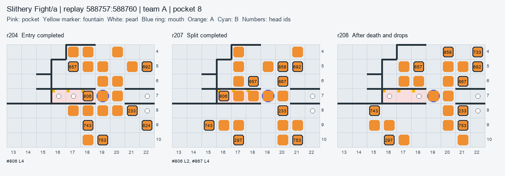
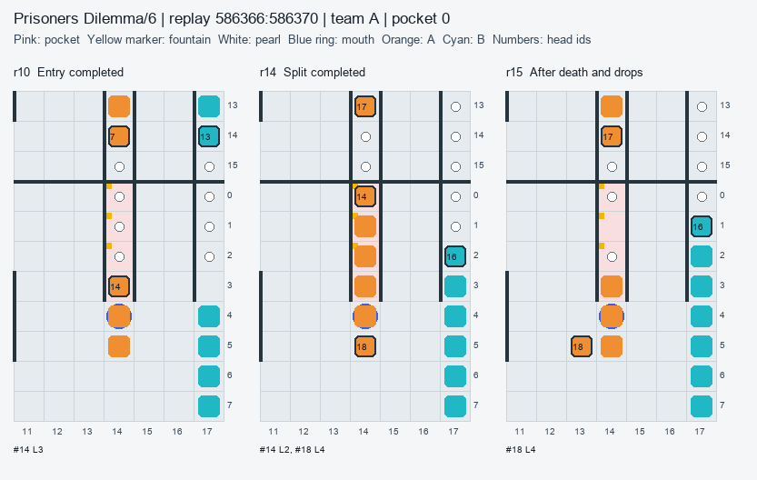
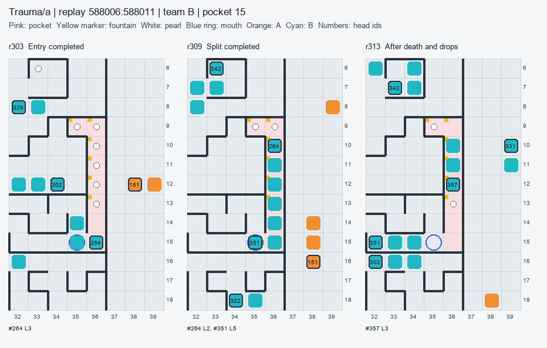

# 포켓 샘 수확: 짧은 진입, 역방향 반출, 사망 진주의 회수

[사실] **섭취량과 순질량은 다르다.** 동결 모집단은 상위권 인덱스 18,799판 중 요청 지도 9,422판, 우리 W0–W12 525판, 동결 때 존재한 v1 로컬 202판이다. 원자료 10,149/10,149판을 처리했고, 멈춘 상위권 145판을 집계에서 제외했다. 유지 모집단의 물리적 머리 에피소드는 **1,372,405개**다. 동결 시각은 2026-10-01 05:11:57 KST(2026-09-30T20:11:57.566Z)다. 이전 공간 연구의 N=881/810 등과 현재 N이 다른 것은 이 동결 사이에 상위권 기보가 늘었기 때문이다.

[해석] 수확의 단위는 끝에 들어가 죽는 큰 드래곤이 아니라, **짧은 진입 조각 → 먹은 뒤 역방향 자식 반출 → 내부 드롭의 다음 조각 회수**다. 단, 이 세 단계가 있어도 한 방문에 자연 진주 1개만 먹으면 부모 잔여 길이 2–3의 손실을 메우는 데 그칠 수 있다. Slithery는 회수 경쟁, PD6는 한 방문의 자연 섭취량, PD10은 거의 무성장인 고정 고리, Trauma는 포켓 내부 후손 사슬이 핵심이다. 새 봇의 승률 또는 최종 왕 길이가 개선됐다는 실험은 하지 않았다.

## 1. 세 단계 방법과 모집단

[사실] **1단계: 전체 모집단 스크립트.** [extract.js](../../exp/pocket/extract.js)는 검증된 [fast decoder](../../legacy/exp/intake-gap/rawload.js)로 기보를 읽고, head/tail 업데이트·분열 몸·사망·tileChange를 따라 몸과 진주 출처를 재구성했다. [episodes.jsonl](../../exp/pocket/episodes.jsonl)과 [tables.json](../../exp/pocket/tables.json)을 먼저 썼다. 원래 10,149판의 결과 몸 수·총길이·최장 대조 불일치는 0이다. `turnStart`는 이동 전이므로 현재 머리 위치로 섭취를 귀속하지 않았다. 먹은 칸의 tileChange를 현재 turnStart의 행동자에게 귀속했다. 초기 진주와 실제 성공한 자연 생성은 출현에 포함하고 사망 드롭은 분리했다.

[사실] **2단계: 크기를 붙인 분류.** 물리적 머리의 진입/초기 배치/분열 탄생을 구분하고, 부모의 종료와 분열 자식의 종료를 따로 기록했다. 그 뒤 같은 포켓 안에서 태어난 후손을 진입·탄생 루트에 붙인 **수확 가족**을 만들었다. 밖에서 태어난 자식은 즉시 반출이며, 다른 포켓에서 태어났다면 그곳의 새 루트다. 이 단계의 클래스 N을 tables.json에 저장한 뒤 정독 대상을 골랐다.

[사실] **3단계: 선택 정독.** 샘 포켓의 주류인 분열 반출을 자연 섭취 2개(Slithery a/b, PD6), 1개(PD10), 4개 이상(Trauma)으로 세분했다. 가족 평균의 진입 길이·섭취·순질량·점유 시간에 정규화 절대거리 합이 가장 가까운 실제 진입을 골랐다. 상위권은 실제 경계 진입만, 우리 고리는 포켓 탄생도 후보로 삼았다. 후보 N과 전체 세부 클래스 N을 아래에 모두 적었다. 우리 PD6/PD10 고리와 Slithery 목표 실패도 별도로 읽었다. 높은 순질량 사례를 전체 평균 대신 제시하지 않는다. [deep-selection.json](../../exp/pocket/deep-selection.json)에 선정 규칙·ID·라운드가 있다.

| 지도/판본 | N 상위 유지 판 | N W0–W12 판 | N 로컬 판 | 포켓 칸 / 샘 칸 | 샘 포켓 모양 |
| --- | --- | --- | --- | --- | --- |
| Slithery Fight/a | 914 | 49 | 26 | 62 / 32 | 깊이 3, 3샘 × 6; 깊이 3, 2샘 × 6; 깊이 1, 1샘 × 2 |
| Slithery Fight/b | 966 | 56 | 20 | 62 / 30 | 깊이 3, 3샘 × 6; 깊이 3, 2샘 × 6 |
| Prisoners Dilemma/6 | 849 | 57 | 14 | 16 / 12 | 깊이 4, 3샘 × 4 |
| Prisoners Dilemma/10 | 835 | 48 | 12 | 16 / 8 | 깊이 4, 2샘 × 4 |
| Trauma/a | 1,869 | 105 | 42 | 78 / 12 | 깊이 8, 6샘 × 2 |
| Schooltime/a | 1,056 | 66 | 26 | 104 / 0 | 샘 포켓 0 |
| Schooltime/b | 1,022 | 39 | 20 | 104 / 0 | 샘 포켓 0 |
| Queen Of Spades/a | 883 | 46 | 22 | 16 / 0 | 샘 포켓 0 |
| Queen Of Spades/b | 876 | 59 | 20 | 16 / 0 | 샘 포켓 0 |

[사실] 판본 미확정은 Slithery 6판, QoS 1판(N=7)이다. 별도 JSON 구획에 남겼고 판본별 수치에 섞지 않았다. W0의 merge2 3세트, stack6의 2세트는 각각 합쳤으며, W1–W12의 나머지 가족은 따로 남겼다. 예전 온라인 9가족은 이번 W0–W12 질문의 모집단 밖이다. 새 경기·네트워크·업로드·커밋은 사용하지 않았다. 동시에 쓰는 작업 프로세스는 최대 2개였고, 가용 메모리<10% 또는 디스크<20 GiB이면 새 작업 배정을 중단했다. 관측한 자원은 한도 위였다.

## 2. 에피소드, 질량, 독립 검산

[사실] 포켓은 kelp·wrap·portal을 반영한 passable 무향 그래프의 2-core 밖 연결 성분이다. 샘은 생성 gap 평균≤12이고 max>0인 칸이다. “샘 포켓”은 이 샘이 하나라도 있는 성분 전체다. **샘 칸 섭취**, **샘 포켓 전체 자연 섭취**, **모든 포켓 자연 섭취**는 다른 필드다. 아래 경제 표는 샘 포켓 전체를 쓰며, 샘이 없는 지도는 모든 포켓을 명시해 쓴다. 모든 비율은 합산 분자/합산 노출이다.

[사실] 물리적 머리 에피소드는 경계 진입 또는 안에서의 초기/분열 탄생으로 시작해 해당 성분을 떠남, 사망, 게임 종료 중 하나로 끝난다. `entryLength`는 진입 이동의 진주를 먹기 **전** 길이다. `near`는 그 순간 입구까지 경로 3 이내의 다른 아군 머리 `[id,길이,거리,칸]`다. 이는 전담 주둔 인원 또는 의도를 판정한 값이 아니다. 점유 HR은 라운드 시작의 머리-라운드 합이다. 포켓 라운드는 같은 판·팀·성분·라운드에 머리가 하나 이상 있으면 한 번만 센 별도 분모다. 클래스끼리 동시에 점유할 수 있어 클래스별 포켓 라운드를 더하면 중복될 수 있다. 둘 다 진입한 라운드의 행동·가족의 경과 라운드와 다르다. 게임 종료는 탈출 실패로 확정하지 않고 검열한다.

[사실] 직접 변화와 회수까지 닫은 변화는 다음과 같다.

```text
rawNet = 자연 섭취 + 아군 드롭 섭취 + 적 드롭 섭취 − 질주 비용 − 사망 몸 길이
recycledNet = rawNet + 그 사망 드롭의 이후 아군 회수 − 아군 포켓 드롭 섭취
```

[사실] 마지막 빼기는 포켓 사망에 이미 회수로 적힌 진주를 다른 포켓 에피소드의 섭취에 다시 더하는 중복을 없앤다. 회수는 해당 에피소드 종료 뒤와 포켓 밖까지, 게임 끝까지 추적하며 먹은 id·팀·라운드·당시 길이를 저장한다. 가족은 같은 포켓 후손의 위 항을 합친다. 모든 가족의 자연 섭취와 순질량 합은 물리적 에피소드 합과 같다. `teamDelta`(동일 시간의 팀 전체 총길이 차)도 원자료에 있으나 동시 다른 드래곤 활동이 섞이므로 수확 이익으로 읽거나 에피소드끼리 합하지 않는다. 살아서 반출된 **기존** 몸 길이도 신규 이익이 아니다.

[해석] 길이 2 또는 3 부모가 죽고 드롭이 전부 아군에게 돌아오면 실제 손실은 1이다. 따라서 다른 비용이 없을 때 자연 2개는 순질량 +1, 자연 1개는 0이다. 드롭을 적이 먹거나 못 주우면 이 식의 이익은 낮아진다. 부모 사망 자체를 실패로 세거나, 반출한 자식 길이를 모두 신규 이익으로 세면 두 방향 모두 잘못된다.

[사실] [verify.js](../../exp/pocket/verify.js)는 [mass_ledger.js](../../tools/mass_ledger.js)의 실제 단계 이동·드롭 장부와 [독립 geometry/2-core](../../exp/spatial/recount.js)를 썼다. 10,149/10,149판에서 진입·탄생·섭취·분열·사망·점유·드롭 회수·순질량이 일치했다. 장부의 이동, 분열, 드롭, 섭취, 총질량, 최종 몸, 계보, 출처 균형 검사는 모두 0이다. 첫 비교는 790판에서 질주 **비용과 그로부터 파생되는 순질량만** 달랐다. 독립 코드가 포켓에 들어가기 전/나온 뒤의 질주까지 포함했기 때문이다. 단계별로 경계 비용을 귀속해 그 790판을 다시 계산했고 최종 불일치 0이다. [최초 검사](../../exp/pocket/verification-initial.json)와 [최종 검사](../../exp/pocket/verification.json)를 둘 다 남겼다. 판본 동결 배정은 공유했으므로 모호한 판본을 독립 확정했다고 주장하지 않는다.

[사실] 양의 순질량을 보고하는 **샘 포켓 부분집합**도 별도 [verify_fountains.js](../../exp/pocket/verify_fountains.js)로 5,929판을 다시 셌다. 성분을 독립 geometry로 확장하고 단계별 비용·모든 드롭 출처를 따라갔으며 불일치 0이다. 아래는 이 부분집합의 1차/독립 원수다.

| 지도/판본 | 구분 | N 판 | 자연 섭취 1차 / 독립 | 사망 N 1차 / 독립 | 점유 HR 1차 / 독립 | 순질량 1차 / 독립 |
| --- | --- | --- | --- | --- | --- | --- |
| Slithery Fight/a | 상위 승자 | 914 | 196,419 / 196,419 | 152,336 / 152,336 | 564,182 / 564,182 | 15,302 / 15,302 |
| Slithery Fight/a | 상위 패자 | 914 | 185,566 / 185,566 | 148,212 / 148,212 | 536,674 / 536,674 | 8,347 / 8,347 |
| Slithery Fight/a | 우리 W12 | 5 | 74 / 74 | 47 / 47 | 168 / 168 | -38 / -38 |
| Slithery Fight/b | 상위 승자 | 966 | 224,255 / 224,255 | 167,857 / 167,857 | 632,185 / 632,185 | 29,825 / 29,825 |
| Slithery Fight/b | 상위 패자 | 966 | 206,832 / 206,832 | 159,299 / 159,299 | 589,275 / 589,275 | 21,915 / 21,915 |
| Slithery Fight/b | 우리 W12 | 2 | 24 / 24 | 13 / 13 | 44 / 44 | -15 / -15 |
| Prisoners Dilemma/6 | 상위 승자 | 849 | 68,268 / 68,268 | 40,953 / 40,953 | 186,394 / 186,394 | 27,232 / 27,232 |
| Prisoners Dilemma/6 | 상위 패자 | 849 | 27,183 / 27,183 | 18,903 / 18,903 | 77,331 / 77,331 | 5,968 / 5,968 |
| Prisoners Dilemma/6 | 우리 W12 | 5 | 1,169 / 1,169 | 1,155 / 1,155 | 4,613 / 4,613 | -22 / -22 |
| Prisoners Dilemma/10 | 상위 승자 | 835 | 19,300 / 19,300 | 18,459 / 18,459 | 87,027 / 87,027 | -73 / -73 |
| Prisoners Dilemma/10 | 상위 패자 | 835 | 13,881 / 13,881 | 12,799 / 12,799 | 54,834 / 54,834 | -950 / -950 |
| Prisoners Dilemma/10 | 우리 W12 | 2 | 338 / 338 | 332 / 332 | 1,332 / 1,332 | 4 / 4 |
| Trauma/a | 상위 승자 | 1,869 | 328,708 / 328,708 | 107,375 / 107,375 | 822,711 / 822,711 | 216,526 / 216,526 |
| Trauma/a | 상위 패자 | 1,869 | 240,661 / 240,661 | 79,040 / 79,040 | 593,118 / 593,118 | 157,571 / 157,571 |
| Trauma/a | 우리 W12 | 7 | 400 / 400 | 101 / 101 | 877 / 877 | 285 / 285 |

[사실] 사망 원인은 재생 원자료 코드다. W=kelp/벽, S=자기 몸(꼬리 포함), O=다른 몸, H=다른 머리 충돌, A=유효 행동 없음(명시 자살·불법 분열·질주 비용 실패 등을 포함)이다. A만으로 자살 의도를 단정하지 않는다. 다음은 샘 포켓 물리 에피소드의 사망 전수이며, 에피소드 원자료에는 당시 행동과 자유 인접칸 수도 있다.

| 지도/판본 | 구분 | 판 N / 사망 N | W | S | O | H | A |
| --- | --- | --- | --- | --- | --- | --- | --- |
| Slithery Fight/a | 상위 승자 | 914 / 152,336 | 89,087 | 38,997 | 126 | 0 | 24,126 |
| Slithery Fight/a | 상위 패자 | 914 / 148,212 | 92,597 | 34,196 | 144 | 0 | 21,275 |
| Slithery Fight/a | 우리 W12 | 5 / 47 | 47 | 0 | 0 | 0 | 0 |
| Slithery Fight/b | 상위 승자 | 966 / 167,857 | 96,201 | 41,285 | 100 | 0 | 30,271 |
| Slithery Fight/b | 상위 패자 | 966 / 159,299 | 95,123 | 39,399 | 178 | 0 | 24,599 |
| Slithery Fight/b | 우리 W12 | 2 / 13 | 13 | 0 | 0 | 0 | 0 |
| Prisoners Dilemma/6 | 상위 승자 | 849 / 40,953 | 22,439 | 12,885 | 510 | 56 | 5,063 |
| Prisoners Dilemma/6 | 상위 패자 | 849 / 18,903 | 11,981 | 5,014 | 165 | 45 | 1,698 |
| Prisoners Dilemma/6 | 우리 W12 | 5 / 1,155 | 1,152 | 3 | 0 | 0 | 0 |
| Prisoners Dilemma/10 | 상위 승자 | 835 / 18,459 | 11,152 | 4,122 | 323 | 72 | 2,790 |
| Prisoners Dilemma/10 | 상위 패자 | 835 / 12,799 | 6,700 | 4,649 | 136 | 76 | 1,238 |
| Prisoners Dilemma/10 | 우리 W12 | 2 / 332 | 332 | 0 | 0 | 0 | 0 |
| Trauma/a | 상위 승자 | 1,869 / 107,375 | 81,842 | 8,690 | 1,741 | 61 | 15,041 |
| Trauma/a | 상위 패자 | 1,869 / 79,040 | 57,481 | 8,541 | 1,797 | 59 | 11,162 |
| Trauma/a | 우리 W12 | 7 / 101 | 99 | 0 | 2 | 0 | 0 |

## 3. 전체 경제: 많이 먹어도 이익이 남는가

| 지도/판본 | 구분 | N 판 / 물리 에피소드 | 자연/판 | 순질량/판 | 순질량/자연 | 순질량/사망 | 사망/자연 | 드롭 아군 / 적 회수 |
| --- | --- | --- | --- | --- | --- | --- | --- | --- |
| Slithery Fight/a | 상위 승자 | 914 / 152,831 | 214.90 | 16.74 | 0.078 | 0.100 | 0.776 | 93.0% / 3.2% |
| Slithery Fight/a | 상위 패자 | 914 / 148,589 | 203.03 | 9.13 | 0.045 | 0.056 | 0.799 | 92.9% / 3.6% |
| Slithery Fight/a | 우리 W12 | 5 / 47 | 14.80 | -7.60 | -0.514 | -0.809 | 0.635 | 28.0% / 49.5% |
| Slithery Fight/a | v0t 로컬 | 6 / 42 | 11.33 | -8.00 | -0.706 | -1.143 | 0.618 | 16.3% / 55.8% |
| Slithery Fight/a | 초기 v1 로컬 | 6 / 39 | 11.50 | -7.17 | -0.623 | -1.103 | 0.565 | 2.6% / 73.7% |
| Slithery Fight/a | 최종 v1 로컬 | 2 / 13 | 11.50 | -7.00 | -0.609 | -1.077 | 0.565 | 7.7% / 53.8% |
| Slithery Fight/b | 상위 승자 | 966 / 168,324 | 232.15 | 30.87 | 0.133 | 0.178 | 0.749 | 93.4% / 3.2% |
| Slithery Fight/b | 상위 패자 | 966 / 159,713 | 214.11 | 22.69 | 0.106 | 0.138 | 0.770 | 93.2% / 3.7% |
| Slithery Fight/b | 우리 W12 | 2 / 13 | 12.00 | -7.50 | -0.625 | -1.154 | 0.542 | 0.0% / 76.9% |
| Slithery Fight/b | v0t 로컬 | 6 / 37 | 11.33 | -7.00 | -0.618 | -1.135 | 0.544 | 0.0% / 73.0% |
| Slithery Fight/b | 초기 v1 로컬 | 6 / 41 | 12.00 | -7.67 | -0.639 | -1.122 | 0.569 | 7.3% / 75.6% |
| Prisoners Dilemma/6 | 상위 승자 | 849 / 46,805 | 80.41 | 32.08 | 0.399 | 0.665 | 0.600 | 90.6% / 3.5% |
| Prisoners Dilemma/6 | 상위 패자 | 849 / 20,288 | 32.02 | 7.03 | 0.220 | 0.316 | 0.695 | 81.7% / 16.2% |
| Prisoners Dilemma/6 | 우리 W12 | 5 / 1,159 | 233.80 | -4.40 | -0.019 | -0.019 | 0.988 | 99.0% / 0.5% |
| Prisoners Dilemma/6 | v0t 로컬 | 6 / 1,488 | 250.00 | -3.83 | -0.015 | -0.016 | 0.988 | 99.0% / 0.3% |
| Prisoners Dilemma/6 | 초기 v1 로컬 | 6 / 1,486 | 249.67 | -4.17 | -0.017 | -0.017 | 0.988 | 99.0% / 0.4% |
| Prisoners Dilemma/6 | 최종 v1 로컬 | 2 / 424 | 214.00 | -4.00 | -0.019 | -0.019 | 0.986 | 98.9% / 0.8% |
| Prisoners Dilemma/10 | 상위 승자 | 835 / 24,023 | 23.11 | -0.09 | -0.004 | -0.004 | 0.956 | 82.4% / 5.0% |
| Prisoners Dilemma/10 | 상위 패자 | 835 / 14,635 | 16.62 | -1.14 | -0.068 | -0.074 | 0.922 | 77.6% / 16.9% |
| Prisoners Dilemma/10 | 우리 W12 | 2 / 334 | 169.00 | 2.00 | 0.012 | 0.012 | 0.982 | 99.4% / 0.0% |
| Prisoners Dilemma/10 | v0t 로컬 | 6 / 1,002 | 169.00 | 2.00 | 0.012 | 0.012 | 0.982 | 99.4% / 0.0% |
| Prisoners Dilemma/10 | 초기 v1 로컬 | 6 / 1,002 | 169.00 | 2.00 | 0.012 | 0.012 | 0.982 | 99.4% / 0.0% |
| Trauma/a | 상위 승자 | 1,869 / 207,175 | 175.87 | 115.85 | 0.659 | 2.017 | 0.327 | 97.8% / 0.1% |
| Trauma/a | 상위 패자 | 1,869 / 148,625 | 128.76 | 84.31 | 0.655 | 1.994 | 0.328 | 97.2% / 0.4% |
| Trauma/a | 우리 W12 | 7 / 173 | 57.14 | 40.71 | 0.713 | 2.822 | 0.253 | 92.0% / 4.0% |
| Trauma/a | v0t 로컬 | 12 / 176 | 36.00 | 23.83 | 0.662 | 2.487 | 0.266 | 86.7% / 2.2% |
| Trauma/a | 초기 v1 로컬 | 12 / 158 | 29.50 | 20.58 | 0.698 | 2.775 | 0.251 | 89.8% / 0.0% |
| Trauma/a | 최종 v1 로컬 | 2 / 12 | 20.00 | 13.50 | 0.675 | 3.000 | 0.225 | 77.8% / 11.1% |

[사실] 아래 출현 몫은 초기 자연 진주와 성공한 자연 생성의 합을 분모로 쓰며 사망 드롭은 제외한다. 모든 포켓 몫은 이전 공간 조사와 비교할 분모, 샘 칸 몫은 빠른 생성 칸에 한정한 별도 분모다. 같은 게임의 승자와 패자는 같은 전체 공급량을 나눠 먹는다.

| 지도/판본 | 구분 | 판 N | 전체 포켓 자연 출현/판 | 전체 포켓 자연 섭취 몫 | 샘 칸 자연 출현/판 | 샘 칸 자연 섭취 몫 |
| --- | --- | --- | --- | --- | --- | --- |
| Slithery Fight/a | 상위 승자 | 914 | 432.68 | 49.7% | 432.68 | 49.7% |
| Slithery Fight/a | 상위 패자 | 914 | 432.68 | 46.9% | 432.68 | 46.9% |
| Slithery Fight/a | 우리 W12 | 5 | 330.00 | 4.5% | 330.00 | 4.5% |
| Slithery Fight/b | 상위 승자 | 966 | 460.89 | 50.4% | 460.89 | 50.4% |
| Slithery Fight/b | 상위 패자 | 966 | 460.89 | 46.5% | 460.89 | 46.5% |
| Slithery Fight/b | 우리 W12 | 2 | 127.50 | 9.4% | 127.50 | 9.4% |
| Prisoners Dilemma/6 | 상위 승자 | 849 | 116.45 | 69.1% | 116.45 | 69.1% |
| Prisoners Dilemma/6 | 상위 패자 | 849 | 116.45 | 27.5% | 116.45 | 27.5% |
| Prisoners Dilemma/6 | 우리 W12 | 5 | 422.80 | 55.3% | 422.80 | 55.3% |
| Prisoners Dilemma/10 | 상위 승자 | 835 | 42.87 | 53.9% | 42.87 | 53.9% |
| Prisoners Dilemma/10 | 상위 패자 | 835 | 42.87 | 38.8% | 42.87 | 38.8% |
| Prisoners Dilemma/10 | 우리 W12 | 2 | 269.00 | 62.8% | 269.00 | 62.8% |
| Trauma/a | 상위 승자 | 1,869 | 312.12 | 56.3% | 312.12 | 56.3% |
| Trauma/a | 상위 패자 | 1,869 | 312.12 | 41.3% | 312.12 | 41.3% |
| Trauma/a | 우리 W12 | 7 | 197.86 | 28.9% | 197.86 | 28.9% |

[사실] Slithery a의 샘 포켓 승자 순질량은 +16.74/판(N=914)이나 전체 포켓은 −11.93/판이다. b는 샘 포켓 +30.87/판, 전체 +10.82/판(N=966)이다. 샘 없는 포켓의 차감은 각각 −28.67, −20.06/판이다. Schooltime a/b와 QoS a/b에는 정의상 포켓 샘 0개이며, 상위 승자도 모든 포켓 합산은 아래처럼 손실이다.

| 지도/판본 | 구분 | N 판 / 에피소드 | 모든 포켓 자연/판 | 모든 포켓 순질량/판 | 포켓 샘 N |
| --- | --- | --- | --- | --- | --- |
| Schooltime/a | 상위 승자 | 1,056 / 11,770 | 3.56 | -16.99 | 0 |
| Schooltime/a | 상위 패자 | 1,056 / 10,172 | 2.76 | -13.44 | 0 |
| Schooltime/a | 우리 W12 | 3 / 5 | 0.67 | -2.33 | 0 |
| Schooltime/b | 상위 승자 | 1,022 / 7,137 | 1.80 | -8.88 | 0 |
| Schooltime/b | 상위 패자 | 1,022 / 3,123 | 1.02 | -3.86 | 0 |
| Schooltime/b | 우리 W12 | 4 / 2 | 0.25 | -0.75 | 0 |
| Queen Of Spades/a | 상위 승자 | 883 / 8,223 | 1.93 | -9.73 | 0 |
| Queen Of Spades/a | 상위 패자 | 883 / 5,176 | 1.21 | -6.41 | 0 |
| Queen Of Spades/a | 우리 W12 | 1 / 0 | 0.00 | 0.00 | 0 |
| Queen Of Spades/b | 상위 승자 | 876 / 6,597 | 1.85 | -7.90 | 0 |
| Queen Of Spades/b | 상위 패자 | 876 / 3,908 | 1.11 | -4.95 | 0 |
| Queen Of Spades/b | 우리 W12 | 6 / 3 | 0.50 | -0.83 | 0 |

[해석] “포켓 전부 무시”와 “포켓 전부 농사”를 모두 지양한다. 일반 분산의 2-core 제한을 유지하면서, 생산과 반출·회수가 확인되는 성분만 전용 수확으로 맡기는 편이 자료와 맞는다. Trauma의 우리 W12는 샘 포켓 **진주당 순질량**이 상위 승자보다 낮지 않지만 점유량과 총 수확량이 적다(N=7 대 1,869). 그 지도는 수확 효율만의 문제가 아니다.

[사실] 부모 머리의 종료와 자식 반출을 분리하면 다음과 같다. 부모가 사망한 방문이 분열 반출 가족의 대부분일 수 있다. 자식 반출 N은 밖에서 태어난 자식을 포함하고, 게임 종료 안쪽 머리는 검열로 남긴다.

| 지도/판본 | 구분 | 판 N / 물리 에피소드 N | 머리 생환 N / 몫 | 머리 사망 N / 몫 | 종료 내부 N / 몫 | 분열 N / 반출 자식 N |
| --- | --- | --- | --- | --- | --- | --- |
| Slithery Fight/a | 상위 승자 | 914 / 152,831 | 0 / 0.0% | 152,336 / 99.7% | 495 / 0.3% | 151,746 / 151,746 |
| Slithery Fight/a | 상위 패자 | 914 / 148,589 | 0 / 0.0% | 148,212 / 99.7% | 377 / 0.3% | 146,834 / 146,834 |
| Slithery Fight/a | 우리 W12 | 5 / 47 | 0 / 0.0% | 47 / 100.0% | 0 / 0.0% | 47 / 47 |
| Slithery Fight/b | 상위 승자 | 966 / 168,324 | 0 / 0.0% | 167,857 / 99.7% | 467 / 0.3% | 171,085 / 171,085 |
| Slithery Fight/b | 상위 패자 | 966 / 159,713 | 0 / 0.0% | 159,299 / 99.7% | 414 / 0.3% | 161,916 / 161,916 |
| Slithery Fight/b | 우리 W12 | 2 / 13 | 0 / 0.0% | 13 / 100.0% | 0 / 0.0% | 13 / 13 |
| Prisoners Dilemma/6 | 상위 승자 | 849 / 46,805 | 4,194 / 9.0% | 40,953 / 87.5% | 1,658 / 3.5% | 47,734 / 46,963 |
| Prisoners Dilemma/6 | 상위 패자 | 849 / 20,288 | 1,320 / 6.5% | 18,903 / 93.2% | 65 / 0.3% | 22,415 / 22,113 |
| Prisoners Dilemma/6 | 우리 W12 | 5 / 1,159 | 0 / 0.0% | 1,155 / 99.7% | 4 / 0.3% | 1,154 / 1,154 |
| Prisoners Dilemma/10 | 상위 승자 | 835 / 24,023 | 4,799 / 20.0% | 18,459 / 76.8% | 765 / 3.2% | 20,755 / 19,740 |
| Prisoners Dilemma/10 | 상위 패자 | 835 / 14,635 | 1,792 / 12.2% | 12,799 / 87.5% | 44 / 0.3% | 14,777 / 14,348 |
| Prisoners Dilemma/10 | 우리 W12 | 2 / 334 | 0 / 0.0% | 332 / 99.4% | 2 / 0.6% | 332 / 332 |
| Trauma/a | 상위 승자 | 1,869 / 207,175 | 98,912 / 47.7% | 107,375 / 51.8% | 888 / 0.4% | 188,223 / 105,893 |
| Trauma/a | 상위 패자 | 1,869 / 148,625 | 69,062 / 46.5% | 79,040 / 53.2% | 523 / 0.4% | 129,627 / 76,244 |
| Trauma/a | 우리 W12 | 7 / 173 | 72 / 41.6% | 101 / 58.4% | 0 / 0.0% | 100 / 97 |

## 4. 클래스의 크기와 수익

[사실] 다음은 샘 포켓 **수확 가족** 분류다. 부모가 죽더라도 자식이 반출되면 분열 반출이다. 같은 포켓에 남은 자식·후손의 죽음과 회수도 가족 비용에 포함했다. `walkExit` 같은 0섭취 이동은 물리 머리에서는 따로 보이지만, 내부 후손이면 같은 가족에 들어간다. 클래스 N은 가족 수, 판 N은 이 코호트의 전체 판 수이며 해당 클래스가 있는 판만을 분모로 삼지 않았다.

| 지도/판본 | 구분 | 판 N | 클래스 | 가족 N / 몫 | 자연/가족 | 순질량/가족 | 순질량/점유 HR | 순질량/포켓 라운드 | 순질량/판 기여 |
| --- | --- | --- | --- | --- | --- | --- | --- | --- | --- |
| Slithery Fight/a | 상위 승자 | 914 | 분열·자식 반출 | 135,990 / 89.0% | 1.32 | 0.27 | 0.070 | 0.070 | 40.13 |
| Slithery Fight/a | 상위 승자 | 914 | 자연 섭취 0·사망 | 3,716 / 2.4% | 0.00 | -1.51 | -1.223 | -1.223 | -6.13 |
| Slithery Fight/a | 상위 승자 | 914 | 무분열 섭취·사망 | 12,809 / 8.4% | 1.25 | -1.26 | -0.453 | -0.453 | -17.60 |
| Slithery Fight/a | 상위 승자 | 914 | 게임 종료 검열 | 316 / 0.2% | 0.97 | 0.99 | 1.322 | 1.322 | 0.34 |
| Slithery Fight/a | 상위 패자 | 914 | 분열·자식 반출 | 132,291 / 89.0% | 1.28 | 0.23 | 0.060 | 0.060 | 32.63 |
| Slithery Fight/a | 상위 패자 | 914 | 자연 섭취 0·사망 | 3,034 / 2.0% | 0.00 | -1.57 | -1.359 | -1.359 | -5.20 |
| Slithery Fight/a | 상위 패자 | 914 | 무분열 섭취·사망 | 13,015 / 8.8% | 1.23 | -1.31 | -0.464 | -0.464 | -18.59 |
| Slithery Fight/a | 상위 패자 | 914 | 게임 종료 검열 | 249 / 0.2% | 1.08 | 1.08 | 1.264 | 1.264 | 0.29 |
| Slithery Fight/a | 우리 W12 | 5 | 분열·자식 반출 | 47 / 100.0% | 1.57 | -0.81 | -0.226 | -0.226 | -7.60 |
| Slithery Fight/b | 상위 승자 | 966 | 분열·자식 반출 | 152,829 / 90.8% | 1.36 | 0.32 | 0.082 | 0.082 | 50.21 |
| Slithery Fight/b | 상위 승자 | 966 | 자연 섭취 0·사망 | 2,830 / 1.7% | 0.00 | -1.25 | -0.901 | -0.901 | -3.65 |
| Slithery Fight/b | 상위 승자 | 966 | 무분열 섭취·사망 | 12,350 / 7.3% | 1.26 | -1.25 | -0.443 | -0.443 | -16.02 |
| Slithery Fight/b | 상위 승자 | 966 | 게임 종료 검열 | 315 / 0.2% | 0.99 | 1.01 | 1.465 | 1.465 | 0.33 |
| Slithery Fight/b | 상위 패자 | 966 | 분열·자식 반출 | 145,523 / 91.1% | 1.32 | 0.28 | 0.072 | 0.072 | 41.44 |
| Slithery Fight/b | 상위 패자 | 966 | 무분열 섭취·사망 | 11,671 / 7.3% | 1.24 | -1.33 | -0.468 | -0.468 | -16.04 |
| Slithery Fight/b | 상위 패자 | 966 | 자연 섭취 0·사망 | 2,230 / 1.4% | 0.00 | -1.31 | -1.031 | -1.031 | -3.04 |
| Slithery Fight/b | 상위 패자 | 966 | 게임 종료 검열 | 289 / 0.2% | 1.04 | 1.08 | 1.312 | 1.312 | 0.32 |
| Slithery Fight/b | 우리 W12 | 2 | 분열·자식 반출 | 13 / 100.0% | 1.85 | -1.15 | -0.341 | -0.341 | -7.50 |
| Prisoners Dilemma/6 | 상위 승자 | 849 | 분열·자식 반출 | 40,218 / 96.1% | 1.67 | 0.66 | 0.144 | 0.144 | 31.34 |
| Prisoners Dilemma/6 | 상위 승자 | 849 | 자연 섭취 0·사망 | 516 / 1.2% | 0.00 | -1.21 | -3.514 | -3.514 | -0.73 |
| Prisoners Dilemma/6 | 상위 승자 | 849 | 게임 종료 검열 | 1,087 / 2.6% | 1.15 | 1.18 | 0.890 | 0.890 | 1.51 |
| Prisoners Dilemma/6 | 상위 승자 | 849 | 무분열 섭취·사망 | 13 / 0.0% | 1.54 | -1.15 | -0.375 | -0.375 | -0.02 |
| Prisoners Dilemma/6 | 상위 승자 | 849 | 분열·반출 없음 | 5 / 0.0% | 0.80 | -2.40 | -0.706 | -0.706 | -0.01 |
| Prisoners Dilemma/6 | 상위 승자 | 849 | 분열·종료 미확정 | 1 / 0.0% | 0.00 | -2.00 | -1.000 | -1.000 | -0.00 |
| Prisoners Dilemma/6 | 상위 패자 | 849 | 분열·자식 반출 | 18,434 / 98.8% | 1.47 | 0.34 | 0.082 | 0.082 | 7.44 |
| Prisoners Dilemma/6 | 상위 패자 | 849 | 자연 섭취 0·사망 | 180 / 1.0% | 0.00 | -1.58 | -2.767 | -2.767 | -0.34 |
| Prisoners Dilemma/6 | 상위 패자 | 849 | 게임 종료 검열 | 37 / 0.2% | 1.08 | 1.05 | 2.294 | 2.294 | 0.05 |
| Prisoners Dilemma/6 | 상위 패자 | 849 | 무분열 섭취·사망 | 13 / 0.1% | 1.46 | -7.23 | -2.938 | -2.938 | -0.11 |
| Prisoners Dilemma/6 | 상위 패자 | 849 | 분열·반출 없음 | 2 / 0.0% | 1.00 | -3.00 | -1.000 | -1.000 | -0.01 |
| Prisoners Dilemma/6 | 우리 W12 | 5 | 분열·자식 반출 | 1,154 / 99.6% | 1.01 | 0.00 | 0.000 | 0.000 | 0.40 |
| Prisoners Dilemma/6 | 우리 W12 | 5 | 자연 섭취 0·사망 | 3 / 0.3% | 0.00 | -8.00 | -24.000 | -24.000 | -4.80 |
| Prisoners Dilemma/6 | 우리 W12 | 5 | 게임 종료 검열 | 2 / 0.2% | 0.00 | 0.00 | – | – | 0.00 |
| Prisoners Dilemma/10 | 상위 승자 | 835 | 분열·자식 반출 | 16,705 / 91.7% | 1.09 | 0.04 | 0.009 | 0.009 | 0.87 |
| Prisoners Dilemma/10 | 상위 승자 | 835 | 분열·반출 없음 | 713 / 3.9% | 1.04 | -1.12 | -0.230 | -0.230 | -0.96 |
| Prisoners Dilemma/10 | 상위 승자 | 835 | 게임 종료 검열 | 533 / 2.9% | 0.50 | 0.56 | 0.368 | 0.368 | 0.35 |
| Prisoners Dilemma/10 | 상위 승자 | 835 | 자연 섭취 0·사망 | 183 / 1.0% | 0.00 | -1.26 | -1.400 | -1.400 | -0.28 |
| Prisoners Dilemma/10 | 상위 승자 | 835 | 무분열 섭취·사망 | 61 / 0.3% | 1.15 | -0.90 | -0.263 | -0.263 | -0.07 |
| Prisoners Dilemma/10 | 상위 승자 | 835 | 분열·종료 미확정 | 14 / 0.1% | 1.00 | -0.93 | -0.241 | -0.241 | -0.02 |
| Prisoners Dilemma/10 | 상위 패자 | 835 | 분열·자식 반출 | 11,923 / 96.0% | 1.13 | -0.02 | -0.004 | -0.004 | -0.29 |
| Prisoners Dilemma/10 | 상위 패자 | 835 | 무분열 섭취·사망 | 37 / 0.3% | 1.62 | -2.35 | -0.725 | -0.725 | -0.10 |
| Prisoners Dilemma/10 | 상위 패자 | 835 | 자연 섭취 0·사망 | 120 / 1.0% | 0.00 | -1.91 | -2.663 | -2.663 | -0.27 |
| Prisoners Dilemma/10 | 상위 패자 | 835 | 게임 종료 검열 | 43 / 0.3% | 0.93 | 0.93 | 0.476 | 0.476 | 0.05 |
| Prisoners Dilemma/10 | 상위 패자 | 835 | 분열·반출 없음 | 291 / 2.3% | 1.17 | -1.50 | -0.316 | -0.316 | -0.52 |
| Prisoners Dilemma/10 | 우리 W12 | 2 | 분열·자식 반출 | 332 / 99.4% | 1.01 | 0.01 | 0.002 | 0.002 | 1.00 |
| Prisoners Dilemma/10 | 우리 W12 | 2 | 게임 종료 검열 | 2 / 0.6% | 1.00 | 1.00 | 0.500 | 0.500 | 1.00 |
| Trauma/a | 상위 승자 | 1,869 | 분열·자식 반출 | 23,153 / 89.3% | 14.12 | 9.44 | 0.268 | 0.422 | 116.94 |
| Trauma/a | 상위 승자 | 1,869 | 자연 섭취 0·사망 | 2,178 / 8.4% | 0.00 | -1.03 | -0.651 | -0.651 | -1.20 |
| Trauma/a | 상위 승자 | 1,869 | 무분열 섭취·사망 | 125 / 0.5% | 1.78 | -0.21 | -0.085 | -0.085 | -0.01 |
| Trauma/a | 상위 승자 | 1,869 | 분열·반출 없음 | 322 / 1.2% | 3.59 | -0.27 | -0.031 | -0.036 | -0.05 |
| Trauma/a | 상위 승자 | 1,869 | 게임 종료 검열 | 152 / 0.6% | 2.07 | 2.07 | 0.895 | 0.895 | 0.17 |
| Trauma/a | 상위 승자 | 1,869 | 분열·종료 미확정 | 3 / 0.0% | 5.33 | 1.67 | 0.143 | 0.179 | 0.00 |
| Trauma/a | 상위 패자 | 1,869 | 분열·자식 반출 | 23,314 / 89.1% | 10.24 | 6.85 | 0.273 | 0.405 | 85.48 |
| Trauma/a | 상위 패자 | 1,869 | 자연 섭취 0·사망 | 2,141 / 8.2% | 0.00 | -1.03 | -0.688 | -0.688 | -1.18 |
| Trauma/a | 상위 패자 | 1,869 | 게임 종료 검열 | 147 / 0.6% | 2.33 | 2.35 | 0.812 | 0.812 | 0.19 |
| Trauma/a | 상위 패자 | 1,869 | 무분열 섭취·사망 | 155 / 0.6% | 1.34 | -0.18 | -0.109 | -0.109 | -0.01 |
| Trauma/a | 상위 패자 | 1,869 | 분열·반출 없음 | 418 / 1.6% | 3.18 | -0.71 | -0.081 | -0.095 | -0.16 |
| Trauma/a | 상위 패자 | 1,869 | 분열·종료 미확정 | 5 / 0.0% | 3.80 | 0.20 | 0.027 | 0.033 | 0.00 |
| Trauma/a | 우리 W12 | 7 | 분열·자식 반출 | 97 / 99.0% | 4.08 | 2.93 | 0.328 | 0.328 | 40.57 |
| Trauma/a | 우리 W12 | 7 | 분열·반출 없음 | 1 / 1.0% | 4.00 | 1.00 | 0.100 | 0.111 | 0.14 |

[사실] 다음은 자연 섭취 수로 나눈 가족 전체다. 반출 클래스만 고른 표가 아니라 실패·검열까지 포함하므로 “두 개를 먹은 성공 사례”만의 평균은 아니다.

| 지도/판본 | 상위 승자 판 N | 자연 수 | 가족 N | 순질량/가족 | 순질량/자연 | 사망 N |
| --- | --- | --- | --- | --- | --- | --- |
| Slithery Fight/a | 914 | 0 | 6,714 | -1.38 | – | 6,629 |
| Slithery Fight/a | 914 | 1 | 95,815 | -0.18 | -0.179 | 95,522 |
| Slithery Fight/a | 914 | 2 | 50,302 | 0.83 | 0.414 | 50,185 |
| Slithery Fight/b | 966 | 0 | 3,412 | -1.21 | – | 3,334 |
| Slithery Fight/b | 966 | 1 | 105,569 | -0.16 | -0.156 | 105,303 |
| Slithery Fight/b | 966 | 2 | 59,343 | 0.85 | 0.424 | 59,220 |
| Prisoners Dilemma/6 | 849 | 0 | 874 | -0.82 | – | 585 |
| Prisoners Dilemma/6 | 849 | 1 | 14,516 | 0.11 | 0.112 | 14,071 |
| Prisoners Dilemma/6 | 849 | 2 | 25,598 | 0.97 | 0.485 | 25,444 |
| Prisoners Dilemma/6 | 849 | 3 | 852 | 1.77 | 0.590 | 853 |
| Prisoners Dilemma/10 | 835 | 0 | 577 | -0.64 | – | 300 |
| Prisoners Dilemma/10 | 835 | 1 | 15,964 | -0.03 | -0.033 | 16,334 |
| Prisoners Dilemma/10 | 835 | 2 | 1,668 | 0.50 | 0.249 | 1,825 |
| Trauma/a | 1,869 | 0 | 2,581 | -1.06 | – | 2,642 |
| Trauma/a | 1,869 | 1 | 134 | 0.13 | 0.134 | 106 |
| Trauma/a | 1,869 | 2 | 282 | 0.71 | 0.353 | 288 |
| Trauma/a | 1,869 | 3 | 4,790 | 1.93 | 0.643 | 4,961 |
| Trauma/a | 1,869 | 4+ | 18,146 | 11.56 | 0.669 | 99,378 |

[해석] Slithery a/b의 자연 2개 가족은 평균 약 +0.83/+0.85이고 자연 1개 가족은 −0.18/−0.16이다(N은 위 표). PD6 자연 2개 가족은 +0.97, PD10은 +0.50이다. 이것이 “자연 2개 이상을 확인한 짧은 방문”의 근거다. 자연 수는 미래 행동의 결과이므로 이 표를 입구에서 완벽하게 알 수 있는 조건이나 인과 효과로 오인하지 않는다. 진입 전에는 현재 보이는 자연 진주·재생 예상·몸 점유·드롭 회수 가능성으로 보수적으로 예측해야 한다.

### 진입 길이, 국면, 입구 머리

[사실] 길이 표는 초기/분열 탄생을 섞지 않은 **실제 경계 진입**만 쓴다. PD의 우리 긴 고리는 포켓에서 새 자식이 탄생하므로 진입 N=0이어도 대량 수확할 수 있다.

| 지도/판본 | 상위 승자 판 N | 진입 전 길이 | 실제 진입 N | 순질량/물리 진입 | 자연/진입 | 곁의 다른 머리 평균 |
| --- | --- | --- | --- | --- | --- | --- |
| Slithery Fight/a | 914 | 2 | 68,289 | 0.20 | 1.34 | 1.67 |
| Slithery Fight/a | 914 | 3 | 34,585 | 0.17 | 1.44 | 1.46 |
| Slithery Fight/a | 914 | 4-7 | 12,888 | -0.15 | 1.26 | 1.23 |
| Slithery Fight/a | 914 | 8-14 | 1,962 | -0.62 | 1.04 | 0.75 |
| Slithery Fight/a | 914 | 15+ | 802 | -0.81 | 0.85 | 0.39 |
| Slithery Fight/b | 966 | 2 | 74,361 | 0.26 | 1.38 | 1.74 |
| Slithery Fight/b | 966 | 3 | 39,963 | 0.25 | 1.49 | 1.53 |
| Slithery Fight/b | 966 | 4-7 | 11,270 | 0.08 | 1.44 | 1.28 |
| Slithery Fight/b | 966 | 15+ | 404 | -0.25 | 1.37 | 0.58 |
| Slithery Fight/b | 966 | 8-14 | 1,247 | 0.07 | 1.52 | 0.87 |
| Prisoners Dilemma/6 | 849 | 2 | 15,597 | 0.79 | 1.73 | 1.44 |
| Prisoners Dilemma/6 | 849 | 3 | 11,243 | 0.97 | 1.86 | 1.26 |
| Prisoners Dilemma/6 | 849 | 4-7 | 630 | 1.04 | 1.86 | 1.47 |
| Prisoners Dilemma/6 | 849 | 8-14 | 69 | 0.99 | 1.94 | 1.04 |
| Prisoners Dilemma/6 | 849 | 15+ | 13 | 0.23 | 1.54 | 0.46 |
| Prisoners Dilemma/10 | 835 | 2 | 6,422 | 0.02 | 0.97 | 1.76 |
| Prisoners Dilemma/10 | 835 | 3 | 6,452 | 0.04 | 0.98 | 1.65 |
| Prisoners Dilemma/10 | 835 | 4-7 | 850 | 0.04 | 0.98 | 1.74 |
| Prisoners Dilemma/10 | 835 | 15+ | 18 | -0.50 | 0.94 | 0.17 |
| Prisoners Dilemma/10 | 835 | 8-14 | 69 | -0.16 | 0.96 | 1.03 |
| Trauma/a | 1,869 | 2 | 8,954 | 2.90 | 3.98 | 0.16 |
| Trauma/a | 1,869 | 3 | 2,225 | 2.95 | 4.07 | 0.14 |
| Trauma/a | 1,869 | 4-7 | 1,234 | 3.37 | 4.52 | 0.06 |
| Trauma/a | 1,869 | 15+ | 66 | 3.21 | 4.61 | 0.05 |
| Trauma/a | 1,869 | 8-14 | 203 | 3.21 | 4.41 | 0.04 |

[해석] Slithery에서는 길이 2–3 진입이 가장 큰 표본으로 양의 평균을 보이며, a의 길이 4 이상은 음의 평균이다. PD6의 4–7 진입 평균도 높지만 N이 630으로 2–3의 26,840보다 작아 “4–7이 최적”이라고 판정하지 않는다. Trauma는 긴 깊이 8 통로에서 가족 후속 행동이 길어, 한 머리 종료의 순질량만으로 최적 길이를 고르면 안 된다. 긴 왕을 보내기보다 길이 2–3 서비스 조각으로 시작하는 규칙이 실용적인 기본값이다.

| 지도/판본 | 상위 승자 판 N | 루트 진입/탄생 국면 | 가족 N | 순질량/가족 | 순질량/점유 HR | 순질량/판 기여 |
| --- | --- | --- | --- | --- | --- | --- |
| Slithery Fight/a | 914 | r0-99 | 52,063 | 0.27 | 0.073 | 15.59 |
| Slithery Fight/a | 914 | r100-249 | 47,494 | -0.05 | -0.014 | -2.58 |
| Slithery Fight/a | 914 | r250-374 | 32,654 | 0.08 | 0.021 | 2.78 |
| Slithery Fight/a | 914 | r375-499 | 20,620 | 0.04 | 0.012 | 0.96 |
| Slithery Fight/b | 966 | r0-99 | 56,511 | 0.34 | 0.089 | 19.90 |
| Slithery Fight/b | 966 | r100-249 | 57,068 | 0.07 | 0.019 | 4.22 |
| Slithery Fight/b | 966 | r250-374 | 34,738 | 0.12 | 0.032 | 4.38 |
| Slithery Fight/b | 966 | r375-499 | 20,007 | 0.11 | 0.031 | 2.38 |
| Prisoners Dilemma/6 | 849 | r0-99 | 22,972 | 0.82 | 0.172 | 22.31 |
| Prisoners Dilemma/6 | 849 | r100-249 | 12,401 | 0.57 | 0.132 | 8.36 |
| Prisoners Dilemma/6 | 849 | r250-374 | 3,710 | 0.28 | 0.074 | 1.21 |
| Prisoners Dilemma/6 | 849 | r375-499 | 2,757 | 0.06 | 0.019 | 0.20 |
| Prisoners Dilemma/10 | 835 | r0-99 | 10,510 | 0.08 | 0.017 | 1.05 |
| Prisoners Dilemma/10 | 835 | r100-249 | 4,562 | -0.12 | -0.026 | -0.67 |
| Prisoners Dilemma/10 | 835 | r250-374 | 1,977 | -0.10 | -0.021 | -0.23 |
| Prisoners Dilemma/10 | 835 | r375-499 | 1,160 | -0.17 | -0.038 | -0.24 |
| Trauma/a | 1,869 | r0-99 | 5,071 | 20.65 | 0.259 | 56.03 |
| Trauma/a | 1,869 | r100-249 | 9,141 | 6.23 | 0.265 | 30.47 |
| Trauma/a | 1,869 | r250-374 | 7,025 | 5.19 | 0.260 | 19.50 |
| Trauma/a | 1,869 | r375-499 | 4,696 | 3.92 | 0.289 | 9.84 |

[사실] 위 국면은 **루트가 시작한** 때다. Trauma의 r0–99 가족은 후손이 훨씬 나중까지 수확할 수 있으므로 그 가족 이익을 전부 r0–99에 발생한 흐름으로 읽으면 안 된다. 짧게 끝나는 Slithery/PD와 직접 지속시간을 비교할 때도 이 차이를 보아야 한다.

[사실] Slithery a의 r0–99 시작 가족은 +0.274/가족(N=52,063), r100–249는 −0.050(N=47,494)다. PD6는 r0–99 +0.824(N=22,972)에서 r375–499 +0.061(N=2,757)로 감소한다. PD10은 r0–99 +0.083(N=10,510)이지만 그 뒤 세 국면은 모두 음수(N=4,562/1,977/1,160)다. Trauma는 루트 국면별 점유 HR당 순질량이 약 +0.259–0.289(N=5,071/9,141/7,025/4,696 가족)이며 후반 가족은 짧게 검열될 수 있다.

[해석] Slithery/PD6는 초반 자연 재고와 입구를 먼저 서비스하고 후반에는 신규 방문을 회수 ETA로 제한한다. PD10의 새 농사 배정은 기본적으로 r0–99의 자연2 확인 기회로 제한한다. Trauma는 고정 라운드에 끊기보다 왕 전환과 가족 반출까지 남은 시간을 계산한다. 이 국면 비교는 생존·조기종료·경쟁을 통제한 인과 효과가 아니다.

| 지도/판본 | 상위 승자 판 N | 입구 3 이내 다른 머리 수 | 실제 진입 N / 몫 | 순질량/진입 |
| --- | --- | --- | --- | --- |
| Slithery Fight/a | 914 | 0 | 23,714 / 20.0% | 0.10 |
| Slithery Fight/a | 914 | 1 | 39,675 / 33.5% | 0.13 |
| Slithery Fight/a | 914 | 2 | 31,992 / 27.0% | 0.15 |
| Slithery Fight/a | 914 | 3 | 16,101 / 13.6% | 0.16 |
| Slithery Fight/a | 914 | 4+ | 7,044 / 5.9% | 0.15 |
| Slithery Fight/b | 966 | 0 | 23,070 / 18.1% | 0.28 |
| Slithery Fight/b | 966 | 1 | 40,811 / 32.1% | 0.25 |
| Slithery Fight/b | 966 | 2 | 35,685 / 28.0% | 0.22 |
| Slithery Fight/b | 966 | 3 | 19,080 / 15.0% | 0.22 |
| Slithery Fight/b | 966 | 4+ | 8,599 / 6.8% | 0.22 |
| Prisoners Dilemma/6 | 849 | 0 | 7,277 / 26.4% | 0.88 |
| Prisoners Dilemma/6 | 849 | 1 | 9,626 / 34.9% | 0.86 |
| Prisoners Dilemma/6 | 849 | 2 | 6,146 / 22.3% | 0.87 |
| Prisoners Dilemma/6 | 849 | 3 | 2,914 / 10.6% | 0.88 |
| Prisoners Dilemma/6 | 849 | 4+ | 1,589 / 5.8% | 0.88 |
| Prisoners Dilemma/10 | 835 | 0 | 2,276 / 16.5% | 0.12 |
| Prisoners Dilemma/10 | 835 | 1 | 4,385 / 31.8% | 0.07 |
| Prisoners Dilemma/10 | 835 | 2 | 3,849 / 27.9% | 0.00 |
| Prisoners Dilemma/10 | 835 | 3 | 2,114 / 15.3% | -0.03 |
| Prisoners Dilemma/10 | 835 | 4+ | 1,187 / 8.6% | -0.05 |
| Trauma/a | 1,869 | 0 | 11,110 / 87.6% | 3.09 |
| Trauma/a | 1,869 | 1 | 1,310 / 10.3% | 2.41 |
| Trauma/a | 1,869 | 2 | 249 / 2.0% | 0.14 |
| Trauma/a | 1,869 | 3 | 13 / 0.1% | -0.15 |

[해석] Slithery는 입구 주변에 다른 머리 1–2개가 있는 진입이 흔하고, PD6도 0–2개가 주류다. Trauma는 실제 경계 진입의 다수가 주변 다른 머리 0개다. 큰 큐가 항상 더 좋은 수익을 보이지 않는다. 이것은 전담 주둔 인원을 관측한 값이 아니므로, 구현은 **한 진입자와 밖의 한 인수자**부터 시작하고 반출 경로를 우선 비우는 편이 타당하다.

### 릴레이와 긴 드래곤

[사실] 릴레이는 이전 같은 포켓 아군 사망의 드롭을 3라운드 이내 들어온 조각이 실제 먹었을 때만 확인했다. 이전 사망자의 후손이면 `returnRunner`, 다른 계통이면 `externalRelay`다. 긴 간격의 회수·의도만 있는 큐는 제외한 최소 계수다. 아래 분류는 분열/무분열 클래스와 **겹친다**.

| 지도/판본 | 구분 | 판 N | 계승 유형 | 가족 N | 순질량/가족 | 순질량/점유 HR |
| --- | --- | --- | --- | --- | --- | --- |
| Slithery Fight/a | 상위 승자 | 914 | 후손 반환 | 52,584 | 0.08 | 0.022 |
| Slithery Fight/a | 상위 승자 | 914 | 타계통 인수 | 27,461 | 0.14 | 0.035 |
| Slithery Fight/a | 상위 패자 | 914 | 타계통 인수 | 22,638 | 0.08 | 0.020 |
| Slithery Fight/a | 상위 패자 | 914 | 후손 반환 | 59,991 | 0.05 | 0.016 |
| Slithery Fight/a | 우리 W12 | 5 | 타계통 인수 | 1 | 0.00 | 0.000 |
| Slithery Fight/b | 상위 승자 | 966 | 후손 반환 | 61,016 | 0.11 | 0.031 |
| Slithery Fight/b | 상위 승자 | 966 | 타계통 인수 | 32,022 | 0.20 | 0.050 |
| Slithery Fight/b | 상위 패자 | 966 | 타계통 인수 | 25,309 | 0.18 | 0.045 |
| Slithery Fight/b | 상위 패자 | 966 | 후손 반환 | 66,162 | 0.08 | 0.024 |
| Prisoners Dilemma/6 | 상위 승자 | 849 | 후손 반환 | 14,965 | 0.26 | 0.069 |
| Prisoners Dilemma/6 | 상위 승자 | 849 | 타계통 인수 | 8,576 | 0.77 | 0.164 |
| Prisoners Dilemma/6 | 상위 패자 | 849 | 후손 반환 | 9,676 | 0.04 | 0.010 |
| Prisoners Dilemma/6 | 상위 패자 | 849 | 타계통 인수 | 2,258 | 0.53 | 0.114 |
| Prisoners Dilemma/6 | 우리 W12 | 5 | 후손 반환 | 1,147 | -0.02 | -0.005 |
| Prisoners Dilemma/10 | 상위 승자 | 835 | 타계통 인수 | 2,310 | -0.25 | -0.051 |
| Prisoners Dilemma/10 | 상위 승자 | 835 | 후손 반환 | 3,511 | -0.04 | -0.010 |
| Prisoners Dilemma/10 | 상위 패자 | 835 | 후손 반환 | 7,442 | -0.02 | -0.006 |
| Prisoners Dilemma/10 | 상위 패자 | 835 | 타계통 인수 | 690 | -0.50 | -0.106 |
| Prisoners Dilemma/10 | 우리 W12 | 2 | 후손 반환 | 330 | 0.00 | 0.000 |
| Trauma/a | 상위 승자 | 1,869 | 타계통 인수 | 10,951 | 5.60 | 0.253 |
| Trauma/a | 상위 승자 | 1,869 | 후손 반환 | 2 | 2.50 | 0.313 |
| Trauma/a | 상위 패자 | 1,869 | 타계통 인수 | 9,690 | 4.01 | 0.245 |
| Trauma/a | 상위 패자 | 1,869 | 후손 반환 | 1 | 0.00 | 0.000 |
| Trauma/a | 우리 W12 | 7 | 타계통 인수 | 67 | 2.75 | 0.308 |

| 지도/판본 | 구분 | N 판 | 길이≥15 머리-라운드 N | 그중 포켓 N / 몫 |
| --- | --- | --- | --- | --- |
| Slithery Fight/a | 상위 승자 | 914 | 541,504 | 2,707 / 0.5% |
| Slithery Fight/a | 상위 패자 | 914 | 431,750 | 2,497 / 0.6% |
| Slithery Fight/a | 우리 W12 | 5 | 2,330 | 2 / 0.1% |
| Slithery Fight/b | 상위 승자 | 966 | 509,618 | 1,680 / 0.3% |
| Slithery Fight/b | 상위 패자 | 966 | 425,204 | 2,273 / 0.5% |
| Slithery Fight/b | 우리 W12 | 2 | 495 | 0 / 0.0% |
| Prisoners Dilemma/6 | 상위 승자 | 849 | 7,293 | 56 / 0.8% |
| Prisoners Dilemma/6 | 상위 패자 | 849 | 3,758 | 34 / 0.9% |
| Prisoners Dilemma/6 | 우리 W12 | 5 | 369 | 0 / 0.0% |
| Prisoners Dilemma/10 | 상위 승자 | 835 | 7,274 | 87 / 1.2% |
| Prisoners Dilemma/10 | 상위 패자 | 835 | 1,199 | 9 / 0.8% |
| Prisoners Dilemma/10 | 우리 W12 | 2 | 0 | 0 / – |
| Trauma/a | 상위 승자 | 1,869 | 397,793 | 1,295 / 0.3% |
| Trauma/a | 상위 패자 | 1,869 | 207,081 | 1,243 / 0.6% |
| Trauma/a | 우리 W12 | 7 | 125 | 0 / 0.0% |

[사실] “긴 드래곤은 들어가지 않음”은 진입 에피소드가 없는 위치 부류이므로 에피소드의 0수익 클래스에 억지로 넣지 않았다. 위 N은 길이≥15의 라운드 위치 노출이고 드래곤 고유 개체 수와 다르다. 왕 보호 규칙과 짧은 서비스 조각의 역할 분리를 보완하는 관측이다.

## 5. 왜 우리의 고리는 돈을 남기지 않는가

### Slithery: 목표, 도착 판정, 안전 모형, 드롭 회수

| 우리 가족 | N Slithery a 판 | F 표식 N | sd 표식 N | 포켓 목표 N | 목표 자연 있음 N | 입구 열린 차례 N | 들어감 / 안 들어감 N |
| --- | --- | --- | --- | --- | --- | --- | --- |
| v0t | 6 | 3,898 | 0 | 2,524 | 1,061 | 28 | 12 / 16 |
| stack11 | 5 | 2,854 | 0 | 1,048 | 547 | 31 | 17 / 14 |
| v1 | 6 | 0 | 71,317 | 27,599 | 12,856 | 216 | 74 / 142 |
| v1post | 4 | 0 | 48,262 | 11,787 | 5,150 | 136 | 47 / 89 |
| v1final | 2 | 0 | 2,739 | 0 | 0 | 0 | 0 / 0 |

[사실] v0t/stack11의 표식은 **F**이고 초기 v1의 표식은 **sd**다. 이들을 같은 sd 실패로 부르면 버전 구분이 틀린다. 열린 입구는 포켓 목표를 가진 차례에 그 성분으로 들어가는 인접 칸이 몸에 막혀 있지 않은 경우다. 목표의 자연 존재와 입구 열림은 별도 조건이며 적 위협이 없다는 보장도 아니다. 최종 v1 a 로컬의 포켓 sd는 0/2,739(N=2)이며 b의 최종 로컬은 동결 시 모집단이 없어 0%로 일반화하지 않는다.

[사실] 우리 [benchmark/plan.cpp:474–512](../../benchmark/plan.cpp)는 후보 뒤의 flood-fill 공간이 길이+2보다 작으면 60 이상의 trap 벌점, 순환이 없으면 dead-end 벌점 8, 공간 부족에 추가 fill 벌점을 준다. 같은 파일의 목표 leaf 항(531)은 `FG_HOLD=2` 안에서 pull이 0이고 `FG_W=0.12`다([params.hpp:318–321](../../benchmark/params.hpp)). 따라서 입구 1–2칸 앞도 이미 목표 도착으로 취급될 수 있다. DFS는 그 조각의 이동을 이어 보지만 전용 수확의 분열·후손 반출·나중 회수 이익을 평가하지 않는다. 탈출 분열은 같은 파일 1634 이후, doom이 가까울 때 뒤늦게 고른다.

[해석] 주차는 “먹을 게 없어서”만이 아니라 **포켓 안 목표를 정하는 배정**과 **계속 살아 이동하는 단일 머리의 안전/hold 평가**가 서로 다른 목적을 가진 결과다. 여기서 안전 veto라는 표현은 엄밀히 두 가지를 구분해야 한다. 몸/벽 진입의 불법 판정은 hard veto이고, 위 areaSafety는 큰 **점수 벌점**이다. 기보에 후보별 값이 없으므로 모든 안 들어간 차례의 유일한 원인이 이 항이었다고 확정하지 않는다. F2p가 pull을 끄고 목표는 유지하는 경우도 있다.

[사실] 들어간 뒤의 손실도 크다. Slithery a W12 샘 포켓 드롭의 아군 회수는 27.96%, 적 회수 49.46%(드롭 N=93, 판 N=5)이며 상위 승자는 아군 93.01%(드롭 N=206,515, 판 N=914)다. 최종 v1 a 로컬은 아군 7.69%, 적 53.85%(드롭 N=26, 판 N=2)다. 몸만 안전하게 반출하고 드롭을 인수할 다음 짧은 조각이 없으면 여전히 음의 이익이다.

### PD6/PD10: 사망 한 번당 자연 하나, 길이 고정

[사실] W12 PD6는 자연 1,169개/사망 1,155회(N=5), 사망 몸 평균 3.02, 드롭 아군 회수 98.97%인데 순질량은 −22(−4.4/판)다. 높은 회수율은 수확 이익을 보장하지 않는다. 드롭 2개로 몸 3개를 회수하는 경우도 손실 1이기 때문이다. 상위 승자 PD6는 사망당 자연 1.667, 사망 몸 평균 2.10(N=849)이며 순질량 +32.08/판이다.

[사실] `benchmark/plan.cpp:1665–1712`의 pocket-eat는 더 먹어서 자식이 birthLen(+노출 보너스)보다 길어지는지를 목표로 하지 않는다. 더 먹지 않으면 자식이 출생 길이보다 짧아질 때 끝의 진주를 먹어 길이를 유지하도록 만든다. 이후 `SPLIT L-2`가 길이 2 부모를 남긴다. PD 고리의 길이 10–11 계승체가 같은 길이를 유지하며 사망 진주를 다시 먹는 장면이 아래 정독에 나온다.

| PD 판본 | 코호트 | N 판 | 자기 샘 칸×라운드 N | 아군 몸에 막힘 | 막은 몸 평균 길이 | 그중 길이≥8 몫 | 성공 자연 생성/팀-라운드 |
| --- | --- | --- | --- | --- | --- | --- | --- |
| 6 | 상위 승자 | 849 | 731,736 | 32.3% | 6.25 | 27.9% | 0.409 |
| 6 | 상위 패자 | 849 | 731,736 | 19.9% | 7.49 | 41.8% | 0.402 |
| 6 | 우리 W12 | 5 | 15,000 | 61.5% | 6.00 | 37.5% | 0.477 |
| 6 | v0t 로컬 | 6 | 18,000 | 65.8% | 6.00 | 37.5% | 0.502 |
| 10 | 상위 승자 | 835 | 407,928 | 14.7% | 4.43 | 13.3% | 0.158 |
| 10 | 상위 패자 | 835 | 407,928 | 14.0% | 6.72 | 40.8% | 0.193 |
| 10 | 우리 W12 | 2 | 4,000 | 41.6% | 8.40 | 60.0% | 0.340 |
| 10 | v0t 로컬 | 6 | 12,000 | 41.6% | 8.40 | 60.0% | 0.340 |

[사실] 이 몸막힘은 [blocking.js](../../exp/pocket/blocking.js)가 roundStart에서 실제 생성 tick **전**의 몸을 셌고, [verify_blocking.js](../../exp/pocket/verify_blocking.js)가 장부의 독립 이동 시뮬레이션으로 1,829판을 다시 세어 불일치 0이었다. 카운트다운이 숨겨져 있어 실제 실패한 생성 **시도 수**는 아니다. W12 PD6의 자기 샘 몸 점유 61.49% 대 승자 32.34%(N=5/849)는 긴 고리의 점유 부담을 보여 준다. 다만 우리 성공 생성/라운드가 승자보다 낮다고 나오지는 않았다. 이 관측만으로 “총 생산량 부족”을 단정하면 안 된다. 직접 확인되는 문제는 **방문마다 비용 1에 자연 1을 써 길이를 유지하는 전환 방식**이다.

[사실] PD10의 상수는 실제다. 온라인 W0–W12 **40/48판**이 정확히 자연 169개, **42/48판**이 포켓 순질량 +2다. 자연 수의 전체 분포는 146개:1판, 163개:2판, 164개:1판, 167개:2판, 169개:40판, 170개:2판(N=48)다. v0t와 초기 v1 로컬은 각각 6/6판이 169개·순질량 +2다. 대부분의 고리는 판당 사망 166회, 방문마다 자연 1개, 길이 고정 계승을 반복한다. 출처 차분 오류나 요약 반올림이 아니다.

[해석] PD10은 상위 승자도 샘 포켓 전체 순질량이 −0.09/판(N=835), 500라운드 도달 승자만 보면 −5.74/판(N=69)다. 진주 169개는 성장을 나타내는 값이 아니라 한 머리의 계속되는 재료 교체에 가깝다. 모든 PD에서 같은 수확 엔진을 그대로 복제하거나 많은 죽음을 자동으로 성공/실패라 부르는 것이 둘 다 부적절하다.

## 6. 게임 ID와 라운드로 정독

| 지도/판본 | 코호트 | 세부 클래스 전체 N / 선정 후보 N | 기보 / 머리 | 라운드 | 진입/탄생 길이 | 가족 자연 / 순질량 |
| --- | --- | --- | --- | --- | --- | --- |
| Slithery Fight/a | 상위 승자 | 47,057 / 42,487 | [588757:588760](../../data/top/588757/588760.replay.gz) #806 | r204–208 | 3 | 2 / 1 |
| Slithery Fight/b | 상위 승자 | 56,088 / 51,263 | [588753:588756](../../data/top/588753/588756.replay.gz) #188 | r64–68 | 3 | 2 / 1 |
| Prisoners Dilemma/6 | 상위 승자 | 25,144 / 21,624 | [586366:586370](../../data/top/586366/586370.replay.gz) #14 | r10–15 | 3 | 2 / 1 |
| Prisoners Dilemma/10 | 상위 승자 | 14,952 / 12,503 | [583443:583449](../../data/top/583443/583449.replay.gz) #29 | r37–42 | 4 | 1 / 0 |
| Trauma/a | 상위 승자 | 17,881 / 9,985 | [588006:588011](../../data/top/588006/588011.replay.gz) #264 | r303–332 | 3 | 17 / 12 |
| Prisoners Dilemma/6 | 우리 W12 | 1,144 / 1,144 | [cand-stack11-online:724071](../../data/online/cand-stack11-online/M724071.replay) #12 | r3–7 | 10 | 1 / 0 |
| Prisoners Dilemma/10 | v0t 로컬 | 984 / 984 | [v0t-b-px4:proxy4_elim_prisoners_dilemma_10_A_2](../../exp/v1/v0t-b-px4/games/proxy4_elim_prisoners_dilemma_10_A_2/game.replay) #16 | r5–9 | 11 | 1 / 0 |

### Slithery Fight/a · 상위 승자 · 588757:588760

[사실] 정독 N=1판/1개 물리 머리 구간. 루트 #806, r204 (18,7)에서 진입 L3, 입구 3 이내 다른 아군 3머리다. 부모 종료는 death r208 (사망 코드 W, 행동 {"kind":"move","steps":["N"]}), 가족 종료 r208; 자연 2, 아군 드롭 섭취 1, 적 드롭 섭취 0, 질주 비용 0, 사망 길이 합 2, 드롭 1, 이후 아군/적 회수 1/0, 순질량 1이다. 분열 r207 자식 #867 L4, 처음부터 성분 밖. 회수 r219 #657 A L4 (16,7).



### Slithery Fight/b · 상위 승자 · 588753:588756

[사실] 정독 N=1판/1개 물리 머리 구간. 루트 #188, r64 (18,7)에서 진입 L3, 입구 3 이내 다른 아군 4머리다. 부모 종료는 death r68 (사망 코드 W, 행동 {"kind":"move","steps":["N"]}), 가족 종료 r68; 자연 2, 아군 드롭 섭취 1, 적 드롭 섭취 0, 질주 비용 0, 사망 길이 합 2, 드롭 1, 이후 아군/적 회수 1/0, 순질량 1이다. 분열 r67 자식 #203 L4, 처음부터 성분 밖. 회수 r70 #208 A L4 (16,7).

### Prisoners Dilemma/6 · 상위 승자 · 586366:586370

[사실] 정독 N=1판/1개 물리 머리 구간. 루트 #14, r10 (14,3)에서 진입 L3, 입구 3 이내 다른 아군 0머리다. 부모 종료는 death r15 (사망 코드 A, 행동 {"kind":"split","childSegmentCount":1}), 가족 종료 r15; 자연 2, 아군 드롭 섭취 1, 적 드롭 섭취 0, 질주 비용 0, 사망 길이 합 2, 드롭 1, 이후 아군/적 회수 1/0, 순질량 1이다. 분열 r14 자식 #18 L4, 처음부터 성분 밖. 회수 r17 #20 A L4 (14,0).



### Prisoners Dilemma/10 · 상위 승자 · 583443:583449

[사실] 정독 N=1판/1개 물리 머리 구간. 루트 #29, r37 (14,3)에서 진입 L4, 입구 3 이내 다른 아군 0머리다. 부모 종료는 death r42 (사망 코드 A, 행동 {"kind":"suicide"}), 가족 종료 r42; 자연 1, 아군 드롭 섭취 1, 적 드롭 섭취 0, 질주 비용 0, 사망 길이 합 2, 드롭 1, 이후 아군/적 회수 1/0, 순질량 0이다. 분열 r41 자식 #36 L4, 처음부터 성분 밖. 회수 r49 #42 B L3 (14,0).

### Trauma/a · 상위 승자 · 588006:588011

[사실] 정독 N=1판/10개 물리 머리 구간. 루트 #264, r303 (36,15)에서 진입 L3, 입구 3 이내 다른 아군 0머리다. 부모 종료는 death r313 (사망 코드 W, 행동 {"kind":"move","steps":["N"]}), 가족 종료 r332; 자연 17, 아군 드롭 섭취 7, 적 드롭 섭취 0, 질주 비용 0, 사망 길이 합 10, 드롭 5, 이후 아군/적 회수 5/0, 순질량 12이다. 분열 r309 자식 #351 L5, 처음부터 성분 밖; r312 자식 #357 L2, r317 탈출; r314 자식 #362 L2, death; r316 자식 #364 L2, r321 탈출; r318 자식 #369 L2, death (나머지는 deep JSON). 회수 r315 #362 B L3 (35,9); r319 #369 B L3 (35,9); r323 #377 B L3 (35,9); r327 #383 B L3 (35,9); r357 #398 B L2 (35,9).



### Prisoners Dilemma/6 · 우리 W12 · cand-stack11-online:724071

[사실] 정독 N=1판/1개 물리 머리 구간. 루트 #12, r3 (17,12)에서 분열 탄생 L10, 입구 3 이내 다른 아군 0머리다. 부모 종료는 death r7 (사망 코드 W, 행동 {"kind":"move","steps":["S"]}), 가족 종료 r7; 자연 1, 아군 드롭 섭취 2, 적 드롭 섭취 0, 질주 비용 0, 사망 길이 합 3, 드롭 2, 이후 아군/적 회수 2/0, 순질량 0이다. 분열 r5 자식 #13 L10, 처음부터 성분 밖. 회수 r7 #15 A L10 (17,13); r10 #15 A L2 (17,15).

### Prisoners Dilemma/10 · v0t 로컬 · v0t-b-px4:proxy4_elim_prisoners_dilemma_10_A_2

[사실] 정독 N=1판/1개 물리 머리 구간. 루트 #16, r5 (14,3)에서 분열 탄생 L11, 입구 3 이내 다른 아군 0머리다. 부모 종료는 death r9 (사망 코드 W, 행동 {"kind":"move","steps":["N"]}), 가족 종료 r9; 자연 1, 아군 드롭 섭취 1, 적 드롭 섭취 0, 질주 비용 0, 사망 길이 합 2, 드롭 1, 이후 아군/적 회수 1/0, 순질량 0이다. 분열 r8 자식 #18 L11, 처음부터 성분 밖. 회수 r13 #19 A L12 (14,0).

[해석] Slithery a/b의 대표 짧은 진입은 부모가 죽어도 L4 자식을 밖으로 낸다. PD6 대표 승자는 L3에서 자연 2개를 먹고 L4 자식을 내며 +1을 얻는다. W12 대표는 L10 계승체가 natural 1개와 자신의 드롭을 써 다음 L10 계승체를 만들며 0에 머문다. PD10 v0t 대표는 r8 자식 L11, r11 다음 자식 L11로 3라운드 간격 고정 고리를 보인다. Trauma 대표는 r303–332에 10개 물리 머리 구간을 잇고 자연 17개·순질량 +12를 얻는다. Trauma의 세 번째 사진 r313은 가족의 **첫 부모 사망 뒤**이며 가족 전체는 r332까지 계속된다.

| Slithery a 정독 코호트 | 기보 | N 판 | 입구가 열렸으나 다른 행동을 고른 예(라운드/머리/길이/행동) |
| --- | --- | --- | --- |
| ours:v0t | v0t-a-px4:proxy4_king_slithery_fight_A_1 | 1 | r193 #125 L2 {"kind":"move","steps":["E"]} |
| ours:v1 | v1-a-px4:proxy4_elim_slithery_fight_B_1 | 1 | r16 #7 L2 {"kind":"move","steps":["W"]} |
| ours:v1final | v1final-a-px4:proxy4_king_slithery_fight_A_1 | 1 | 이 판의 포켓 목표 표식 0 또는 열린 입구 실패 예 없음 |
| ours:stack11 | cand-stack11-online:724115 | 1 | r27 #81 L2 {"kind":"move","steps":["W"]} |

[사실] 이 표식 정독은 대표 경제 클래스의 무작위 표본이 아니다. 가족별 열린 입구를 가장 많이 안 들어간 판을 골라 실패 행동을 확인한 목적 표본(N=각 1)이다. 선정 기준과 원래 표식은 deep JSON에 남겼다.

## 7. 구현에 전달할 수확 규약

[해석] 다음은 관측과 규칙을 결합한 **새 구현 가설**이다. 구현·자가대전·온라인 검정을 수행하지 않았으므로 효과가 입증된 패치가 아니다. 일반 sd 목표는 2-core에 둔다. 수확 전용 역할은 포켓 id, 진입자, 반출 방향, 드롭 회수자, 임대 만료 라운드를 함께 가져야 한다.

1. **진입 전:** 길이 2–3 비왕 조각을 기본으로 한다. 적이 먼저 닿는 입구, 다른 몸이 막은 역방향 자식 경로, 분열 한도에 여유가 없는 상태에서는 들어가지 않는다. 자연 진주 2개 이상을 실제 경로에서 확인하거나 보수적으로 보장하고, 내부 드롭은 성장을 위한 자연 진주로 세지 않는다. 임대 2–4라운드와 ETA를 써 겹치는 배정을 풀고, 대기자는 core에서 자기 꼬리까지 고려한 합법 순환 경로로 이동한다. 아무 행동 없이 기다릴 수 없다.
2. **행동 평가:** 현재 머리 이동만이 아니라 부모와 역방향 자식의 다음 2라운드 의무 행동을 전개한다. 명시적으로 예약된 수확에서만 dead-end 공간 벌점을 대체하고 벽·자기 꼬리·아군 충돌 판정은 그대로 둔다. 최소 한 자식 분열 자리를 예약하고, 진입 뒤 일반 폭발 분열이 그 자리를 쓰지 못하게 한다.
3. **분열:** 자식의 옛 꼬리에서 밖으로 향하는 첫 경로가 비어 있는 동안 자연 2개 이상을 확보한 뒤 `SPLIT L-2`를 기본으로 한다. 막다른 끝 직전/끝에서 더 먹을 이익과 다음 분열 가능성을 비교한다. birthLen 유지 상한으로 성장을 막지 않는다. 부모 길이 2가 더 앞으로 남은 진주를 먹고 길이 4가 되면 한 번 더 합법 분열할 수 있지만, 길이 3에서 `SPLIT 1`은 죽는다. 부모 잔여 2–3의 의도된 손실은 자연 섭취 이익과 회수율로 예산화한다.
4. **릴레이 순서:** 자식 반출 → 입구 비우기 → 부모 드롭 확인 → 다음 짧은 진입자 순서다. 새 자식 id는 가장 크므로 같은 라운드 후반에 움직인다. 아군은 부모 분열 전에 출구를 비워야 한다. 긴 인수자는 core에서 반출된 조각을 받고, 내부 드롭은 반환 서비스 조각이 주워 다음 자연 2개와 묶는다. 3라운드 이내 신선한 회수 정보가 없거나 적이 먼저 닿으면 생산 슬롯을 재배정한다.
5. **종료:** 왕/최장 부류는 포켓 수확을 맡기지 않는다. 재진입은 `남은 라운드 ≥ 접근 ETA + 포켓 경로 + 분열/자식 탈출 + 회수 ETA + 2`일 때만 한다. 지도별 전환 시계 뒤에는 반출 조각을 core의 긴 아군에게 넘기고 무작정 다시 농사에 넣지 않는다. 최종 라운드의 안전한 한 칸 진주 수확처럼 죽기 전에 게임이 끝나는 유한 시계 예외는 별도 판단한다.

| 지도/판본 | 진입·분열·릴레이 | 시계와 무시 조건 | 기대 순질량의 관측 근거 |
| --- | --- | --- | --- |
| Slithery Fight/a | 깊이3 생산 성분만. L2–3, 자연≥2. 밖 인수자 1 + 진입자 1, 반출 우선; 내부 드롭 회수 임대. | 초반 선점; 전환 시계 이후는 반출/회수 ETA가 남는 경우만. 길이4+·샘 없는 성분·적 선점 입구 제외. | 관측 기반 목표 +16.7/판(N=914); 500도달 +16.5(N=898). 자연2 가족의 관측 기여 +45.6/판은 낙관적 조건부 값. |
| Slithery Fight/b | 같은 규약, b의 30샘/12성분 표 사용. a의 얕은 단일 샘 둘은 b에 없음. | L2–3, 자연≥2와 아군 회수를 함께 충족; 큰 큐로 입구를 막지 않음. | +30.9/판(N=966); 500도달 +31.1(N=956). 자연2 가족의 기여 +52.1/판은 조건부. |
| Prisoners Dilemma/6 | 초기 긴 계승체의 기존 몸은 core로 반출한 뒤 짧은 서비스 조각 2–3으로 교체하는 후보. 한 방문 자연2–3 후 잔여2 분열; 드롭 반환. | 한 입구 한 진입자, 필요할 때 밖 인수자1. birthLen 고정 루프보다 실수확과 자연 재생성 슬롯 비우기 우선. 전환 시계 뒤 새 장기 고리 시작 금지. | +32.1/판(N=849); 500도달 +39.1(N=72). 우리 W12 −4.4/판(N=5) 대비 가설 목표이며 새 봇 예측값 아님. |
| Prisoners Dilemma/10 | 기존 고리는 생존/재료 교체 용도로만. 새 농사 배정은 동시에 자연2를 확인한 L2–3 조각에 한정; 큰 인수 큐 금지. | 새 농사는 r0–99 자연2 확인만 기본 허용. 자연1 반복, 길이10–11 유지 루프, 늦은 혼잡 포켓은 추가 배정하지 않음. 기본 경제 우선순위 core/왕 전환. | 정규 고리 약0, 우리 완주 고리 종료 +2(N=로컬 각6/W12 2). 상위 전체 −0.09(N=835), 자연2 가족의 관측 기여 약+1.0/판. |
| Trauma/a | 두 깊이8/6샘 성분은 적극 서비스. L2–3 시작, tail 경로가 열린 때 L−2 반출, 부모는 남은 진주를 먹고 합법 분열을 이어 감. 내부 후손의 반대방향 사슬을 허용. | 입구 한 가족 우선. 큐보다 내부 후손의 몸 비우기/반출 통로를 관리. 늦게는 반출 자식을 밖 긴 아군에게 넘김. 샘 없는 얕은 포켓 제외. | 샘 성분 +115.9/판(N=1,869), 500도달 +117.0(N=1,779). W12 +40.7(N=7): 우선 점유/서비스량을 늘리는 목표. |
| Schooltime/a | 포켓 샘0. 반복 농사 배정 안 함. | 중앙의 안전한 생산을 우선. 전투 생존이나 마지막 턴 일회 수확은 별도. | 포켓 농사 목표0; 관측 모든 포켓 −17.0/판(N=1,056). |
| Schooltime/b | 포켓 샘0, 느린 생성 판본. 반복 농사 배정 안 함. | a의 생산표 복사 금지; core 느린 생성 칸을 서비스. | 목표0; 모든 포켓 −8.9/판(N=1,022). |
| Queen Of Spades/a | 깊이1 포켓, 포켓 샘0. 일반 분산/농사 대상에서 제외. | 성장 예산 없이 진주1을 위해 보내지 않음; 전투/최종 행동 예외. | 목표0; 모든 포켓 −9.7/판(N=883). |
| Queen Of Spades/b | 포켓 샘0. a와 같이 반복 농사 제외. | 안전한 생산 띠와 왕 전환에 머리를 배정. | 목표0; 모든 포켓 −7.9/판(N=876). |

[해석] 표의 +값은 **그 지도에서 상위 승자의 점유·자연 섭취·회수 수준을 재현했을 때의 관측 기준**이다. 신규 정책의 기대값을 시뮬레이션으로 확인한 수치가 아니다. PD6/10은 조기 종료 판이 많아 전체 판 평균과 500도달 조건부 평균을 함께 보았다. 조건부 평균도 상대 제거와 생존 선택이 섞여 인과 추정은 아니다. 다음 구현의 판정은 포켓 섭취량이 아니라 이 장부의 순질량, core 반출, 최종 왕 계보 수취와 최장으로 해야 한다.

## 8. W0–W12와 모든 동결 로컬 가족

| 지도/판본 | 우리 가족 | N 판 | 실제 진입 N / 초기·분열탄생 N | 샘 포켓 자연/판 (샘0은 모든 포켓) | 순질량/판 | 사망/자연 | 점유 HR |
| --- | --- | --- | --- | --- | --- | --- | --- |
| Slithery Fight/a | k8 | 4 | 2 / 24 | 11.50 | -7.00 | 0.565 | 88 |
| Slithery Fight/a | v0t | 6 | 6 / 36 | 11.33 | -8.00 | 0.618 | 132 |
| Slithery Fight/a | v1 | 6 | 3 / 36 | 11.50 | -7.17 | 0.565 | 132 |
| Slithery Fight/a | v1ct | 2 | 3 / 12 | 12.00 | -8.00 | 0.625 | 46 |
| Slithery Fight/a | v1final | 2 | 1 / 12 | 11.50 | -7.00 | 0.565 | 44 |
| Slithery Fight/a | v1fix | 2 | 1 / 12 | 11.50 | -7.00 | 0.565 | 44 |
| Slithery Fight/a | v1post | 4 | 1 / 24 | 11.25 | -7.00 | 0.556 | 84 |
| Slithery Fight/a | merge2 | 12 | 9 / 72 | 11.83 | -7.08 | 0.570 | 276 |
| Slithery Fight/a | stack1 | 2 | 1 / 12 | 11.50 | -7.50 | 0.565 | 44 |
| Slithery Fight/a | stack2 | 4 | 0 / 24 | 11.00 | -7.00 | 0.545 | 80 |
| Slithery Fight/a | stack3 | 4 | 2 / 24 | 11.50 | -7.00 | 0.565 | 88 |
| Slithery Fight/a | stack4 | 3 | 1 / 18 | 11.33 | -7.33 | 0.559 | 64 |
| Slithery Fight/a | stack5 | 3 | 7 / 18 | 13.00 | -8.00 | 0.641 | 83 |
| Slithery Fight/a | stack6 | 6 | 19 / 36 | 14.33 | -7.83 | 0.640 | 193 |
| Slithery Fight/a | stack7 | 4 | 7 / 24 | 12.75 | -7.50 | 0.608 | 105 |
| Slithery Fight/a | stack8 | 3 | 11 / 18 | 14.67 | -7.67 | 0.659 | 101 |
| Slithery Fight/a | stack9 | 2 | 8 / 12 | 15.50 | -8.50 | 0.645 | 72 |
| Slithery Fight/a | stack10 | 1 | 0 / 6 | 11.00 | -7.00 | 0.545 | 20 |
| Slithery Fight/a | stack11 | 5 | 17 / 30 | 14.80 | -7.60 | 0.635 | 168 |
| Slithery Fight/b | k8 | 4 | 7 / 24 | 12.75 | -7.25 | 0.608 | 108 |
| Slithery Fight/b | v0t | 6 | 1 / 36 | 11.33 | -7.00 | 0.544 | 124 |
| Slithery Fight/b | v1 | 6 | 5 / 36 | 12.00 | -7.67 | 0.569 | 139 |
| Slithery Fight/b | v1post | 4 | 4 / 24 | 12.00 | -7.50 | 0.583 | 96 |
| Slithery Fight/b | merge2 | 9 | 2 / 54 | 11.22 | -7.00 | 0.554 | 188 |
| Slithery Fight/b | stack1 | 5 | 0 / 30 | 11.00 | -7.00 | 0.545 | 100 |
| Slithery Fight/b | stack2 | 3 | 0 / 18 | 11.00 | -7.00 | 0.545 | 60 |
| Slithery Fight/b | stack3 | 3 | 2 / 18 | 11.67 | -7.00 | 0.571 | 68 |
| Slithery Fight/b | stack4 | 4 | 2 / 24 | 11.50 | -7.25 | 0.565 | 88 |
| Slithery Fight/b | stack5 | 4 | 15 / 24 | 15.00 | -7.50 | 0.650 | 140 |
| Slithery Fight/b | stack6 | 8 | 19 / 48 | 13.38 | -7.63 | 0.626 | 235 |
| Slithery Fight/b | stack7 | 3 | 3 / 18 | 12.00 | -7.67 | 0.583 | 72 |
| Slithery Fight/b | stack8 | 4 | 3 / 24 | 11.75 | -7.00 | 0.574 | 92 |
| Slithery Fight/b | stack9 | 5 | 11 / 30 | 13.20 | -7.40 | 0.621 | 144 |
| Slithery Fight/b | stack10 | 6 | 7 / 36 | 12.17 | -7.00 | 0.589 | 148 |
| Slithery Fight/b | stack11 | 2 | 1 / 12 | 12.00 | -7.50 | 0.542 | 44 |
| Prisoners Dilemma/6 | v0t | 6 | 1 / 1,487 | 250.00 | -3.83 | 0.988 | 5,925 |
| Prisoners Dilemma/6 | v1 | 6 | 0 / 1,486 | 249.67 | -4.17 | 0.988 | 5,916 |
| Prisoners Dilemma/6 | v1final | 2 | 1 / 423 | 214.00 | -4.00 | 0.986 | 1,687 |
| Prisoners Dilemma/6 | merge2 | 14 | 1 / 3,379 | 243.50 | -3.79 | 0.987 | 13,455 |
| Prisoners Dilemma/6 | stack1 | 3 | 0 / 667 | 224.33 | -9.33 | 0.991 | 2,658 |
| Prisoners Dilemma/6 | stack2 | 3 | 3 / 703 | 237.67 | -9.33 | 0.987 | 2,813 |
| Prisoners Dilemma/6 | stack3 | 1 | 0 / 226 | 228.00 | -11.00 | 0.991 | 900 |
| Prisoners Dilemma/6 | stack4 | 3 | 0 / 690 | 232.00 | -2.33 | 0.986 | 2,744 |
| Prisoners Dilemma/6 | stack5 | 4 | 1 / 887 | 224.00 | -6.50 | 0.989 | 3,537 |
| Prisoners Dilemma/6 | stack6 | 9 | 0 / 2,237 | 250.56 | -4.67 | 0.988 | 8,907 |
| Prisoners Dilemma/6 | stack7 | 4 | 1 / 890 | 225.00 | -7.50 | 0.988 | 3,548 |
| Prisoners Dilemma/6 | stack8 | 4 | 0 / 949 | 239.25 | -4.00 | 0.987 | 3,776 |
| Prisoners Dilemma/6 | stack9 | 4 | 0 / 999 | 251.75 | -1.25 | 0.986 | 3,975 |
| Prisoners Dilemma/6 | stack10 | 3 | 0 / 711 | 239.00 | -2.33 | 0.986 | 2,828 |
| Prisoners Dilemma/6 | stack11 | 5 | 0 / 1,159 | 233.80 | -4.40 | 0.988 | 4,613 |
| Prisoners Dilemma/10 | v0t | 6 | 0 / 1,002 | 169.00 | 2.00 | 0.982 | 3,996 |
| Prisoners Dilemma/10 | v1 | 6 | 0 / 1,002 | 169.00 | 2.00 | 0.982 | 3,996 |
| Prisoners Dilemma/10 | merge2 | 7 | 0 / 1,137 | 164.14 | -3.14 | 0.986 | 4,530 |
| Prisoners Dilemma/10 | stack1 | 4 | 0 / 668 | 169.00 | 2.00 | 0.982 | 2,664 |
| Prisoners Dilemma/10 | stack2 | 4 | 0 / 663 | 167.50 | -1.00 | 0.985 | 2,642 |
| Prisoners Dilemma/10 | stack3 | 6 | 1 / 1,002 | 168.83 | 0.00 | 0.984 | 3,995 |
| Prisoners Dilemma/10 | stack4 | 4 | 1 / 669 | 169.25 | 2.00 | 0.982 | 2,669 |
| Prisoners Dilemma/10 | stack5 | 3 | 0 / 501 | 169.00 | 2.00 | 0.982 | 1,998 |
| Prisoners Dilemma/10 | stack6 | 5 | 0 / 835 | 169.00 | 2.00 | 0.982 | 3,330 |
| Prisoners Dilemma/10 | stack7 | 3 | 0 / 501 | 169.00 | 2.00 | 0.982 | 1,998 |
| Prisoners Dilemma/10 | stack8 | 3 | 0 / 500 | 168.33 | -2.33 | 0.986 | 1,992 |
| Prisoners Dilemma/10 | stack9 | 3 | 0 / 501 | 169.00 | 2.00 | 0.982 | 1,998 |
| Prisoners Dilemma/10 | stack10 | 4 | 0 / 668 | 169.00 | 2.00 | 0.982 | 2,664 |
| Prisoners Dilemma/10 | stack11 | 2 | 0 / 334 | 169.00 | 2.00 | 0.982 | 1,332 |
| Trauma/a | k8 | 8 | 62 / 50 | 33.00 | 23.00 | 0.246 | 566 |
| Trauma/a | v0t | 12 | 103 / 73 | 36.00 | 23.83 | 0.266 | 935 |
| Trauma/a | v1 | 12 | 85 / 73 | 29.50 | 20.58 | 0.251 | 767 |
| Trauma/a | v1final | 2 | 9 / 3 | 20.00 | 13.50 | 0.225 | 81 |
| Trauma/a | v1post | 8 | 62 / 49 | 33.00 | 23.00 | 0.246 | 566 |
| Trauma/a | merge2 | 21 | 28 / 2 | 6.76 | 4.05 | 0.197 | 252 |
| Trauma/a | stack1 | 7 | 8 / 0 | 6.71 | 3.43 | 0.170 | 72 |
| Trauma/a | stack2 | 7 | 9 / 1 | 7.14 | 4.57 | 0.180 | 87 |
| Trauma/a | stack3 | 7 | 16 / 2 | 12.29 | 7.43 | 0.209 | 157 |
| Trauma/a | stack4 | 7 | 12 / 4 | 9.00 | 5.00 | 0.222 | 118 |
| Trauma/a | stack5 | 7 | 52 / 37 | 32.29 | 22.14 | 0.270 | 499 |
| Trauma/a | stack6 | 14 | 128 / 88 | 39.00 | 26.43 | 0.273 | 1,212 |
| Trauma/a | stack7 | 7 | 82 / 53 | 48.43 | 33.14 | 0.265 | 750 |
| Trauma/a | stack8 | 7 | 59 / 45 | 34.57 | 23.29 | 0.277 | 540 |
| Trauma/a | stack9 | 7 | 53 / 38 | 31.71 | 22.29 | 0.252 | 487 |
| Trauma/a | stack10 | 7 | 73 / 53 | 44.86 | 31.57 | 0.242 | 669 |
| Trauma/a | stack11 | 7 | 94 / 79 | 57.14 | 40.71 | 0.253 | 877 |
| Schooltime/a | k8 | 4 | 17 / 0 | 2.50 | -6.25 | 1.700 | 33 |
| Schooltime/a | v0t | 6 | 5 / 0 | 0.33 | -1.33 | 2.500 | 7 |
| Schooltime/a | v1 | 6 | 21 / 0 | 2.50 | -4.00 | 1.400 | 45 |
| Schooltime/a | v1ct | 2 | 7 / 0 | 3.50 | -3.50 | 1.000 | 16 |
| Schooltime/a | v1final | 2 | 1 / 0 | 0.00 | -1.50 | – | 1 |
| Schooltime/a | v1fix | 2 | 11 / 0 | 4.00 | -6.00 | 1.375 | 25 |
| Schooltime/a | v1post | 4 | 14 / 0 | 2.50 | -4.75 | 1.400 | 30 |
| Schooltime/a | merge2 | 17 | 1 / 0 | 0.00 | -0.12 | – | 1 |
| Schooltime/a | stack1 | 4 | 0 / 0 | 0.00 | 0.00 | – | 0 |
| Schooltime/a | stack2 | 4 | 1 / 0 | 0.00 | -0.75 | – | 2 |
| Schooltime/a | stack3 | 4 | 1 / 0 | 0.00 | -0.50 | – | 1 |
| Schooltime/a | stack4 | 4 | 0 / 0 | 0.00 | 0.00 | – | 0 |
| Schooltime/a | stack5 | 4 | 8 / 0 | 0.75 | -2.50 | 2.667 | 14 |
| Schooltime/a | stack6 | 6 | 8 / 0 | 0.33 | -2.33 | 4.000 | 10 |
| Schooltime/a | stack7 | 6 | 5 / 0 | 0.50 | -1.33 | 1.667 | 8 |
| Schooltime/a | stack8 | 5 | 3 / 0 | 0.20 | -1.20 | 3.000 | 3 |
| Schooltime/a | stack9 | 6 | 5 / 0 | 0.00 | -1.00 | – | 6 |
| Schooltime/a | stack10 | 3 | 1 / 0 | 0.33 | -0.67 | 1.000 | 4 |
| Schooltime/a | stack11 | 3 | 5 / 0 | 0.67 | -2.33 | 2.500 | 6 |
| Schooltime/b | k8 | 4 | 1 / 0 | 0.00 | -0.50 | – | 1 |
| Schooltime/b | v0t | 6 | 0 / 0 | 0.00 | 0.00 | – | 0 |
| Schooltime/b | v1 | 6 | 3 / 0 | 0.17 | -1.00 | 3.000 | 8 |
| Schooltime/b | v1post | 4 | 0 / 0 | 0.00 | 0.00 | – | 0 |
| Schooltime/b | merge2 | 4 | 0 / 0 | 0.00 | 0.00 | – | 0 |
| Schooltime/b | stack1 | 3 | 2 / 0 | 0.33 | -1.33 | 2.000 | 6 |
| Schooltime/b | stack2 | 3 | 0 / 0 | 0.00 | 0.00 | – | 0 |
| Schooltime/b | stack3 | 3 | 0 / 0 | 0.00 | 0.00 | – | 0 |
| Schooltime/b | stack4 | 3 | 0 / 0 | 0.00 | 0.00 | – | 0 |
| Schooltime/b | stack5 | 3 | 1 / 0 | 0.00 | -0.67 | – | 1 |
| Schooltime/b | stack6 | 8 | 2 / 0 | 0.00 | -0.50 | – | 5 |
| Schooltime/b | stack7 | 1 | 0 / 0 | 0.00 | 0.00 | – | 0 |
| Schooltime/b | stack8 | 2 | 1 / 0 | 0.00 | -1.00 | – | 1 |
| Schooltime/b | stack9 | 1 | 1 / 0 | 0.00 | -2.00 | – | 1 |
| Schooltime/b | stack10 | 4 | 1 / 0 | 0.00 | -0.50 | – | 4 |
| Schooltime/b | stack11 | 4 | 2 / 0 | 0.25 | -0.75 | 2.000 | 2 |
| Queen Of Spades/a | k8 | 4 | 14 / 0 | 1.00 | -5.00 | 3.500 | 14 |
| Queen Of Spades/a | v0t | 6 | 9 / 0 | 0.67 | -1.83 | 2.250 | 9 |
| Queen Of Spades/a | v1 | 6 | 14 / 0 | 1.00 | -3.17 | 2.333 | 16 |
| Queen Of Spades/a | v1final | 2 | 2 / 0 | 0.50 | -2.00 | 2.000 | 2 |
| Queen Of Spades/a | v1post | 4 | 14 / 0 | 1.00 | -5.50 | 3.500 | 14 |
| Queen Of Spades/a | merge2 | 9 | 3 / 0 | 0.22 | -0.44 | 1.500 | 3 |
| Queen Of Spades/a | stack1 | 3 | 3 / 0 | 0.67 | -1.00 | 1.500 | 4 |
| Queen Of Spades/a | stack2 | 4 | 7 / 0 | 1.00 | -1.75 | 1.750 | 7 |
| Queen Of Spades/a | stack3 | 4 | 1 / 0 | 0.00 | -0.50 | – | 1 |
| Queen Of Spades/a | stack4 | 3 | 0 / 0 | 0.00 | 0.00 | – | 0 |
| Queen Of Spades/a | stack5 | 3 | 3 / 0 | 0.67 | -1.33 | 1.500 | 3 |
| Queen Of Spades/a | stack6 | 7 | 14 / 0 | 0.57 | -2.57 | 3.500 | 14 |
| Queen Of Spades/a | stack7 | 3 | 6 / 0 | 0.67 | -2.33 | 3.000 | 6 |
| Queen Of Spades/a | stack8 | 4 | 10 / 0 | 1.00 | -2.75 | 2.500 | 14 |
| Queen Of Spades/a | stack9 | 3 | 12 / 0 | 2.00 | -4.33 | 2.000 | 17 |
| Queen Of Spades/a | stack10 | 2 | 6 / 0 | 1.00 | -5.00 | 3.000 | 9 |
| Queen Of Spades/a | stack11 | 1 | 0 / 0 | 0.00 | 0.00 | – | 0 |
| Queen Of Spades/b | k8 | 4 | 9 / 0 | 0.25 | -3.75 | 9.000 | 9 |
| Queen Of Spades/b | v0t | 6 | 1 / 0 | 0.00 | -0.17 | – | 2 |
| Queen Of Spades/b | v1 | 6 | 6 / 0 | 0.17 | -1.50 | 6.000 | 7 |
| Queen Of Spades/b | v1post | 4 | 4 / 0 | 0.25 | -2.00 | 4.000 | 4 |
| Queen Of Spades/b | merge2 | 12 | 0 / 0 | 0.00 | 0.00 | – | 0 |
| Queen Of Spades/b | stack1 | 4 | 0 / 0 | 0.00 | 0.00 | – | 0 |
| Queen Of Spades/b | stack2 | 3 | 1 / 0 | 0.33 | -0.67 | 1.000 | 1 |
| Queen Of Spades/b | stack3 | 3 | 0 / 0 | 0.00 | 0.00 | – | 0 |
| Queen Of Spades/b | stack4 | 4 | 0 / 0 | 0.00 | 0.00 | – | 0 |
| Queen Of Spades/b | stack5 | 4 | 6 / 0 | 1.00 | -8.00 | 1.500 | 7 |
| Queen Of Spades/b | stack6 | 7 | 5 / 0 | 0.57 | -1.00 | 1.250 | 5 |
| Queen Of Spades/b | stack7 | 4 | 18 / 0 | 1.00 | -5.00 | 4.500 | 24 |
| Queen Of Spades/b | stack8 | 3 | 0 / 0 | 0.00 | 0.00 | – | 0 |
| Queen Of Spades/b | stack9 | 4 | 1 / 0 | 0.25 | -0.25 | 1.000 | 1 |
| Queen Of Spades/b | stack10 | 5 | 6 / 0 | 0.60 | -1.20 | 2.000 | 8 |
| Queen Of Spades/b | stack11 | 6 | 3 / 0 | 0.50 | -0.83 | 1.000 | 3 |

[사실] 온라인 family는 merge2, stack1–11이고 merge2/stack6의 반복 세트는 합쳤다. v0t/v1/k8/v1post/v1ct/v1fix/v1final은 로컬이며 온라인 성적으로 읽지 않는다. N=0인 최종 로컬 판본은 행을 만들지 않았다.

## 9. 남은 불확실성과 재현 파일

[사실] 누락된 원자료 판은 0이다. 불확실한 판본 7판은 별도이고, 프로그램의 의도·차례별 안전 후보 점수·숨겨진 재생 카운트다운·새 프로토콜의 효과는 이 기보만으로 확정하지 못한다. 회수되지 않은 드롭은 게임 끝에 남은 것으로 처리했다. 경기 밖의 미래 회수는 없다. 순질량은 살아 있는 팀 질량의 회수 포함 기여이며 최종 왕의 점수 증가와 동일하지 않다.

[사실] 재현 순서는 [README](../../exp/pocket/README.md), 원자료 키는 [population.json](../../exp/pocket/population.json), 전체 표는 [tables.json](../../exp/pocket/tables.json), 개별 머리·가족·드롭 회수는 [episodes.jsonl](../../exp/pocket/episodes.jsonl)(동일 내용의 [gzip 압축본](../../exp/pocket/episodes.jsonl.gz)), 1차/독립 숫자는 [verification.json](../../exp/pocket/verification.json)과 [fountain-verification.json](../../exp/pocket/fountain-verification.json), 몸막힘은 [blocking.json](../../exp/pocket/blocking.json) 및 [blocking-verification.json](../../exp/pocket/blocking-verification.json), 정독은 `exp/pocket/deep-*.json`이다. [SUMMARY.txt](../../exp/pocket/SUMMARY.txt)는 이 보고서와 검사를 마친 뒤 마지막에 작성한다.
