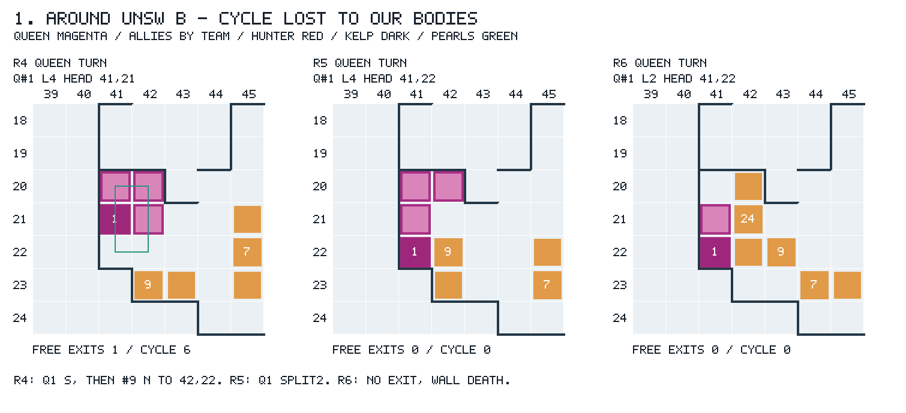
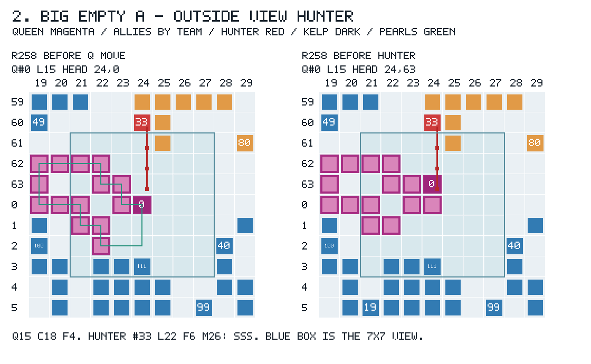
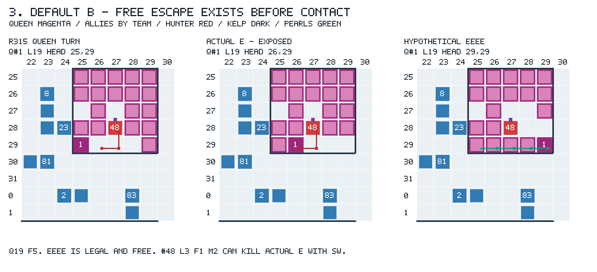

# v1.8 기본값 여왕 사망 전수 — 벙커 설계 입력

작성: 2026-10-02 09:13:11 KST. 분석 시작 2026-10-02 08:20:14 KST. **분석만 수행했다. 봇 변경·새 대전·커밋·네트워크 사용은 0이다.** 쓰기는 이 글과 `exp/queen-rammed/**`에 한정했다.

**현재 기본값의 여왕 사망은 지형·아군 봉쇄, 위험한 종료 머리, 자기 몸 전이에서 크게 갈린다.** 빌드가 같은 전체118판에서 사망89건을 기록했다(원 지도110판/87건, flip8판/2건). 원 지도 사망87건은 피격 38, 갇힘 37, 자기 몸으로의 탈출 10, 적 몸 진입 1, 여왕의 정면 공격 1이다. 피격 38건 중 29건은 공격자 머리가 마지막 여왕 차례에 보였고, 29건에는 현재 몸으로 돌 수 있는 고리도 있었다. 필요한 벙커는 **몸 전이가 맞고, 아군이 회전 경로를 비우며, 적이 종료 머리에 못 닿는 자세**다. 원을 그리는 모양이나 방 면적만으로는 이 조건을 충족하지 않는다.

아래 숫자는 기존 로컬 기보의 기제 진단이다. 승패·최종 총 길이로 설계를 채택하거나 버리지 않았다. `[사실]`은 기보 복원 또는 명시된 고정 판면 계산이고, `[해석]`은 아직 구현·대전하지 않은 설계 입력이다. 전체 사망 기록은 [tables.json](../../exp/queen-rammed/tables.json)의 `mainDeaths` 89행(원 지도87+flip2)과 부록 A에 있다.

## 1. 현재 기본값과 모집단을 먼저 고정했다

[사실] `versions/v1.8/bot`을 공식 judge clang으로 **컴파일만** 해 확인했다. 결과는 **518,494 bytes**, SHA-256 `5df1351a1cfa33917e91786fa22e573910daf662e869bc6b6d3d76c2da5cce97`이다. 현재는 **Q1_ON·Q1B_ON·Q2BOX_ON=true**, FREECOST_ON·Q2SIGHT_ON·Q1B_BACKUP_ON·Q1C_SIGHT_ON=false다. VERSION §8의 옛 기본값을 현재로 간주하지 않았다. [WASM 대조](../../exp/queen-rammed/build-identity.json)의 바이트 일치로 아래 팔을 주 집계에 넣었다.

| 팔 | 깨끗한 요청 상대 기록 N | 현재 기본값과의 관계 |
|---|---:|---|
| `exp/q2box/on` | 78 | WASM 동일; Q2BOX 켬이 현재 기본값 |
| `exp/q1c/off` | 44 | WASM 동일; 이 중 flip 8판은 id 검증으로 분리 |
| `exp/qsight/off` | 92 | WASM 동일; QSIGHT 끔이 현재 기본값 |
| `exp/q1c/id-base`, `id-off` | 각각 6 | WASM 동일; 같은 키·물리 사건은 중복 제거 |
| `exp/qsight/id-base`, `id-off` | 각각 6 | WASM 동일; 같은 키·물리 사건은 중복 제거 |

[사실] **238기록 → 118개 서로 다른 물리 기보 = 원 지도 110 + flip 8**이다. 키·팀·초기 지도·물리 사건 해시가 모두 같은 반복 실행을 한 번만 세었다. 물리 해시는 소나를 포함하고 instruction 수·indicator/log/debug만 제외한다. `last clean row`를 택했으며, 재실행 전 실패 이력 3행은 따로 남겼다. Q1c self 8판은 요청 상대 king/hunter가 아니므로 제외했다. 기보 누락·JSON 오류·복원 오류는 0이다. [동결 명부](../../exp/queen-rammed/inventory.json)와 각 게임의 `aliases`에 모든 원 폴더·행·기보를 남겼다.

| 주 집계 층 | 경기 N | 사망 N |
|---|---:|---:|
| 번들 처음 보는 5지도 | 20 | 14 |
| 생성 7지도 | 18 | 14 |
| 온라인 10·스프린트 7지도, Around UNSW 시드2 포함 | 72 | 59 |
| **원 지도 합계** | **110** | **87** |
| flip id 검증 층 | 8 | 2 |
| **현재 기본값 전수 합계** | **118** | **89** |

[사실] 원 지도 110판 중 r500 완주는 82판이며 여왕 생존은 21판이다. 별도 2판은 조기 종료 당시만 생존했다. 이 둘을 r500 생존으로 운반하지 않았다. flip도 같은 기본 빌드이므로 전수 집계에 포함했다. 원 지도 반대편과 같은 기하를 재배정한 층이므로, 아래 기제 분석은 원 지도110판/87사망을 기본 분모로 쓰고 flip2는 따로 표시한다. 부록 B의 보조 집단은 1,530기록, 중복 제거 저장 기보 773개다. 현재 기본값과 다른 빌드는 **주 사망 유형의 분모에 넣지 않았다**.

## 2. 질문의 “안전한 첫걸음”을 세 가지로 나눴다

[사실] 모든 복원에 `UNSW_RULES=123`을 주었다. 여왕 id는 초기 실제 팀의 최저 id이며 A=0이라고 고정하지 않았다. `r`은 0부터 시작하는 replay round다. 마지막 여왕 차례는 보통 죽는 라운드의 먼저 온 여왕 차례다. 공격자 시야는 그 시점의 wrapped Chebyshev≤3이며, **이전 라운드 여왕 차례의 시야도 별도 필드**로 저장했다.

1. **비충돌 첫걸음:** 켈프·자기 몸·다른 몸에 닿지 않는 한 걸음. 자기 꼬리도 이동 전에 충돌 검사한다. SPLIT은 별도 행동이다.
2. **M 밖 첫걸음:** 그 한 걸음을 실제 여왕 몸·진주로 전이한 뒤, 아직 행동하지 않은 적 머리 모두와 지형 최단 거리가 `M(L)=ceil(L/4)+L−2`보다 크다. 랩·켈프·포털은 반영하고 다른 몸은 거리 계산에서 무시한다. **무진주 직접 MOVE 도달에 대한 보수적 경보 밖**이라는 뜻이다.
3. **계보 R₁ 밖:** 분열 자식까지 고려한 `R₁(L)=max(M(L),L−1+M(L−2))` 밖이다(L<4는 M). 보고한 안전 증인에서는 부모 머리→몸 지형 거리≤L−1도 실제 그래프에서 확인했다. 중간 진주·다른 조각 사망 드롭으로 길이가 늘어나는 것은 여전히 별도다.

[사실] 길이·몸은 기보의 완전한 상태를 사용했다. 봇이 당시 전부 알았다는 뜻은 아니다. “M 밖 첫걸음 없음”은 **죽음 강제의 증명과 다르다**. 자기 몸이나 아군 스크린이 적 경로를 막거나, 여러 무료 걸음·분열로 다른 종료 상태를 만들 수도 있다. 현재 몸을 고정한 BFS와 실제 몸을 전이하는 공격 증인을 함께 저장했다. 자세한 조건은 [queen-mechanics §1](queen-mechanics.md), `tables.definitions`에 있다.

## 3. 서로 겹치지 않는 사망 유형과 크기

[사실] 아래 N은 원 지도87사망이다. flip 층은 **모든 첫걸음 M 안 피격1 + 아군 출구 봉쇄1**을 더한다. 전수89건으로는 피격39/갇힘38/자기 몸10/적 몸1/정면 공격1이며, 원 지도110판의 분석과 구분해 `mainSummary`에 저장했다.

| 유형 | 원 지도87 | flip2 | 전수89 | 판면에서 확인한 것 |
|---|---:|---:|---:|---|
| 막다른 끝의 벽·자기 목 봉쇄 | 28 | 0 | **28** | L2–3, 켈프 3방향 + 자기 목 1방향; 그 차례의 이동/합법 분열로 생존 불가 |
| 피격, 모든 비충돌 첫걸음이 M 경보 안 | 25 | 1 | **26** | 출구는 있지만 직접 도달 외피 밖으로 한 걸음만에 못 나감 |
| 비충돌 대안이 있는데 3걸음 탈출로 자기 몸 충돌 | 10 | 0 | **10** | 모두 MOVE의 세 번째 걸음, `esc` 표식; 아래 §4.3 |
| 아군 점유를 없애면 마지막 출구가 생기는 갇힘 | 9 | 1 | **10** | 아군 몸의 즉시 봉쇄를 확인; 아군의 의도나 최초 원인은 별도 |
| 피격, M 밖 첫걸음 대안이 존재 | 8 | 0 | **8** | 살아 있던 직접 머리 기준 회피 대안 미선택; 그중 6건은 R₁ 밖 대안도 존재 |
| 같은 라운드에 태어난 자식에게 피격 | 3 | 0 | **3** | 공격자 머리가 여왕 차례에 아직 없었음; 미상을 시야 밖으로 세지 않음 |
| 피격, 비충돌 첫걸음 자체가 없음 | 2 | 0 | **2** | `qw` 정지 분열 뒤 머리를 공격받음 |
| 여왕이 적 몸으로 이동 | 1 | 0 | **1** | `islands B / king`, r294, L25 |
| 여왕이 적 머리로 이동 | 1 | 0 | **1** | `maze A / king`, r253, L7 |
| **합계** | **87** | **2** | **89** | 원 지도: 피격38 + 갇힘37 + 자기 몸10 + 적 몸1 + 정면 공격1 |

[사실] 마지막 여왕 차례의 운영상 방 상태는 **현재 몸 정렬 고리 39, 복도/끝 28, 주머니 18, 열린 영역 2**다. 주머니는 작은 단일 입구 성분 또는 현재 빈 flood 공간≤9의 분류이며 영구적인 방 이름이 아니다. `lastTurnRoom`, `afterQueenActionRoom`, `deathRoom`을 모두 보존했다. 본문의 주변3칸은 랩 맨해튼≤3이며, 시야7×7의 Chebyshev≤3 아군 집합도 `piecesWithinView3Heads`/`piecesWithinView3Body`에 별도로 남겼다. 빈 공간은 현재 몸을 고정한 값이고 고리 용량과 다르다.

### 3.1 겹치는 진단 지표

[사실] 아래는 위 유형과 겹친다. 합산하지 않는다.

- 피격 **38건 중 여왕 L≥4는 29건**이다. 공격자 이동 시작 L의 중앙값은 **3**, 범위 **2–27**이고 여왕 사망 L은 **2–36**이다. 긴 여왕도 짧은 머리와 맞교환하면 죽는다.
- 공격자 머리는 마지막 여왕 차례에 **보임 29 / 시야 밖 6 / 아직 미출생 3**이다. 미출생 3을 빼면 알려진 머리 35건 중 6건이 시야 밖이다.
- 실제 충돌까지 **무료 예산 안 23 / 밖 15**다. 따라서 무료 도달만 피하는 벙커는 유료 암살 15건을 놓친다.
- 피격 **31/38**에서 아군 머리가 여왕 3칸 안에 없었다. 몸 세그먼트까지 봐도 **27/38**은 3칸 안 아군이 없었다. 머리가 가까웠던 7건 중, 공격자보다 작은 id의 가까운 아군이 있었던 것은 3건뿐이다.
- 피격 **29/38**에는 현재 몸이 정렬된 무성장 고리 증인이 있었다. **고리 존재는 적 진입 차단과 다르다.**

## 4. 큰 유형은 무엇이 달랐으면 살아 있었을까

### 4.1 지형 사망 28: 시작부터 불가능한 16과 나중에 들어간 12

[사실] 28건 모두 마지막 판면에서 비켈프 변이 하나이고 그것은 자기 목이다. L2–3은 합법 분열도 못 하므로 그 시점은 실제 무대안이다. 이 중 **16건**은 초기 머리에서 목을 제외한 유일한 앞으로의 지형 경로를 따라가도 분기·순환 전에 끝에 닿는다. Autarky/PD/Slithery 각4, gen_R_01/gen_S_03 각2다. 분열은 머리와 id를 앞에 남기므로 이 경로를 뒤집지 못하며 유한한 정지 차례만 늘릴 수 있다.

[해석] 이 16건을 벙커 구현의 구출 목표로 삼으면 도달 불가능한 게이트가 된다. 기존 탈출 자식·동점 규칙 백업을 보존하는 집단이다. 다른 **12건**은 초기 순방향이 이미 막다른 사슬인 경우가 아니므로, 끝에 도착하기 전의 진입·몸 상태가 설계 대상이다. “모르는 통로는 전부 금지”를 되살리지 말고 **관측으로 출구/순환이 확인된 공간과 현재 몸의 진입 가능성**을 검사할 근거다. 이 글은 해당 12개의 이전 의사결정을 전부 반사실 재최적화하지 않았으므로 12건 전부 구출 가능하다고 주장하지 않는다.

### 4.2 아군 봉쇄 9: 출구 한 칸보다 여왕의 다음 회전 경로를 예약해야 한다



[사실] **g0051 / hunter:around_unsw:B:1**이다. r4 여왕 #1 L4의 현재 몸은 2×3, **C6 고리**에 정렬되어 있었고 첫 출구는 S 하나였다. 여왕 S 뒤 #9 L2가 `(42,23)→(42,22)`로 N 이동했다. #9의 그 판면 비충돌 첫걸음도 N 하나다. 따라서 Q2BOX의 “다른 비봉쇄 대안이 있으면 금지”가 구해 주지 못한다. r5 여왕은 이미 출구0이라 `qw SPLIT2`를 했고, 새끼 #24도 방을 차지했다. r6 여왕 L2는 N=자기 목, E=#9 몸, S/W=켈프여서 W 사망했다. **새끼 출생 전에 봉쇄가 먼저 있었다.** 실제 차례·몸은 [scenes.json](../../exp/queen-rammed/scenes.json)에 있다.

[사실] 안전 방 catalogue의 동일한 2×3/L4는 **순서 있는 몸 상태 28개 중 생존 가능 12개**, 최장 고리6이다. 이 r4 상태는 그 C6의 실제 정렬 증인이며 무성장 두 바퀴 검사를 통과한다. r6은 다른 몸을 고정하면 접근 가능한 자체 영역3/L2이고 생존 경로가 없다. 전체 사망 직전 작은 영역≤9 상태 **23개**를 실제 간선/몸으로 검사했으며 전부 무성장 지속 경로가 없었다. 이 중 **18개**는 catalogue의 3×3 유도 도형과 간선까지 일치했고 나머지5는 footprint/내부 간선이 달랐다. [catalogue 대조](../../exp/queen-rammed/catalogue-check.json).

[해석] 구하려면 r4보다 앞에서 #9의 그 사슬 진입을 바꾸거나, 여왕 회전 경로를 지키기 위해 #9를 멈추지 않는 희생 대상으로 허용해야 한다. **그 판면에서 #9에게 다른 좋은 이동이 있었다는 주장은 틀리다.** 여왕의 회전 고리와 그다음 빈 칸을 다른 아군의 머리·몸·새끼가 점유하지 않도록 예약해야 한다. 길이4/방6은 현재 무성장 순환에는 충분하지만 영구 금고는 아니다: f=1, G=2이므로 입구 노출을 건너뛸 G+2=4걸음이 안 된다. Q1 먹이로 L6이 되면 C6 자체도 꽉 찬다.

### 4.3 자기 몸 탈출 10: 반복 이동의 지급·꼬리 전이가 선행 조건이다

[사실] **10건 모두** 첫걸음 비충돌 대안이 있는데 `esc`의 세 번째 걸음에서 Hit Self였다. MOVE 시작 L은 6/8/10/14다. 같은 완전한 입력·같은 명령을 두 지급 규칙으로 계산하면 **123에서는 10/10 자기 몸 충돌, 구 규칙에서는 10/10 충돌 없이 완료**한다. 예를 들어 g0018/default_small B/hunter r128 L8의 `WSW`는 f=2여서 두 번째 걸음 뒤 구 예측처럼 꼬리를 추가로 없앨 수 없다. 세 번째 W가 아직 남은 자기 몸에 닿는다. [개별 전이](../../exp/queen-rammed/counterfactuals.json)의 `rules123`, `rules110SameInput`에 몸 배열을 남겼다.

[해석] 이 결과는 무료 지급·꼬리 예측 오류와 정확히 맞는 입력 반례다. 실제 C++ 내부의 관측/기억을 여기서 재생하지 않았으므로 다른 기억 오류까지 배제한 단일 원인 확정은 아니다. 그래도 벙커의 여러 걸음·반복 고리는 이 전이 검증 없이 안전 인증할 수 없다. **FREECOST_ON을 그냥 켜자는 제안은 아니다.** 그 팔은 [VERSION §13](../../versions/v1.8/VERSION.md)에서 실제 몸 기억 drift·키별 안전 회귀가 남았다. 필요한 것은 선택한 첫 행동에 대해 123 몸 전이를 정확히 검사하고, 틀린 경로를 제거하는 분리된 수정이다.

### 4.4 피격 25: M 경보 안이라는 사실과 실제 강제를 구별한다

[사실] 다른 몸을 그 여왕 차례의 위치에 고정하고 실제 자기 몸·진주를 전이한 공격 경로를 찾았다. 피격 **22건**에서는 **모든 비충돌 단일 걸음**에 대해 **같은 실제 공격자가 죽이는 경로**의 증인이 있었다. 시간 초과/탐색 cap 사건은 0이다. 이것은 한 걸음 분기만의 조건부 강제이며 여러 걸음, 아군의 다른 행동, 모든 다음 라운드의 강제가 아니다. M 경보 안 25건 중 나머지3은 어떤 한 걸음에 실제 공격자만으로는 원 M 이내의 경로가 없었다. M 외피는 다른 적·몸 장애물 때문에 넓을 수 있다.



[사실] **g0013 / hunter:big_empty:A:1 r258**: 여왕 #0 L15, 머리 `(24,0)`, 공격자 #33 L22 `(24,60)`이다. 랩을 반영하면 머리 거리는4지만 Chebyshev4라 시야 밖이다. 여왕은 N으로 `(24,63)`에 갔고 #33은 **SSS, 3걸음/f6/M26**으로 충돌했다. 여왕 N/E/S 각 종료 상태에 대해 공격 증인은 SSS/SSESS/SSSESSW다. 고리 **C18/Q15, f4, G3**은 자체 순환 가능하지만 입구 위상 건너뛰기는5걸음이 필요하다. 열린 토러스의 이 고리는 단일 외부 입구도 없다.

[사실] 당시 3칸 안 아군 머리 #111 L7은 공격자 #33보다 id가 커서 이 라운드에는 늦다. 공격자를 볼 수 있는 아군 머리 #115 L9는 여왕에서7칸 떨어져 있었다. 가까운 아군 머리가 있다고 그 공격 전에 막을 수 있는 것은 아니다. 전체 시야 밖6 중 그 순간 다른 아군 머리의 창에 공격자가 든 것은 **g0013·g0016 두 건**뿐이었다. 이 또한 이전 차례에 유효한 소나가 실제 도달했다는 뜻은 아니다.

[해석] 이런 판은 M 벌점을 더 세게 해도 안전한 한 걸음이 생기지 않는다. 더 이른 접근 차단·앞선 id의 스크린·다중 걸음·이미 통제하는 방이 필요하다. 3칸 안 앞선 id 아군으로 실제 공격의 중간 칸에 몸통을 놓는 1–4걸음 분기를 검사했지만 **이번 제한된 긴급 배치 검사에서는 증인0**이었다. 기록된 공격 경로만 막는 검사이며 모든 더 이른 배치/우회에 대한 불가능 증명은 아니다. 스크린은 적이 온 뒤 옆에 붙이는 것보다 **앞선 턴에 공격 통로를 차지하는 배치**로 설계해야 한다.

### 4.5 M 밖 첫걸음 8과 무료 여러 걸음: 길이는 이미 충분한 사례가 있다

[사실] 직접 머리 M 기준 안전한 첫걸음이 있었던 기존 공격자 피격8건은 g0006/g0017/g0059/g0073/g0088/g0099/g0101/g0106이다. g0099/Default A/king r258은 E 대안이 있는데 `qw SPLIT2`로 머리를 남겼다가 #85 L2의 E에 맞았다. **움직이지 않는 분열도 종료 머리 위험을 매겨야 한다.** R₁까지 밖인 대안은 이8 중6건이다. 미출생 별도3 중 g0038에도 E/W의 R₁ 밖 대안이 있어 계보 기준의 안전 단일 걸음 증인은 합계7건이다.



[사실] **g0056 / hunter:default:B:1 r315**: 여왕 L19/f5의 비충돌 첫걸음은 E 하나다. 실제 E 뒤 `(26,29)`에 머물렀고 #48 L3/f1/M2가 `(27,28)`에서 SW로 쳤다. 같은 시작 몸에서 **EEEE는 합법·전부 무료**, 종료 `(29,29)`, L19 유지이며 기존 직접 적 머리 모두의 M 밖이다. 실제 #48의 S 목적지 `(27,29)`는 반사실에서는 여왕 몸통이라 기록된 공격도 막힌다. **다른 부모의 R₁ 밖은 아니므로 전체 계보 안전으로 인증하지 않았다.** 그림의 세 번째 패널만 반사실이고 두 앞 패널은 실제다.

| 피격의 실제 상태 | 최소 발견한 M 밖 무료 경로 | 현재 Q/f | 그 걸음 수를 무료로 주는 최소 L | R₁도 밖인가 |
|---|---|---|---|---|
| g0056 Default B/hunter r315 | EEEE, 4걸음 | 19/5 | 13 | 아니오 |
| g0102 Devil B/king r61 | NE, 2걸음 | 7/2 | 5 | 예 |
| g0109 QoS A/king r256 | NN, 2걸음 | 9/3 | 5 | 예 |

[사실] 한 걸음 M 안전 대안이 없는 피격 중 위3개에 다중 무료 증인이 있었다. 검색은 실제 몸/진주, 다른 몸 고정, 최대 min(f,4)걸음이다. f>4인 경우 그 이후까지 없다는 증명은 하지 않았다. 자기 몸 사망 중에도 g0035 NN/g0081 SSS의 M 밖 무료 분기가 있어 전체 다중 증인은5건이다. 모든 증인의 경로와 상한은 `freeEscape`에 있다.

[해석] **길이를 더 유지했으면** 구했다는 단순한 설명은 위3건에 맞지 않는다. 이미 무료 예산이 충분했다. 필요한 것은 정확한 몸 전이로 생성·선택하는 **안전한 종료 경로**다. 표의 최소 L은 예산 산술이며 여왕 몸을 실제로 그 길이로 바꾼 실험이 아니다. 일괄적인 L≥13 바닥으로 기하와 도달 문제를 해결할 수 없다.

### 4.6 미출생 3: 보이는 부모 꼬리가 공격 발생 지점이었다

| 사건 | 부모가 마지막 여왕 차례에 있던 상태 | 같은 라운드 공격자 |
|---|---|---|
| g0029 arena A/king r17 | #3 L7, 머리(9,5), 꼬리(5,7) | #7 L3, E 1걸음 |
| g0038 Colosseum B/king r23 | #2 L4, 머리(5,6), 꼬리(6,8) | #8 L2, S 1걸음 |
| g0057 Devil A/hunter r74 | #9 L14, 머리(16,14), 꼬리(14,3) | #30 L12, WS 2걸음 |

[사실] **세 부모 모두 머리는 시야 밖, 실제 꼬리는 시야 안**이었다. 존재하는 적 머리만 보는 모델에는 없는 공격자다. g0038의 실제 선택은 EN이었고 E 한 걸음 또는 W 한 걸음이면 무진주 R₁ 밖이었다. g0029의 M-safe S는 R₁에는 안전하지 않다. `M safe`를 바로 생존 보장으로 읽으면 이 차이가 사라진다.

[해석] 현 머리 보고 외에 **분열 가능한 적 몸/옛 꼬리 발생 위치**를 위협에 넣을 근거다. 완전한 꼬리를 봇이 식별할 수 없는 관측에서는 가능한 몸 위치에서 보수적 발생 집합을 만들고, 외피와 실제 경로를 분리해야 한다.

## 5. 진짜 금고 조건을 실제 위치에 대조했다

[사실] 무성장 단순 순환은 **C>Q**, 랩/포털 없는 직교 격자에서는 짝수 C가 필요하다. 두 변이 모두 2 이상인 빈 직사각 방의 최대 고리는 짝수 면적이면 면적 전체, 홀수 면적이면 면적−1이다. 따라서 **3×3 방의 면적9는 Q8을 담는 지속 고리로 부족**하다(최대 C8). Q4에는 C6, Q15에는 C16이 최소지만 실제 몸 정렬·진입 경로도 있어야 한다. [safe-cycle catalogue](../../exp/queen-math/rooms-pictures.txt), [queen-mechanics §4](queen-mechanics.md).

[사실] 유일한 외부 진입 칸 g를 매 여왕 턴 종료마다 **머리 아닌 자기 몸통**으로 막으려면, 고정 길이·고정 고리에서 **f(Q)≥G+2**, G=C−Q가 충분조건이다. 적의 무료 사거리뿐 아니라 긴 유료 공격도 첫 진입 몸통에서 멈춘다. g를 머리/빈 칸으로 남기는 종료 위상은 위험하다. 모든 적 세그먼트가 밖에 있어야 분열 자식까지 배제할 수 있다.

| Q | 최소 직교 고리 C | f | G+2 | 그 최소 고리의 몸통 입구 차단 |
|---:|---:|---:|---:|---|
| 4 | 6 | 1 | 4 | 불가 |
| 5 | 6 | 2 | 3 | 불가 |
| 8 | 10 | 2 | 4 | 불가 |
| 9 | 10 | 3 | 3 | 가능 |
| 10 | 12 | 3 | 4 | 불가 |
| 13 | 14 | 4 | 3 | 가능 |
| 15 | 16 | 4 | 3 | 가능 |

[사실] 실제 사망87건 중 정렬 고리39개를 확인했다. **현재 몸으로 f≥G+2를 만족하는 정렬 고리 전체는 6개**, 여섯 판면에 각각1개였다. 브리지뿐 아니라 **지형의 한 칸 절단점**을 검사하고 모든 외부 진입·포털을 포함했으며, 적 몸/꼬리의 내부 존재와 고리 진주·생성 가능 칸도 검사했다. 그 결과 **위 충분조건으로 현재 위치에서 인증되는 금고는 0**이다. g0106/Maze B는 입구 몸통·위상 조건이 맞는 큰 성분 쪽이 있지만 이미 수많은 적이 내부에 있고 생성 칸도 있다. 실제 조건을 갖춘 작은 안전 방 사례로 세지 않았다. [전수 금고 대조](../../exp/queen-rammed/vault-check.json).

[해석] 이 0은 다른 몸 배치나 아군이 장기 차단하는 요새 전체의 부재 증명이 아니다. **현재 여왕 몸에 정렬된 이 충분조건의 금고를 당장 쓸 수 있다는 증거가 없다는 뜻**이다. 무성장 고리가 있는 29피격을 “금고를 갖고도 실패”라고 부르는 것도 틀리다.

[해석] 금고 설계에는 (1) 인증된 고리/입구, (2) 모든 적 몸·새끼가 밖, (3) 종료 때 g=몸통, (4) 성장 후에도 C>Q, (5) 진주/생성 시계가 채우는 위험, (6) 아군의 고리·출구 예약이 필요하다. 특히 **Q9/C10의 빈 한 칸에서 진주를 먹으면 Q10=C10**으로 다음 칸이 자기 꼬리다. 더 큰 C12로 옮겨도 Q10의 f3은 G+2=4보다 작다. “길이가 늘수록 같은 금고가 더 안전해진다”는 단조 가정을 쓰면 안 된다.

## 6. 엘리트 종료 생존 24마리는 어떻게 살았는가

[사실] [queen-early](queen-early.md)의 동결 코호트 **264판/528여왕**에서 종료 생존은24다. **18마리는 r11–223 조기 전멸 종료의 생존**이며 r500 안전의 증거로 바꾸지 않았다. 나머지6마리가 실제 r500까지 살았다. 조기 생존18마리는 종료 L2가8/L3가9/L4가1이고 모두 분열1–8회였다. 자연 진주를 먹고 L4에서 다시 줄이는 짧은 여왕 경로가 많았으며, 아군 드롭 섭취는5마리, 적 드롭 섭취는3마리에만 있었다. 이는 관측 행동이며 의도적인 여왕 보호 정책의 확정은 아니다. 개별 거리·아군·섭취는 부록 C에 함께 적었다. 아래 여섯의 거리는 r300–499의 각 여왕 차례200개, 몸을 무시한 랩·켈프·포털 최단 거리다. “아군 곁”은 같은 torus Manhattan≤3 정의다. 전체24의 기록은 [elite-comparison.json](../../exp/queen-rammed/elite-comparison.json)에 있다.

| game / 팀 / 지도 | 최종 Q | 적 머리 거리 min/중앙/max | 아군 곁 차례 /200 | 방문 머리 칸 /200 | 관측된 생존 방식 |
|---|---:|---|---:|---:|---|
| 815244 / Stockfish / Default | 33 | 6/18/27 | 54 | 163 | 이동 범위가 넓고 후기 드롭 성장; 말미 접힌 몸만으로 영구 금고 확인 안 됨 |
| 815352 / Yueci Li / Trauma | 9 | 33/41/53 | 42 | 63 | 지형상 큰 격리, 아군 드롭13개 섭취; r474/476에도 분열 |
| 814623 / Tony S / Trauma | 12 | 52/69/78 | 57 | 109 | 긴 지형 거리로 접근 억제, 후반 성장 |
| 814625 / Tony S / Devil | 3 | 2/8/15 | 0 | 58 | 짧은 여왕, 근처 아군 없이 생존 |
| 814627 / Tony S / Default | 4 | 1/5/12 | 0 | 130 | 짧은 여왕, 무호위; 적 무료 도달 기회도9번 있었음 |
| 814547 / fandagong / Schooltime | 2 | 2/9/15 | 5 | 10 | r400–499 정확한 주기4의 네 칸 고리 |

[사실] fandagong의 실제 고리는 `(18,13)→(18,14)→(19,14)→(19,13)`이다. Q2/C4라 스스로 돌 수 있지만 f1 < G+2=4라 영구 몸통 입구 차단 금고와 다르다. Stockfish는 r499 빈 flood16칸이 마지막 행동 뒤697칸으로 변한다. 현재 빈 flood 크기를 고정된 방 면적처럼 쓰지 않아야 한다. Tony S/Default에는 공격 기회가 있었지만 실제 공격이 선택되지 않은 사례도 있다.

[해석] 이 여섯은 **지형 거리, 짧은 유지, 후기 성장, 작은 반복 고리**의 서로 다른 생존을 보인다. 모든 여왕이 긴 코일·스크린·영구 금고를 썼다는 증거는 없다. 18조기 생존까지 더해 “24마리의 검증된 벙커”라고 부를 수 없다. 이 자료는 새 규칙 직후 약22분의 코호트이고 상대를 포함한35팀 이름이 들어 있다. 여왕 보호 업데이트 완료나 처음 보는 퀄리파이어 지도에서의 효과를 확정하지 않는다.

## 7. 설계 선택지 순위 — 겨냥하는 기제와 예상 효과

[해석] 아래 순위는 **현재 사망을 직접 설명하고 구현 결과를 반증할 수 있는 정도**로 정했다. 예상 효과는 조건부 상태 변화이며 승률 예측이 아니다. 봇에 적용한 변경은 없다.

| 순위 | 선택지 | 겨냥하는 관측 | 예상 효과와 제한 |
|---:|---|---|---|
| **1** | **첫 행동의 123 지급·몸 전이 검증** | 자기 몸 탈출10/10, 전부 세 번째 걸음 | 알려진 몸/진주에서 불법 경로를 제거하고 비충돌 대안을 남김. 반복 고리·무료 다중 이동의 선행 조건. FREECOST 일괄 켬과 분리해 검증해야 함. |
| **2** | **여왕 회전 경로 예약·방 진입 허가·성장 여유** | 아군 봉쇄9, 후발 막다른 끝12, Around r4의 C6→r5 봉쇄 | 아군 머리뿐 아니라 남을 몸·분열 자식까지 다음 고리를 비움. 탈출 대안 없는 조각은 미리 진입을 막거나 희생 처리. 시작부터 지형 강제16은 구출 목표에서 분리. |
| **3** | **종료 머리 M/R₁ 검사 + 필요한 무료 경로** | M 대안 미선택8, 미출생3, 다중 무료 피격 증인3 | 이동·정지 분열의 마지막 머리와 옛 꼬리 발생을 함께 매김. 최소 한 적의 기록된 공격을 막는 실제 대안을 고름. M/R₁ 무진주 외피, 부분 관측·다른 드롭·아군 차례 변화를 함께 보고해야 함. |
| **4** | **공격 쪽에 먼저 둔 스크린 + 정찰** | 피격31/38에 가까운 아군 머리 없음, 시야 밖6 중 현재 다른 관측자2 | 앞선 id의 조각이 경로/입구를 몸통으로 차단하거나 공격자를 교환함. 여왕 고리 쪽은 비우고 적 쪽을 막음. 가까이 붙기 자체는 아군 함정을 늘릴 수 있고, 늦은 id는 당일 공격을 못 막음. |
| **5** | **조건이 맞는 지도/상태에서만 진짜 금고 채택** | 순환 가능 피격29, 현재 금고 인증0 | C>Q·f≥G+2·단일 g·모든 적 몸 밖·무성장 조건이 맞으면 외부 직접 공격과 외부 자식의 첫 진입을 차단. 방/몸 위상 인증 실패 시 단순 고리 생존 모드로만 사용. 다른 곳으로 이동해 금고를 만드는 효과는 아직 미측정. |
| **6** | **고정 바닥 대신 경로·방 용량에 따른 길이 목표** | 공격자 L 중앙3; 현재 Q7/9/19도 무료 탈출 미사용; Q9→10의 금고 깨짐 | 원하는 2/3/4걸음에 f가 2/3/4 필요하므로 예산 최소 L5/9/13을 따름. 동시에 성장 후 순환 용량과 입구 위상을 검사. 일괄 L≥X 또는 면적≥N만으로 생존을 보장하지 않음. |

[해석] 벙커의 최소 상태 출력은 `현재 고리/몸 정렬`, `성장 후 빈 칸`, `외부 입구·적 내부 존재`, `종료 입구의 머리/몸/빈 상태`, `다음 적 도달/자식 발생`, `예약을 침범하는 아군 몸`, `경로 전이 검증 결과`다. 구조적 인증과 거리 경보를 섞어 하나의 “안전 방 점수”로 만들면 이번처럼 순환이 있어도 공격받거나 아군이 고리를 끊는 실패를 숨긴다.

## 8. 검증과 재현

[사실] 요청 범위의 **1,768깨끗한 기록**을 읽어 반복 기보를 제거한 **891기보(주118+보조773)**를 123 규칙으로 복원했다. sim/splits/drops/ledger/final/lineage 등 비영 검사합은0, 복원 오류0이다. 여왕 사망89개(원87+flip2)의 별도 배열 전이 검사에서 실제 여왕 MOVE85개·실제 공격 MOVE39개·M 첫걸음89개·고리 두 바퀴80개·공격 반사실 경로51개가 일치했다. [verification.json](../../exp/queen-rammed/verification.json). 지형 helper도 **31지도/186,392방향 간선**을 replay simulator와 대조해 불일치0이다. [geometry-verification.json](../../exp/queen-rammed/geometry-verification.json). 금고 검사는 현재 몸의 위상 조건을 만족하는 정렬 고리를 전수 검사했다.

[사실] 위 검증은 서로 공유하는 기보 decoder와 지형 helper가 있으므로 완전히 독립된 엔진이라고 부르지 않는다. 온라인 실제 정책·봇 내부 기억·적의 전략 변경 효과를 검증하지 않았다. 몸을 고정한 반사실·최대4 무료 걸음·원 M 이내의 공격 검색에는 각각 조건과 상한이 있다. `no safe`라는 표현은 어떤 조건의 안전인지 반드시 읽어야 한다.

[사실] 그림3개는 원 기보 몸·켈프·진주·포털에서 결정적으로 생성했고 직접 시각 검사를 했다. 셋째 그림의 EEEE만 반사실이다. 현재 기본값118판의 모든 사망89는 `mainDeaths`; 원 지도87은 `originalDeaths`/`originalSummary`, flip2는 `identityDeaths`/`identitySummary`; 이전 빌드는 `sideCohorts`/`sideGames`다. 예시는 전수 사망 중 설계 실패를 분리해 보이는 상태를 택했다. 사망89행·현재 WASM238개 원 기록·모든 본문 링크·PNG3개를 [최종 납품 대조](../../exp/queen-rammed/qa.json)로 검사했다. 현재 봇 소스는 시작 snapshot과 비교해 변경0이다. 디스크는 약86GiB 여유에서 시작했고 큰 배치는 `nice -n 10`으로 요청했으나 OS가 setpriority를 거부해 실제 nice 적용은 보장하지 못했다.

```sh
# 새 게임을 만들지 않는 기존 기보 분석
nice -n 10 env UNSW_RULES=123 node exp/queen-rammed/extract.js
nice -n 10 env UNSW_RULES=123 node exp/queen-rammed/enrich.js
nice -n 10 node exp/queen-rammed/analyze.js
node exp/queen-rammed/counterfactuals.js
node exp/queen-rammed/catalogue.js
node exp/queen-rammed/family.js
node exp/queen-rammed/observability.js
node exp/queen-rammed/vault.js
node exp/queen-rammed/verify.js
node exp/queen-rammed/verify-geometry.js
node exp/queen-rammed/finalize.js
```

## 부록 A. 현재 기본값 여왕 사망 89건 전부(원 지도87+flip2)

[사실] `k`=bot-hunter, `p`=proxy4_king. 유형 H피=적이 움직여 피격, H공=여왕이 적 머리로 이동, S=자기 몸, W=벽, O=다른 몸이다. 공격자는 `id / 이동 시작 L / 무료 f / 요청 경로(충돌까지 걸음)`이고 충돌 시 L은 JSON에 따로 있다. O의 “몸#”는 움직여 공격한 killer가 아닌 접촉 몸이다. 시야는 **마지막 여왕 차례**다. `출구 없음`은 비충돌 첫걸음0, `없음`은 출구는 있지만 M 밖이 없음이다. 주변 아군은 `h`=머리≤3, `b`=어느 몸 세그먼트≤3이고 두 집합은 겹친다. 방은 그 마지막 차례 상태이며 사망 순간 방도 JSON에 있다.

| ID | 상대:지도:편:시드 | r / 원인 / Q | 공격자·접촉 몸 | 공격자 시야 | 방/정렬 고리 | 주변 아군 h / b | M 밖 첫걸음 |
|---|---|---|---|---|---|---|---|
| [g0015](../../exp/queen-rammed/raw/g0015.json) | k:Colosseum:A:1 | 35 / H피 / 5 | #6 / L5 / f2 / NEEE(4) | 보임 | 고리 C6 | h:— / b:— | 없음 |
| [g0016](../../exp/queen-rammed/raw/g0016.json) | k:Colosseum:B:1 | 60 / H피 / 13 | #27 / L6 / f2 / SSS(3) | 밖 | 고리 C20 | h:5,10 / b:5,9,10 | 없음 |
| [g0037](../../exp/queen-rammed/raw/g0037.json) | p:Colosseum:A:1 | 53 / H피 / 5 | #30 / L3 / f1 / N(1) | 보임 | 고리 C6 | h:— / b:— | 없음 |
| [g0038](../../exp/queen-rammed/raw/g0038.json) | p:Colosseum:B:1 | 23 / H피 / 3 | #8 / L2 / f1 / S(1) | 미출생 | 고리 C4 | h:— / b:— | E/W |
| [g0008](../../exp/queen-rammed/raw/g0008.json) | k:arena:B:1 | 40 / H피 / 36 | #2 / L15 / f4 / EEE(3) | 밖 | 열린 영역 | h:— / b:— | 없음 |
| [g0029](../../exp/queen-rammed/raw/g0029.json) | p:arena:A:1 | 17 / H피 / 10 | #7 / L3 / f1 / E(1) | 미출생 | 고리 C10 | h:— / b:— | S |
| [g0030](../../exp/queen-rammed/raw/g0030.json) | p:arena:B:1 | 30 / H피 / 13 | #7 / L4 / f1 / S(1) | 보임 | 주머니 | h:— / b:— | 없음 |
| [g0051](../../exp/queen-rammed/raw/g0051.json) | k:around_unsw:B:1 | 6 / W / 2 | — | — | 주머니 | h:9,24 / b:9,24 | 출구 없음 |
| [g0052](../../exp/queen-rammed/raw/g0052.json) | k:around_unsw:B:2 | 6 / W / 3 | — | — | 주머니 | h:9,24 / b:9,24 | 출구 없음 |
| [g0001](../../exp/queen-rammed/raw/g0001.json) | p:around_unsw:A:1 | 189 / H피 / 17 | #193 / L5 / f2 / S(1) | 보임 | 주머니 | h:— / b:180 | 출구 없음 |
| [g0081](../../exp/queen-rammed/raw/g0081.json) | p:around_unsw:A:2 | 221 / S / 14 | — | — | 고리 C16 | h:— / b:— | 없음 |
| [g0002](../../exp/queen-rammed/raw/g0002.json) | p:around_unsw:B:1 | 6 / W / 2 | — | — | 주머니 | h:9,29 / b:9,29 | 출구 없음 |
| [g0082](../../exp/queen-rammed/raw/g0082.json) | p:around_unsw:B:2 | 6 / W / 3 | — | — | 주머니 | h:9,29 / b:9,29 | 출구 없음 |
| [g0012](../../exp/queen-rammed/raw/g0012.json) | k:australia:B:1 | 256 / O / 2 | 몸#132 L4 | — | 주머니 | h:141 / b:17,132,141 | 출구 없음 |
| [g0033](../../exp/queen-rammed/raw/g0033.json) | p:australia:A:1 | 214 / H피 / 7 | #69 / L4 / f1 / EE(2) | 보임 | 고리 C22 | h:117 / b:97,117,129 | 없음 |
| [g0032](../../exp/queen-rammed/raw/g0032.json) | p:australia_flip:B:1 | 214 / H피 / 7 | #69 / L4 / f1 / EE(2) | 보임 | 고리 C22 | h:117 / b:97,117,129 | 없음 |
| [g0053](../../exp/queen-rammed/raw/g0053.json) | k:autarky:A:1 | 4 / W / 3 | — | — | 복도/끝 | h:12 / b:12 | 출구 없음 |
| [g0054](../../exp/queen-rammed/raw/g0054.json) | k:autarky:B:1 | 4 / W / 3 | — | — | 복도/끝 | h:13 / b:13 | 출구 없음 |
| [g0083](../../exp/queen-rammed/raw/g0083.json) | p:autarky:A:1 | 4 / W / 3 | — | — | 복도/끝 | h:12 / b:12 | 출구 없음 |
| [g0084](../../exp/queen-rammed/raw/g0084.json) | p:autarky:B:1 | 4 / W / 3 | — | — | 복도/끝 | h:12 / b:12 | 출구 없음 |
| [g0013](../../exp/queen-rammed/raw/g0013.json) | k:big_empty:A:1 | 258 / H피 / 15 | #33 / L22 / f6 / SSS(3) | 밖 | 고리 C18 | h:111 / b:111 | 없음 |
| [g0014](../../exp/queen-rammed/raw/g0014.json) | k:big_empty:B:1 | 142 / H피 / 14 | #47 / L12 / f3 / ESSS(4) | 보임 | 고리 C20 | h:— / b:48 | 없음 |
| [g0035](../../exp/queen-rammed/raw/g0035.json) | p:big_empty:A:1 | 76 / S / 10 | — | — | 고리 C16 | h:— / b:— | 없음 |
| [g0055](../../exp/queen-rammed/raw/g0055.json) | k:default:A:1 | 175 / S / 6 | — | — | 고리 C12 | h:— / b:— | 없음 |
| [g0056](../../exp/queen-rammed/raw/g0056.json) | k:default:B:1 | 315 / H피 / 19 | #48 / L3 / f1 / SW(2) | 보임 | 고리 C22 | h:— / b:— | 없음 |
| [g0099](../../exp/queen-rammed/raw/g0099.json) | p:default:A:1 | 258 / H피 / 9 | #85 / L2 / f1 / E(1) | 보임 | 주머니 | h:— / b:— | E |
| [g0100](../../exp/queen-rammed/raw/g0100.json) | p:default:B:1 | 268 / H피 / 2 | #55 / L3 / f1 / SS(2) | 보임 | 고리 C18 | h:— / b:— | 없음 |
| [g0017](../../exp/queen-rammed/raw/g0017.json) | k:default_small:A:1 | 35 / H피 / 5 | #5 / L4 / f1 / NNN(3) | 밖 | 고리 C10 | h:2 / b:2 | N/W |
| [g0018](../../exp/queen-rammed/raw/g0018.json) | k:default_small:B:1 | 128 / S / 8 | — | — | 고리 C12 | h:19 / b:19 | E/W |
| [g0039](../../exp/queen-rammed/raw/g0039.json) | p:default_small:A:1 | 52 / S / 6 | — | — | 고리 C8 | h:2 / b:2 | N/S |
| [g0040](../../exp/queen-rammed/raw/g0040.json) | p:default_small:B:1 | 167 / H피 / 7 | #36 / L3 / f1 / WS(2) | 보임 | 고리 C8 | h:— / b:— | 없음 |
| [g0057](../../exp/queen-rammed/raw/g0057.json) | k:devil:A:1 | 74 / H피 / 19 | #30 / L12 / f3 / WS(2) | 미출생 | 고리 C26 | h:— / b:— | 없음 |
| [g0058](../../exp/queen-rammed/raw/g0058.json) | k:devil:B:1 | 39 / H피 / 5 | #4 / L17 / f5 / SSES(4) | 보임 | 고리 C8 | h:— / b:— | 없음 |
| [g0101](../../exp/queen-rammed/raw/g0101.json) | p:devil:A:1 | 105 / H피 / 9 | #92 / L2 / f1 / N(1) | 보임 | 고리 C10 | h:— / b:— | W |
| [g0102](../../exp/queen-rammed/raw/g0102.json) | p:devil:B:1 | 61 / H피 / 7 | #48 / L2 / f1 / S(1) | 보임 | 고리 C18 | h:— / b:— | 없음 |
| [g0085](../../exp/queen-rammed/raw/g0085.json) | p:gen_L_02:A:1 | 3 / W / 2 | — | — | 복도/끝 | h:6 / b:6 | 출구 없음 |
| [g0086](../../exp/queen-rammed/raw/g0086.json) | p:gen_L_02:B:1 | 3 / W / 2 | — | — | 복도/끝 | h:8 / b:8 | 출구 없음 |
| [g0042](../../exp/queen-rammed/raw/g0042.json) | p:gen_L_03:B:1 | 336 / S / 10 | — | — | 고리 C14 | h:— / b:— | E/S/W |
| [g0087](../../exp/queen-rammed/raw/g0087.json) | p:gen_M_03:A:1 | 202 / H피 / 2 | #18 / L4 / f1 / S(1) | 보임 | 고리 C6 | h:— / b:— | 없음 |
| [g0088](../../exp/queen-rammed/raw/g0088.json) | p:gen_M_03:B:1 | 126 / H피 / 9 | #66 / L3 / f1 / S(1) | 보임 | 고리 C10 | h:— / b:— | E |
| [g0021](../../exp/queen-rammed/raw/g0021.json) | k:gen_M_07:A:1 | 32 / W / 2 | — | — | 복도/끝 | h:6 / b:6 | 출구 없음 |
| [g0022](../../exp/queen-rammed/raw/g0022.json) | k:gen_M_07:B:1 | 32 / W / 2 | — | — | 복도/끝 | h:7 / b:7 | 출구 없음 |
| [g0003](../../exp/queen-rammed/raw/g0003.json) | p:gen_M_07:A:1 | 32 / W / 2 | — | — | 복도/끝 | h:7 / b:7 | 출구 없음 |
| [g0089](../../exp/queen-rammed/raw/g0089.json) | p:gen_R_01:A:1 | 2 / W / 2 | — | — | 복도/끝 | h:— / b:— | 출구 없음 |
| [g0090](../../exp/queen-rammed/raw/g0090.json) | p:gen_R_01:B:1 | 2 / W / 2 | — | — | 복도/끝 | h:— / b:— | 출구 없음 |
| [g0091](../../exp/queen-rammed/raw/g0091.json) | p:gen_S_03:A:1 | 3 / W / 2 | — | — | 복도/끝 | h:— / b:— | 출구 없음 |
| [g0092](../../exp/queen-rammed/raw/g0092.json) | p:gen_S_03:B:1 | 3 / W / 2 | — | — | 복도/끝 | h:— / b:— | 출구 없음 |
| [g0093](../../exp/queen-rammed/raw/g0093.json) | p:gen_X_07:A:1 | 125 / W / 3 | — | — | 복도/끝 | h:— / b:— | 출구 없음 |
| [g0094](../../exp/queen-rammed/raw/g0094.json) | p:gen_X_07:B:1 | 196 / S / 6 | — | — | 고리 C8 | h:45 / b:45 | N/S/W |
| [g0059](../../exp/queen-rammed/raw/g0059.json) | k:islands:A:1 | 35 / H피 / 11 | #5 / L5 / f2 / NWWW(4) | 밖 | 고리 C12 | h:— / b:— | W |
| [g0060](../../exp/queen-rammed/raw/g0060.json) | k:islands:B:1 | 261 / H피 / 24 | #136 / L3 / f1 / NW(2) | 보임 | 주머니 | h:— / b:— | 없음 |
| [g0103](../../exp/queen-rammed/raw/g0103.json) | p:islands:A:1 | 123 / H피 / 19 | #110 / L4 / f1 / ES(2) | 보임 | 고리 C54 | h:— / b:48 | 없음 |
| [g0104](../../exp/queen-rammed/raw/g0104.json) | p:islands:B:1 | 294 / O / 25 | 몸#280 L4 | — | 고리 C38 | h:— / b:— | 없음 |
| [g0105](../../exp/queen-rammed/raw/g0105.json) | p:maze:A:1 | 253 / H공 / 7 | 정지 머리#250 L2 | 보임 | 주머니 | h:— / b:— | 출구 없음 |
| [g0106](../../exp/queen-rammed/raw/g0106.json) | p:maze:B:1 | 278 / H피 / 13 | #241 / L3 / f1 / NN(2) | 보임 | 고리 C14 | h:316 / b:171,316 | N |
| [g0063](../../exp/queen-rammed/raw/g0063.json) | k:portals:A:1 | 177 / O / 3 | 몸#151 L6 | — | 주머니 | h:103,130,138,151 / b:103,130,138,151,152 | 출구 없음 |
| [g0107](../../exp/queen-rammed/raw/g0107.json) | p:portals:A:1 | 119 / W / 3 | — | — | 복도/끝 | h:— / b:— | 출구 없음 |
| [g0108](../../exp/queen-rammed/raw/g0108.json) | p:portals:B:1 | 178 / W / 2 | — | — | 복도/끝 | h:— / b:192 | 출구 없음 |
| [g0065](../../exp/queen-rammed/raw/g0065.json) | k:prisoners_dilemma:A:1 | 3 / W / 3 | — | — | 복도/끝 | h:6 / b:6 | 출구 없음 |
| [g0066](../../exp/queen-rammed/raw/g0066.json) | k:prisoners_dilemma:B:1 | 3 / W / 3 | — | — | 복도/끝 | h:7 / b:7 | 출구 없음 |
| [g0095](../../exp/queen-rammed/raw/g0095.json) | p:prisoners_dilemma:A:1 | 3 / W / 3 | — | — | 복도/끝 | h:7 / b:7 | 출구 없음 |
| [g0096](../../exp/queen-rammed/raw/g0096.json) | p:prisoners_dilemma:B:1 | 3 / W / 3 | — | — | 복도/끝 | h:7 / b:7 | 출구 없음 |
| [g0068](../../exp/queen-rammed/raw/g0068.json) | k:queen_of_spades:B:1 | 117 / H피 / 4 | #5 / L20 / f5 / NEEE(4) | 보임 | 고리 C6 | h:— / b:— | 없음 |
| [g0109](../../exp/queen-rammed/raw/g0109.json) | p:queen_of_spades:A:1 | 256 / H피 / 9 | #94 / L2 / f1 / E(1) | 보임 | 고리 C18 | h:— / b:— | 없음 |
| [g0110](../../exp/queen-rammed/raw/g0110.json) | p:queen_of_spades:B:1 | 304 / H피 / 2 | #111 / L2 / f1 / W(1) | 보임 | 고리 C4 | h:— / b:— | 없음 |
| [g0069](../../exp/queen-rammed/raw/g0069.json) | k:schooltime:A:1 | 192 / H피 / 8 | #72 / L27 / f7 / SWW(3) | 보임 | 고리 C24 | h:— / b:— | 없음 |
| [g0070](../../exp/queen-rammed/raw/g0070.json) | k:schooltime:B:1 | 143 / S / 8 | — | — | 주머니 | h:24 / b:24 | 없음 |
| [g0111](../../exp/queen-rammed/raw/g0111.json) | p:schooltime:A:1 | 54 / S / 8 | — | — | 고리 C12 | h:— / b:— | E |
| [g0112](../../exp/queen-rammed/raw/g0112.json) | p:schooltime:B:1 | 89 / S / 8 | — | — | 고리 C10 | h:— / b:— | E |
| [g0071](../../exp/queen-rammed/raw/g0071.json) | k:slithery_fight:A:1 | 3 / W / 3 | — | — | 복도/끝 | h:— / b:24 | 출구 없음 |
| [g0072](../../exp/queen-rammed/raw/g0072.json) | k:slithery_fight:B:1 | 3 / W / 3 | — | — | 복도/끝 | h:— / b:25 | 출구 없음 |
| [g0097](../../exp/queen-rammed/raw/g0097.json) | p:slithery_fight:A:1 | 3 / W / 3 | — | — | 복도/끝 | h:— / b:33 | 출구 없음 |
| [g0098](../../exp/queen-rammed/raw/g0098.json) | p:slithery_fight:B:1 | 3 / W / 3 | — | — | 복도/끝 | h:— / b:29 | 출구 없음 |
| [g0073](../../exp/queen-rammed/raw/g0073.json) | k:stripes:A:1 | 120 / H피 / 18 | #13 / L5 / f2 / SSSW(4) | 밖 | 열린 영역 | h:— / b:— | W |
| [g0074](../../exp/queen-rammed/raw/g0074.json) | k:stripes:B:1 | 195 / W / 2 | — | — | 주머니 | h:5,22 / b:5,22 | 출구 없음 |
| [g0113](../../exp/queen-rammed/raw/g0113.json) | p:stripes:A:1 | 48 / H피 / 4 | #9 / L2 / f1 / W(1) | 보임 | 주머니 | h:— / b:— | 없음 |
| [g0114](../../exp/queen-rammed/raw/g0114.json) | p:stripes:B:1 | 209 / H피 / 2 | #91 / L2 / f1 / E(1) | 보임 | 주머니 | h:— / b:— | 없음 |
| [g0076](../../exp/queen-rammed/raw/g0076.json) | k:tower_defense:B:1 | 394 / W / 2 | — | — | 복도/끝 | h:18 / b:18 | 출구 없음 |
| [g0115](../../exp/queen-rammed/raw/g0115.json) | p:tower_defense:A:1 | 214 / H피 / 3 | #62 / L2 / f1 / N(1) | 보임 | 주머니 | h:— / b:2 | 출구 없음 |
| [g0116](../../exp/queen-rammed/raw/g0116.json) | p:tower_defense:B:1 | 202 / W / 2 | — | — | 복도/끝 | h:91 / b:91 | 출구 없음 |
| [g0047](../../exp/queen-rammed/raw/g0047.json) | p:trauma:A:1 | 113 / O / 2 | 몸#22 L3 | — | 주머니 | h:22,27 / b:2,22,27 | 출구 없음 |
| [g0046](../../exp/queen-rammed/raw/g0046.json) | p:trauma_flip:B:1 | 113 / O / 2 | 몸#22 L3 | — | 주머니 | h:22,27 / b:2,22,27 | 출구 없음 |
| [g0077](../../exp/queen-rammed/raw/g0077.json) | k:trophy:A:1 | 287 / H피 / 2 | #6 / L2 / f1 / S(1) | 보임 | 고리 C4 | h:51 / b:51 | 없음 |
| [g0078](../../exp/queen-rammed/raw/g0078.json) | k:trophy:B:1 | 88 / H피 / 9 | #10 / L3 / f1 / SS(2) | 보임 | 고리 C10 | h:6 / b:6 | 없음 |
| [g0005](../../exp/queen-rammed/raw/g0005.json) | p:trophy:A:1 | 214 / H피 / 2 | #40 / L3 / f1 / S(1) | 보임 | 고리 C10 | h:— / b:— | 없음 |
| [g0006](../../exp/queen-rammed/raw/g0006.json) | p:trophy:B:1 | 95 / H피 / 2 | #30 / L3 / f1 / SS(2) | 보임 | 고리 C4 | h:— / b:— | S/W |
| [g0080](../../exp/queen-rammed/raw/g0080.json) | k:weakhold:B:1 | 370 / W / 3 | — | — | 복도/끝 | h:— / b:126 | 출구 없음 |
| [g0117](../../exp/queen-rammed/raw/g0117.json) | p:weakhold:A:1 | 303 / W / 3 | — | — | 복도/끝 | h:— / b:— | 출구 없음 |
| [g0118](../../exp/queen-rammed/raw/g0118.json) | p:weakhold:B:1 | 68 / W / 2 | — | — | 주머니 | h:24 / b:22,24 | 출구 없음 |

[사실] 전수표 안 flip 층의 사망은 g0032 (`australia_flip B/king`, r214 H피 L7), g0046 (`trauma_flip B/king`, r113 O L2)다. 각각 원 지도의 g0033/g0047과 대응한다. 독립 기제 증거로 더하지 않았다.

## 부록 B. 현재 기본값과 다른 보조 집단

[사실] cand4-*는 현재 기본값이 아니다. Q2h 지형 예외/여왕 id 수정 이전 계보이고 현재 Q1/Q1b2·Q2BOX와도 다르다. q-analysis의 v18/q18/q18b2 역시 Q2BOX 전이다. Q2box/freecost의 off·id-base·id-off는 `698253…`의 이전 기본값이다. Q1c b/c/on은 예비/목격 스위치, QSIGHT on은 공유 보고 스위치가 달라 현재와 다른 WASM이다. 아래 폴더를 전부 보조로 읽었다. **N은 폴더 내 요청 상대의 마지막 깨끗한 키이며 flip을 포함할 수 있다. 폴더 사이 같은 판이 겹치므로 N/사망을 합산하거나 이 표로 채택하지 않는다.**

| 보조 폴더 | N | 여왕 사망 N | L≥4 피격 N |
|---|---:|---:|---:|
| `exp/freecost/id-base` | 12 | 10 | 2 |
| `exp/freecost/id-off` | 12 | 10 | 2 |
| `exp/freecost/off` | 68 | 57 | 17 |
| `exp/freecost/on` | 68 | 57 | 17 |
| `exp/q1c/b` | 44 | 25 | 14 |
| `exp/q1c/c` | 44 | 25 | 15 |
| `exp/q1c/on` | 44 | 28 | 15 |
| `exp/q1c/self` | 0 | 0 | 0 |
| `exp/q2/cand-king` | 44 | 42 | 9 |
| `exp/q2/cand2-hunter` | 44 | 34 | 15 |
| `exp/q2/cand4-hunter` | 44 | 32 | 17 |
| `exp/q2/cand4-hunter2` | 44 | 38 | 13 |
| `exp/q2/cand4-king` | 44 | 40 | 14 |
| `exp/q2/cand6-hunter` | 44 | 34 | 12 |
| `exp/q2/cand6-hunter2` | 44 | 36 | 13 |
| `exp/q2/cand6-king` | 44 | 36 | 11 |
| `exp/q2/off5-king` | 44 | 44 | 2 |
| `exp/q2/off6-king` | 44 | 44 | 2 |
| `exp/q2/v17-hunter` | 44 | 43 | 1 |
| `exp/q2/v17-king` | 40 | 39 | 2 |
| `exp/q2/v17x-king` | 36 | 35 | 1 |
| `exp/q2box/id-base` | 12 | 10 | 2 |
| `exp/q2box/id-off` | 12 | 10 | 2 |
| `exp/q2box/off` | 78 | 60 | 21 |
| `exp/qsight/on` | 92 | 74 | 29 |
| `exp/v16/q1/q18-gen` | 70 | 65 | 23 |
| `exp/v16/q1/q18-hunter` | 44 | 34 | 17 |
| `exp/v16/q1/q18-king` | 44 | 39 | 13 |
| `exp/v16/q1/q18b2-gen` | 70 | 63 | 21 |
| `exp/v16/q1/q18b2-hunter` | 44 | 31 | 15 |
| `exp/v16/q1/q18b2-king` | 44 | 39 | 13 |
| `exp/v16/q1/q18off-id` | 4 | 3 | 1 |
| `exp/v16/q1/v18-gen` | 70 | 64 | 21 |
| `exp/v16/q1/v18-hunter` | 44 | 32 | 17 |
| `exp/v16/q1/v18-king` | 44 | 40 | 14 |
| `exp/v16/q1/v18q1off-id` | 6 | 6 | 3 |

[사실] `exp/q1c/self`의 N0은 파일 부재가 아니라 요청 상대 밖8판을 제외한 결과다. Q1c의 off는 현재 기본값으로 주 집계, b/c/on만 보조다. Q2box on은 현재 기본값으로 주 집계, off/id-base/id-off는 보조다. Freecost는 off/on 모두 보조이며 QSIGHT off는 주 집계, on은 보조다. 모든 빌드 근거·소스 스위치·실행 명세·기보 별칭은 `tables.buildInventory`에 있다.

## 부록 C. 조기 종료 당시만 생존한 엘리트 18마리

| game | 팀 / 지도 | 종료 / Q | 분열 | 섭취 자연/아군/적 | 적 거리 min/중앙 | 아군 곁 / 차례 | 방문 머리 칸 |
|---|---|---|---:|---|---|---|---:|
| 813640 | calc / Trophy | 84 / 3 | 7 | 13/1/0 | 5/17 | 56/84 | 60 |
| 815169 | zitian / Schooltime | 179 / 3 | 5 | 9/0/0 | 5/13 | 20/179 | 97 |
| 814183 | zitian / Trophy | 147 / 3 | 6 | 12/0/0 | 2/15 | 68/147 | 102 |
| 815192 | Sponge(Albert and Bob) / Trophy | 74 / 3 | 4 | 8/0/0 | 2/11.5 | 6/74 | 69 |
| 814261 | Team SKKU / Default | 223 / 2 | 5 | 7/1/0 | 2/12 | 58/223 | 129 |
| 814767 | UnderTheC / Trophy | 135 / 3 | 6 | 12/0/0 | 4/13 | 84/135 | 71 |
| 813579 | UnderTheC / Trauma | 11 / 2 | 1 | 0/0/0 | 98/102 | 2/11 | 10 |
| 813580 | UnderTheC / Devil | 11 / 2 | 1 | 0/0/0 | 22/30 | 8/11 | 10 |
| 813581 | UnderTheC / Default | 11 / 2 | 1 | 0/0/0 | 2/8 | 0/11 | 10 |
| 813582 | UnderTheC / Portals | 51 / 2 | 4 | 7/0/0 | 도달 경로 없음 | 22/51 | 32 |
| 815123 | 3.14159265 / Trophy | 191 / 2 | 8 | 14/1/0 | 4/16 | 99/191 | 104 |
| 815259 | Sponge(Albert and Bob) / Queen Of Spades | 160 / 2 | 6 | 6/3/2 | 3/17 | 31/160 | 141 |
| 815261 | y / Trophy | 140 / 3 | 6 | 9/2/1 | 2/13 | 78/140 | 115 |
| 815262 | Sponge(Albert and Bob) / Default | 216 / 3 | 6 | 11/0/0 | 2/15 | 86/216 | 109 |
| 815035 | Sponge(Albert and Bob) / Default | 184 / 4 | 3 | 6/0/0 | 2/14 | 42/184 | 129 |
| 815036 | :3 / Trophy | 87 / 3 | 3 | 6/0/0 | 3/15 | 36/87 | 72 |
| 814793 | WeHaveQuizzes / Queen Of Spades | 184 / 2 | 3 | 4/0/1 | 2/6 | 33/184 | 132 |
| 814271 | WeHaveQuizzes / Trophy | 117 / 3 | 5 | 10/0/0 | 3/9 | 47/117 | 101 |

[사실] 부록 C의 거리는 각 게임의 모든 여왕 차례 기준이며 r500 표의 후기200차례와 기간이 다르다. “도달 경로 없음”은 그 차례들에 적 머리로부터 통행 가능한 지형 경로가 없었던 경우이며 거리0이나 시야 정보 누락으로 바꾸지 않았다.
