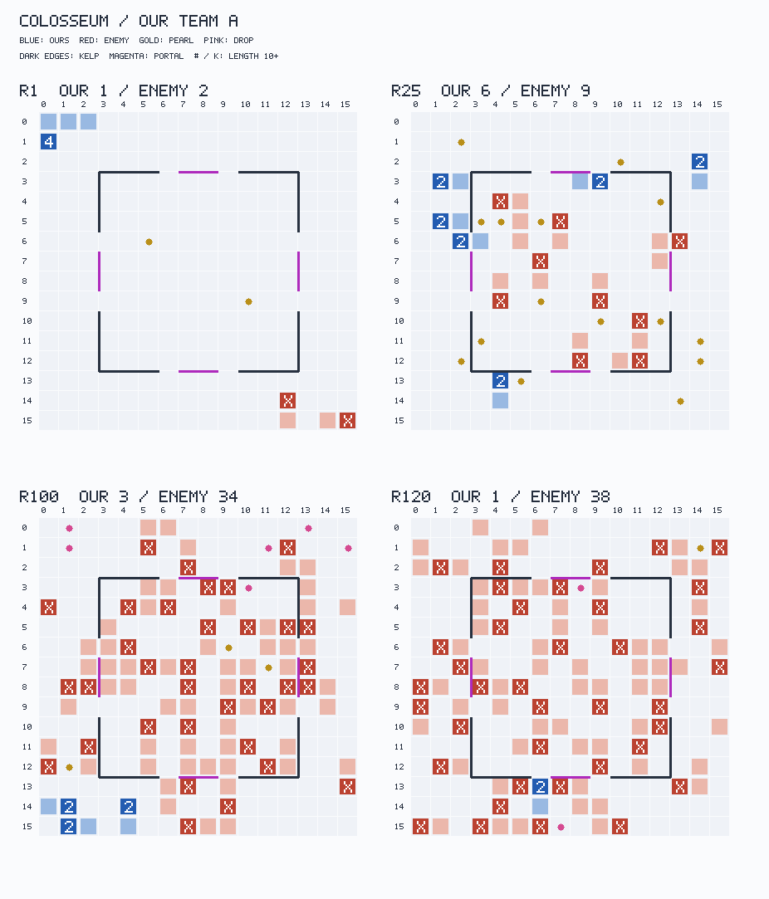
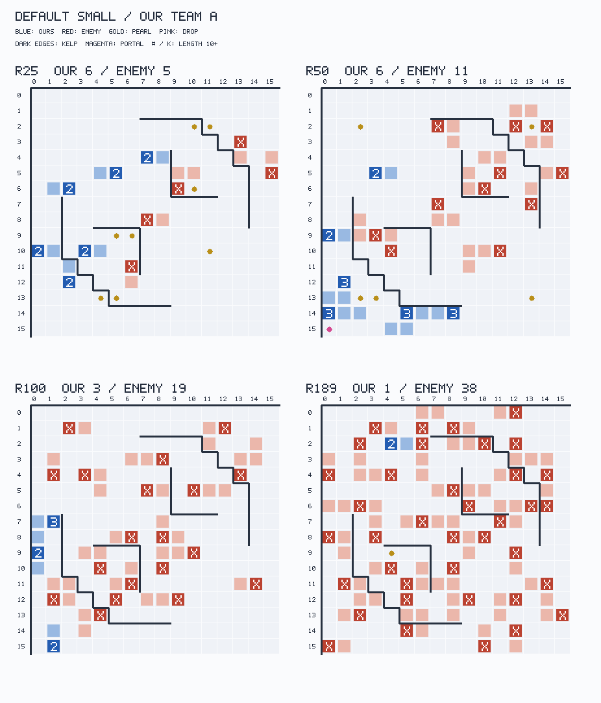
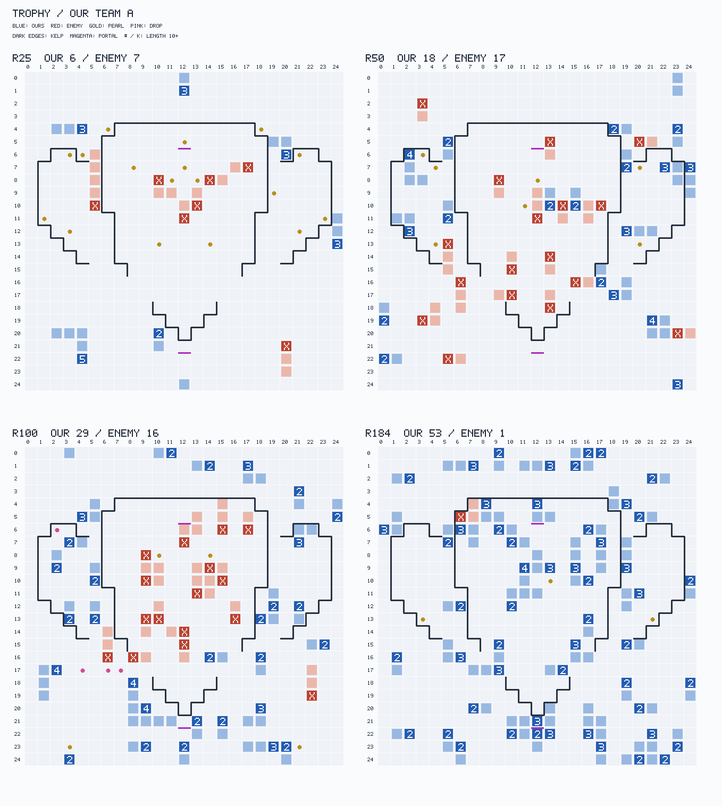

# 작은 지도에서의 전멸과 혼잡한 Trophy의 생존

작성 시각: 2026-10-01T14:08:24.320435+09:00. 전수 표를 먼저 만들고 부류를 고정한 뒤 정독했다. 범위는 기존 기보 분석이며, 새 봇 실행·네트워크·업로드·커밋은 N=0이다.

[사실] 번들 소형지도에서 F 24/24, S 24/24가 전멸했다. 인식 OFF Trophy도 F 8/8, S 8/8 전멸이다. 반면 상위권 수집 Trophy 승자 N=1,891은 분열의 211,628/222,806(95.0%)를 L4→2+2로 했다. 양쪽 수집 당시 순위가 모두 1–10인 별도 표본 N=466에서도 같은 방향이다.

[해석] 현재 근거는 **일괄적으로 분열을 늦추거나 최소 길이를 높이는 처방을 지지하지 않는다.** 첫 분열 시각 하나보다, 먹이를 다시 분열로 바꾸는 속도, 다음 적 차례의 돌진을 피하는 이동, 아군 몸으로 출구를 막지 않는 배치가 중요해 보인다. 이 분석에서 새 생존 규칙의 승률 효과를 시험한 N=0이다.

## 1. [사실] 전수 → 부류의 크기 → 정독

1. **전수 스크립트.** `setup.js`가 로컬 기보·온라인 인덱스·top/elite 인덱스와 elite의 `battle.json`을 조사하고 `tables.json`을 먼저 썼다. `extract.js`의 두 worker가 시뮬레이션과 머리/꼬리 갱신 방식으로 각 기보를 각각 재구성했다. 표본 추출 N=0, 사용 가능한 선택 모집단 N=2,129이다.
2. **부류와 크기.** 아래의 배타적 붕괴 부류와 r25 머리 수 부류를 전수 집계했다. `tables.json`에 모든 멤버 키와 N을 저장했다. 붕괴 부류는 의도·원인 모형이 아니라 사망 구성의 기술 분류다.
3. **정독.** 부류 내 분열 수·종료 시각·최대 머리 수·r25/r100 머리 수의 평균에 가까운 판을 골랐다. 정규화 절대거리 합으로 선택하며 승점 극값을 고르지 않았다. 정독 N=8팀-판(대표 7 + 사용자 지정 앵커 1)이고, 선택 부류 N과 실제 id/round는 `deep-selection.json`, `deep-reads.json`에 있다.

[사실] 재사용한 코드는 `exp/spatial/lib.js`의 빠른 기보 로더와 `tools/mass_ledger.js`의 이동·돌진·분열·드롭 원장, `exp/general/atlas_recount.js`의 별도 지도 그래프다. 별도 재구성은 `exp/spatial/recount.js`와 `exp/pocket/blocking.js`의 머리/꼬리 및 점유 갱신 방식을 작은 지도 지표에 맞췄다. 기존 파일 수정 N=0이다.

[사실] `turn` hook은 **turnStart, 이동 전**이다. 라운드별 상태는 그 라운드의 첫 turnStart에서 한 번 읽는다. 사망 위치는 실패한 칸으로 들어가기 전 머리 위치이고, head-on 접촉 칸은 별도로 기록했다. 좌표는 (x,y), 0부터 시작한다. 엔진 r120에서 마지막으로 죽은 판의 완료 라운드 수는 121이다. 분위수는 정렬한 N값 중 floor((N−1)p)번째의 경험 분위수이며, 여기의 중앙값은 p=0.5다. 최대 머리 수는 라운드 시작에서 본 최대이며, 라운드 중 순간 수는 countFlips/raw의 사건 기록에 따로 남는다.

[사실] 실행 worker 상한은 2다. `memory_pressure -Q`의 free 비율 <10% 또는 `statfs`의 남은 공간 <21 GiB면 중지한다. 실제 기록은 `resource.jsonl`이다. `nice -n 10`으로 실행을 요청했으나 이 샌드박스에서는 `setpriority: Operation not permitted`가 나와 실제 우선순위 저하는 적용되지 않았다. 측정/재집계 결과는 이 자원 조건에서 나온 값이다.

## 2. [사실] 모집단과 빠진 기보

|자료|사용 N|용도 / 제외|
|---|---|---|
|exp/gen F·S, 번들 3지도|48|한 엔진·한 지도당 8판; 양쪽 × 상대 2종 × seed 1–2|
|exp/gen F·S, Trophy 인식 OFF|16|F·S 각 8판|
|v1.2 Trophy 인식 ON|4|exp/v12/e-v12 seed 1; seed 2 네 판은 rows만 있고 replay 없음|
|온라인 W0–W12|105|기존 spatial/general의 15세트: merge2 반복 3, stack6 반복 2 포함|
|온라인 v1-w1..3|21|각 세트 Trophy 7판|
|data/top Trophy|1906|정체 휴리스틱 15판 제외 → 승자/패자 각각 N=1,891|
|그중 양쪽 순위 1–10|466|순위가 null이면 제외; 양쪽 순위가 명시된 엄격 부분집합|
|data/elite Trophy 추가|29|top와 같은 gameId 6판을 중복 제외; 순위 1–10 자기 팀 승자 N=22, 패자 N=13|
|합계|2129|온라인/로컬 우리 팀-판 N=194; 전멸 194/194|

[사실] `data/elite/index.jsonl`은 완료 게임 N=272이고 지도명 종류 N=10는 전부 알려진 10지도다. `battle.json`에만 있는 대기/미수집 메타데이터 N=33, 전체 메타데이터 N=305도 따로 확인했다. 처음 보는 지도명 N=0, battle 메타데이터의 처음 보는 지도명 N=0이다. 그중 Trophy 4판은 replay가 없어 분석에 넣지 않았다. 인식 ON seed 2의 누락 4판을 합쳐 누락 N=8을 `population.missing`에 명시했다.

[사실] 수집 본문에 `dev test` 및 순위 누락 상대가 있다. 따라서 top 전체를 ‘양쪽 모두 top 10’이라고 부르지 않는다. 전체 N=1,891의 결과와 엄격 N=466, 추가 elite의 순위 1–10 자기 팀 N=35를 구분한다. 완료 index의 전체 N=272, top와 중복 제거한 Trophy 추가 N=29, 순위 1–10 팀-판 N=35는 단위가 다르다.

[사실] 분석한 우리 로컬 소형지도는 arena 11×11(area 121, N=16), Colosseum 16×16(area 256, N=16), default_small 16×16(area 256, N=16), Trophy 25×25(area 625, 인식 OFF N=16·ON N=4)다. 따라서 아래 area≤625는 이 관찰 범위를 묶는 실험 경계이며 최적 임계값을 추정한 N=0이다.

[해석] 스프린트의 처음 보는 지도 본선은 요청에 적힌 16:30 KST 이후다. 이번 로컬 스냅샷에는 해당 완료 기보 N=0이므로 unseen 소형지도에서 elite가 실제로 이 규칙을 쓴다는 결론은 낼 수 없다. Trophy는 혼잡 생존의 관찰 근거이며, 번들 세 지도는 우리 실패의 직접 근거다.

## 3. [사실] 게임 규칙이 만드는 해석의 경계

[사실·규칙] `rules/ALL.md`의 Movement / Execution order / Splitting / Death / Vision을 적용했다. 머리→머리면 길이와 팀에 관계없이 두 마리가 죽는다. 한 적 머리와의 접촉은 머리 수 1:1 교환이다. id가 작은 순서대로 움직이고, 분열 새끼는 새 id로 같은 라운드 뒤에 움직인다. 목·꼬리도 이동 직전 충돌 검사에서는 막힌 칸이다.

[사실·규칙] 돌진의 추가 성공 이동마다 길이 1을 쓴다. L2는 첫 칸에서 먹이를 먹어 길이가 늘지 않는 한 두 번째 이동을 지불할 수 없다. 사망하면 머리부터 한 칸씩 건너 ⌈L/2⌉ 진주를 남긴다. 따라서 길이는 head-on의 승패를 결정하지 않지만 탈출/공격 거리, 잃는 질량, 남긴 진주의 양을 바꾼다.

[사실·정의] d3/d8은 wrap을 고려한 Manhattan 거리 ≤3/≤8이다. 아군 수는 자기 머리를 제외하며 균형은 a+1−e다. 별도의 visible 수는 실제 7×7 시야인 Chebyshev ≤3이다. d8은 전체 기보 지표로 단일 봇 시야에서 직접 얻을 수 없다. moverStart는 행동 전, victimAtContact는 충돌 직전이고 victimLastTurn은 피해자의 마지막 의사결정 상태다. 이 서로 다른 시점을 섞어 동시 관측이라고 해석하지 않는다.

[사실·정의] 막힘(cornered)은 이동 직전 4방향 중 빈 통과 가능 칸이 0개인 상태다. 돌진·분열·남의 머리를 치는 행동까지 모두 불가능하다는 뜻은 아니다. `trap`은 막힌 상태에서의 벽/몸/무행동 사망이며, `rammed`는 상대가 우리 머리에 들어와 둘 다 죽은 사건이다.

## 4. [사실] 작은 지도에서 어떻게 무너지는가

|지도/엔진|전멸/N|마지막 사망 r 중앙값 [최소–최대]|rammed / ram / trap|지속 열세 r 중앙값|라운드 시작 최대 머리 중앙값|
|---|---|---|---|---|---|
|local/arena/F|8/8|29 [25–44]|25 / 1 / 3|14|3|
|local/arena/S|8/8|36 [31–56]|38 / 3 / 5|17|4|
|local/Colosseum/F|8/8|98 [84–120]|56 / 5 / 4|22|8|
|local/Colosseum/S|8/8|114 [82–146]|76 / 2 / 2|24|8|
|local/default_small/F|8/8|173 [94–231]|59 / 1 / 42|22|8|
|local/default_small/S|8/8|146 [120–180]|57 / 11 / 52|22|8|
|local/Trophy/F|8/8|163 [142–254]|77 / 4 / 15|8|10|
|local/Trophy/S|8/8|197 [98–284]|102 / 10 / 32|8|12|
|local/Trophy/인식ON|4/4|169 [167–205]|43 / 3 / 10|6|7|

[사실] 번들 사망 N=442 중 head-on 사망은 334/442, 막힘은 108/442다. 막힘의 94/108이 default_small에 집중된다. default_small F·S의 막힘 94/94에는 인접 아군 조각이 있었다. 몸만 세면 57/94, 머리 인접은 68/94이며 두 유형은 겹친다. 적 몸 인접은 3/94였다. 실제 실패 action은 W(벽) 71/94, O(다른 몸) 23/94다. 이는 이동 직전 인접 점유이며, 아군 하나가 없었다면 살았을 것이라는 인과 판정은 아니다.

[사실] 단순 분열 직후 사망만으로는 Colosseum을 설명하지 못한다. F Colosseum 사망 N=65 중 최근 분열 ≤2라운드 사망은 1/65, ≤10라운드는 4/65다. F arena는 각각 12/29, 25/29이고 default_small은 14/102, 31/102다. S도 Colosseum ≤2라운드가 0/80인데 arena는 9/46, default_small은 15/120이다. 최근 분열은 부모와 새끼 양쪽을 포함하며 ‘그 분열 때문에 죽었다’는 인과 판정이 아니다.

### 4.1 [사실] 배타적 붕괴 부류와 크기

[사실] 순서는 생존 → 분열 0회 소멸 → trap가 사망의 50% 이상 → cross-team head-on이 사망의 75% 이상 → 혼합이다. 따라서 75%가 넘는 판도 분열 0회이면 무분열 부류다. 경계는 설명용 기술 분류이고 최적 생존 threshold를 추정한 값이 아니다.

|코호트|N|머리 교환 우세|막힘 우세|혼합|무분열 소멸|생존|
|---|---|---|---|---|---|---|
|local/arena/F|8|7|0|0|1|0|
|local/arena/S|8|8|0|0|0|0|
|local/Colosseum/F|8|8|0|0|0|0|
|local/Colosseum/S|8|8|0|0|0|0|
|local/default_small/F|8|3|2|3|0|0|
|local/default_small/S|8|2|2|4|0|0|
|local/Trophy/F|8|7|0|1|0|0|
|local/Trophy/S|8|6|1|1|0|0|
|local/Trophy/인식ON|4|4|0|0|0|0|
|online/W0-W12|105|54|16|25|10|0|
|online/v1|21|7|5|9|0|0|
|top/loser|1891|1726|1|65|16|83|
|top/bothTop10/loser|466|444|0|2|9|11|

[해석] arena는 작은 공간에서 교환 손실을 보충할 시간이 짧고, Colosseum은 초기 분열 후 재생산/점유의 격차가 계속 커지는 유형이다. default_small은 별도로 아군 간 출구 막힘이 크게 섞인다. 한 가지 ‘너무 이른 분열’ 설명으로 세 지도를 합치면 이 차이를 놓친다.

### 4.2 [사실] 각 게임의 전체 타임라인

[사실] **우리 N=194판 모두**에서 분열의 round·부모/새끼 id·rule과 전체 indicator, 부모/새끼 길이, 모든 사망 원인·좌표, 매 라운드 머리 수/길이 배열, 열세 전환, 마지막 20라운드의 실제 행동을 저장했다. [전체 타임라인 색인](../../exp/small/INDEX.md), [기계용 표](../../exp/small/tables.json)의 `ourGames`, `exp/small/timelines/`을 본다. 마지막 20라운드는 두 팀의 상태와 사건 및 우리 행동을 담고, 상대의 전체 행동은 압축 raw에 남겼다.

[사실] ‘수 비율이 뒤집힘’에는 두 값이 있다. 모든 split/death 사건 직후의 sign 변화(`countFlips`, `firstDeficitEvent`)와 라운드 시작 수(`firstDeficit`, `stableDeficit10`)다. head-on은 피해자 사망 후 이동자 사망이어서 잠깐 생기는 수 차이도 사건 열에 드러난다. 지속 열세는 10개 연속 라운드 시작에서 우리가 더 적은 첫 라운드이며 새끼가 같은 라운드에 죽는 경우도 전체 사건에는 남는다.

## 5. [사실] head-on의 길이·수·막힘

|코호트|접촉 N|우리 이동/상대 이동|우리 L2–3|d3 열세|d8 열세(전지)|시야 열세|마지막 자기 판단에서 빈칸 0|
|---|---|---|---|---|---|---|---|
|local/bundled/F|147|7 / 140|133/147 (90.5%)|95/147 (64.6%)|142/147 (96.6%)|119/147 (81.0%)|2/144 (1.4%)|
|local/bundled/S|187|16 / 171|171/187 (91.4%)|124/187 (66.3%)|179/187 (95.7%)|149/187 (79.7%)|15/186 (8.1%)|
|online/v1|245|17 / 228|227/245 (92.7%)|153/245 (62.4%)|228/245 (93.1%)|187/245 (76.3%)|11/245 (4.5%)|
|online/W0-W12|701|48 / 653|606/701 (86.4%)|410/701 (58.5%)|665/701 (94.9%)|553/701 (78.9%)|34/696 (4.9%)|
|top/winner|93335|56688 / 36647|83117/93335 (89.1%)|16217/93335 (17.4%)|17715/93335 (19.0%)|18037/93335 (19.3%)|1648/93082 (1.8%)|
|top/loser|93335|36647 / 56688|83673/93335 (89.6%)|30863/93335 (33.1%)|62002/93335 (66.4%)|41577/93335 (44.5%)|1906/92934 (2.1%)|
|top/bothTop10/winner|22010|13235 / 8775|19787/22010 (89.9%)|3570/22010 (16.2%)|3714/22010 (16.9%)|4002/22010 (18.2%)|375/21944 (1.7%)|
|top/bothTop10/loser|22010|8775 / 13235|20153/22010 (91.6%)|7106/22010 (32.3%)|14923/22010 (67.8%)|9677/22010 (44.0%)|464/21904 (2.1%)|

[사실] 모든 두 머리 사망 접촉 N=99,839를 [headons.jsonl](../../exp/small/headons.jsonl)에 한 사건씩 기록했다. 적과 접촉 N=96,135, 아군과 접촉 N=3,704다. mover/victim id와 팀, action 문자열, 실패 step, 이동 전/접촉 시 길이, d3/d8/시야 머리 수, 빈 출구, 상대의 마지막 판단과 접촉 위치가 있다. 아군 접촉은 적 1:1 교환 표에 넣지 않았다.

[사실] 번들에서 상대가 들어와 죽은 피해자 N=311 중 이전 차례가 확인되는 N=307에서 빈 출구가 2개 이상이었던 경우는 226/307이다. 이전 길이 L2는 218/307이고, 접촉이 상대 action의 두 번째 이상 step인 경우는 148/311이다. 따라서 ‘모두 이미 구석에 몰렸음’도 ‘모두 길이가 길어서 희생됨’도 아니다.

[사실] 능동 교환을 시야 균형 ≥+1로 제한하면 기존 번들 능동 교환 15/23, 온라인 능동 교환 44/65가 걸린다. 그러나 번들의 주된 피해는 수동 rammed 311/334이고 온라인은 881/946이다. 능동 trade만 차단해도 이 큰 수동 피해가 자동으로 사라지지는 않는다.

[해석] 수의 차이는 head-on 한 번을 이기게 하지 않는다. 1:1 이후에도 머리를 보충하고 드롭을 회수할 수 있는가를 결정한다. 길이 3은 길이 2보다 돌진 여유가 있지만, 상대와 부딪히면 똑같이 사망한다. 가장 직접적인 조사 대상은 빈칸 중 무엇을 골랐는지와 그 칸이 적의 다음 id 차례에서 닿는지다. 본 분석은 대안 행동을 실행하지 않았으므로 ‘그 칸이면 반드시 생존’ 반사실 N=0이다.

## 6. [사실] Trophy 승자·패자·우리의 차이

### 6.1 [사실] 분열 일정과 머리 수

|코호트 N|첫 분열 r 중앙값 (분열한 판 N)|r0–24 / 25–49 / 50–99 분열/판|전체 분열/판|r25 / r50 / r100 머리|r100 실제 도달 N|
|---|---|---|---|---|---|
|top/winner (1891)|10 (1891)|4.2 / 11.4 / 31.0|117.8|5.6 / 14.3 / 30.7|1639|
|top/loser (1891)|10 (1875)|2.8 / 6.2 / 14.6|54.4|4.3 / 7.9 / 9.3|1639|
|top/bothTop10/winner (466)|10 (466)|4.1 / 11.5 / 31.7|113.2|5.5 / 14.3 / 31.4|396|
|top/bothTop10/loser (466)|10 (457)|2.8 / 6.0 / 14.3|48.9|4.2 / 7.6 / 8.7|396|
|elite/rank10/winner (22)|10 (22)|4.6 / 11.8 / 31.0|97.5|6.0 / 15.5 / 31.2|17|
|elite/rank10/loser (13)|13 (13)|1.7 / 5.3 / 17.7|59.0|3.1 / 6.8 / 11.6|11|
|online/W0-W12 (105)|15 (95)|1.2 / 2.0 / 3.3|8.1|3.2 / 4.8 / 4.0|85|
|online/v1 (21)|15 (21)|1.9 / 5.5 / 7.0|17.5|3.8 / 8.5 / 8.0|20|
|local/Trophy/F (8)|5 (8)|1.8 / 3.8 / 4.2|10.0|3.8 / 6.8 / 7.9|8|
|local/Trophy/S (8)|5 (8)|1.9 / 5.0 / 9.0|16.0|3.9 / 7.9 / 11.4|7|
|local/Trophy/인식ON (4)|20 (4)|0.8 / 4.5 / 6.2|12.0|2.8 / 7.0 / 9.2|4|

[사실] 위 표의 머리 수 곡선은 코호트 전체 N을 분모로 하며 이미 끝난 판은 최종 상태를 유지한다. ‘r100 실제로 진행한 판’만 조건부로 보면 top 승자 30.98머리, 패자 10.72머리(각 N=1,639); 엄격 top10 승자 32.12, 패자 10.26(각 N=396)다. 두 분모를 혼동하지 않는다.

[사실] top 승자 N=1,891의 r50–99 분열은 58,602회, 사망은 27,566회로 +31,036머리다. 패자는 분열 27,586회, 사망 25,008회로 +2,578머리다. **이 구간 head-on 사망은 양쪽 모두 22,458회**다. 승자는 막힘·아군충돌 등 추가 사망까지 더 겪으면서 분열로 수를 늘렸다. 온라인 v1 N=21은 같은 구간 분열 148, 사망 157로 −9머리다.

[해석] ‘교환에서 적 머리를 더 많이 죽임’으로 수 우위를 설명할 수 없다. 교환 수는 같다. 승자의 분열과 먹이 회수가 교환 후 남는 머리 수를 다르게 만든다는 설명이 이 수지와 맞는다. 다만 먹이를 먼저 차지해서 분열이 많아졌는지, 먼저 머리가 많아서 먹이를 차지했는지의 인과 방향은 기보만으로 분리되지 않는다.

### 6.2 [사실] 조각 길이와 분열 직후 생존

|코호트|L4→2+2 분열/N|해당 새끼 +30 생존/관찰 N|r100 L2–3 머리/머리 N|r100 최장 평균 (도달 N)|
|---|---|---|---|---|
|top/winner|211628/222806 (95.0%)|115373/174697 (66.0%)|49177/50778 (96.8%)|3.6 (1639)|
|top/loser|99552/102884 (96.8%)|36177/94199 (38.4%)|16892/17566 (96.2%)|3.3 (1639)|
|top/bothTop10/winner|49778/52746 (94.4%)|27268/40467 (67.4%)|12301/12718 (96.7%)|3.7 (396)|
|top/bothTop10/loser|21924/22792 (96.2%)|7373/20725 (35.6%)|3884/4062 (95.6%)|3.3 (396)|
|online/v1|278/367 (75.7%)|168/267 (62.9%)|166/169 (98.2%)|3.0 (20)|
|online/W0-W12|575/853 (67.4%)|332/548 (60.6%)|348/416 (83.7%)|5.0 (85)|
|local/Trophy/F|67/80 (83.8%)|58/67 (86.6%)|63/63 (100.0%)|2.4 (8)|

[사실] 분열의 4以下 bin은 최소 합법 분열 길이가 4이므로 실제로 전부 L4→2+2다. 생존은 새끼 id 하나를 추적하며 손자까지 합친 계보 생존이 아니다. 종료가 birth+30보다 빠르면 +30 분모에서 제외한다. 사망 round가 정확히 birth+30이면 그 round 시작에는 살아 있다고 센다.

|혼잡 기준: 자기 포함 시야 머리 ≥5|분열 N|새끼 +30 생존/관찰 N|시야 머리 <5 생존/관찰 N|
|---|---|---|---|
|local/bundled/F|40|16/29 (55.2%)|85/114 (74.6%)|
|local/bundled/S|65|25/49 (51.0%)|82/129 (63.6%)|
|online/v1|114|51/105 (48.6%)|177/250 (70.8%)|
|online/W0-W12|252|84/219 (38.4%)|380/573 (66.3%)|
|top/winner|79622|40799/61481 (66.4%)|79587/121291 (65.6%)|
|top/loser|32241|10739/30124 (35.6%)|26557/67065 (39.6%)|

[해석] 우리 쪽은 혼잡한 창에서 난 새끼의 생존이 더 낮지만, elite 승자는 같은 창에서도 비혼잡 창과 비슷하다. ‘혼잡 ≥5이면 분열을 무조건 금지’ 역시 승자 행동을 그대로 설명하지 못한다. 부모/꼬리의 실제 출구와 적의 도달 가능성을 함께 보는 선택적 조건이 더 타당한 실험 후보다.

### 6.3 [사실] 교환 질량과 진주 회수

|코호트 (head-on N)|우리가 이동 / 들이받힘|적 길이−우리 길이 합|우리 드롭의 우리 회수|우리 드롭의 적 회수|적 드롭의 우리 회수|
|---|---|---|---|---|---|
|top/winner (93335)|56688 / 36647|-4711|105846/152620 (69.4%)|42214/152620 (27.7%)|73509/147992 (49.7%)|
|top/loser (93335)|36647 / 56688|4711|69719/147992 (47.1%)|73509/147992 (49.7%)|42214/152620 (27.7%)|
|top/bothTop10/winner (22010)|13235 / 8775|-1918|25159/35642 (70.6%)|9372/35642 (26.3%)|16772/34042 (49.3%)|
|top/bothTop10/loser (22010)|8775 / 13235|1918|16251/34042 (47.7%)|16772/34042 (49.3%)|9372/35642 (26.3%)|
|online/v1 (245)|17 / 228|83|49/313 (15.7%)|231/313 (73.8%)|21/401 (5.2%)|
|online/W0-W12 (701)|48 / 653|-103|114/1065 (10.7%)|773/1065 (72.6%)|62/1150 (5.4%)|
|local/Trophy/F (81)|4 / 77|32|7/94 (7.4%)|79/94 (84.0%)|8/126 (6.3%)|

[사실] 교환 머리 수 순수지(net)는 모든 cross-team 접촉에서 0이다. top 승자는 교환 질량의 합에서 오히려 −4,711이지만 자기 드롭 105,846/152,620을 회수했다. 우리 v1은 49/313, W0–W12는 114/1,065다. 드롭이 끝까지 안 먹히거나 다른 드롭이 덮어쓰면 양쪽 회수의 합은 100%가 아니다. 남은 진주 잔액과 드롭 대조 오류 N=0이다.

[해석] 짧은 조각을 서로 치는 전략은 주변의 다음 머리들이 진주를 회수할 때 유지된다. 우리의 +83(v1) 같은 길이 교환 이익이 곧 생존 이익이 아닌 이유다. 많은 조각과 수확/재분열이 연결되어야 하고, 교환으로 죽은 조각 수만 보고 ‘trade가 좋았다’고 판정하면 안 된다.

### 6.4 [사실] 몸을 벽으로 쓰는 정도와 왕 안전 거리

|코호트 (팀-판 N)|적이 우리 몸에 죽음 N|적 몸이 인접한 trap N / trap 전체|적 몸 인접 turn / turn 전체|r25 / r50 / r100 최장 머리의 최근접 적 거리|
|---|---|---|---|---|
|top/winner (1891)|684|1224/27491 (4.5%)|85136/10569210 (0.8%)|8.6 (N=1879) / 7.4 (N=1832) / 7.2 (N=1639)|
|top/loser (1891)|927|1060/8371 (12.7%)|62251/3277238 (1.9%)|7.7 (N=1879) / 5.7 (N=1832) / 4.3 (N=1639)|
|top/bothTop10/winner (466)|119|293/5765 (5.1%)|17989/2482781 (0.7%)|8.4 (N=461) / 7.7 (N=445) / 7.2 (N=396)|
|top/bothTop10/loser (466)|267|227/1290 (17.6%)|12498/673624 (1.9%)|7.4 (N=461) / 5.6 (N=445) / 4.5 (N=396)|
|online/v1 (21)|4|9/164 (5.5%)|214/22073 (1.0%)|8.3 (N=21) / 5.5 (N=21) / 3.5 (N=20)|
|online/W0-W12 (105)|3|23/360 (6.4%)|477/57553 (0.8%)|8.3 (N=105) / 5.6 (N=105) / 3.6 (N=85)|

[사실] ‘왕’은 그 순간 실제 최장(동률 최소 id)으로 정의한다. 이는 봇의 불완전한 왕 믿음과 다르다. r100 top 승자 최장 길이는 평균 3.64, 최대 7(N=1,639)이다. 따라서 이 거리 표는 대부분 L3–4의 최장 조각 안전이며, L20 이상 요새 왕의 증거가 아니다.

[해석] Trophy에서 보이는 주된 생존 방식은 작은 머리를 계속 생산하고 주변 진주를 다시 먹는 흐름이다. 몸으로 적을 죽이는 사건은 있지만, 의도된 wall formation과 우연한 점유를 기보에서 판별한 N=0이다. 특히 default_small은 아군 조각 인접 trap 94/94(몸 57/94, 머리 68/94)라서 길이를 늘린 벽 배치가 오히려 출구를 더 막을 수 있다.

### 6.5 [사실] 전멸 시각

|코호트|전멸/N|마지막 사망 r 중앙값 / p10 / p90|500라운드까지 양쪽 생존|
|---|---|---|---|
|top/loser|1808/1891|174 / 87 / 316|83|
|top/bothTop10/loser|455/466|165 / 78 / 297|11|
|elite/rank10/loser|13/13|242 / 86 / 309|0|
|online/v1|21/21|155 / 110 / 242|—|
|online/W0-W12|105/105|129 / 89 / 171|—|

[사실] top 전체 N=1,891에서 500라운드까지 둘 다 살아 점수로 갈린 판은 83/1,891이고, 엄격 top10은 11/466이다. 전멸한 패자의 마지막 사망 중앙값은 top r174(N=1,808), 엄격 top10 r165(N=455)다. 우리 온라인 v1은 r155(N=21), W0–W12는 r129(N=105)다. 승자도 종료 시각은 동일하지만 승자 전멸 N=0이다.

## 7. [사실] 부류를 정한 뒤의 실제 판면 읽기

|선택 부류|부류 N / 그룹 N|game key / 팀|읽기 목적|
|---|---|---|---|
|local/arena/F : 머리 교환 우세(≥75%)|7 / 8|v12-F-H:proxy4_king:arena:A:1 / A|부류 평균에 가까운 판|
|local/Colosseum/F : 머리 교환 우세(≥75%)|8 / 8|v12-F-H:proxy4_king:Colosseum:B:1 / B|부류 평균에 가까운 판|
|local/default_small/F : 막힘 우세(≥50%)|2 / 8|v12-F-H:proxy4_king:default_small:A:1 / A|부류 평균에 가까운 판|
|online/v1 : 혼합 붕괴|9 / 21|v1-w3:753212 / A|부류 평균에 가까운 판|
|top/bothTop10/winner : r25 5–8머리|263 / 466|top:637160:637169 / A|부류 평균에 가까운 판|
|top/bothTop10/loser : 머리 교환 우세(≥75%)|444 / 466|top:671682:671691 / A|부류 평균에 가까운 판|
|local/arena/F : 무분열 소멸|1 / 8|v12-F-H:proxy4_king:arena:B:1 / B|부류 평균에 가까운 판|
|local/Colosseum/F : 사용자 지정 앵커|1 / 1|v12-F-H:proxy4_king:Colosseum:A:1 / A|사용자 지정 사례|

### 7.1 [사실] Colosseum 앵커: 작은 조각이 즉시 죽은 것이 아니다 (N=1)

[사실] `v12-F-H:proxy4_king:Colosseum:A:1`은 csplit r1,6,13,18,24,30,33,57의 8회다. 처음 다섯 번과 마지막은 L4→2+2, r30/r33은 L5→3+2다. 첫 라운드 시작 열세는 r1이지만 r10에는 3:2로 앞서며, 지속 열세는 r23부터다. r25 6:9, r50 8:20, r100 3:34, r120 1:38이다.

[사실] 우리 사망은 rammed 7 + ram 2 =9개다. 마지막 20라운드 r101–120에는 r110 #4 ram L2 @(7,13), r112 #8 rammed L2 @(5,15), r120 #3 rammed L2 @(6,12)가 있다. r101–109는 3마리, r111은 2, r113–120은 1마리로 시작한다. 상대는 총 분열 85, 사망 49, 최종 1+85−49=37마리다. 우리도 1+8−9=0이다. 종료는 r120, 완료 121라운드로 ‘r125쯤’보다 정확하게 좁혔다.

[사실] 파란 머리의 숫자는 길이이며 id가 아니다. 붉은 X/K는 적 머리, 연한 색은 몸, 금색은 자연 진주, 분홍은 드롭이다. 벽·포털은 replay header에서 그렸다. 판면 상태는 `node eval/board.js`의 출력 그대로다. exact command와 header name은 [boards.json](../../exp/small/boards.json)에 있다.

[해석] r33 이후 대부분의 조각이 한동안 살아 있는데도 보충 격차가 벌어진다. 이 판 하나에서는 ‘2조각이라 생기자마자 죽음’보다 목표 8 이후의 정체와 수확/이동 실패가 더 잘 맞는 설명이다. 상대의 85회 분열 중 일부는 우리와의 교환 외의 자체 사망도 보충한다.

[사실] 같은 지도 교환 우세 부류 N=8의 평균에 가까운 대표 `v12-F-H:proxy4_king:Colosseum:B:1`도 csplit r1,9,17,18,26,27,32,40의 8회다. r25 5:7, r50 8:21, r100 2:39이고 완료 108라운드다. 마지막 사망은 r85 #24 ram L2 @(8,13), r90 #14 rammed L3 @(0,9), r97 #7 rammed L2 @(12,13), r105 #1 rammed L2 @(3,0), r107 #20 rammed L2 @(2,0)이다. 앵커와 다른 좌석에서도 비슷한 후기 수 격차를 확인한다(정독 N=1).

### 7.2 [사실] default_small: 아군 출구 막힘이 먼저 수를 깎는다 (부류 N=2, 정독 N=1)

[사실] `v12-F-H:proxy4_king:default_small:A:1`은 분열 11, 사망 13(trap 9, rammed 4)이다. r25는 6:5로 앞서고 지속 열세는 r35부터다. r51 csplit #12→#19, r53 escape-split #0→#20 이후에도 r59·63·71·85에 분열이 이어진다. r87 #20 trap L2 @(1,7), r88 #28 trap L2 @(0,7)이 남아 있는 가지를 자른다.

[사실] 마지막 20라운드 r170–189에는 새 분열 N=0이다. r170–177 시작은 우리 2마리, r177 #2 rammed @(7,1) 이후 r178–189는 1마리다. r189 #9 rammed @(3,2)로 끝난다. 마지막 20라운드만 보면 교환 붕괴 같지만, 전수 사망에서 앞선 trap 9개를 놓치면 원인 구성이 바뀐다.

[해석] 이 경우 분열의 새끼 빈칸만 확인하는 조건은 부족할 수 있다. 부모 주변의 아군 몸과 벽이 이후 동선을 막는지도 봐야 한다. 다만 분열을 없앤 동일 조건 판은 실행하지 않았으므로 분열 금지가 해결한다는 주장 N=0이다.

### 7.3 [사실] arena의 두 사례: 분열 직후 위험과 무분열의 실패 (각 N=1)

[사실] 교환 우세 부류 N=7의 대표 `v12-F-H:proxy4_king:arena:A:1`은 csplit r8 #0→#2, r16 #0→#7, r19 #7→#12이다. r14부터 지속 열세, r25 2:20이다. r19 #2 rammed @(4,0), r22 #0 trap @(5,10), r26 #12 rammed @(1,9), r27 #7 rammed @(10,8)로 끝난다. 마지막 20라운드는 r8–27라서 모든 분열이 그 창에 포함된다.

[사실] 별도 무분열 부류 N=1인 `v12-F-H:proxy4_king:arena:B:1`은 분열 0회, r25에 L8인 #1이 @(7,7)에서 rammed로 죽는다. r25 시작 수는 1:17이다. 길이를 보존한 한 조각이 head-on에서 안전하다는 규칙적 근거는 없다.

### 7.4 [사실] 엄격 top10의 승자: 수를 늘린 뒤 교환을 감당한다 (부류 N=263, 정독 N=1)

[사실] `top:637160:637169`, cheji bt(A) 대 Stockfish(B), 승자 A는 분열 120, 사망 69, 최종 53머리다. 최초 r12 #1(L6), r16 #5(L7), r17 #6(L5), r19 #3(L4)의 분열로 시작한다. r25에는 6:7로 약간 뒤지지만 r50 18:17, r100 29:16, r184 53:1이다. 교환은 능동 41, 들이받힘 22의 63접촉이며 양쪽 모두 63개씩 교환으로 잃는다. 전체 상대 수지는 2+65−67=0, 우리 수지는 2+120−69=53이다.

[해석] 이 대표 승자의 첫 분열조차 L4 고정은 아니다. 초기 한 라운드의 다소 낮은 수를 회복하고 이후 분열을 지속하는 점이 중요하다. 마지막 판면의 작은 머리 다수와 지역 점유는 확인되지만, 통일된 ‘벽 formation’을 계획했다는 읽기는 하지 않는다.

### 7.5 [사실] 엄격 top10 패자와 우리 v1의 대응 읽기

[사실] 교환 우세 패자 부류 N=444의 대표 `top:671682:671691`은 Team SKKU(A) 대 Stockfish(B), A 분열 44, 사망 46, 전멸이다. 최초 r13/15/17/18 분열, r25에는 5:3으로 앞선다. r50 9:13, r100 8:39로 뒤집힌다. 능동 ram 8, rammed 29, trap 9다. r165 #141 rammed L4 @(21,11), r166 #145 trap L2 @(21,6)으로 끝난다. 초기 수 우위가 후기 재생산 부족을 보장해 주지 않는다.

[사실] 우리 v1 혼합 부류 N=9의 대표 `v1-w3:753212`은 첫 split r15, 분열 16, 사망 18(trap 7, rammed 9, ram 2)이다. 지속 열세 r10, r25 3:6, r50 11:19, r100 9:40, r148 1:54다. 마지막 20라운드 r129–148에는 r135 #38 @(22,4), r140 #20 @(0,6), r146 #22 @(1,22), r148 #0 @(0,20)의 rammed가 있다. 적 최종 53머리다.

## 8. [사실] 독립 재집계와 숫자의 한계

|전체 집계|시뮬레이션 원장|기보 갱신 재구성|
|---|---|---|
|games|2129|2129|
|deaths|252971|252971|
|splits|346965|346965|
|contacts|99839|99839|
|eliminatedTeams|2046|2046|

|핵심 코호트|N 주/독립|전멸 주/독립|사망 주/독립|분열 주/독립|적 head-on 주/독립|r100 머리 합 주/독립|
|---|---|---|---|---|---|---|
|local/bundled/F|24/24|24/24|196/196|164/164|147/147|48/48|
|local/bundled/S|24/24|24/24|246/246|214/214|187/187|58/58|
|local/Trophy/F|8/8|8/8|96/96|80/80|81/81|63/63|
|local/Trophy/S|8/8|8/8|144/144|128/128|112/112|91/91|
|local/Trophy/인식ON|4/4|4/4|56/56|48/48|46/46|37/37|
|online/W0-W12|105/105|105/105|1063/1063|853/853|701/701|416/416|
|online/v1|21/21|21/21|409/409|367/367|245/245|169/169|
|top/winner|1891/1891|0/0|136529/136529|222806/222806|93335/93335|58082/58082|
|top/loser|1891/1891|1808/1808|106177/106177|102884/102884|93335/93335|17566/17566|
|top/bothTop10/winner|466/466|0/0|30705/30705|52746/52746|22010/22010|14620/14620|
|top/bothTop10/loser|466/466|455/455|23690/23690|22792/22792|22010/22010|4062/4062|

[사실] 각 게임의 모든 라운드 수·질량·길이, 사망 원인/좌표, 분열, 접촉 및 mover/victim의 d3/d8/visible/free를 두 방식으로 대조했다. 불일치 N=0. Python `verify.py`가 별도 코드로 45코호트 × 21항목(원인 dictionary 포함)을 다시 합산해 불일치 N=0이다. 원장 sim/split/drop/eat/질량/최종/계보/진주 잔액/미상 사망 검사 합은 모두 0이다.

|기전 핵심 수치|주 집계|별도 재구성/합산|
|---|---|---|
|번들 rammed N|311|311|
|그중 직전 판단 확인 N|307|307|
|직전 빈 출구 ≥2 N|226|226|
|직전 L2 N|218|218|
|접촉 step ≥2 N|148|148|
|default_small trap: 전체|94|94|
|default_small trap: 아군 조각 인접|94|94|
|default_small trap: 아군 몸 인접|57|57|
|default_small trap: 아군 머리 인접|68|68|
|default_small trap: 적 몸 인접|3|3|

|elite 핵심 수치|주 집계|독립 합산|
|---|---|---|
|top/winner: L4 분열|211628|211628|
|top/winner: r50–99 분열|58602|58602|
|top/winner: r50–99 사망|27566|27566|
|top/winner: r50–99 head-on 사망|22458|22458|
|top/loser: L4 분열|99552|99552|
|top/loser: r50–99 분열|27586|27586|
|top/loser: r50–99 사망|25008|25008|
|top/loser: r50–99 head-on 사망|22458|22458|

[사실] 핵심 기전은 우리 194판을 새로 읽은 `key_recount.js`와 주 표를 별도로 합산한 Python `key_compare.py`로 게임별·28그룹별 대조했다. 불일치 N=0. 머리/몸의 구분과 피해자의 마지막 차례는 이 추가 대조에 포함한다. [key-verification.json](../../exp/small/key-verification.json)에 양쪽 수를 보존했다.

|교환 드롭 수치 (코호트 N)|접촉 원장 합산|사망 원장 별도 합산|
|---|---|---|
|top/winner (1891): 자기 드롭|152620|152620|
|top/winner (1891): 자기 드롭의 자기 회수|105846|105846|
|top/loser (1891): 자기 드롭|147992|147992|
|top/loser (1891): 자기 드롭의 자기 회수|69719|69719|
|online/v1 (21): 자기 드롭|313|313|
|online/v1 (21): 자기 드롭의 자기 회수|49|49|
|online/W0-W12 (105): 자기 드롭|1065|1065|
|online/W0-W12 (105): 자기 드롭의 자기 회수|114|114|

[사실] 드롭 회수는 별도 Python 코드로 접촉 원장(ct) 대신 사망별 원장(dt)을 합산해 양쪽 수를 대조했다. 위 표의 드롭 provenance 자체는 공유 mass_ledger에 의존하므로, 이것을 별도 머리/꼬리 알고리즘이 회수까지 독립 재구성했다고 주장하지 않는다. 원장의 drop/eat/잔액 검사 불일치 N=0은 별도로 확인했다.

[사실] 공통 의존성은 빠른 binary decoder다. 이를 공식 viewer 변환과 별도로 비교한 N=3판은 11,961 + 21,921 + 17,985 =57,867 이벤트, 불일치 N=0이다. 지도 그래프와 라운드·사망 판정 정의도 공유하므로 완전히 독립된 엔진 검증이라고 부르지 않는다. 기록은 [verification.json](../../exp/small/verification.json), [decoder-qa.json](../../exp/small/decoder-qa.json)에 있다.

[해석] 비교는 관찰 상관이다. 같은 팀/버전이 반복되고 F/S는 같은 seed 키의 대응 판이다. 모든 event를 독립 표본으로 잡은 p값이나 승률 개선 CI를 만들지 않았다(N=0). 다음 실험은 동일성 확인과 작은 지도 쌍 비교, 실제 시야만 이용한 발동 로그를 따로 필요로 한다. 현재 발견은 이 후속 실험의 방향을 좁힌다.

## 9. [해석·가설] 관측으로 켜는 생존 규칙

[해석] 우선순위는 ‘수 증가를 유지하면서 위험한 위치의 분열/이동을 거르기’다. 모든 분열에 L6 같은 하한을 씌우는 가설은 elite L4→2+2의 큰 모집단과 반대이며, 이번 자료에서는 우선 후보로 삼지 않는다. 다만 길이 3의 탈출 여유를 **위협을 받은 부모에게만** 남기는 조건부 실험은 가능하다.

[가설] 아래 수치는 지도명이 아니라 r0의 area, 현재 자신의 길이·id, 7×7의 머리/몸/벽, UNIT_COUNT, 최근 관측으로 계산한다. global enemy count, d8, 숨은 샘 공급량, 전체 실제 왕 id는 입력으로 쓰지 않는다. sonar를 쓸 경우 메시지의 나이와 중복 id를 기록한다. 모든 후보의 새 봇 적용/결과 실험 N=0이고 예상 효과는 방향만 적는다.

|우선|가설·threshold|직접 관찰 근거 N|예상 상태 효과 / 반증 지표|
|---|---|---|---|
|1|**수 부족 시 안전한 재생산**: area≤625, r<100; 기존 목표 8을 넘었어도 창에서 a+1≤e이고 부모/새끼 빈 출구 각각 ≥2면 L4→2+2 추가 허용. 실험용 전체 cap=min(엔진 UNIT_LIMIT,64,⌊area/8⌋); 비상 탈출 split은 별도 취급.|Colosseum F N=8 모두 head-on 우세; 앵커 수지 1+8−9=0 vs 1+85−49=37. Trophy 승자 분열 L4 N=211,628. cap 공식의 검증 N=0.|발동: 목표 cap 때문에 막혔던 안전 split 수↑. 상태: r50/100 머리와 자연 진주 섭취↑, +30 새끼 생존↓이면 반증. 결과: 전멸률↓ 예상, 큰 지도는 area gate로 영향 제한.|
|2|**다음 id 차례의 머리 도달을 피함**: area≤625 또는 visible 머리≥5; 빈 후보라도 다음 자기 turn 전 적이 닿는 경로가 있으면 거부/감점. 현재와 목적지 주변의 관측된 몸·벽, 포털 불확실성, 적 id 순서를 사용. L2는 추가 이동을 지불하지 못함을 모델에 반영.|번들 rammed N=311; 직전 판단 N=307 중 빈 출구≥2가 226, L2가 218. 적의 2step 이상 접촉 148/311.|발동: ‘빈 칸이지만 다음 적 turn에 닿음’ 후보 수 측정. 상태: 해당 판단 이후 ≤2라운드 rammed↓, pearls/turn 급감 여부 확인. 결과: 머리 교환 우세 부류 전멸↓ 예상.|
|3|**위협 부모에게만 돌진 여유 보존**: area≤625, visible 머리≥5, 관측 적이 부모까지 Manhattan≤2; 정상 split은 부모 L≥3·새끼 L≥2(최소 합 L5), 그렇지 않으면 먼저 안전한 이동. 빈출구0의 비상 split은 금지하지 않음.|혼잡 split N=40(F),65(S),114(v1),252(W0–W12); 새끼 +30 생존 16/29,25/49,51/105,84/219. elite 혼잡 N=79,622는 잘 생존하므로 일괄 금지 근거는 없음.|발동: L4 위험 split 보류 수. 상태: 부모가 실제 유효 sprint를 사용했는지와 ≤10라운드 부모/가족 손실↓. 머리 수/먹이 재생산이 더 줄면 폐기.|
|4|**능동 trade의 지역 지원 gate**: area≤625 또는 visible 머리≥5; a+1−e≥+1일 때만 자발적 head-on. L>3이면 보수적으로 추가 거부; 빈출구0의 불가피한 교환과 정상 선택을 분리.|기존 번들 능동 trade N=23 중 15, 온라인 N=65 중 44가 +1 미만. top 승자의 시야 +1 이상 접촉 58,739/93,335.|상태: 능동 불리한 교환↓, 회수율↑ 예상. 수동 rammed 311/334(번들)는 이 gate만으로 해결되지 않는 반증 범위. 교환 회피 후 trap↑이면 폐기.|
|5|**보호와 회수 연결**: area≤625, 자신의 L≥4이고 보이는 적 MD≤3이면 적의 도달을 피하는 후보를 먼저 선택. 최근 ≤2라운드 눈앞의 사망/드롭으로 확인한 진주만 거리≤3에서 안전한 짧은 아군이 회수; 개별 목표는 sonar/id로 중복 방지.|r100 최장 거리 승자 7.21(N=1,639), 패자 4.31(N=1,639), 우리 v1 3.50(N=20). 자기 교환 드롭 회수 105,846/152,620 vs v1 49/313.|상태: 최장/장조각 rammed↓, 관측 드롭 우리 회수↑, L4→2+2 보충 유지. 이는 전지 왕이나 드롭 provenance를 봇에 주는 규칙이 아님. 결과: 지속 열세에 들어가는 시각 지연 예상.|
|후순위|**몸 벽 formation**: 시야/최근 지도에 확인된 순환 ≥L+4, 출구≥2, 보호되는 생산을 동시에 확인할 때만 짧은 body wall 시도. 확인 못 한 지형에선 켜지 않음.|top 승자 실제 body kill N=684, head-on N=93,335. default_small 아군 몸 인접 trap N=57/94(아군 조각 전체 94/94). 의도된 formation 확인 N=0.|상태: 안전한 몸 뒤 수확↑와 body kill↑를 따로 측정. 아군 빈출구0/trap↑이면 반증. 현재 자료만으로 채택 순위는 낮음.|

[가설·측정] 후속 구현은 **(1) 관측 조건에서 발동했는가 → (2) 사전 정의한 머리/출구/회수/안전 상태가 바뀌었는가 → (3) 전멸과 승리가 바뀌었는가**를 나눠 보고한다. 현재 1–3단계의 새 규칙 실험 N=0이다. 최소 검증은 번들 3지도 + Trophy 인식 OFF, 양쪽 × 상대 2종 × seed≥1–2의 대응 판이며, 큰 지도 동일성·CPU/오류를 같이 본다. cap 변경과 threat 변경을 한 번에 합쳐 어느 쪽 효과인지 잃지 않는다.
