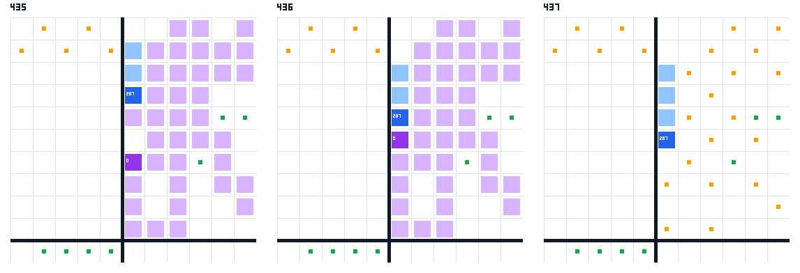
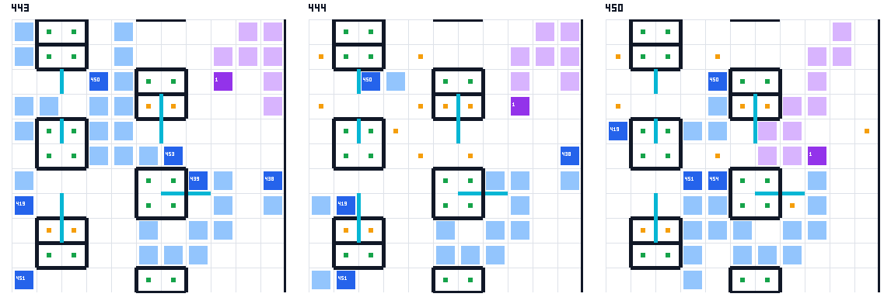
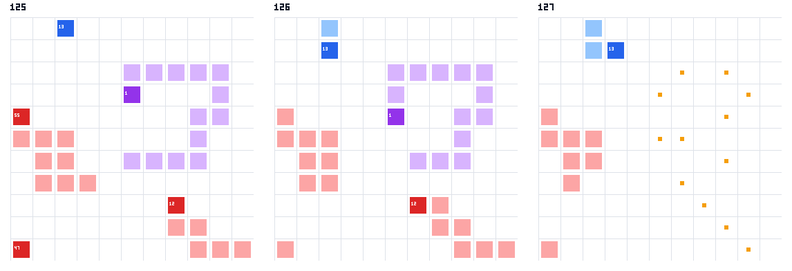

# v1.8 두 완료 묶음 분석 — 2026-10-02 04:11:10 KST

**제안: Q1_ON과 Q1B_ON을 함께 켠다. Q2는 cand4 + Q2h 지형 예외, Q2k 끔을 유지한다.** 여왕 정보가 신선한 먹이는 의도한 대상으로 갔고, 등록한 성장 변화가 보였다. Q1b2는 Q1에서 생긴 아군 함정 3건을 없앴다. 부분 적용 제안이며, 등록 기준 전체 통과를 뜻하지 않는다. 제때 합치기 드롭 섭취 48.7%, 예비 지킴, 여왕 조기 사망 뒤 동일성은 미달이다.

## 1. 표본과 판정 방법

`AGENTS.md` §4.7, `Q1.md` §5·9.2·11·13, `VERSION.md` §5–9의 등록 문장을 유지했다. 승패 합계로 기본값을 정하지 않았다. 여왕 길이는 등록한 질량 전달 기제의 상태 변화로만 읽었다. 봇·params·작업 큐·DECISIONS는 수정하지 않았고, 새 판·네트워크·업로드·커밋은 없었다.

모든 재생은 `UNSW_RULES=123` 및 `perGame(...,{rules:"123"})`이다. 여왕은 초기 드래곤 중 우리 팀 최저 id로 정했다. 라운드는 기보의 `roundStart.round` 그대로이며 r500은 최종 상태다. 기존 queenstat의 “r500 생존”은 **종료 시 생존**을 뜻해 조기 종료도 포함한다. 아래에서 실제 500라운드 생존을 따로 보인다. 길이 곡선은 실제 그 체크포인트를 넘긴 판만 쓰며, 조기 종료 3판의 길이를 뒤 라운드로 복제하지 않았다. 중앙값은 기존 도구와 같은 상위 중앙값이다.

| 묶음 | 키/변형 | 변형 수 | 채택 기보 N | 제외한 과거 오류 줄 |
|---|---|---|---|---|
| Q1, 22지도 × 2좌석 × 2상대 × seed1 | 88 | 3 | 264 | 3 |
| Q1, 생성 35지도 × 2좌석 × king seed1 | 70 | 3 | 210 | 0 |
| Q1 off 동일성 | 4 | 1 | 4 | 0 |
| 합친 v1.8 off 추가 동일성 | 6 | 1 | 6 | 0 |
| spec-11, cand4/cand6 × king seed1·hunter seed2 | 88 | 2 | 176 | 0 |
| Q2 hunter seed1 합산용 | 44 | 2 | 88 | 0 |

Q1 주 묶음은 158키 × 3 = 474판이며 off 4판을 합치면 등록한 478판이다. 행은 키마다 **exit=0, G 존재, error/botProblem 없음인 마지막 행**을 채택했다. `v18-king` 46줄 중 오류 2줄, `q18b2-king` 45줄 중 오류 1줄은 모두 뒤 정상 행으로 대체됐다. 총 477개 주 묶음 로그 줄에서 정상 474개가 남았고 누락 기보는 0이다. 오류 내용은 `ERR_INVALID_ARG_TYPE: path ... undefined`이다. 기록 실패의 정확한 원인은 기보만으로 확정하지 않는다. `runq-q18.log`는 02:40:36에 both specs done을 남겼다.

`tables.json`의 audit에는 선택한 원래 행 번호, 오류 이력, 각 기보 SHA-256이 있다. 주 묶음 474판과 spec-11 176판의 재생 검산(sim/splits/drops/eatTC/ledger/final/lineage/natBal/dropBal/unknownDeath)은 전부 0이다. 기존 qmech·queenstat·queendeath도 별도 재실행해 먹이·드롭·사인 수를 대조했다. 체크포인트 표본과 경계 라운드 처리 차이는 아래 주석과 `actualCheckpoints`에 분리했다.

## 2. A — Q1/Q1b2, 등록 기준별 판정

| 등록 항목 | +Q1 값 · N | +Q1b2 값 · N | 판정 |
|---|---|---|---|
| 여왕 정보 신선, 적용 구간 먹이의 여왕 대상 ≥95% | 380/380 = 100% (r300+) | 59/59 = 100% (r430+) | PASS / PASS. b2는 r430 전 예비 규칙 |
| 전체 생존 중 여왕 대상 먹이(참고) | 380/516 = 73.6% | 320/775 = 41.3% | 소식 없음 및 b2 조기 예비 구간을 포함한 수 |
| 생존 중 r430+ 비여왕 먹이 0 | 32/89회 | 53/112회 | **FAIL / FAIL**, 등록 문장 그대로 |
| 위 비여왕 먹이의 신선한 여왕 정보 | 0/32회 | 0/53회 | 모두 소식 없음의 대체 경로. 0 기준을 통과로 바꾸지 않음 |
| 여왕 대상 먹이 드롭 실제 섭취 보고 | 459/1124 = 40.8% | 495/946 = 52.3% | 보고 기준 PASS. 아래 Q2i 상호작용 참조 |
| r340 뒤 성장 > 기반, 같은 키 | 성장 중앙값 7 vs 기반 6, N18 | 11 vs 기반 6, N18 | PASS / PASS, 공통 r400 생존 키 |
| r430 전 여왕 먹이는 그때 최장인 경우뿐 | Q1의 목적과 다름 | 190/261회만 전역 최장 | **FAIL**: 71회 예외 |
| r430 생존 판 예비 곡선 ≥Q1 | 비교 열 | r400 15 vs16, r430 16 vs23, N23 | **FAIL** |
| Q 표식 먹이는 산 여왕에게만 | 해당 표식 없음 | 59/59회, 비여왕 대상 0 | PASS |
| FE Q 제때 합치기 slack [6,26] | 제때 관문 없음 | 42/42회; 최소6, 최대26; 15판 | PASS |
| FE Q 드롭을 여왕이 ≥50% 섭취 | 비교값: 전체 여왕 드롭 40.8% | 116/238 = **48.7%**, 희생42회 | **FAIL**. 50%로 반올림하지 않음 |
| 모으기가 여왕을 가두지 않음, trap/a ≤기반 | 3/158판 vs 기반0/158 | 0/158판 vs 기반0/158 | Q1 FAIL / b2 PASS |
| 머리 2칸 안 다른 머리 수, r340–480 매10라운드 | 중앙0; ≥2는 0/311 | 중앙0; ≥2는 0/363 | 보고 PASS. 기반0/351 |
| 여왕 사후 Q 먹이 0 · 보통 먹이 지속 | Q 표식 없음; 보통1898회 모두 비여왕 | Q 0/1713회; 보통1713회 모두 비여왕 | 대상 대체 PASS, 완전 동일성은 아래 FAIL |
| r300 뒤 여왕 자신의 feed # 표식 0 | 0/158판 | 0/158판 | PASS. 기반도0: Q2a의 기존 금지와 겹침 |
| r300 전 사건 동일 | 158/158키 | 158/158키 | PASS / PASS |
| r280 전 여왕 사망 판 끝까지 동일 | 119/120키 | 119/120키 | **FAIL / FAIL**: big_empty A seed1 |
| Q1 끔 = 기반 · 합친 스위치 둘 다 끔 | q18off 4/4키 | 합친 off 6/6키 | PASS. 표본 총10, 중복 독립 표본으로 과장하지 않음 |
| Q1B 끔 = 별도 독립 Q1 · b2 대 b1 | q18는 B 끔 대조군 158키 | 독립 복제 N0; b1 묶음 N0 | **미측정**. v1.7 기반 과거4/4 및 §11 결과를 이번 증거로 세지 않음 |
| CPU <80M · 오류0 | max32.3M, 158판; 778257턴 | max32.3M, 158판; 776773턴 | PASS / PASS. 채택 결과와 과거 오류3줄을 구별 |
| 켠 후보 업로드 복제 2/2 | 이번 ON 후보 N0 | 이번 ON 후보 N0 | **미측정**. 합친 off smoke만 기존2/2 |
| 판면 둘, 살아 있는 여왕 먹이와 사후 경로 | 아래 그림1·2, 사후 r380 판면txt | 아래 그림2, 같은 r380 판면과 사후 보통먹이1713회 | 관측 제시 PASS; 사후 동일성은 FAIL 유지 |

신선함은 각 기증자의 7×7 시야에 여왕 몸/머리가 들어온 시점과 받은 음파를 복원해 판정했다. 알려진 여왕 머리가 있고 `max(lastSeen,headSeen)` 나이가 20 이하일 때다. `sonarPing.hitId` 수신은 받는 드래곤의 다음 차례에 적용하고, MSG2의 checksum·팀·나이·직접/릴레이 형식을 검사했다. 단순히 기보에서 여왕이 살아 있다는 이유로 모든 먼 조각이 그녀를 안다고 간주하지 않았다. Q1의 136회 비여왕 먹이는 전부 이 조건 밖이다. b2의 신선한 정보 중 r430 전 비여왕 먹이 280회는 등록한 예비 구간이다. 적용 구간을 나눈 값과 전체 값은 함께 남겼다.

**예비 규칙의 두 한계를 그대로 남긴다.** r430 전 최장 판정은 실제 전역 길이로 읽으면 71/261 예외다. b2의 18판261회를 별도 재생해 기증자까지 포함한 전역 최장을 다시 확인했고190회로 같았다. 기반도 여왕 먹이 220회 중 적어도79회는 그때 전역 최장이 아니었다. 봇은 부분 관측에서 고른 받는 쪽을 사용하므로 이 숫자를 새 버그 71개로 단정하지 않지만, 등록한 “그때 최장만” 문장은 통과하지 못했다. 예비 길이도 아래 같은 키에서 부족했다.

### 여왕·예비 길이 곡선

세 변형 모두 실제 r400을 넘긴 **공통 18키**다. r450/r500 전에 죽은 여왕은 길이0을 유지해 중간에 표본을 갈아 끼우지 않았다. 먹이 진주는 r300 뒤 누적이다.

| 변형 | 여왕 L r300/350/400/450/500 | 각 판 r340→400 증가 중앙값 | 먹이에서 얻은 진주 · N |
|---|---|---|---|
| v1.8 기반 | 10/15/20/22/27 | 6 | 316 · 18판 |
| +Q1 | 10/18/25/33/37 | 7 | 389 · 18판 |
| +Q1b2 | 10/16/25/30/44 | 11 | 378 · 18판 |

키별 증가가 기반보다 큰/같은/작은 판은 Q1 8/5/5, b2 10/4/4다. 모든 지도에서 개선됐다는 주장은 아니다. 시작 시점을 고정한 실제 r300 기반 생존 32키에서도 증가 중앙값은 기반2 → Q1 5 → b2 7이며, 여왕 먹이 진주는 441/461/523개다. 이 코호트는 뒤 사망도 포함한다.

| 변형 | 실제 생존 길이: r300 (N) / r350 (N) / r400 (N) / r450 (N) | 종료 시 산 여왕 L 중앙값 (N) |
|---|---|---|
| v1.8 기반 | 8 (32) / 15 (27) / 20 (24) / 26 (21) | 27 (22) |
| +Q1 | 8 (32) / 16 (24) / 23 (21) / 33 (18) | 35 (20) |
| +Q1b2 | 8 (32) / 15 (27) / 29 (23) / 36 (23) | 44 (25) |

기존 qmech는 조기 종료 생존 판의 미관측 체크포인트 길이를 0으로 넣고, 사망이 체크포인트와 같은 라운드면 생존 표본에서 뺀다. 그래서 qmech의 r300 생존35와 라운드 시작 표의36에는 r300에 죽는 gen_X_03 A 한 판 차이가 있다. 실제 r300 뒤 활동 표본은 조기 종료3판까지 빼 32다. qmech 원출력은 검증 파일에 보존했고, 성장 판정에는 위 실제 관측 코호트를 썼다.

b2가 실제 r430을 넘긴 23키를 먼저 고정해 예비(여왕 제외 최장)를 비교했다.

| 변형 | 예비 L r300/350/400/430 · N23 |
|---|---|
| v1.8 기반 | 11/15/26/25 |
| +Q1 | 11/13/16/23 |
| +Q1b2 | 11/13/15/16 |

Q1과 b2 모두 산 공통 r430 18키로 바꿔도 예비 곡선은 Q1 8/11/14/14, b2 8/11/12/15다. r400의 부족이 남는다. 등록 목적 “예비도 같거나 길다”는 통과하지 않았다.

### Q2i·Q2f/f2와의 상호작용

| 층 | 기반 여왕 드롭 섭취 | Q1 | b2 전체 여왕 드롭 | b2 JIT 드롭 섭취 |
|---|---|---|---|---|
| king | 138/273 (50.5%) | 159/375 (42.4%) | 129/203 (63.5%) | 14/18 (77.8%; 희생7) |
| hunter | 159/299 (53.2%) | 226/525 (43.0%) | 206/379 (54.4%) | 41/81 (50.6%; 희생15) |
| gen | 58/231 (25.1%) | 74/224 (33.0%) | 160/364 (44.0%) | 61/139 (43.9%; 희생20) |

등록 §5.3의 기반 비교도 남긴다. 기반 r300 뒤 표식 먹이 전체의 지정 받는 쪽이 먹은 몫은 3848/8435 =45.6%(먹이 2615회,158판)다. 기반에서 여왕 대상으로만 제한하면355/803 =44.2%다. Q1의 여왕 지정 드롭459/1124 =40.8%, b2의495/946 =52.3%와 나란히 보되, 받는 쪽·생존 구간이 다른 분모임을 유지한다.

Q2i가 켜져 있어도 여왕은 먹이 드롭을 먹는다. Q1 459개, b2 495개이고 b2 JIT에서116개다. Q1의 40.8%는 v1.7 기반 등록 비교값52%보다 11.2%p 낮고, b2 JIT 48.7%는 과거69%보다 20.3%p 낮다. 이번 JIT 드롭238개 중 다른 아군70, 적20, 미섭취32개다. 전체 Q 표식은136/266 =51.1%지만, **등록한 FE JIT 기준의 분모238을 전체 Q 분모266으로 바꾸면 안 된다.** 생성 지도 JIT 61/139 =43.9%가 가장 약하다.

이 비교에는 기반·지도·기증자 분포 차이가 있고 Q2i 끈 대조군은 없다. 따라서 Q2i가 전달 저하의 원인이라고 확정하지 않는다. 그림2에서 보듯 긴 기증자의 드롭을 다른 아군이 먹는 실제 실패가 있다. 길 위 섭취는 남아 있지만 충분한 드롭 전달까지 확인된 상태는 아니다.

Q2f/f2가 켜진 기반의 r300 뒤 trap/a는0, Q1은3, b2는0이다. Q1의 세 사례는 hunter Maze A r436, hunter Portals B r330, 생성 gen_X_04 A r467이다. 적 몸이 함께 막은 trap도 별도로 셌는데 이 묶음에서는 추가 사례가 없었다. b2 묶음에서 상자 증가는 사라졌다. 6칸 멈춤·예비 먹이·늦은 합치기의 개별 기여는 분리하지 않았다. trap/a는 차례 시작에 아군이 출구를 막았다는 분류이며 단독 사인으로 과장하지 않는다.

### 사후 대체·동일성의 실패 한 판

여왕 사후 Q1 보통 먹이1898회와 b2 보통 먹이1713회는 모두 비여왕 대상이었다. b2의 11회는 여왕 사후20라운드 이내 신선한 잔여 기억을 갖지만 전부 r430 전 예비 경로이고 Q 표식은 없었다. “전역 최장으로 모두 전달”이라고 확대하지 않는다. v1.7 대체는 알려진 아군 길이와 왕 계급 규칙이다.

다만 `proxy4_king:big_empty:A:1`은 여왕이 r76에 죽어 소식이 충분히 사라졌는데, Q1은 r414, b2는 r386에 처음 갈렸다. 첫 차이는 음파가 아니라 이동이다. Q1 #236 L7: 기반 W v5.6 d7, 후보 S v5.7 d6. b2 #183 L5: 기반 E v7.5 d7, 후보 S v7.4 d6. 그 직전 사건까지는 같았다. **등록한 사후 동일성 FAIL**이다. 탐색 깊이7→6은 명령어 비용으로 깊이가 줄었던 `VERSION.md` §6의 문제와 닮았지만 프로파일 없이 원인을 확정하지 않는다. 원사건은 `identity-diagnosis.json`에 있다. `identity-dead-queen-base.txt`는 이 키 r380의 전체 판면이다. 여왕이 없고 그때까지는 세 변형의 사건이 같으며, 후반 대체 활동이 계속되는 사전 장면2를 확인한다. 두 후보 모두 끝까지 같은 키125/158, r300 전 차이0/158이다.

## 3. B — spec-11, Q2 기본값 점검

시작 주머니 Autarky·PD·Slithery 6키를 뺀 38키를 주 표본으로 썼다. 44키 전체의 생존 분자는 같고 분모만44다. hunter 시드 합산은 상대·지도·좌석이 일치하는 44개의 기본 키에 seed1/2를 붙인 88판(주머니 제외76판)이며, king seed1과 섞지 않았다.

| 후보 · 상대 · 시드 | 종료 시 생존/38 | 실제 r500 생존 | 조기 종료 생존 | 사망 중앙 r · 사망 N | L≥4 들이받힘 / 배타적 while-L≥4 | 탈출 분열 뒤 trap |
|---|---|---|---|---|---|---|
| cand4-hunter | 12/38 | 11 | 1 | 143 · 26 | 17 / 16 | 3 |
| cand6-hunter | 10/38 | 9 | 1 | 131 · 28 | 12 / 12 | 10 |
| cand4-hunter2 | 6/38 | 6 | 0 | 208 · 32 | 13 / 13 | 9 |
| cand6-hunter2 | 8/38 | 7 | 1 | 166 · 30 | 13 / 13 | 12 |
| cand4-king | 4/38 | 4 | 0 | 136 · 34 | 14 / 11 | 7 |
| cand6-king | 8/38 | 8 | 0 | 128 · 30 | 11 / 11 | 5 |

| 등록 질문 | 값 · N | 판정 |
|---|---|---|
| cand4의 seed2 생존이 cand2 10/38 수준을 재현하는가 | 6/38; seed1은12/38 | **FAIL**: 점 추정으로 수준을 재현하지 못함. 등록에 CI/허용폭은 없음 |
| 사망 중앙 라운드가 cand2 r161보다 늦는가 | cand4 seed2 r208, 사망32; seed1 r143, 사망26 | seed2 PASS / seed1 FAIL |
| cand2의 L≥4 while-rammed 13에서 줄었는가 | cand4 seed2 13/38 | **FAIL**: 줄지 않음 |
| king 상대 생존이 등록 snapshot cand0/35에서 오르는가 | cand4 4/38, cand6 8/38; 완료 cand 원자료2/38 | 증가 PASS. 기준 snapshot과 완료 기준의 N 차이 명시 |
| Q2k seed2 생존 및 L≥4 들이받힘 | 생존8 vs6/38; 들이받힘13 vs13/38 | 생존 PASS / 들이받힘 FAIL |
| Q2k seed1+2 합산 생존 증가 | cand4 18/76, cand6 18/76 | **FAIL**: 증가 없음 |
| 합산 L≥4 들이받힘 감소 | cand4 30/76, cand6 25/76 | 관측 감소 PASS; Q2k 단독 인과는 미측정 |
| 시작 주머니 v1.7 동일성 | 지형 예외 없는 cand4 0/12, 있는 cand6 12/12, seed1 | cand4 FAIL / cand6 PASS |
| 시작 주머니 seed2 대 v1.7 seed2 | v1.7 hunter seed2 N0 | **미측정** |
| 스위치 off 동일성 | off5 44/44, off6 44/44 | PASS; 동일한44조건의 두 검증 |
| 오류/timeout 및 CPU | spec-11 원로그·fault 0/176; 후보 CPU 측정 N0 | 오류 PASS / CPU **미측정** |
| 현재 v1.8 기본값 기존 CPU·업로드 복제 | max31.4M, 3판; Q1·Q1B off 상태 smoke2/2 | 기존 점검 PASS. cand6 CPU로 옮겨 적지 않음 |
| r50/r100 길이 · 적 여왕 처치 보고 | 아래 보조 표, 38판/묶음 | 보고 기준 PASS. 이 값으로 승패 성능을 추정하지 않음 |

등록한 보조 관측(여왕 길이와 적 여왕 처치, Q2k 표식)도 함께 남긴다. 길이 중앙값에는 죽은 여왕0이 들어가며 여기서는 각 묶음 고정38키다.

| 묶음 · N38 | 여왕 L 중앙 r50/r100 | 우리로 인한 적 여왕 사망 | qk 표식 차례 | qp 표식 차례 |
|---|---|---|---|---|
| cand4-hunter | 4/4 | 15 | 15 | 0 |
| cand6-hunter | 4/4 | 11 | 11 | 1307 |
| cand4-hunter2 | 5/6 | 12 | 11 | 0 |
| cand6-hunter2 | 4/6 | 11 | 10 | 1702 |
| cand4-king | 4/3 | 7 | 7 | 0 |
| cand6-king | 4/4 | 6 | 5 | 1581 |

사망 전조는 queendeath의 배타적 분류 전체를 아래에 보인다. “after escape-split”이면 길이 항목에서 빠지는 도구 규칙을 유지했다. 등록 표의 cand4 seed1 L≥4 들이받힘16은 이 배타적 분류다. 실제 죽을 때 L≥4였던 모든 들이받힘은 최근 분열1건을 더해17이다. cand6 seed1의 총 들이받힘14에는 L≤3 두 건이 있어 L≥4는12다. 분류를 섞어 개선 폭을 만들지 않았다.

| queendeath 전조 | c4 hunter s1 (사망26) | c6 hunter s1 (28) | c4 hunter s2 (32) | c6 hunter s2 (30) | c4 king s1 (34) | c6 king s1 (30) |
|---|---|---|---|---|---|---|
| allyHead while L<=3 | 0 | 0 | 0 | 0 | 0 | 1 |
| allyHead while L>=4 | 0 | 0 | 1 | 1 | 0 | 0 |
| enemyBody while L>=4 | 0 | 0 | 0 | 1 | 1 | 1 |
| ram while L<=3 | 0 | 0 | 0 | 0 | 0 | 3 |
| ram while L>=4 | 0 | 0 | 0 | 0 | 1 | 1 |
| rammed after escape-split | 1 | 0 | 0 | 0 | 4 | 0 |
| rammed while L<=3 | 1 | 2 | 2 | 1 | 6 | 2 |
| rammed while L>=4 | 16 | 12 | 13 | 13 | 11 | 11 |
| sac after escape-split | 1 | 0 | 0 | 0 | 0 | 0 |
| sac while L>=4 | 2 | 1 | 2 | 2 | 4 | 6 |
| trap after escape-split | 3 | 10 | 9 | 12 | 7 | 5 |
| trap while L<=3 | 2 | 3 | 4 | 0 | 0 | 0 |
| trap while L>=4 | 0 | 0 | 1 | 0 | 0 | 0 |

같은 키의 생존 전환도 엇갈린다. seed1 hunter에서 cand4만 생존4키, cand6만 생존2키; seed2에서는 각각2키와4키다. 합산 사망 중앙값은 cand4 r175(사망58), cand6 r153(58)이고, 탈출 분열 뒤 trap은12 →22다. 길이가 큰 여왕의 들이받힘 감소와 함정 증가가 함께 나타났다.

**cand4와 cand6는 순수 Q2k 비교가 아니다.** 보존된 cand4 `queenStall`은 Q2H && amQueen이고, cand6는 여기에 `!qgFlag_` 지형 예외가 있다. cand6에는 off 명령어 경로를 가른 변경도 들어 있다. seed1 원자료는 동일 키의 반복 실험이며 키를 두 번 세지 않았다. 이런 빌드 차이를 감안하면 Q2k의 실제 기제만 분리해 기본값을 켤 근거는 아직 없다. 현재 cand4 + 지형 예외라는 조합을 cand4의 옛 주머니 결과로 기각하지 않는다.

### 시작 주머니 결과: 동점 금고

각 셀은 최종 생존 최장/총 길이, 좌석 A·B다. 이 값은 등록한 금고 보존의 동일성 점검이다. 아래에는 승패 합계를 쓰지 않는다.

| 상대 · 시드 | 지도 | v1.7 A / B | cand4 A / B | cand6 A / B | 같은 seed 비교 |
|---|---|---|---|---|---|
| king · 1 | autarky | 52/71 / 52/71 | 8/8 / 0/0 | 52/71 / 52/71 | cand6 동일, cand4 다름 |
| king · 1 | prisoners_dilemma | 21/21 / 20/33 | 19/22 / 0/0 | 21/21 / 20/33 | cand6 동일, cand4 다름 |
| king · 1 | slithery_fight | 48/48 / 19/38 | 31/59 / 51/85 | 48/48 / 19/38 | cand6 동일, cand4 다름 |
| hunter · 1 | autarky | 55/98 / 53/79 | 30/55 / 48/55 | 55/98 / 53/79 | cand6 동일, cand4 다름 |
| hunter · 1 | prisoners_dilemma | 22/35 / 21/34 | 33/50 / 28/46 | 22/35 / 21/34 | cand6 동일, cand4 다름 |
| hunter · 1 | slithery_fight | 74/129 / 71/218 | 60/160 / 48/128 | 74/129 / 71/218 | cand6 동일, cand4 다름 |
| hunter2 · 2 | autarky | 미측정 / 미측정 | 22/40 / 49/55 | 50/86 / 48/88 | v1.7 seed2 없음 |
| hunter2 · 2 | prisoners_dilemma | 미측정 / 미측정 | 24/31 / 27/48 | 26/39 / 26/26 | v1.7 seed2 없음 |
| hunter2 · 2 | slithery_fight | 미측정 / 미측정 | 54/182 / 56/191 | 57/209 / 48/170 | v1.7 seed2 없음 |

지형 예외를 가진 cand6는 seed1 king·hunter 모두 여왕 사망 라운드(Autarky r4, PD r3, Slithery r3), 최장, 총 길이, 개별 결과까지 v1.7과 같다(12/12). 예외 없는 cand4는 여왕 사망이 각각 r10/r7/r5로 밀리며 금고 결과가 달라진다(0/12 동일). 현행 Q1 재시험의 v18 기반도 seed1 주머니12키에서 같은 금고 결과를 보였다. seed2는 v1.7 기준 판이 없어 “v1.7과 같다”라고 할 수 없다. cand6의 seed2 금고 수를 seed1 기준 숫자와 섞어 채택 근거로 쓰지 않았다.

## 4. 판면 3개

기존 `eval/board.js`를 `UNSW_RULES=123`으로 돌린 전체 판면 txt와 같은 재생 상태로 만든 PNG/SVG/스냅샷 JSON이다. 각 그림은 왼쪽부터 라운드 순서다. 보라: 우리 여왕(진한 칸 머리), 파랑: 다른 아군, 빨강: 적, 주황: 사망 드롭, 초록: 자연 진주, 검정: kelp, 청록: 포털 가장자리. 머리에는 id를 적었다. 포털 도착지 연결선은 생략했다. 표시창은 중심에서 토러스 좌표로 ±5칸이며 시야 제한 없이 기보 전체 상태를 그렸다.

### 그림1 — Q1이 만든 아군 출구 봉쇄

hunter / Maze / A / seed1, 중심(0,19). 여왕 #0 L63은 r436에 (0,19)에서 no-exit으로 죽었다. 서쪽은 kelp, 동·남쪽은 자기 몸, 북쪽(0,18)은 아군 #287이 차지한다. r437의 주황은 그녀의 드롭이다. 같은 키 기반은 r382 rammed로 사망, b2는 종료까지 L92로 살았다. 원 기보와 `q1-maze-ally-trap.txt`의 r435–437을 함께 확인했다.

### 그림2 — 제때 합쳤지만 드롭은 다른 아군이 가져감

hunter / Portals / B / seed1, 중심(26,7). r443 #453 L32가 `feed #1 d4 L32 Q`를 했다(s=21). #453이 사라지고 r444에 드롭이 남는다. 전 기보에서16개 중 여왕 #1은 r447에 (27,7)의1개만 먹었고, 다른 아군이15개를 먹었다. #450이 r446·448·450에, #419가 r448부터, #454가 r450부터 먹는다. 적 섭취와 남은 드롭은0이다. Q 표식·산 여왕·시간 관문은 맞아도 전달 성공까지 보장하지 않는 사례다. b2의 이 키 여왕은 최종 L22로 살았다.

### 그림3 — Q2i에도 시야 밖 긴 머리의 공짜 들이받힘

cand4 / hunter / big_empty / B / seed2, 중심(60,57). r126 차례 시작에 여왕 #1 L14는 (60,56), 적 #12 L14는 (61,60)에 있다. 적 머리는 체비셰프4여서 그녀 7×7 시야 밖이다. 여왕은 S(v+7.1)로 (60,57)에 갔고, 적은 이제 맨해튼4인 곳을 공짜4걸음으로 들이받았다. 두 머리는 r127에서 사라진다. 이 사망은 queendeath의 rammed while L>=4이며 마지막 분열 전조는 없다.

## 5. 제안하는 기본값

| 스위치/조합 | 제안 | 움직인 등록 목적 · 남은 한계 |
|---|---|---|
| Q1_ON | **켬** | 신선한 정보380/380 대상 정확, 같은 키에서 r340 뒤 성장 증가. 늦은 비여왕32회와 사후 동일성1/120 실패는 남음 |
| Q1B_ON (Q1_ON과 함께) | **켬** | 산 여왕59/59 및 시간42/42 관문, 아군 trap/a 3→0. JIT 드롭48.7%와 예비 곡선은 FAIL |
| Q2 기본 | **cand4 + Q2h 지형 예외 유지** | 동점 금고 seed1 12/12 복원. cand4 seed2 생존6/38로 기존10/38 수준 재현은 실패 |
| Q2K_PACK_ON | **끔 유지** | 시드 간 효과가 뒤집혔고 합산 생존18/76 동률. 들이받힘 감소는 Q2h·소스 변경과 분리되지 않음 |

부분 적용 규칙을 각 목적에 적용했다. Q1의 대상 전환·성장과 b2의 출구 보존·산 여왕/시간 관문은 움직였으므로 켬을 제안한다. 예비 보전이나 전달률까지 성공했다고 묶어 말하지 않는다. 다음 보완의 관측 대상은 생성 지도 JIT 전달(61/139), 긴 먹이의 아군 가로채기(Portals 사례), 소식 없는 경로의 탐색 깊이 동일성(big_empty), r430 전 예비 곡선이다. Q2k는 동일 소스의 cand4+지형 예외 대 +Q2k로 분리된 자료가 필요하다.

이번 분석으로 params를 바꾸지 않았다. ON 후보 업로드 복제, Q1B 단독 off 복제, v1.8 위 b1 비교, v1.7 hunter seed2, spec-11 후보 CPU는 N0로 남긴다. 기존 smoke2/2와 기본 CPU3판은 각각의 시험 대상만 지원한다.

## 6. 재현 자료

- `exp/q-analysis/tables.json`: 표본 audit, q1/q2 집계, 실제 관측 체크포인트·같은 키 비교, 신선함 복원, 기준별 값/N/상태, 판별 제안.
- `analyse.js → freshness.js → diagnose.js → refine.js → check-longest.js → report.js`: 재계산 순서. `verify-existing.js`, `boards.js`, `qa.js`는 기존 도구·그림·최종 대조용이다.
- `verify-qmech-{v18,q18,q18b2}.md`, `verify-queenstat.txt`, `verify-queendeath.txt`, `verify-fingerprint.txt`: 기존 도구 원출력.
- `boards/manifest.json`, PNG/SVG/JSON/TXT 3세트: 판면과 출처.
- `identity-diagnosis.json`: 조기 여왕 사망 뒤 첫 차이의 양쪽 사건·마지막 표식.
- `qa.json`: 행·기보 결과, SHA-256, 기존 도구 수치, 표본 자격, 주머니 동일성, 판면 파일 검산 11항목 통과.

PASS는 해당 등록 기준을 관측했다는 뜻이다. FAIL을 부분 적용 제안 때문에 PASS로 바꾸지 않았고, N0은 미측정으로 남겼다.
