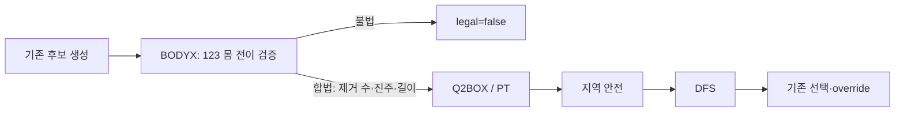
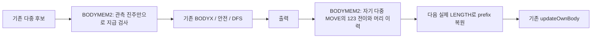

# v1.8: 여왕 규칙 대응 (개막 에이전트 소유)

## Q1c BUILD 사전 등록 (2026-10-02 06:11:50 KST; 새 판 0)
- **범위:** WORKQUEUE Q의 Q1 다음 일 2·3. `Q1B_BACKUP_ON=false`, `Q1C_SIGHT_ON=false`를 각각 넣고 기존 Q1/Q1b2 및 다른 기본값은 보존한다. 작업 시작 소스는 `exp/q1c/bot-base`다. 근거는 `exp/v16/q1/Q1.md` §9–14와 WORKQUEUE의 조정자 결정이다. BUILD에서 게임·커밋·네트워크를 사용하지 않는다.
- **꽂는 자리(b):** `flow-fortress.md` G `computeGoal`의 여왕 선택을 r300–429에 건너뛰고 v1.7의 최장·최신 소식 선택을 쓴다(여왕이 최장이면 그쪽). 여왕 자신은 이동 집결하지 않는다. 같은 시기에 산 여왕의 신선한 소식이 있으면 비여왕의 DFS 잎에 `GATHER_W * max(0, Q1B_HOLD - 여왕 머리까지 torus Manhattan 거리)`를 뺀다. 집결 목표의 hold는 기존 GH_HOLD=3이고 여왕 회피는 별개다. r430부터 Q1b2를 유지한다.
- **세기(b):** 집결 당김 .12/칸, 여왕 회피 최대 .72(거리0)이며 거리5는 .12다. 진주 +1, 거리3 진주 다섯 약3.4, 위협 인접 −30보다 약하다(`terms.md`). 잎 항 한 번이며 DFS 매 걸음의 정적 벌점이 아니다. 따라서 6칸은 부드러운 선호이고 강제 장벽은 아니다. 후보·깊이·예산은 바꾸지 않는다.
- **예상 판면(b):** r350–429에 떨어진 여왕 주변 대신 예비 주변으로 기증자가 모여 예비가 먹는다. 여왕 곁으로 지나가는 대안 중 거리가 큰 쪽이 약하게 선호된다. r430부터 살아 있는 여왕 쪽 제때 합치기로 바뀐다.
- **꽂는 자리(c):** World 관측→소나 수신→Q1 목표/비컨/gh/CONV2 선택 및 네 먹이 RETURN 경로다. 적 팀의 id0/1을 직접 본 차례를 기록한다(머리뿐 아니라 실제 보이는 몸도 생존 증거). `round-lastDirect<=50` 또는 `round-lastHeard<=50`일 때 믿음=true다. Q1 전환은 r300 이후 믿음=true일 때만 켜며, 믿음=false면 v1.7의 최장 선택을 쓴다. 여왕이 최장이어도 믿음=false인 여왕 대상 먹이/합치기는 금지한다. 기존 여왕 안전·먹이 금지는 유지한다.
- **소나(c):** format2의 id11/rnd7/x6/y6/len7/hx6/hy6/team1/magic6 위치와 의미를 유지한다. 검사합 상위1비트를 자기 직접 목격50 신호로 쓰고 하위7비트로 검사한다. 하위7비트 검사합의 salt를 구 형식과 구분해 구8비트 메시지를 믿음 신호로 오독하지 않는다. 기존 왕 relay는 비트 없이 원래 형식을 유지하고, 새 bit는 직접 보고에만 싣는다. 받은 bit=true는 메시지의 원래 보고 라운드가 기존 직접/수신 증거보다 엄격히 새로울 때만 채택한다. 수신 믿음을 다시 전하지 않으므로 메아리 없이 마지막 직접 목격+최대100라운드 안에 사라진다. bit=false는 타인의 비목격이며 직접 목격을 취소하지 않는다.
- **세기(c):** 점수 보너스가 아닌 Q1 경로/먹이 RETURN의 관문이다. 소나 발사 시점·방향·왕 relay 빈도를 바꾸지 않는다. on의 매 차례에 믿음/직접/수신 증거 라운드·송신 bit를 표시해 early RETURN도 분석 가능하게 한다.
- **예상 판면(c):** 적 여왕을 못 본 집단은 예비를 키우고, 목격한 조각의 직접 소나를 받은 기증자는 그다음 차례부터 여왕 합치기를 허용한다. 적 여왕 사망 뒤 아직 50라운드 유효한 목격(수신은 최대100) 때문에 잘못된 true가 남을 수 있으므로 사망 직후 합치기0은 보장하지 않는다. 이 구간을 숨기지 않고 ground truth와 전수 대조한다.
- **기제 기준(b):** 같은 키의 Q1b2(off)와 b-only를 비교한다. r430에 여왕이 살아 있는 짝의 비여왕 최장 길이 r350/400/430이 증가하는지(주 기준 r400/r430), 여왕 2칸 안 아군 머리 수와 r300 뒤 아군 몸 함정이 늘지 않는지 확인한다. 집결 표식의 목표 id가 신선한 최장 규칙과 맞는지 실제 판면으로 검증한다. 길이는 이 특정 질량 이동 기제만 확인하며 승패 게이트는 없다.
- **기제 기준(c):** c-only/off와 both/b-only를 비교한다. 네 경로의 여왕 대상 feed/merge는 믿음=true인 차례에서만 일어난다(위반0). 모든 우리 차례의 믿음 및 송신 bit를 실제 적 여왕 생존과 비교해 정확도>50%, precision/recall과 각 분모를 지도·편·상대별 보고한다. true 직접 메시지가 실제 아군에게 전달되고 더 신선하면 N=1라운드 이내(수신자의 다음 차례) 설정되어야 한다. 오래된·같은 라운드·false/왕relay는 믿음을 갱신하지 않고, 마지막 자기 목격/진짜 수신 뒤50라운드 넘으면 false이며 수신 믿음만 가진 조각의 송신 bit=false다. 발동/전달 기회가 없으면 미확인으로 쓴다.
- **깨짐 공통:** 두 새 스위치 off는 작업 시작 v1.8 WASM 바이트 동일 및 사건/소나 동일, Q1 목표 시계는 r300 이후이며 c-on 소나/진단과 CPU 비용은 r0부터 달라질 수 있어 초기 물리 행동의 차이도 보고함, 오류0, CPU 경보80M 미만/한도100M. 게임 없는 컴파일·합성 검사는 BUILD에서, 사건·판면·CPU는 조정자 실행 후 확인한다.
- **실행 범위:** 196판 이하. 네 변형(off/b-only/c-only/both)의 같은 키: 번들5·온라인Trauma·스프린트Australia·생성M_07/L_03·`exp/v16/q1/maps-flip`의 trauma_flip/australia_flip, 양편·king/hunter 시드1 =176판. off/현재v1.8 동일성은 온라인Trophy·스프린트Around UNSW·생성M_07 × 양편 × king 6키(12판), both 대 현재v1.8의 오래 사는 여왕 탐침4지도 × 양편(8판). 제한 때문에 22지도 전체·전 생성지도·시드2는 다음 실행 범위다. flip은 id 검증이며 독립 표본으로 더하지 않는다.
- **BUILD 확인(2026-10-02 06:25:30 KST; 새 판0):** 공식 judge clang으로 base/off/b-only/c-only/both 컴파일 성공. base와 off는 518494 bytes, SHA-256 `5df1351a1cfa33917e91786fa22e573910daf662e869bc6b6d3d76c2da5cce97`로 바이트 동일하다(`exp/q1c/compile-check.json`). 네 변형의 실제 C++ 관측·소나/기존 필드·freshness·50라운드 경계·한단계 전송·뒤집힌 여왕 id·r430 목표·수신자 관문 합성 검사 통과. 명세196판/동일성6키·경로·중복·다른 기본값 보존·복제본·JS 구문·공백 검사 통과. 기존 Maze B 기보 하나를 분석 도구로 읽어 rules123 재구성 checks 전부0을 확인했다(`analysis-smoke.json`); Q1c의 실판 발동/정확도/전파/CPU 결과가 아니다. 실행은 `node exp/q1c/runq.js exp/q1c/spec.json --jobs 3 --cap 6`, 분석은 `exp/q1c/ANALYZE.md`다. 실판 기준은 모두 조정자 실행 뒤 미검증 상태다.

## 0. 기반과 규칙
- **기반:** v1.7(8654c5e)이다. 인식 끔(QUAL_NO_MAPID), W7b·W7c 켬, H0 합침, W15a 스위치 모두 끔.
- **규칙 1.2.3('Slay Queen', 2026-10-01 20:08):**
  - r500에 여왕(팀의 최저 id: A는 0, B는 1)이 긴 팀이 이긴다. 죽은 여왕은 0이다.
  - 첫 ceil(L/4) 걸음은 공짜다(`rules/ALL.md`).
- **로컬 엔진:** `tools/unswbc`(20:23부터 1.2.3)이다.
- **나눠 맡기:** Q2(이 줄)는 여왕 안전, 적 여왕 암살, 공짜 걸음이다. Q1(전환 에이전트)은 모든 먹이기와 전환을 여왕으로 돌리고 성장 계획을 맡는다(패치로 받는다).

## 1. 기준 측정 (20:42–20:49 KST; v1.7, 1.2.3, proxy4_king, 온라인 10지도 × 양편 × 시드 1–2; `exp/q2/v17-king`, `queenstat.js`)
- **우리 여왕이 r500까지 산 판: 1/40.**
  - 사망: 함정 24, 들이받힘 14, 들이받기 1. 중앙 라운드는 89다.
  - 여왕 길이 중앙값은 r50에 이미 2다. 자발 분열이 여왕을 다른 드래곤처럼 쪼개, 여왕이 머리 쪽 2–3칸으로 남는다.
- Autarky·PD·Slithery Fight에서는 두 여왕이 r3–5에 시작 주머니에서 죽는다(W15a 18절). 그 뒤는 동점 규칙(최장 생존 드래곤)으로 갈린다.
- 상대 proxy4_king(옛 규칙 봇)의 여왕도 2/40만 살았다. 우리가 적 여왕을 죽인 판은 3이다.

## 2. Q2a–c 사전 등록 (20:51–20:55 KST; 판 0)
- **공통:**
  - 우리 여왕은 `amQueen()`(우리가 A면 id 0, B면 1)이고, 적 여왕은 `enemyQueenId()`다.
  - 스위치는 모두 기본 끔이다. 끈 빌드(`exp/q2/bot-v18off`)는 v1.7(8654c5e, `exp/q2/bot-v17`)과 사건이 같아야 한다.
- **Q2a `Q2A_NOSPLIT_ON`:**
  - 여왕은 자발 분열(정책, frag, bsplit, csplit, kcap, floor, lsplit, sx, sr)을 하지 않는다. 단, 분열 뒤 길이가 `QUEEN_KEEP_LEN`(8) 이상이면 한다.
  - 탈출 분열은 그대로 둔다. 그 자리에서 여왕은 어차피 죽고, 새끼는 동점 규칙에 쓰인다.
  - 표식 `" qs"`
- **Q2b `Q2B_SAFE_ON`:**
  - 여왕이 받는 위협(threatCore)은 언제나 "적에게 유리"로 친다(할인 없음). 그 위에 `QUEEN_THREAT_MULT`(3)배를 한다. 그래서 T1 30은 90이 되고, 왕이면 왕 배수도 겹친다.
  - 먼 위협장(ks2의 5–7칸)을 여왕에게도 켠다. 도달은 1.2.3 규칙(ceil(L/4) + L − 2)을 따른다.
  - 여왕은 누구와도 맞교환하지 않는다(교환값 0).
  - 여왕의 첫걸음 값:
    - 아는 막다른 가지(W15a regionAhead == 2)는 `QUEEN_DEAD_PEN`(200)이다. 가장 긴 길이 r500을 넘기면 0이다.
    - 알려진 고리 없이 미지로 이어지는 영역의 양옆이 막힌 통로 칸은 `QUEEN_TUNNEL_PEN`(30)이다.
  - 표식 `" qd<n>"`
- **Q2c `Q2C_HUNT_ON`(Q2b와 함께):**
  - 여왕이 아닌 우리 드래곤에게 적 여왕과의 정면충돌은 `QUEEN_KILL_VALUE`(400)다.
  - 적 여왕 머리(`QUEEN_HUNT_MEMORY` 6라운드 안에 본 것)는 끌림원 `QUEEN_HUNT_VALUE`(3)다.
  - 적 여왕은 라운드마다 먼저 움직인다(최저 id). 그래서 우리 조각은 그 라운드의 머리를 보고 친다. 공짜 걸음으로 L5는 2칸, L9는 3칸 거리에서 칠 수 있다.
  - 표식 `" qk"`
- **기제 점검(기준: `exp/q2/v17-king`. 판: 온라인 10지도 × 양편 × proxy4_king, 1.2.3. abc와 off는 시드 1–2, a·b·c는 시드 1):**
  1. off = v17, 40/40 사건이 같다.
  2. **Q2a:** `qs`가 나오고, 여왕 길이 중앙값(r50 2)이 오른다. 여왕 사망 중 L2–3 들이받힘이 준다.
  3. **Q2b:** `qd`가 나오고, 여왕의 들이받힘·들이받기 사망(15/39)과 막다른 곳 사망이 준다.
  4. **Q2c:** `qk`가 나오고, 우리가 적 여왕을 죽인 판(3/40)이 는다.
  5. **함께(abc):** r500 여왕 생존(1/40)이 오른다.
  6. **깨짐 없음:** 오류 0, CPU
  - **부작용(보고):** 여왕 섭취(길이 추이), 유닛 수, 분열 수, 조각 사망

## 3. 1차 결과와 다음 후보 사전 등록 (20:53–21:38 KST)
- **1차(온라인 10지도, 시작 주머니 3지도 뺀 7지도 × 양편):**
  - off = v1.7, 40/40 사건이 같다.
  - **Q2c가 섰다:** 적 여왕을 우리가 죽인 판이 abc 7/28이다(v1.7 3/28). 적 여왕 사망 중앙 라운드는 r60이다(v1.7 r100). `qk`는 6차례다.
  - **Q2a가 섰다:** 여왕 r50 길이 중앙값이 4다(v1.7 2). `qs`는 a에서 736차례다.
  - **여왕 생존은 그대로다:** abc 1/28, a 0/14, b 0/14, v1.7 1/28.
  - **사망 전조(`queendeath.js`, abc 27):**
    - 자기 탈출 분열 직후 갇힘 9(판 막다른 곳이나 자기 몸 방)
    - L ≤ 3에서 들이받힘 8
    - 탈출 분열 직후 들이받힘 3
  - **Default A1:** 여왕이 L15로 5×5 방을 채웠다. 우리 L2 조각이 방 입구를 막았고, 탈출 분열 뒤 다음 차례에 죽었다.
  - **Portals A1:** 여왕(L3)이 r10에 출구 모르는 포털을 넘어(`PORTAL?`) 막다른 곳에 들어가 r12에 죽었다.
  - **섭취(`queeneat.js`):** 여왕은 그녀 차례 100번에 3.8–6.4개를 먹는다. Devil A2에서는 100라운드 동안 0개였다(요새 왕으로 가만히 있음). 성장은 Q1 몫이다.
- **여왕 시작 길이와 시작 수(지도 파일):**
  - 시작 수: 1마리(arena, Colosseum, gen_S_01·S_03·X_11–13), 2마리(대부분), 9–10마리(Australia, Around UNSW)
  - 여왕 시작 길이: L2(Stripes, Tower Defense, gen_S_06), L3–4(대부분), L6–7(big_empty, gen_L_01·03·06, Slithery), L11(PD), L14(Autarky)
- **v1.8 기본값 변경:** `DEADSPLIT_ON`(W15a-s)을 켰다(조정자 결정; 1.2.3에서 다시 본다).
- **추가 스위치(기본 끔):**
  - **Q2a 일꾼 규칙:** 다른 드래곤이 `QUEEN_MIN_WORKERS`(2) 미만이면, 분열 뒤 여왕이 `QUEEN_SPLIT_KEEP`(4) 이상이 되는 분열은 허용한다(시작 1–2마리 지도).
  - **Q2a2 `Q2A_NOESC_ON`:** 판이 아니라 적이 여왕을 막았을 때는 탈출 분열(아래 탈출 분열, cand-avoid2의 esc-split)을 하지 않는다. 판 막다른 곳에서는 그대로 한다.
  - **Q2b 보강:**
    - 출구를 모르는 포털을 여왕이 스스로 넘지 않는다(늦은 왕과 같다).
    - 먼 위협장에서 공짜 걸음 안(d ≤ ceil(L/4))의 머리는 T3로 친다.
  - **Q2d `Q2D_FREESTEP_ON`:** 1.2.3 비용으로 질주 값과 꼬리를 계산한다(공짜 걸음 너머만 SPRINT_COST와 꼬리 한 칸). L ≥ 5는 모든 2걸음 이동이 후보이고 마지막 라운드에도 그렇다. 죽이기 경로 도달은 ceil(L/4) + L − 2이고, 음파 보고 길이도 1.2.3 비용을 쓴다.
  - **Q2e `Q2E_ROOM_ON`:** 여왕의 넓이 안전(함정·막다른 곳·채우기 벌점)을 `QUEEN_AREA_MULT`(3)배 한다.
  - **Q2f `Q2F_NOBOX_ON`:** 판 크기와 상관없이 다음 값을 받는다(조각의 먹이기 행동은 이 후보를 거치지 않는다). 표식 `" qb<n>"`.
    - 여왕이 아닌 첫걸음이 여왕 머리의 빈 출구를 차지하면: 출구 0 남김 `QUEEN_SEAL_PEN` 120, 1 남김 `QUEEN_BOX_PEN` 30
    - 여왕 머리에서 맨해튼 2 안에 끝나면: `QUEEN_ZONE_PEN` 10
  - **Q2g `Q2G_DOOMFLAG_ON`(표식만):** 걸음이 있지만 모든 단일 걸음이 r500 전에 끝나는 아는 막다른 가지면, 여왕이 스스로 지형 사망으로 표시한다(`" qg"`).
    - 그 경우 탈출 분열 고리가 새끼(동점 규칙의 최장 생존 드래곤)를 지킨다. Q2 스위치는 판 막다른 곳의 탈출 분열을 막지 않는다. 그래서 행동은 그대로다.
    - 여왕이 죽은 뒤 동점 모드(최장 = 왕)는 Q1의 대체 대상에 맡긴다(전환 에이전트에게 요청).
- **시험 상대(조정자 요청):** `exp/q2/bot-hunter`는 후보(cand)에 강한 사냥(`QUEEN_HUNT_VALUE` 10, 기억 12라운드)을 더한 것이다. 우리 여왕을 실제로 노리는 상대다.
- **판(`exp/q2/spec-4.json`, 1.2.3, 시드 1):**
  - 22지도 = 온라인 10 + 묶음 5(arena, Colosseum, default_small, big_empty, stronghold) + 스프린트 7
  - 판 묶음:
    - cand 대 hunter 44
    - v1.7 대 hunter 44
    - cand 대 proxy4_king 44
    - v1.7 대 proxy4_king 추가 36(묶음 5, 스프린트 7, 생성 6)
- **매 판 보고하는 기제 지표(조정자):** r500 여왕 생존, 여왕 길이 r50/100/250/500, 사망 원인과 전조, 적 여왕 처치, 묶음별 첫 여왕 사망 판면.
- **Q2b 고침(21:38, 조정자 "첫걸음 항만"; `terms.md` 교훈):**
  - 여왕 위협 3배와 할인 없음을 threatCore(탐색 모든 걸음)에서 뺐다.
  - 그 대신 여왕 이동이 끝나는 칸만 `queenFirst`(할인 없이 3배, 먼 위협장 포함)로 매긴다. W7a′와 같은 방식이다.
  - 먼 위협장의 공짜 걸음 가중(T3)과 1.2.3 도달은 위협장 자체라 그대로 둔다.
  - 1차의 abc·abcn·abcnd는 옛 Q2b(모든 걸음 3배)로 돌았다. cand·hunter(`spec-4`)는 새 Q2b다.

## 4. 2차 결과 (21:39–23:21 KST; 1.2.3, 시드 1. 시작 주머니 3지도를 뺀 19지도 × 양편 = 38판; 22:48–23:21 망 끊김, 로컬 판은 계속 돌았다)
- **분석 도구 고침(5b242fa):** `tools/mass_ledger.js`가 1.2.3의 공짜 걸음을 몰랐다. 1.2.3 기보에서 길이가 줄고 재동기화가 판당 469–543번 났다. `rules: '123'`(또는 `UNSW_RULES=123`)로 고쳤고, 그 뒤 재동기화는 0이다. 위 1차 숫자도 고친 도구로 다시 셌다.
- **Q2h `Q2H_STALL_ON`(22:2x 추가):**
  - 여왕의 탈출 분열은 2칸 새끼만 떼어 내고(여왕은 L−2를 지킴) 그 자리에서 기다린다. 분열은 머리를 움직이지 않는 유일한 행동이다.
  - 막다른 곳에서 진주를 먹으러 더 들어가지 않는다.
  - 표식 `" qw"`
- **Q2a 보강:** 여왕은 먹이 주기(conv, sf, 후반 먹이기, CONV2의 희생)를 하지 않는다. cand 대 hunter에서 여왕 사망 5번이 자기 먹이 주기였다.

| 묶음(38판) | r500 여왕 생존 | 사망 중앙 라운드 | 여왕 길이 r50/100 | 적 여왕 우리가 처치 |
|---|---|---|---|---|
| v1.7 대 hunter | 1 | r111 | 2/2 | 8 |
| cand 대 hunter | 5 | r131 | 4/4 | 14 |
| **cand2(cand + Q2h + 먹이 금지) 대 hunter** | **10** | **r161** | 4/4 | 13 |
| cand2d(+ Q2d 공짜 걸음) 대 hunter | 6 | r169 | 4/4 | 13 |
| v1.7 대 proxy4_king(추가 18지도 36판) | 1 | r82 | 2/0 | 5 |

- **사망 전조 이동(`queendeath.js`):**
  - 탈출 분열 직후 갇힘: cand 16 → cand2 7
  - 이제 주 사인은 L ≥ 4에서 들이받힘이다: cand2 13, cand2d 15.
- **cand2 여왕이 산 지도:** stronghold 2/2, Tower Defense 2/2, Trauma 2/2, arena, Australia, Maze, QoS 각 1/2. 나머지 지도는 0이다.
- **스프린트 지도의 여왕(v1.7 대 king, v1.7 대 hunter, cand 대 hunter):**
  - Around UNSW에서는 세 묶음 모두 우리 여왕이 r6에 죽는다. 시작 10마리 사이에서 작은 벽 방에 우리 조각과 함께 갇혔다(지형 사망 아님, `pocketmaps.js`로 시작 머리가 2-core 위).
  - Tower Defense에서는 cand 여왕이 양편 모두 L27로 살았다. 나머지 지도에서는 r35–r486 사이에 죽는다.
- **W15a-s(1.2.3 재점검):** `ds`는 cand·cand2 132판에서 0번이었다. 이 지도들에서는 묶이지 않는다(무해).
- **Q2g:** `qg`가 시작 주머니 지도에서 나온다(cand 28, cand2 59차례).
- **Q2d:** 생존을 늘리지 않았다(cand2 10 → cand2d 6). 끈 채로 둔다.
- **다음:** L ≥ 4 들이받힘(사냥꾼). 조정자가 제안한 '벙커' 자세를 본다. 여왕이 적 머리의 공짜 걸음 도달 밖에서 자기 고리를 돌고, 우리 조각이 가로막는다.

## 5. 사전 등록: 들이받힘 줄이기 (23:27–23:33 KST; 판 0)
- **근거(`exp/q2/rammed.js`, cand2 대 hunter, 들이받힌 여왕 16):**
  - 그녀 마지막 차례에 들이받은 머리가 7×7 안에 있었다: 10. 마지막 이동 값 ≤ −100(이미 막힘): 4.
  - 들이받은 머리가 공짜 걸음 안이었다: 4. 4칸 안 적 머리 수 중앙값: 1.
  - 마지막 이동 값이 양수였던 판이 6이다(위험을 못 봄). 길이 추정이 도달을 놓친 경우가 섞여 있다.
- **조정자 전략 사실(conv, 새 규칙 상위권 264판):** 두 여왕이 다 죽은 판이 91%다. 우리 여왕만 살아도 거의 이긴다. 생존이 길이보다 훨씬 크다.
- **Q2i `Q2I_CAUTION_ON`:**
  - 여왕 첫걸음 값이 모든 적 머리를 4칸까지 닿는다고 본다(길이 추정과 보이지 않는 꼬리를 무시).
  - 여왕은 진주를 찜(cl/ce)하지 않고 새 낙하를 다투지(grab) 않는다. 길 위의 진주만 먹는다.
- **Q2f2 `Q2F2_GRADED_ON`:** 맑은 구역 값을 거리별로 매긴다. 맨해튼 1은 20, 2는 10이다. 그래서 곁의 조각은 물러나는 쪽이 이득이다. 근거는 Around UNSW 시작에서 자매 9마리가 그녀를 가둔 것이다.
- **Q2j `Q2J_ESCORT_ON`(호위):**
  - 여왕이 아닌 우리 드래곤에게 우리 여왕 머리에서 맨해튼 `QUEEN_GUARD_DIST`(4) 안의 적 머리는 맞교환 값이 최소 `QUEEN_GUARD_VALUE`(60)다. 여왕 머리는 2라운드 안에 보거나 들은 것이다.
  - lnt 거부로 지우지 않는다. 사냥 끌림과 죽이기 경로가 이를 따른다.
- **기제 점검(cand2 대비, hunter 상대 22지도 × 양편 × 시드 1):**
  1. r500 여왕 생존(cand2 10/38)과 사망 중앙 라운드(r161)가 오른다.
  2. L ≥ 4 들이받힘(13)이 준다.
  3. 끈 빌드는 v1.7(+ 묶이지 않는 -s)과 사건이 같다(`off4-king`).
  4. 여왕 길이 r50·r100, 적 여왕 처치, 오류 0

## 6. 3차 결과 (23:29–00:03 KST; hunter 상대, 시작 주머니 뺀 19지도 × 양편 = 38판)

| 묶음 | r500 여왕 생존 | 사망 중앙 라운드 | L ≥ 4 들이받힘 | 탈출 분열 직후 갇힘 |
|---|---|---|---|---|
| cand2 | 10 | r161 | 13 | 7 |
| cand3(+ Q2i 경계) | 11 | r173 | 16 | 4 |
| **cand4(+ Q2f2 단계 구역 + Q2j 호위)** | **12** | r143 | 16 | 3 |

- **들이받힘 진단(`rammed.js`, cand3 19건):**
  - 들이받은 머리 상당수가 L11–27이었다. 그들은 공짜 걸음 4–7칸으로 그녀 7×7 시야 밖(체비셰프 4)이나 경로 4–5에서 친다.
  - 1.2.3에서는 L ≥ 13 드래곤이 시야 밖에서 공짜로 칠 수 있다. 여왕 혼자 보는 정보로는 막을 수 없다(아군 정보나 호위가 필요).
- **시작 주머니 지도와 동점 규칙(조정자 경고):**
  - cand(Q2h 없음)는 Autarky·PD·Slithery에서 v1.7과 결과가 같다(고리 그대로).
  - cand2(Q2h)는 Autarky에서 G 30/48로 졌다(cand 55 승/53). PD에서는 33/28로 이겼다(cand 22 승/21 패).
  - 그래서 **Q2h는 지형 사망 여왕(Q2g 판정)에는 쓰지 않는다**(23:58–00:02 고침). 거기서는 보통 탈출 분열이 금고 새끼를 지킨다.
  - 걸음이 아예 없을 때는 머리가 아는 막다른 가지(목에서 봄)에 있으면 지형으로 친다.
- **동일성 문제와 고침:**
  - 끈 빌드(off4)는 v1.7과 39/40이 같았다. big_empty B가 r61에 갈렸다(표식 없음).
  - 원인은 탐색 시간이다. 같은 수에서 v1.7은 d7, off4는 d6이었다. 새 코드가 탐색이 마디마다 부르는 ks2Threat의 명령어를 늘려 마감 깊이가 줄었다.
  - ks2Threat, tradeValue, 분열 문의 새 검사를 `if constexpr`로 갈라 스위치가 꺼지면 v1.7 명령어 그대로가 되게 했다. 다시 재는 중이다(`off5-king`).
- **Q2dq `Q2DQ_ON` 사전 등록:**
  - 여왕만 1.2.3 공짜 걸음 이동을 쓴다(2걸음 후보와 지불 계산). 모든 드래곤에 켠 Q2d는 생존을 10 → 6/38로 낮췄다.
  - 기준: cand4 대비 생존과 L ≥ 4 들이받힘(16)

## 7. cand5 결과와 Q2k 사전 등록 (00:00–00:14 KST)
- **cand5 = cand4 + Q2dq + Q2h 지형 예외:**
  - 시작 주머니 뺀 38판에서 여왕 생존 11(cand4 12), 사망 중앙 r156이다.
  - 탈출 분열 직후 갇힘 9(cand4 3)는 지형 예외가 막다른 가지 안의 여왕을 보통 분열로 돌린 몫이다. 생존 수는 거의 같다.
  - 시작 주머니 지도는 v1.7·cand와 같은 결과로 돌아왔다(Autarky 55 승/53, PD 22 승/21, Slithery 74 승/71). **동점 규칙 금고가 지켜진다.**
  - Q2dq는 이득이 없다(들이받힌 16번 중 9번은 그녀가 질주하던 차례). 끈 채로 둔다.
- **Q2k `Q2K_PACK_ON`:**
  - 여왕이 이미 아는 모든 아군 머리(3라운드 안에 보거나 들음)에서 맨해튼 `QUEEN_PACK_DIST`(4)보다 멀다. 그런데 가장 가까운 아군 머리에서 더 멀어지는 첫걸음이면 `QUEEN_PACK_PEN`(8)을 받는다. 표식 `" qp<n>"`.
  - 근거: 들이받힘 대부분이 시야 밖에서 공짜 걸음으로 친 긴 사냥꾼이다. 조각은 그녀보다 멀리 보고, 호위(Q2j)는 그들이 가까이 있어야 한다.
  - 기준: cand4 대비 r500 생존(12/38)과 L ≥ 4 들이받힘(16)이다. 판은 `exp/q2/spec-10.json`(cand6 대 hunter, off6 동일성)이다.
- **동일성 다시(00:09–00:18):** off5(명령어 경로를 가른 끈 빌드)와 v1.7이 44/44 사건이 같다(big_empty 양편 포함; -s는 묶이지 않음).
- **cand6(cand4 + Q2h 예외 + Q2k) 결과(00:13–00:41):**
  - 여왕 생존 10/38, 들이받힘 14, 갇힘 13, 사망 중앙 r131이다. Q2k는 이득이 없어 끈 채로 둔다.
  - 시작 주머니 지도는 v1.7과 같다(금고 유지).
  - off6 = v1.7, 44/44.
  - Around UNSW B(모든 묶음에서 r6 사망)는 이렇게 죽었다.
    - 여왕이 2×3 방 구석에서 2×2로 감겼다.
    - 이미 막힌 자매 #9(v −133)가 상자 값을 받고도 그녀 곁에 들어왔다.
    - 그녀의 정지 분열 새끼가 방 가운데로 들어와 출구가 없어졌다.

## 8. v1.8 기본값 = cand4 + Q2h 지형 예외 (00:42–00:49 KST; 조정자 결정)
- **여왕 id 고침(조정자, 983fdab):**
  - 온라인에서는 A팀 여왕이 id 1인 판이 절반이다(새 규칙 상위권 264판 중 135판; 전환 에이전트 발견). 로컬 엔진은 A에 늘 0을 준다.
  - `amQueen() = myId <= 1`이다. `ourQueenId()`는 0이나 1을 보기 전에는 −1이고, 그 드래곤의 팀으로 정한다. `enemyQueenId() = 1 − ourQueenId`(모르면 −1)다.
  - 모르면 여왕 대상 행동(사냥, 호위, 상자)을 하지 않는다.
  - 개막은 남아 있던 고정 id(queenBoxPen, Q2j 호위, main.cpp의 Q2dq 비용)를 `ourQueenId()`와 `myId <= 1`로 바꿨다.
  - 조정자가 순서를 바꾼 Trophy·Stripes에서 확인했다(` qs`/` qd`가 id 1인 진짜 여왕에게 붙음).
- **켬:** Q2A_NOSPLIT_ON(먹이 금지 포함), Q2A_NOESC_ON, Q2B_SAFE_ON, Q2C_HUNT_ON, Q2E_ROOM_ON, Q2F_NOBOX_ON, Q2F2_GRADED_ON, Q2G_DOOMFLAG_ON, Q2H_STALL_ON(지형 예외), Q2I_CAUTION_ON, Q2J_ESCORT_ON, DEADSPLIT_ON
- **끔:** Q2D_FREESTEP_ON, Q2DQ_ON, Q2K_PACK_ON, DEADKNOWN_ON, ESCTAIL_ON, ESCPEEL_ON
- **주석:** 사용자 규칙(코드 주석은 짧게, 근거는 VERSION.md)에 맞춰 v1.8 params의 W15a·Q2 주석을 한 줄로 줄였다. 근거와 수치는 이 문서 §1–7에 있다.
- **점검:**
  - 올리기 시험 2/2 통과(Portals, Slithery Fight; `exp/q2/final/smoke-upload.txt`)
  - CPU(대 proxy4_swarm, 시드 1): Trophy·big_empty·gen_M_07에서 최대 31.4M(한도 1억), 오류 0
  - 이 시험 동안 spec-11을 잠시 멈췄다가 다시 띄웠다(이어 돌기). CPU 판 3개를 병렬로 돌려 내 동시 판이 잠깐 4였다.
- **남은 일:** `docs/WORKQUEUE.md`의 Q 아래 "Q2 다음 일"에 넘겼다(spec-11 분석, Around UNSW B 상자, 공유 목격, 벙커, Q2k·Q2dq 재시험, 들이받힘 진단).

## 9. Q1·Q1b2 합침, 스위치 기본 끔 (01:51–01:54 KST; 전환 에이전트, 조정자 지시로 v1.8에 직접)
- **넣은 것:**
  - Q1: r300부터 모으기, conv·늦은 먹이, 드롭 남기기(gh), 비컨, CONV2 K를 여왕으로 돌린다. 여왕 소식이 없으면 v1.7 규칙(최장)을 쓴다. 이것이 여왕이 없을 때의 대체다.
  - Q1b2: r430 전에는 최장(예비)이 받는다. 모으기는 여왕에서 6칸 앞에서 멈춘다. 여왕 4칸 안 진주와 거기 이어진 드롭은 여왕 몫이다. r430부터는 여왕 곁 conv와 제때 합치기(s ∈ [6, 26], 여왕 3칸 안 적 머리 없음)를 한다. 여왕은 먹이가 되지 않는다(Q2a의 `queenNoFeed`에 합침).
- **스위치:** `Q1_ON = false`, `Q1B_ON = false`
  - 여왕 id는 v1.8의 `amQueen()`/`ourQueenId()` 하나만 쓴다.
  - 주석은 사용자 규칙대로 한 줄이다. 근거는 `exp/v16/q1/Q1.md`에 있다.
- **점검:**
  - 끈 빌드는 5db1c0f와 6/6이 같다(arena A·대 hunter B, australia A·대 hunter B, around_unsw B, autarky B; `exp/v16/q1/v18q1off-id`).
  - CPU 최대 31.5M, 오류 0.
  - 올리기 시험 2/2(Portals, Slithery Fight 대 archetype_swarm; `exp/v16/q1/smoke-v18q1.txt`). 결과는 5db1c0f와 같다.
- **기제 결과(v1.7 기반, 1.2.3; `exp/v16/q1/Q1.md` §6–12):**
  - 여왕 경로 먹이는 모두 여왕에게 갔다(43/43, 80/80). 늦은 비여왕 먹이 0.
  - 산 여왕의 길이 r400/450/500: Q1 7/13/19, v1.7 4/5/6.
  - r300 전과 r280 전 여왕 사망 판은 v1.7과 같다.
  - Q1b2는 여왕 먹이 0. 합치기는 산 여왕에게만 갔고, 그녀가 드롭의 69%를 먹었다.
  - 같은 108키에서 r500 여왕 생존: v1.7 1, Q1 5, Q1b2 5.
- **켜기 판단:** Codex가 §13 다시 재기(v1.8 위, 478판)를 분석해 정한다. 할 일은 `docs/WORKQUEUE.md` Q 아래에 있다.

## 10. Q2box 사전 등록 (2026-10-02 04:42:04 KST; BUILD 단계, 새 판 0)
- **작업:** Q2 다음 일 2, Around UNSW B 상자. `Q2BOX_ON = false` 하나로 묶는다. 나머지 기본값은 시작 당시 소스 그대로다(Q1_ON·Q1B_ON은 현재 true). 시작 소스는 `exp/q2box/bot-base`에 복제했다.
- **꽂는 자리:** `flow-fortress.md`의 첫 행동 후보 생성(단일 걸음·질주·포털·교환) 뒤, areaSafety와 DFS 앞이다. 후보 순서와 슬롯을 보존하고 금지 후보의 legal만 false로 한다. DFS·threat·leaf에는 새 항을 넣지 않는다. 모든 새 실행 경로는 `if constexpr (P::Q2BOX_ON)` 안에 둔다.
- **봉쇄 판정:** 지금 직접 보이는 우리 여왕의 목을 제외한 알려진 출구를 중복 없이 센다. 현재 빈 출구가 하나 이상인데, 우리 이동 후 전부 막히면 seal이다. 1.2.3의 첫 ceil(L/4) 공짜 걸음·실제 보이는 진주·꼬리 이동으로 행동 전체가 남기는 몸을 계산한다. 질주 중간 칸도 남으면 막힘으로 친다. 우리 옛 몸이 비워 새 출구가 생기면 seal이 아니다. 교환은 조각이 죽어 몸을 비우므로 seal이 아니고, 미지 포털은 관측 가능한 봉쇄를 판정할 수 없어 비봉쇄 대안으로 둔다.
- **강도:** seal은 기존 qb의 −120(+ 구역 −10/−20)과 달리 점수가 아니다. legal인 비봉쇄 대안이 하나라도 있으면 seal 후보 전부를 금지한다. 대안이 DOOM_VALUE보다 낮거나 위협·함정에 있어도 금지한다. 비봉쇄 대안이 없을 때만 기존 점수 선택을 유지한다. 진주 +1, 거리 3 진주 다섯 개 약 +3.4, 위협 −30보다 우선하는 첫 행동 제약이다.
- **새끼 이탈:** 프로토콜은 부모 id·분열 종류를 주지 않는다(`rules/splitting.md`, `protocol.md`). 따라서 첫 차례가 r0 뒤이고 처음 길이가 2인 비여왕이 직접 보이는 여왕 머리 2칸 안에 있으면 정지 분열 새끼를 포함하는 보수적 관측 조건으로 쓴다. 봉쇄 금지 뒤, 여왕과의 거리가 지금보다 커지는 알려진 비교환 이동이 있으면 첫 행동은 그 중에서만 고른다(점수·죽음 예측과 무관). 그런 대안이 없으면 봉쇄 금지만 적용한다. 다른 부모의 인접 L2 새끼에도 적용될 수 있음을 부작용으로 점검한다.
- **예상 판면:** Around UNSW B r3–7에서 막힌 자매는 여왕의 마지막 빈 출구에 들어가지 않는다. qw로 태어난 L2 새끼는 방 가운데로 들어가기보다 여왕에게서 멀어지는 첫 걸음을 택한다. 여왕의 출구가 남고 r6 사망이 사라진다. Around UNSW A는 기존 판면·여왕 궤적이 유지될 것으로 예상한다.
- **표식:** 선택한 이동에 `qbs<n>`(봉쇄 금지 후보 수), `qbe<n>`(새끼 이탈 때문에 제외한 후보 수)을 붙인다. 표식은 결과이고 발동 상황·몸 점유는 기보 판면에서 별도로 재구성한다.
- **기제 기준(실행 뒤 확인, 승패 게이트 없음):**
  1. 비봉쇄 대안이 있는 관측 상황에서 seal 선택 0, 우리 조각의 여왕 seal은 약 0이다. 예외는 대안 부재·시야 밖 정보로 나누어 전수 기록한다.
  2. qw 새끼의 첫 차례에서 이탈 대안이 있으면 이탈을 택하고, Around UNSW B r6 사망이 사라진다. Around UNSW A 사건·여왕 판면은 기반과 대조하고 차이를 보고한다.
  3. 다른 지도에서 키별 r500 여왕 생존이 기반보다 낮아지지 않는다. 줄어든 키가 하나라도 있으면 사망 전후 판면과 이탈 조건의 부작용을 조사한다. 생존은 안전성 기준이며 승패·총 길이는 채택 근거가 아니다.
  4. off는 시작 v1.8과 명령어·사건이 같다. 온라인·스프린트·생성 지도 및 양편을 포함한 12키로 사건 동일성을 확인한다. CPU 경보 80M 미만, 한도 100M, 오류 0을 확인한다.
- **실행 명세:** `exp/q2box/spec.json` 총 180판: hunter의 22지도 시드 1, king의 Around UNSW·시작 주머니 3·번들 5·생성 6 시드 1, Around UNSW 양 상대 시드 2, on/off 짝. 동일성은 온라인 Trophy·스프린트 Around UNSW·생성 gen_M_07 × 양편 × 양 상대의 off/base 12키다. 외부 조정자가 실행하며 BUILD 단계에서는 게임·커밋·네트워크를 사용하지 않는다.
- **BUILD 확인(2026-10-02 04:57:46 KST, 게임 0):** 공식 judge clang으로 base/off/on 컴파일 성공. base와 off WASM은 496456 bytes, SHA-256 `698253da7cb5f7886463210bdcd738719cfa86fc07757ae467640708ca306c35`로 바이트 동일하다(`exp/q2box/compile-check.json`). 실제 gate 블록으로 만든 합성 후보 fixture 14개 통과, spec 180키 중복 없음·경로 존재·on/off 복제와 다른 기본값 보존·JS 구문·diff 공백 검사 통과. 게임 사건 동일성·CPU·r6 제거·다른 지도 생존은 조정자 실행 후 확인한다. 분석 절차는 `exp/q2box/ANALYZE.md`다.


## 11. Free-step cost model 사전 등록 (2026-10-02 05:03:57 KST; freecost BUILD, 새 판 0)
- **상태:** 진행 중(Codex). 새 `FREECOST_ON=false`; 다른 스위치·기본값은 보존한다. 근거는 `research/observations/duels.md` §9 가설 1, 규칙은 `rules/movement.md`·`execution-order.md`다.
- **꽂는 자리:** `docs/arch/flow-fortress.md`의 후보 → first-action 안전 → DFS 진입 → MOVE/sonar 보고다. `paidSteps`만 Q2d 후보 확장과 분리한다. 시작 길이 L의 free=ceil(L/4)를 고정하고 paid=max(0,steps-free)를 후보 비용·꼬리 제거·DFS 진입 길이·음파 길이·다음 관측까지의 자기 몸 기억에 쓴다. 자기 질주 도달은 free+L−2의 지급 가능성으로 검사하되 기존 후보 길이 상한·진주/탈출/late 관문은 유지한다. `freeStepsOn()`과 Q2D_FREESTEP_ON/Q2DQ_ON은 바꾸지 않는다.
- **적 도달:** Q2b의 기존 BFS·거리장·범위/활성 관문을 재사용한다. 새 도달장을 만들지 않는다. 근거리 cap4는 그대로다. 장거리의 인접 진주는 유료 걸음 예산에만 +1로 더하며 시작 길이의 free를 늘리지 않는다. BFS가 지급 가능 범위 안에 넣은 칸을 ks2Threat가 구 규칙 길이 검사로 지우지 않게 한다. 시야 밖 길이 99·기억·점유의 기존 보수적 가정은 유지한다.
- **세기:** SPRINT_COST=1.6은 유지하고 유료 걸음에만 곱한다. 첫 이동의 L5 2걸음은 +1.6, L9 3걸음은 +3.2, L13 4걸음은 +4.8이다. 확실한 진주 +1, 목표 당김 .4/칸, 위협 인접 −30, AREA_TRAP −60과 비교한다(`terms.md`). DFS 매 노드에 새 정적 보너스를 반복하지 않는다. 후속 한 걸음은 매 차례의 첫걸음이므로 기존처럼 무료다.
- **예상 판면:** L5+가 기존에 생성하던 2걸음 진주/탈출 후보에서 불필요한 길이 비용이 사라진다. 무료 걸음 뒤 꼬리는 정상 전진만 하므로 기존 유료 예측보다 몸이 길고, 예전 예측이 비었다고 한 꼬리 칸은 아직 막혀 있을 수 있다. L9+의 기존 3걸음 탈출도 같은 방식이다. 여왕·긴 용이 공짜라는 이유로 자기 몸/벽에 들어가는 것은 허용하지 않는다. L4 이하와 1걸음 비용은 같다. 진주로 L4→5가 되어도 이번 행동의 무료 걸음은 1이다.
- **기제 기준(사후 변경 없음, 승패/길이 게이트 없음):**
  1. L≥5의 기존 후보 중 1<steps≤ceil(L/4)인 이동 선택 빈도/차례당 비율이 off보다 증가한다. L·시드·지도·편·상대별 분모와 선택 변화 판면을 남긴다. 발동 차례가 없거나 증가하지 않으면 기제 미확인이다.
  2. 모든 이동의 유료 걸음·후속 길이·꼬리 제거가 시작 L로 계산한 규칙과 같다. 완전한 몸/확정 진주 상태의 fixture 및 기보 재구성에서 body resync drift=0이다. 관측 밖 몸/진주와 blind portal은 불확실성으로 분리하며 독립 기보 simulator의 0만으로 내부 예측을 입증하지 않는다.
  3. on/off 짝에서 우리 Hit Self/Hit Wall 사망과 여왕 사망이 늘지 않는다. 합계와 키별 회귀를 모두 기록하고 사망 직전·직후 판면을 읽는다. oversprint/오류 0이다.
  4. off는 작업 시작 v1.8의 공식 WASM 명령어와 동일하다. 온라인·스프린트·생성 × 양편 × 두 상대의 12키 사건/메시지 동일성을 실행 뒤 확인한다. CPU 경보 80M 미만, 한도 100M, 오류 0을 확인한다.
- **실행 범위:** 번들 처음 보는 5지도, 온라인 3지도, 스프린트 3지도, 생성 6지도, 양편·proxy4_king/hunter 시드1의 on/off 136판 + 온라인·스프린트·생성 각1지도 양편·두 상대의 off/base 동일성 24판 = 160판. BUILD에서는 게임·커밋·네트워크를 사용하지 않는다. 추가 시드는 이번 명세 밖이다.
- **관측 표식:** on의 알려진 MOVE에는 `fc<free>,<paid>,<predictedLength>,<unknownSlots>,<bodyHash>`를 붙인다. 몸 해시는 head→tail 타일 번호의 32비트 FNV다. 실제 실행한 예측 기억을 기보의 이동 직후 몸과 대조하며, unknownSlots>0·사망·blind는 분리한다. 보조 fixture는 실제 predictor 함수도 독립 규칙 oracle과 대조한다.
- **BUILD 완료(2026-10-02 05:16:31 KST; 게임 0):** 공식 judge clang base/off/on 컴파일 성공. base/off WASM 496456 bytes, SHA-256 `698253da7cb5f7886463210bdcd738719cfa86fc07757ae467640708ca306c35`로 바이트 동일(`exp/freecost/compile-check.json`). 실제 Planner 지급·World 몸 예측·Q2b 도달을 사용한 합성 on 2833/off 1386개 통과. spec 160판/68 on-off 키/12 동일성 키, 경로·중복·복제본·다른 스위치 기본값·JS 구문·공백 검사 통과(`validation.json`). 실제 발동/기보 drift/사망/사건 동일성/CPU는 외부 실행 뒤 확인한다. 실행은 `node exp/freecost/runq.js exp/freecost/spec.json --jobs 3 --cap 6`, 분석은 `ANALYZE.md`다. 커밋·네트워크 사용 없음.
- **분석 도구 읽기 점검(2026-10-02 05:17:26 KST; 새 판 0):** 기존 Q2box Colosseum A 기보 하나를 읽어 analysis의 hook/실제 C++ predictor 연동을 확인했다(`exp/freecost/analysis-smoke.json`). checks 전부0, oracleDrift0이며 freecost on의 발동/사망/CPU 결과는 아니다.


## 12. Q2box ANALYSIS 결과 (2026-10-02 05:48:24 KST)

기존 180판만 `ANALYZE.md`대로 `UNSW_RULES=123`으로 분석했다. 새 게임·봇/params 수정·커밋·네트워크 0. 승패·총 길이는 판정에 사용하지 않았다.

| 사전 기준 | 값 | N | 판정 |
|---|---|---|---|
| 1a. 비봉쇄 대안이 있는 관측 seal 선택 0 | off 8 → on 0 | 78 on/off 키; on 잔여 seal 26건 전수 검토 | PASS |
| 1b. 우리 조각 seal 약 0 | off 41 → on 26; 시야 밖 0, 생성 대안 부재 26 | 각 78판 | FAIL: 약 0 목표 미달; 예외 전수 기록 |
| 2a. 이탈 대안 있는 qw 새끼 첫 행동 | on 18/18 이탈, off 21/21; qw의 qbe 0 | on qw 128마리 중 126 첫 행동 매칭, 조건 해당 18 | PASS: 조건 준수; qw 이탈의 추가 개선은 미확인 |
| 2b. Around UNSW B r6 사망 제거 | off/on 모두 r6 사망 4/4 | 상대 2 × 시드 1–2, B 4키 | FAIL |
| 2c. Around UNSW A 기반 유지 | 사건·여왕 머리 궤적 각각 4/4 동일 | A 4키 | PASS |
| 3. 다른 지도 키별 r500 여왕 생존 비회귀 | off/on 14/70; 회귀 0/70, 조기 사망 0/54 | 다른 지도 70키, 양쪽 사망 54키 | PASS |
| 4a. off 명령어·사건 동일성 | BUILD WASM 바이트 동일; 두 분석 모두 사건 12/12 동일 | WASM 2개, 온라인·스프린트·생성 × 양편 × 양 상대 12키 | PASS |
| 4b. CPU 경보 80M 미만·한도 100M | 우리 팀 최대 32.1M; CPU 누락 0 | 180판 모두 우리 팀 CPU 줄 있음 | PASS |
| 4c. 오류·재구성 깨짐 없음 | 오류·historyErrors·missing 0; sim/splits/drops/ledger/final 등 모두 0 | 180판 | PASS |

- **발동과 예외:** qbs 합계 118개 후보, qbe 합계 32개 후보. qbe는 모두 비qw L2 새끼 25마리에게 붙었고 첫 이동 사망 0/25; 이탈 조건 해당 비qw는 55/55 이탈했다. 잔여 seal 26건은 모두 직접 시야 안이다. 24건은 지급 가능한 1–4걸음 경로에 비봉쇄가 없고, 나머지 2건(Australia B r252 #132, stronghold A r191 #2)은 L4의 비거래 3걸음만 가능해 실제 후보로 생성되지 않는다(탈출 3걸음은 L≥6). 거래 경로·해당 지도의 포털 0. 전수 목록은 `exp/q2box/exceptions.md`, 몸·경로 원자료는 `exceptions.json`이다.
- **qw 누락 2/128:** islands B #163 r261, Around UNSW A #240 r189는 새끼 첫 행동 전에 여왕이 들이받혀 죽었다. 성공에서 제외했다. Around B 시드1의 #9 r4는 N만 가능해 봉쇄 금지가 발동하지 않는다. r5 qw 새끼는 여왕과 거리 3이라 ≤2 이탈 조건 밖이다. 시드2 새끼는 원래 이탈했으나 r6 사망은 그대로다. 벽 포함 r4–7은 `walls-on.txt`/`walls-off.txt`, 행동 순서는 `around-actions.json`이다.
- **안전성 대조:** 시작 주머니 3지도 사건·여왕 궤적 12/12 동일. 전체 78키 생존 회귀 0, 양쪽 사망 60키에서 더 이른 여왕 사망 0. Around A의 표식은 달라도 사건·여왕 궤적은 같다. 현재 v1.8 소스는 이후 freecost BUILD로 6파일 달라졌지만 저장 원본 `bot-base`는 baseline SHA와 전부 일치하고 실행된 id-base/off 사건도 12/12 같다. 명세나 기보는 바꾸지 않았다.
- **판면 2개:** big_empty A/hunter/시드1 r195. 직전 r194 #15는 off에서 W로 여왕 (20,6)의 마지막 출구 (21,6)를 막았고, on에서는 정지 분열해 출구가 남았다. 다음 r195의 다른 조각 #94 seal은 대안 부재 예외다. 두 판면은 `exp/v16/board.js`의 실제 1.2.3 재구성이다.

**off**

```text
round 195 around 20,6 (x 17..)
  3 .....ee
  4 aaaaf..
  5 aa.afF.
  6 aaBACc*
  7 aabb.cc
  8 ..bbddd
  9 ....d..
a=#0 L16  b=#12 L5  c=#15 L7  d=#63 L10  e=#72 L7  f=#92 L3
```

**on**

```text
round 195 around 20,6 (x 17..)
  3 .....ee
  4 aaaaf..
  5 aa.afF.
  6 aaBA.C*
  7 aabb.c.
  8 ..bbddd
  9 ....d..
a=#0 L16  b=#12 L5  c=#15 L2  d=#63 L10  e=#72 L7  f=#92 L3
```

**제안: switch ON.** 봉쇄 선택 8→0과 실제 출구 확보로 목적이 의도한 방향으로 움직였고 안전성 회귀·깨짐은 없다. 약 0 seal과 Around B r6 제거 실패는 결함으로 남긴다. 부분 적용 규칙에 따른 제안이며 스위치는 수정하지 않았다.


## 13. Freecost ANALYSIS 결과 (2026-10-02 06:08:24 KST)

기존 160판만 `exp/freecost/ANALYZE.md`대로 `UNSW_RULES=123`으로 분석했다. 새 게임·봇/params 수정·커밋·네트워크 0. 승패·최종 길이는 판정에 쓰지 않았다. 온라인 행동 근거는 `research/observations/duels.md` §9 가설1이다.

| 사전 기준 | 값(off → on) | N | 판정 |
|---|---|---|---|
| 1. L≥5 무료 다중 이동 수·차례당 비율 증가 | 1,630/119,526(1.364%) → 9,701/111,464(8.703%); 완주 1,613 → 9,681 | 68짝, 각 68판; 시드1 | PASS |
| 2a. 완전한 입력의 지급·길이·꼬리 predictor | oracleDrift 0; 합성 on 2,833/off 1,386 통과 | 기보 완주 MOVE 853,339(160판); 합성 4,219 | PASS |
| 2b. 실제 자기 몸 기억 drift=0 | knownBodyDrift 6,845, uncertainBodyDrift 204; 알려진 불일치의 free/paid/길이 차이 0, 몸 해시 차이 6,845 | predicted 350,600; unknownSlots=0 태그 347,615; 38/68키에서 known drift | FAIL |
| 2c. 재구성·관측 불확실성·태그 | sim/eatTC/splits/drops/ledger/final/lineage/natBal/dropBal/unknownDeath 모두 0; unknownBodies 2,985, blindUnverified 845, missingTags 0 | 160판; on 완주 MOVE 351,445 | PASS(불확실성은 성공에서 제외) |
| 3a. Hit Self 합계·키별 비증가 | 1,317 → 1,343(+26); 증가 23키 | 68짝 | FAIL |
| 3b. Hit Wall 합계·키별 비증가 | 3,490 → 3,289(−201); 증가 17키 | 68짝 | FAIL(합계 PASS, 키별 FAIL) |
| 3c. 여왕 사망·더 이른 사망 비증가 | 57 → 57; 새 사망 4키, 더 이른 사망 12키(새 사망 포함) | 68짝; 양쪽 사망 중 앞당김 8키 | FAIL(합계 PASS, 키별 FAIL) |
| 3d. oversprint·invalidAction·오류 0 | 각각 0 | 160판 | PASS |
| 4a. off 공식 WASM·사건/메시지 동일성 | 496,456 bytes/SHA-256 동일; 두 분석 모두 12/12 same | WASM 2개; 온라인·스프린트·생성 × 양편 × 양 상대 12키 | PASS |
| 4b. CPU <80M 경보/<100M 한도 | 최대 off 32.1M → on 32.4M; CPU 누락 0 | 160판 | PASS |
| 4c. 오류·실행 누락·실패 이력 없음 | missing/historyErrors 0, expectedGames 160, pairs 68, identity 12 | 160판 | PASS |

- **선택 변화:** arena B/proxy4_king/시드1의 첫 차이 r15 #1은 같은 시작 몸 L5에서 off `N`, on `NE`다. on은 (7,8)→(7,7)→(8,7)의 진주를 먹고 L6으로 끝나며 free=2/paid=0, 비용 개선 +1.6이다. 아래 r16 판면 2개에서 머리 이동과 남은 몸을 확인했다. 기존 후보 관문은 유지된다.
- **3걸음 탈출:** big_empty A/proxy4_king/시드1 r91 #12는 L9에서 `NWW esc`, free=3/paid=0, 진주 없이 L9 유지(+3.2)다. 시작 (20,55)→(20,54)→(19,54)→(18,54), 꼬리 3칸만 정상 전진했다. off의 같은 id는 이미 다른 위치/L5여서 이 비교를 같은 상태의 가격 인과 증거로 쓰지 않는다. r91/92 양쪽 판면은 `exp/freecost/boards/`, 전체 몸은 `selected-states.json`에 있다.
- **비가격 사례:** Trophy B/hunter r12 #1은 양쪽 모두 같은 L3 몸·한 걸음인데 off `S`, on `W`로 달랐다. 무료 비용 개선 사례에서 제외했다. Q2b의 진주 경계 변경과 음파 길이 보고 변경을 이 기보만으로 분리할 수 없어, Q2b만의 기보 인과 효과는 미확인이다. 지급 경계와 threat 소거 방지는 실제 C++ 합성 검사에서 확인했다.
- **몸 전수 확인:** 불일치 7,049건의 시작/완료 몸·fc·실제 진주·포털/벽 경로는 `audit.json`에 있다. 알려진 6,845건은 길이·지급이 맞고 몸 순서/타일 해시가 다르다. 이 중 시작 몸 전체와 이동 경로가 관측창 안인 사례도 16건(Portals)이다. 예: proxy4_king/Portals B r169 #174, L6→7에서 예상 해시 3193563132 ≠ 실제 2175577662. unknownSlots=0이 기억의 모든 타일이 관측으로 확정됐다는 뜻은 아니며, big_empty r350의 갓 태어난 L17 #201처럼 창 밖 몸을 직선으로 추정한 사례도 포함한다. 이러한 표식/기억의 한계를 기준 통과로 바꾸지 않았다. 불확실 경로 204건 중 길이 차이 194건, 지급 차이 0이다. 독립 simulator 0과 완전한 입력 oracle 0으로 실제 기억의 FAIL을 덮지 않는다.
- **사망 판면 전수:** 회귀 34키의 양쪽 S/W 및 여왕 사망 7,154건을 실제 차례 순서의 직전/직후 몸·경로·판면으로 대조했다(`audit.json`, `audit-review.json`). 직후 다음 차례 판면 7,151건, 게임 끝 3건은 최종 전체 상태로 보완했다. 분류는 표식 기반이며 의도적 먹이 on/off 1,104/951, no-exit 2,557/2,501, 일반 자기 경로 0/13, 일반 벽 경로 1/0, 여왕 머리 접촉 14/13이다. 먹이/막힘 변화로 원시 S/W 합계를 면제하지 않았다. 구 유료 꼬리 예측으로는 비었다고 할 자기 칸에서 실제 충돌한 사례는 off 12건/on 0건이다(선택이 달라지므로 개별 동일 상태 개선 인과는 미확인). on Portals A/hunter r307 #175의 `EE`는 첫 E 포털 도착 (19,12) 뒤 둘째 E가 켈프라 사망했다. 공짜여도 알려진 경로 밖 벽 안전성은 미해결이다.
- **여왕 회귀:** 새 사망은 stronghold A/king r236 W, stronghold A/hunter r200 O, Portals B/hunter r172 W, Around UNSW A/hunter r449 W다. 양쪽 사망에서 앞당김은 arena B/king 30→26 H, default_small B/king 136→105 H, Colosseum B/hunter 60→32 H, Portals B/king 178→164 W, Trophy B/hunter 88→50 H, gen_X_07 A/king 125→110(H), B/king 196→171(W), A/hunter 127→97 W다. Slithery 양편·양 상대의 r3 W 4/4, Around UNSW B의 r6 W 2/2는 그대로다. 모든 초기 여왕 id는 팀별 최저 id로 확인했다.
- **탐색 깊이:** 같은 키·라운드·id의 d 표식 117,173쌍에서 on 낮음 1,631, 같음 113,494, 높음 2,048; 평균 off 6.9732/on 6.9763이다. 달라진 관측·선택이 포함돼 예측/태그 비용의 인과 검사는 아니며, CPU 경보는 없다.

**off, arena B/proxy4_king/시드1 r16**

```text
round 16 around 7,8 (x 4..)
  5 x**.**.
  6 *xX***.
  7 *x.A**.
  8 Xx*a...
  9 *.aa.*.
 10 ..a....
  0 .......
a=#1 L5
```

**on, arena B/proxy4_king/시드1 r16**

```text
round 16 around 7,8 (x 4..)
  5 x**.**.
  6 *xX***.
  7 *x.aA*.
  8 Xx*a...
  9 *.aa.*.
 10 ..a....
  0 .......
a=#1 L6
```

**제안: switch OFF.** 무료 다중 이동 목적은 의도한 방향으로 움직였지만 실제 몸 기억 drift와 키별 안전성 회귀가 남아 “목적 개선 + 깨짐 없음”의 부분 적용 규칙을 충족하지 않는다. 봇·params·스위치는 수정하지 않았다.


## 14. Q1c ANALYSIS 결과 (2026-10-02 07:10:31 KST)

기존 196판을 `exp/q1c/ANALYZE.md`대로 `UNSW_RULES=123`으로 분석했다. 소스·명세 검증 통과(현재 v1.8 변경 없음), 새 게임·봇/params 수정·커밋·네트워크 0. 승패·최종 총 길이는 판정에 쓰지 않았다. 주 집계는 원 지도 36키이며 flip 8키는 별도 id 검증이다.

| 사전 기준/안전 점검 | 값 | N | 판정 |
|---|---|---|---|
| b: 백업 길이 r350 증가 | Δ 중앙값 +1; +/0/−=6/2/2 | 공통 생존 12키 중 관측 10; null 2 | PASS |
| b: 백업 길이 r400 증가 | Δ 중앙값 0; +/0/−=4/2/4 | 같은 10키; null 2 | FAIL |
| b: 백업 길이 r430 증가 | Δ 중앙값 +2.5; +/0/−=6/2/2 | 같은 10키; null 2 | PASS |
| b: 여왕 2칸 안 머리 비증가 | r340–429 중앙값 0→0, ≥2 0/117→0/117; 공통 checkpoint 증가 4/102. r430–480 중앙값 0→0, ≥2 0/78→0/66; 증가 1/60 | 36키; 증가 키 각각 4/1 | FAIL(개별 증가; 집계 중앙값·≥2 몫은 유지) |
| b: r300 이후 아군 몸 함정 비증가 | off/b 각각 0; 새 함정 0 | 36키씩; flip 8키씩도 0 | PASS |
| b: 목표 id·실제 질량 이동 | 목표 #228 L10 직접 시야·bl10 일치; #268→#256 진주 2/2 섭취; flip A 여왕 #1 목표 허용 | 판면 목표 표본 2; 기증 1; BUILD 변형 fixture 4 | PASS(표본); 전체 내부 관측기억 전수 검증은 아님 |
| c: 네 RETURN 여왕 feed/merge 관문 | 믿음=false 위반 0; c/on/self 여왕 feed 17/16/12 | 전체 feed 947/938/310; cv2 실판 기회 0 | PASS(발동 경로); cv2 미확인 |
| c: c 믿음 정확도>50% | 정확도 45.60%, P/R 70.69%/9.31%; TP/FP/FN/TN=12067/5004/117515/90616 | 225202(원지도36키) | FAIL |
| c: c 송신 bit(송신 차례 중복 제거) 정확도>50% | 정확도 43.50%, P/R 81.77%/2.96%; TP/FP/FN/TN=3813/850/124971/93076 | 222710(원지도36키) | FAIL |
| c: c 송신 bit(ray) 정확도>50% | 정확도 49.86%, P/R 84.95%/2.01%; TP/FP/FN/TN=5358/949/261180/255316 | 522803(원지도36키) | FAIL |
| c: on 믿음 정확도>50% | 정확도 49.67%, P/R 73.55%/10.72%; TP/FP/FN/TN=12952/4657/107819/98027 | 223455(원지도36키) | FAIL |
| c: on 송신 bit(송신 차례 중복 제거) 정확도>50% | 정확도 47.01%, P/R 82.10%/3.18%; TP/FP/FN/TN=3816/832/116296/100086 | 221030(원지도36키) | FAIL |
| c: on 송신 bit(ray) 정확도>50% | 정확도 55.75%, P/R 86.02%/2.31%; TP/FP/FN/TN=5376/874/227710/282642 | 516602(원지도36키) | PASS |
| c: self 믿음 정확도>50% | 정확도 47.74%, P/R 86.68%/17.50%; TP/FP/FN/TN=8591/1320/40514/29620 | 80045 | FAIL |
| c: self 송신 bit(송신 차례 중복 제거) 정확도>50% | 정확도 40.58%, P/R 95.46%/4.01%; TP/FP/FN/TN=1957/93/46821/30079 | 78950 | FAIL |
| c: self 송신 bit(ray) 정확도>50% | 정확도 51.57%, P/R 93.53%/3.46%; TP/FP/FN/TN=3337/231/93243/96190 | 193001 | PASS |
| c: true 직접 소나 전달·다음 차례 설정 | c 1634/1634, on 1771/1771, self 1347/1347; delay≤1; 팀 불일치 0 | 4752 신선한 채택 기회; 중복/더 신선한 증거 제외 993 | PASS |
| c: stale/same-round/false/relay 비갱신·50 감쇠·비메아리 | 재구성 errors 0; 만료 true 0; 수신 믿음만 가진 송신 true 0 | 655277 우리 차례; 만료 605238차례 | PASS |
| 공통: off WASM·사건/소나 동일 | 518494 bytes/SHA 동일; identity 두 도구 각각 6/6 | WASM 2; 동일성 6키/12판 | PASS |
| 공통: r300 목표 시계·초기 물리 차이 공개 | Q1 시계 300 유지; 소나/표식 제외 첫 행동 r300전 off/b 7키(최초65), off/c 1키(209), b/on 0키 | 각44키 | PASS(시계); b의 의도 범위 밖 행동 변화는 안전성 우려 |
| 공통: CPU 경보80M·한도100M | 최대32.7M; ≥80M/≥100M 0; CPU 누락0 | 196판 | PASS |
| 공통: 오류·누락·재구성 깨짐 0 | historyErrors/missing/errors 및 checks 전 항 0; validation 오류0 | 196판; c/on/self 655277차례 | PASS |
| both 안전 판면: 새 여왕 아군 몸 함정 | stronghold B/hunter r496 trap/a 1; off/b/c는 해당 여왕 생존 | b/on 44짝; 새 함정1키 | FAIL |

**flip 별도 확인(독립 표본에 합산하지 않음):** b 공통 생존 6키의 r350/400/430 Δ중앙값 −1.5/−0.5/0(각 N6, +/0/− 각각0/1/5·2/1/3·3/0/3): 길이 증가 FAIL. crowd 중앙값·≥2 몫 유지, 공통 checkpoint 1/90 증가로 비증가 FAIL; trap0 PASS. 팀 최저 id가 원 지도 반대편과 같음을 실제 초기 상태에서 확인했다.

| flip 목격 기준 | 값 | N | 판정 |
|---|---|---|---|
| c 믿음 정확도>50% | 정확도33.90%, P/R 89.78%/5.40%; TP/FP/FN/TN=2320/264/40642/18659 | 61885, 8키 | FAIL |
| c 송신 차례 정확도>50% | 정확도31.26%, P/R 93.29%/1.05%; TP/FP/FN/TN=445/32/42113/18723 | 61313, 8키 | FAIL |
| c ray 정확도>50% | 정확도35.46%, P/R 95.13%/0.68%; TP/FP/FN/TN=625/32/90791/49281 | 140729, 8키 | FAIL |
| on 믿음 정확도>50% | 정확도37.11%, P/R 83.90%/5.64%; TP/FP/FN/TN=2403/461/40224/21602 | 64690, 8키 | FAIL |
| on 송신 차례 정확도>50% | 정확도34.85%, P/R 92.77%/1.24%; TP/FP/FN/TN=526/41/41728/21820 | 64115, 8키 | FAIL |
| on ray 정확도>50% | 정확도41.18%, P/R 93.86%/1.15%; TP/FP/FN/TN=1039/68/89296/61528 | 151931, 8키 | FAIL |

- **b:** 공통 r430 생존 12키 중 arena/hunter A와 M_07/king B는 이미 종료돼 checkpoint가 null이다. 0으로 채우지 않았다. 한쪽만 생존한 4키는 Australia B/hunter(off r256 trap/a→b 생존), L_03 A/king(off 생존→b r242 rammed), L_03 A/hunter(생존→r371 sac), L_03 B/hunter(생존→r414 rammed)다. 선택 변화·사망 ±2라운드·몸/행동은 `review.json`, crowd 증가 6키(원5+flip1)의 ±2라운드 실제 판면은 `crowd-review.txt`다. r400 증가는 없지만 r430·실제 백업 섭취는 개선 방향이다. 개별 crowd 증가를 숨기지 않는다.
- **목표와 관측:** Trauma B/king r340 #213 L2는 직접 보이는 #228 L10(30,19)을 목표로 S 이동한다(`qbk228,-1`, `bl10@30,19`). big_empty B/king r340 #11 L14는 #12 L26 소식(1,52)을 택한다. 실제 그 라운드 머리는 (1,49)라 소식과 ground truth를 구분한다. flip Trauma A/king의 여왕은 팀 최저 id #1이며 r400 여왕 L19가 최장이므로 #3/#18 등이 #1을 목표로 삼는 것은 정상이다. r300–339는 목표 소식, r340부터 이동, r430 이후 기존 late 규칙이다. 전체 관측 최장 재현을 두 표본으로 주장하지 않았다.
- **c:** 관문은 발동했으나 true 목격이 드물어 false 정확도만으로 성공을 주장할 수 없다. 주 집계 정확도는 c 믿음45.60%/송신차례43.50%, on 49.67%/47.01%, self 47.74%/40.58%다. 정확도·precision/recall·분모의 지도/편/상대/시기 및 ray/송신차례 표는 `RESULT.md`에 있다. flip을 독립 표본으로 합산하지 않는다. cv2 표식 발동0은 미확인이다.
- **전파·감쇠:** true가 실제 다음 아군 차례에 전달된 횟수 c/on/self=1964/2116/1665; 더 신선하지 않은 330/345/318건을 제외한 1634/1771/1347건 전부 설정됐고 최대 지연1이다. 마지막 증거+50 초과 true 0, 수신만 가진 송신 bit=true 0, 모든 qc/수신·송신 재구성 오류0. self 8판 중 목격8/8, 채택6/8, r430+ feed7/8이며 전체 true 전파·late queen feed가 있다. M_07 두 편에는 전파 기회0이므로 그 키의 전파는 미확인이다.
- **stale는 위반과 구분:** c/on stronghold A/hunter r300 #184→여왕 #0는 heard280(age20), 실제 적 여왕은 이미 죽었으나 belief=true라 관문위반은 아니다. flip Trauma B/hunter c r406 #55는 heard389(age17), on r368 #40은 seen246(age122)/heard357(age11), r370 #45는 heard353(age17)다. 총5표식 모두 FP로 계산했으며 몸·±2라운드 상태는 `review.json`, 실제 판면은 `stale-boards.txt`다. 소나 진실은 차례 시작 기준이며 해당 차례 도중 적 여왕 사망 가능성은 독립 death 훅으로 확인했고, 모든 FP를 그대로 유지했다.
- **새 함정:** on stronghold B/hunter r494 여왕 L4가 escape-split2(qw)로 L2가 되고, r495 S로 (45,1), r496의 N은 자기 몸/켈프이고 E/S/W는 아군 #188 L79 몸이라 no-exit 후 충돌한다. qc=false(heard135)다. r494–498 벽 포함 판면은 `trap-on.txt`/`trap-base.txt`; off/b/c는 해당 여왕이 산다. 원시 새 함정을 의도적 먹이로 면제하지 않았다. b-only의 r300전 차이7키 원인(태그/메모리 비용·탐색 예산)은 이 기보로 분리할 수 없다.
- **원자료:** `analysis.json`, `summary.json`, `backup-mechanism.md`, `sight-mechanism.md`, `identity.txt`, `propagation-audit.json`, `review.json`. BUILD WASM/fixture를 확인했고 `nice -n 10` 호출은 환경에서 setpriority를 거부했으나 분석 명령은 정상 종료했다. 전 지도·시드2는 명세 밖이다.

**판면 2개: b-only stronghold A/hunter/시드1, 백업 #256 주변.** r395 #268 L3가 #256에 먹이로 사망하고 진주2개가 실제 #256에 모두 섭취됐다. 아래 r395→399의 L8→10과 donor-origin 섭취2를 함께 확인했다(두 번째 진주는 r398 #256의 S 행동에서 섭취). 해당 라운드 여왕 #0가 최장이어서 `computeGoal`은 여왕 목표도 허용한다. 이 한 사례를 모든 기증자의 집결 목표가 백업으로 바뀌었다는 증거로 쓰지 않는다.

```text
round 395 around 10,17 (x 7..)
 14 aaaa**.
 15 a.aa...
 16 b......
 17 B.dd...
 18 *Ddd...
 19 Ccc....
 20 ..cc...
a=#0 L51  b=#256 L8  c=#264 L5  d=#265 L5
```

```text
round 399 around 10,17 (x 7..)
 14 aaaa**.
 15 a.aa...
 16 b......
 17 bbbb...
 18 *.*B...
 19 c......
 20 c......
a=#0 L52  b=#256 L10  c=#264 L5
```

**제안: switch OFF (Q1B_BACKUP_ON=OFF, Q1C_SIGHT_ON=OFF).** b는 일부 질량 이동이 개선됐지만 개별 crowd 증가와 의도 밖 초기 행동·새 여왕 사망이 남는다. c는 관문·전파는 개선 방향이나 정확도 목표 미달과 both의 새 아군 몸 함정이 남아 “목적 개선 + 깨짐 없음”을 충족하지 않는다. 스위치는 수정하지 않았다.


## 15. QSIGHT BUILD 사전 등록 (2026-10-02 07:18:07 KST; 새 판 0)
- **범위/근거:** WORKQUEUE Q2 다음 일 3, `research/observations/queen-mechanics.md` §1의 `M(L)=ceil(L/4)+L-2`, `research/observations/queen-early.md`, `exp/q2/rammed.js`의 시야 밖 L11–27 사냥꾼이다. 새 `Q2SIGHT_ON=false`만 추가한다. 나머지 기본값은 보존하며 BUILD에서 게임·커밋·네트워크를 사용하지 않는다. 시작 소스는 `exp/qsight/bot-base`에 보존한다.
- **꽂는 자리:** flow-turn의 World 관측/소나 수신 → Planner 후보 첫걸음(Q2b `queenFirst`) → main의 행동 후 소나 송신이다. 비여왕은 지금 직접 본 적 머리 중 L≥9 또는 마지막으로 안 아군 여왕 머리까지 M 이내인 것을 하나 고른다. 실제 길이를 모르면 현재 v1.8 적 길이 추정/하한의 최대를 쓰며 정확한 길이로 주장하지 않는다. 보낼 머리 선택도 알려진 간선 BFS로 M을 비교한다(몸 무시, 미관측 일반 간선은 열린 것으로 취급). 여왕 소식은 머리 관측 기준 20라운드 이하만 쓴다. 위협이 여왕에 가까울수록 우선, 동점은 길이·id다.
- **규약:** 기존 format2 및 Q1c checksum bit, hotspot, 왕 relay를 변경하지 않는다. 사용하지 않는 magic 0x21의 별도 64bit 메시지(원 목격 라운드·송신자·적 id·머리 좌표·길이·팀·checksum)로 한 광선을 대체하고 나머지 세 광선에는 기존 메시지를 보낸다. 마지막 여왕 머리/알려진 몸을 향하는 광선을 우선하며 막힌/가려진 광선, 자기 몸 굴절, 포털, 죽은 송신자는 전달 실패 가능성이 있다. 재전송은 하지 않는다. 여왕만 수신 기록을 최대16개 저장하고 원 목격 시점+3까지 유지하며 같은/오래된 보고는 갱신하지 않는다. 수신을 새 목격으로 바꾸지 않아 메아리가 없다. id0/1 팀 관측으로 여왕을 판별한다.
- **세기:** 보고별 알려진 간선 BFS(켈프 제외, 알려진 포털 포함, 몸 무시)의 거리 d에 무료 범위 `ceil(L/4)*(age+1)`이면 `QUEEN_THREAT_MULT*T3=45`, 그 밖 `M+age*ceil(L/4)` 이내면 `QUEEN_THREAT_MULT*T4=27`, 밖이면0을 준다. age는 원 목격 이후 라운드 차이다. 무진주 여러 턴의 상한으로 길이를 반복 지불하지 않는다. 여러 보고 및 기존 queenFirst와는 max이며 합산하지 않는다. 현재 직접 보이는 적 id의 보고는 빼고 직접 위협장을 유지한다. 진주+1/당김.12/위협인접30보다 크지만 강제 장벽은 아니다. DFS 정적 반복항·후보·깊이·예산·먹이 RETURN은 바꾸지 않는다.
- **예상 판면:** 여왕 밖의 조각이 긴 머리를 보고, 살아서 쏜 광선이 여왕 몸에 닿으면 다음 여왕 차례에 qsr 표식과 위협 가격이 생긴다. 같은 상태에 안전 대안이 있으면 보고 도달 밖 첫걸음이 선호된다. 벽/몸/포털·사거리 전역화로 대안이 없을 때 회피는 보장되지 않으며 정지분열은 기존 결정 순서를 따른다.
- **기제 기준:** (a) 직접 머리만 보고, L/도달 조건·송신 방향·원 라운드·팀이 맞음; 실제 송신/여왕 수신·채택·만료를 전수 연결하고 물리적으로 도달한 메시지는 여왕 다음 차례(지연1라운드 이내)에 설정됨. 막힌 광선/송신자 사망/전달 기회0은 미확인 또는 실패 분모로 공개한다. (b) 실제 판면과 같은 입력 counterfactual에서 첫걸음의 보고 가격이 정확하고, 도달 밖 합법 대안이 있을 때 선택이 그쪽으로 변하는지 확인한다. 회피 실패·split·무대안·직접 관측 우선 사례를 따로 센다. (c) 같은 키 off/on에서 마지막 여왕 자기 시야 밖 L≥9 사냥꾼의 rammed 사망 수와 전체 rammed 중 몫이 감소하는지 보고하고, 다른 여왕 사망 원인별 합계·키별 새/조기 사망이 늘지 않는지 점검한다. 전체 사망이 늘어 몫만 내려가면 개선으로 보지 않는다. 승패·총길이 게이트는 없다.
- **깨짐:** off는 작업 시작 공식 WASM 바이트 동일 및 사건/소나 동일, 오류0, CPU 경보80M 미만/한도100M. 합성 검사로 형식/Q1c 동시 켬 호환·wrap·만료·중복·양 팀 여왕 id·reach·왕/hotspot 필드 보존을 점검한다. 실판 전달·회피·사망·CPU는 조정자 실행 뒤 판정한다.
- **실행 범위:** 시드1 on/off 각각 22지도(온라인10·스프린트7·번들5) × 양편 × king/hunter =176판. 생성 M_07 on/off 양편·양상대8판, off/현재v1.8 동일성 온라인Trophy·실제 sprint Australia·생성L_03 × 양편 × king =12판, 총196판. 시드2 전체는 200판 제한 밖이므로 이번 결과에 포함하지 않는다.
- **위험:** 최대 길이127/좌표6bit/id11bit의 형식 한계, 관측 부분 길이 과소추정, 진주/적 분열 계보의 추가 도달, 모르는 포털, 보고 나이의 넓은 위협 영역, 한 광선의 기존 소나 대체로 다른 수신자 소식/echo/탐색 예산이 달라질 수 있다. CPU/안전 회귀를 확인하기 전 채택하지 않는다.
- **BUILD 확인(2026-10-02 07:31:35 KST; 새 판0):** 공식 judge clang base/off/on 컴파일 성공. base/off WASM 518,494 bytes 및 SHA-256 `5df1351a1cfa33917e91786fa22e573910daf662e869bc6b6d3d76c2da5cce97`로 바이트 동일하다. off의 World/Planner 크기는 원본864/1520 bytes이며 on은 World920 bytes다. 실제 C++ 합성 검사에서 새 형식·64개 단일 bit CRC 거부·wrap·TTL3·중복/신선 갱신·cap16·양 팀 여왕 id·조건/방향·reach/queenFirst 경계·직접 위협 max·벽/알려진 포털 및 기존 소나/왕 relay/Q1c 동시 켬 호환이 통과했다. C++ golden 패킷을 JS decoder로 대조했고 소스/지도 해시·다른 기본값·복제본·명세196판/동일성6키·JS 구문·공백 검사를 통과했다. 실판 사건 동일성·전달·회피·사망 원인·CPU는 아직 미확인이다. 인계는 `exp/qsight/BUILD.txt`, `spec.json`, `ANALYZE.md`다.


## 16. QSIGHT ANALYSIS 결과 (2026-10-02 08:18:21 KST)

기존 196판을 `ANALYZE.md`대로 `UNSW_RULES=123`으로 분석했다. 주 집계는 원22지도 88짝, 생성 M_07 4짝은 별도다. 승패·최종 총길이는 판정에 쓰지 않았다. 봇·params·스위치 변경, 새 게임, 커밋, 네트워크는 모두 0이다.

| 사전 기준 | 값 | N | 판정 |
|---|---|---|---|
| a: 현재 직접 머리·좌표·원 라운드·송신자·팀 | 위반0; L≥9 보고532 / L<9 보고489 | 송신 기회1021 | PASS |
| a: 내부 길이 추정/하한·L/도달 조건·우선순위 | 원 World 재구성 및 독립 후보 정렬 불일치0; 여왕 소식 나이0–20 | 1021; 짧은 보고489 | PASS |
| a: 송신 방향·한 보고/세 기존 광선 | 원 main의 MOVE/SPLIT 방향 재현 불일치0; 발사 시4광선·보고1개 | 기회1021 / 실제 발사1001 | PASS |
| a: 실제 송신→여왕 hit→다음 차례 수신 | 1021→1001→74→72; 여왕이 수신 전 죽은2도 hit 분모에 포함 | 기회1021, hit74, 다음 차례 존재72 | PASS(존재한 차례72/72); 소실2 |
| a: 신선 채택·동일/오래된 보고·만료·비메아리 | 수신72 / 새 채택71 / 미채택1; cache/qsn 재구성 오류0; age>3 기록0; 모든 송신은 새 직접 목격 | 여왕17487차례, cache175기록/173차례; 송신1021 | PASS |
| a: 물리 도달 지연≤1 | 지연1인72, >1인0 | 수신72 | PASS |
| a: 실제 길이와 추정 구분 | 과소486 / 일치240 / 과대295; 실제 길이라고 주장하지 않음 | 보고1021 | PASS(규약); 정확한 적 길이 보장은 아님 |
| b: 보고 BFS 가격·age·max·직접 관측 제외 | 독립 전 타일장 및 실제 qsp 불일치0; 0/27/45 선택102/59/12(0에 split2 포함) | cache 차례173 / 기록175 | PASS |
| b: 같은 관측 입력 Planner·후보/선택 변화 | 실제 on 행동173/173 재현; 가격장만 끈 동일 상태와 선택 차이8; 밖으로3, 45→27로3, 경로만2 | 173; 변화8 | PASS(기제 발동) |
| b: 도달 밖 합법 대안이 있을 때 회피 | 기존 선택이 도달 안인4건 중 밖으로3; stripes B/hunter r180은 합법 E/S 가격0에도 W 가격27 유지 | 대안 있는 위험 선택4 | FAIL(회피 실패1); 개선3 |
| b: 무대안·split·직접 관측 우선 공개 | 도달 안71: 밖 대안없음70 / 대안있음1; split2; 합법 첫걸음0인3; 직접 보이는 보고67개 제외 | cache173차례 / 기록175 | PASS(분리 집계) |
| c: 시야 밖 L≥9 rammed 수·전체 rammed 중 몫 감소 | 2→1; 2/36=5.56%→1/36=2.78%; 전체 rammed36→36 | 원지도88짝; rammed 각36 | PASS(관측 감소); 전체 안전은 아래 FAIL |
| c: 시야 밖/미상 분리 | 전체 시야 밖6→5; 그중 L≥9 2→1; rammer 미상3→4 | rammed 각36 | PASS(분모 공개); 미상을 밖으로 세지 않음 |
| c: 다른 사인·전체 여왕 사망 비증가 | trap25→26, sac7→7, enemyBody1→1, ram1→1; 총70→71 | 원지도88짝 | FAIL |
| c: 키별 새/조기 사망 비증가 | 새2키; 양쪽 죽은 키에서 조기3키(아래 전수); 앞당김 flag는 새 사망 포함5키 | 원지도88짝, 공통 사망69키 | FAIL |
| c: 생성 지도 별도 | 사망3→3(trap), rammed0→0; 신호/수신0→0; 새/조기0 | M_07 4짝 | PASS(깨짐); 전달·회피·사냥꾼 감소는 미확인(N0) |
| c: 기존 시작 주머니 초기 사망 비증가 | Autarky r4 4/4, PD r3 4/4, Slithery r3 4/4 유지; Around UNSW B r6 2/2 유지 | 14짝 | PASS |
| 깨짐: 완료·오류 이력·ledger 검증 | expected/loaded196, pairs92, identity6, missing/historyErrors/errors0; checks 전 항0 | 196판 | PASS |
| 깨짐: off WASM 바이트·소스/지도/명세 | base/off 각각518494 bytes 및 SHA 동일; 전후 validate 통과 | WASM2, 검증2회 | PASS |
| 깨짐: off 사건·소나 동일 | analyze identity6/6; 기존 replay fingerprint도6/6 | 6키/12판 | PASS |
| 깨짐: CPU 경보80M·한도100M·누락 | 우리 팀 최대57.6M(on), off32.1M; ≥80M/≥100M/누락 각0 | 196판 | PASS |
| 합성: 형식/CRC·wrap·TTL·중복/cap16·양 팀 여왕·reach·벽/포털·direct max·legacy/왕/hotspot/Q1c 호환 | 공식 재컴파일 및 합성 검사 모두 통과; CRC 단일 bit 거부는 on/compat 각64 | WASM3, fixture3변형, CRC128 | PASS |

- **전달 실패 전수:** 죽은 송신자20, 켈프368, 자기 몸/머리67, 다른 아군 몸171/머리69, 적 몸194/머리58 =947/1021. 발사1001 중 여왕 hit74, 수신72, 채택71이다. hit 뒤 다음 차례가 없는2건은 Devil B/king r61, big_empty A/hunter r446의 여왕 사망이다. 실패 분모에서 빼지 않았다. 광선 방향이 바뀐 자기 몸 굴절은 최소86건(실패84), 실제 광선의 포털 경유21건(실패18)으로 위 종료 원인과 겹친다. 동일 방향 굴절 및 ‘미지 포털만이 원인’인 실패 수는 미확인이다. 거리 비교에서 관측 간선 BFS와 실제 지도 BFS가 다른 것은143/1021이며 이를 구현 오류로 세지 않았다. 전체92판 중 송신 기회0은41판, 수신0은68판이다.
- **같은 입력:** 재구성한 원 관측·소나·자식 초기화·몸/간선/거울 기억을 원 C++ World에 순서대로 넣었다. 여왕 World/Planner를 복제해 가격장만0으로 만들고 동일 후보 규칙으로 비교했다(게임0). 실제 on 선택173/173, qsp173/173, 독립 BFS장173/173, 송신 조건/길이/우선순위/방향1021/1021 일치다. 밖으로 바뀐3건은 Around UNSW A/king r177 E→W, big_empty B/king r193 E→N, Trophy B/king r22 E→W다. 45→27은 Default B/hunter r183, Queen Of Spades B/hunter r115, stripes B/hunter r181이다. Colosseum A/king r46 SS→S, B/hunter r38 E→SE는 첫 가격27 유지다. 변화8건과 회피 실패1건의 실제 이웃·몸을 `counterfactual-states.json`으로 대조했다. 가격0은 보고 도달 밖을 뜻하며 미지 간선·몸 기억·과소추정까지 포함한 안전 보장은 아니다.
- **사냥꾼 감소:** arena B/hunter r40은 양쪽 모두 시야 밖 긴 머리에 죽었다. big_empty A/hunter는 off r258의 시야 밖 L22 rammed가 on r446의 직접 보이는 L39 rammed로 바뀌었다(충돌 시 길이도 각22/39). 해당 on 여왕은 생전에 채택0이므로 이를 여왕 보고장 회피의 인과 효과로 주장하지 않는다. 전체 사망이 증가했으므로 몫 감소만으로 성공 판정하지 않았다. 지도/편/상대/키별 사인·분모·null, 두 시점 rammer 길이, CPU는 `summary.json`에 있다.
- **안전 회귀 전수:** Default A/king 258→253에서 여왕 W 후 #90의 EE가 (12,17)에 충돌; Default B/king 268→260에서 S 후 #62의 E가 (8,11)에 충돌; Queen Of Spades B/hunter 117→116에서 S 후 #2의 SWWW가 (17,0)에 충돌했다. 새 사망은 Portals B/hunter r207(자기 꼬리로 돌아가는 W 포털과 나머지 켈프로 출구0, no-exit E), stronghold B/hunter r336(N=#59, E=#209, S=#219 아군 몸, W=자기 몸; no-exit E)다. off/on 양쪽 라운드 판면10개와 실제 여왕/사냥꾼 차례·행동·죽기 전/후 몸·벽/포털 이웃은 `boards/`, `board-selection.json`, `safety-audit.json`에 전수 보존했다. 이후 다른 행동/소나로 달라진 판면을 같은 상태의 인과 비교로 취급하지 않았다.
- **원자료/재현:** `analysis.json`, `review.json`, `signal-paths.json`, `summary.json`, `counterfactual-states.json`, `safety-audit.json`; 분석·합성 호출·fingerprint·공식 compile/fixtures/validate를 재실행했다. `nice -n 10`은 환경이 setpriority를 거부했으나 분석 명령은 정상 종료했다. 시드2/추가 지도·게임은 없다.

**의도한 상황의 판면2개: big_empty B/proxy4_king/시드1.** 첫 그림의 아군 #32는 자기 시야 안 적 #86의 실제 L11을 보고 L8로 추정해 r192 위치(49,47)를 W 광선으로 보냈다. 광선은 (46,45)→여왕 #1 몸(42,45)에 닿았고, r193 여왕 차례에 qsn1,1/qsr86,192,3057,8,32로 채택됐다. 두 번째 그림에서 같은 입력의 보고 OFF 선택 E(43,44)는 가격27, ON 선택 N(42,43)은0이다. age1의 free4/reach10에 맞으며 실제 기보도 N이다. 실제 L11의 도달 밖이라는 뜻은 아니다. 그림은 라운드 시작이며 켈프선은 생략한다; 순간 시야·합법성은 실제 차례 훅으로 확인했다.

```text
round 192 around 46,45 (x 41..)
 40 ..f........
 41 F.f........
 42 fff..Bbbbbd
 43 ...ccc...bd
 44 ...c.cc..bd
 45 .Aa...C....
 46 .aaa.......
 47 .a.a....Xxx
 48 .aaa.......
 49 .aa........
 50 .aa...Eee..
a=#1 L14  b=#29 L7  c=#32 L7  d=#88 L5  e=#111 L3  f=#113 L6
```

```text
round 193 around 46,45 (x 41..)
 40 ...........
 41 fFf..B.....
 42 fff..bbbbb.
 43 ...ccc...bd
 44 .A...cc...d
 45 .a...Cc....
 46 .aaa.......
 47 .a.a...Xxxx
 48 .aaa.......
 49 .aa........
 50 .aa..Eee...
a=#1 L14  b=#29 L7  c=#32 L7  d=#88 L5  e=#111 L3  f=#113 L6
```

**제안: switch OFF (`Q2SIGHT_ON=OFF`).** 전달·일부 회피는 의도한 방향으로 움직였지만 새/조기 여왕 사망과 trap 증가가 남아 “목적 개선 + 깨짐 없음”의 부분 적용 규칙을 충족하지 않는다. 스위치는 수정하지 않았다.


## 17. BODYX BUILD 사전 등록 (2026-10-02 09:17:36 KST; 새 판 0)

- **상태:** 진행 중(Codex BUILD). `BODYX_ON=false`를 새로 추가한다. `FREECOST_ON=false`, 후보 생성 관문/순서/개수, `paidSteps()`·SPRINT_COST·위협·분열·음파·World 기억 갱신은 변경하지 않는다. 근거: `research/observations/queen-rammed.md` §4.3·§7 우선순위1, census 자기 몸 탈출10건.
- **꽂을 자리:** `docs/arch/flow-fortress.md`의 CAND → SA → DFS. 기존 single/sprint/escape/kill 후보 생성 뒤, Q2BOX/PT/지역 안전/탐색 전에 알려진 다중 MOVE를 123 순서로 검증한다. 시작 L로 free=ceil(L/4)를 고정하고, 지급 가능성 → 자기 몸(꼬리 포함) 충돌 → 머리 추가 → 진주 없으면 정상 꼬리 제거 → 유료 걸음 추가 꼬리 제거 순서다. 제거 수·진주 수와 DFS 시작 길이를 이 전이로 대체한다. 다중 후보의 flood fill은 정확한 잔존 몸을 읽고, DFS는 정확한 제거 수·길이로 시작하되 이후 차례의 기존 보수적 visited-path 가정은 유지한다. 단일 후보의 몸 검사·점수는 그대로이고, Q2BOX의 다중 후보 몸 예측도 같은 전이를 읽는다. 탈락한 후보를 뒤의 선택/분열 관문이 MOVE로 되살리지 않는다.



- **세기:** 새 점수 항은 없다. 자기 몸 충돌 후보는 hard legality에서 제거한다. 확실한 진주 +1, sprint 2/3/4걸음 비용 −1.6/−3.2/−4.8은 그대로다. L8·3걸음·진주0이면 기존 예측 L6/꼬리 제거5 대신 123 L7/제거4를 탐색에 넘긴다. L14·3걸음이면 L14/제거3이다. 정적 위협을 DFS에서 반복해 키우지 않는다.
- **예상 판면:** census g0018/default_small B/hunter r128 L8 `WSW`의 세 번째 W는 두 번째 이동 뒤에도 남은 자기 몸을 치므로 탈락한다. g0081/around_unsw A/hunter r221 L14 `SSW`도 세 번째 W를 탈락시킨다. 안전한 한 걸음 대안이 있는 10건에서 불법 esc가 출력되지 않아야 한다. 첫 ceil(L/4) 동안 정상 꼬리만 전진하고, 유료 이동은 추가 한 칸 제거하며 진주를 먹은 걸음은 정상 제거를 생략한다.
- **기제 기준(고정):** (a) 같은 완전한 입력에서 census10/10 명령이 거절되거나 비충돌 대안으로 교체된다. 구 규칙 동일 명령10/10 완주는 반례 대조다. (b) 우리 여왕/모든 드래곤의 다중 MOVE 자기 몸 사망이 약0으로 줄어야 한다(원시 S와 의도적 먹이·막힘을 숨기지 않고 분리). 완주 다중 이동의 매 걸음 예측 몸 배열·길이·꼬리가 replay와 일치해 drift0이어야 한다. 완전 입력 oracle과 실제 Planner 기억을 별도로 대조하며 불확실 입력/몸 기억 drift는 통과로 치지 않는다. 실제 판면을 같은 id/차례의 전후로 확인한다. (c) 다른 사망 원인 증가 없음(합계·키별), 오류/지급 실패0, off 공식 WASM 및 사건·음파 동일성, CPU80M 경보/100M 한도와 탐색 깊이 확인. 승패/최종 길이로 판정하지 않는다.
- **범위·한계:** 부분 관측·기존 몸 기억 재구성 자체는 이번 수정 범위 밖이다. on의 `bodyx` 예측 표식과 실제 replay를 대조해 이 한계를 기록하고, drift가 있으면 미통과로 남긴다. BUILD에서는 기존 fixture·컴파일만 실행한다. 게임·커밋·네트워크0. `exp/bodyx/bot-base`는 작업 시작 기반을 동결한다.

- **BUILD 완료(2026-10-02 09:33:50 KST; 새 판0):** `BODYX_ON=false`, `FREECOST_ON=false` 유지. params.hpp·bodyx.hpp·plan.hpp·plan.cpp만 봇 소스에 변경했다. 단일 후보와 후보 생성 관문은 보존하고, 다중 후보 검증·정확한 제거 수/길이·flood의 잔존 몸/현재 꼬리·Q2BOX 다중 몸 예측을 연결했다. off의 템플릿 헬퍼는 인스턴스화하지 않아 공식 base/off WASM이 518494 bytes, SHA-256 `5df1351a1cfa33917e91786fa22e573910daf662e869bc6b6d3d76c2da5cce97`로 바이트 동일이다. on은530752 bytes다(`exp/bodyx/compile-check.json`). census10/10 거절, off10/10 완주, 각 입력에서 안전한 한 걸음 대안 존재, 실제 두 걸음 뒤 몸 일치. 실제 전이/Planner 검증/기존 가격의 합성 포함3998건 통과(`fixture-check.json`). 기존 census g0018 기보만 읽은 분석 연결 검사에서 완주 다중 MOVE82건의 C++ 배열/매 걸음 replay 머리·꼬리 drift0, ledger checks전부0(`analysis-smoke.json`); 실제 on 판 결과로 세지 않는다. spec192판/84 on-off짝/12 off-base 동일성 키, 경로·중복·다른 기본값 보존·복제본·JS 구문·diff 공백 검사 통과(`validation.json`). 실제 입력 기억 drift·다른 사망 원인·사건/음파 동일성·CPU는 외부 실행 뒤 확인한다. `ANALYZE.md`와 `BUILD.txt`로 인계하며 커밋·네트워크0이다.


## 18. BODYX ANALYSIS 결과 (2026-10-02 10:11:29 KST; 기존 기보만)

§17·`exp/bodyx/ANALYZE.md`의 기준을 유지했다. 모든 replay 도구는 `UNSW_RULES=123`으로 실행했다. 새 게임·봇/params 수정·커밋·네트워크0.

| 사전 기준 | 값 | N | 판정 |
|---|---|---|---|
| 자료 완전성 | 192/192판, 누락0·실패이력0, 84짝·동일성12짝 | 192판 | PASS |
| (a) census 거절/구 규칙 반례 | ON 거절10/10, OFF 완주10/10; 모두 세 번째 S·두 걸음 뒤 몸 일치·안전한 한 걸음 대안 있음 | 10 입력 | PASS |
| (a) 합성 전이·가격 보존 | 3998/3998, drift0·가격 변경0 | 3998 입력 | PASS |
| (a) 실제 발동·경로 회피 | bodyxr 제거35(하한); default_small A #0 r52 NNW→N, 전체 사건 첫 차이가 해당 action | 84 ON판; 동일 입력 사례1 | PASS |
| (b) 모든 드래곤 다중 S | OFF19/3189→ON0/3638; 완주 3027→3504 | OFF3189/ON3638 시도 | PASS |
| (b) 여왕 다중 S | OFF9/149→ON0/180; 완주 140→179 | 각84 여왕판 | PASS |
| (b) 완전 입력 몸 배열·길이 | C++/독립123 oracle/최종 replay drift0 | 7281 완주(ON3504) | PASS |
| (b) 매 걸음 머리·꼬리/update | stepDrift0·누락0; ON 7306걸음, OFF 6324걸음 | 7281 완주 전체 검사 | PASS |
| (b) 실제 Planner 기억 drift0 | 122/3504 불일치: 시작 해시121·끝 해시104·끝 길이1(중복) | 3504 예측/3504 완주 | FAIL |
| (b) 불확실 입력을 성공으로 제외 | unknown 슬롯33·미관측 경로14·표식 누락0; 불확실/불일치 합집합 134, 검증 인정 3370 | 3504 ON 완주 | FAIL(불확실 잔존) |
| (c) 다른 원시 사망 증가 없음 | H672→717, O1370→1349, W5617→5421, A0→1; 키별 증가44/84 | 각84판 | FAIL |
| (c) 다른 기제 사망 증가 없음 | sac1573→1592, trap6997→6758, rammed285→301, ram255→268, enemyBody5→11, allyHead132→148, fault0→0, sprintDeath0→1; 증가52/84키 | 각84판 | FAIL |
| (c) 새/조기 여왕 사망 | 새5·기존보다 조기8; 전수 전후 판면 확인 | 84짝 | FAIL |
| (c) 지급 실패/invalid A0 | ON default A/hunter #14 r188 L2 NW에서 두 번째 걸음 A; OFF0 | ON3638 다중 시도 | FAIL |
| (c) 오류/timeout/no reply0 | 이력 오류0·tle0·action 누락0, ledger 10항 전부0; 잘못 인식 표식0 | 192판; action 감사168판 | PASS |
| (c) OFF 공식 WASM 동일성 | base/off 518494 bytes 전체 동일, SHA256 5df1351a1cfa33917e91786fa22e573910daf662e869bc6b6d3d76c2da5cce97 | 공식 WASM 1짝 | PASS |
| (c) OFF 사건·음파 동일성 | 12/12 IDENTICAL | 12짝 | PASS |
| (c) CPU80M/100M | ON max32.4M, OFF32.3M; 경보0·한도 초과0·측정 누락0 | 192판 | PASS |
| (c) 탐색 깊이 확인 | 226781 공통 차례: 하락3728·동일219492·상승3561; ON d0=16, OFF0 | 226781 공통 round/id | PASS(확인; 깊이 임계치 사전등록 없음) |

원시 S는 OFF1588→ON1591이다. 실제 action·차례 몸/지형 이웃으로 전수 확인한 ON1591건은 단일 먹이기1574·빈 출구0의 no-exit17이며, OFF는 먹이기1543·no-exit25·다중19·기타 단일1이다. 원시 집계에서 제외하지 않았다. 84키별 분모·원인 변화는 `exp/bodyx/keywise.tsv`, 증가 원인53키(원시/기제/여왕의 합집합)와 새/조기 여왕13건은 `safety-audit.md`, 전후 판면·실제 차례 입력9145건은 `review.json`·`boards/`에 있다.

기억 drift121건은 실제 시작 몸 해시부터 다르다. 시작이 맞고 끝만 틀린 Colosseum B #49 r124 WS는 미관측2칸의 진주 과대 추정으로 예측L4/실제L2다. 지급 실패 default A #14 r188도 미관측2칸으로 예측L3; 첫 포털 도착(27,27)에 실제 진주가 없어 L2인 채 유료 두 번째 걸음에서 A로 죽었다. 완전 입력 oracle0으로 이 실패를 통과시키지 않았다.

L8 유료 세 번째 사례는 arena A #0 r17 EEN(진주3): free2·paid1·L8→10; L14 무료 세 걸음은 big_empty A #115 r306 NNN(진주0): free4·paid0·L14 유지다. 모든 매 걸음 배열은 drift0이다. 첫 선택 변화60키와 사례87건은 `review.json`에 보존했다. 선택 변화 이후 같은 round/id의 깊이·사망 차이는 순수 비용이나 같은 입력의 인과 증거가 아니다. 시드1/명세21지도이며 시드2·전체 지도 검증은 미실시다. nice10을 요청했으나 환경이 setpriority를 거부했고 분석은 정상 종료했다.

**의도한 상황 판면2개 — default_small A/proxy4_king/seed1, 여왕 #0 L6.** r52까지 의미 있는 사건이 동일하고 첫 차이는 #0의 action(OFF NNW, ON N)이다. 시작 몸 [82,81,65,49,33,34], 진주 없는 NNW는 두 걸음 후 남은 (1,3)=49를 세 번째 W가 친다. ON은 bodyxr1로 제거하고 안전한 N을 출력했다. 다음 그림의 A는 (2,4), 몸은 [66,82,81,65,49,33]로 L6을 유지한다. `exp/v16/board.js`로 r52/r53 라운드 시작을 출력했다; 다른 드래곤도 그 사이 움직이며 켈프선은 생략된다. 해당 여왕의 실제 차례 입력은 별도 확인했다.

```text
round 52 around 2,3 (x 14..)
 15 .....Xx..
  0 .......C.
  1 .......c.
  2 ...aa....
  3 ...a.....
  4 dD.a..B..
  5 ...aAbb..
  6 .........
  7 .........
a=#0 L6  b=#2 L3  c=#8 L2  d=#17 L2
```

```text
round 53 around 2,3 (x 14..)
 15 ....Xx...
  0 .......dD
  1 .........
  2 C..a.....
  3 .E.a..B..
  4 .e.aA.b..
  5 ...aa.b..
  6 .........
  7 .........
a=#0 L6  b=#2 L3  c=#4 L4  d=#8 L2  e=#17 L2
```

**제안: switch OFF (`BODYX_ON=OFF`).** 목적(다중 자기 몸 충돌 회피)은 개선됐지만 기억 drift122·지급 실패1·다른 사망/새·조기 여왕 회귀가 남아 “목적 개선 + 깨짐 없음”의 부분 적용 규칙을 충족하지 않는다. 기본값은 수정하지 않았다. 다음 작업은 몸 기억·미관측 진주 입력 검증이다.


## 19. BODYMEM BUILD 사전 등록 (2026-10-02 10:20:47 KST; 새 판 0)
- **범위:** 새 `BODYMEM_ON=false` 하나로 자기 몸 기억과 미관측 진주 의존 지급 관문을 묶는다. `BODYX_ON=true`, `FREECOST_ON=false` 및 모든 다른 스위치/가격/후보 생성/DFS 예산은 유지한다. 기반은 작업 시작 `exp/bodymem/bot-base`다. 근거는 §18와 `exp/bodyx/RESULT.md`의 시작 몸 drift121/3504, default A/hunter #14 r188 L2 NW의 두 번째 지급 사망이다. WORKQUEUE Q의 후속 몸 기억 작업이며 요청 범위 밖 WORKQUEUE/DECISIONS는 수정하지 않는다.
- **꽂는 자리:** `docs/arch/flow-turn.md`의 출력 뒤 다음 ingest 전 몸 기억 → updateOwnBody, 이동 후 direct sonar 길이 → 아군 길이 기억, `flow-fortress.md`의 생성된 다중 후보 → BODYX → 안전/DFS다. `bodyx.hpp`의 시작 L에 고정한 gratis와 걸음별 실제 전이를 재사용한다. 무료 걸음은 정상 꼬리 전진만, 진주 걸음은 정상 꼬리를 유지하고, 유료 걸음만 추가 꼬리를 제거한다. 유효 split 뒤 부모 몸도 자른다. 시야 밖 진주는 없는 것으로 예측하되 이동 전 몸+새 머리 이력을 다음 관측까지 보존하고 실제 LENGTH로 자른다. 살아 있는 몸은 이 이력의 머리 쪽 prefix이므로 미관측 섭취 뒤도 길이 정보로 복원한다. 포털을 건넌 자기/아군 관측 chain은 실제 across 변으로 잇는다. 아군 direct 보고는 같은 123 이동 후 길이를 받으며 머리가 바뀐 보고에 옛 chain을 붙이지 않는다. 전달되지 않은 아군의 실제 경로는 추측하지 않는다.
- **지급 관문:** 시작 L로 free=ceil(L/4)를 고정한다. 후보의 각 유료 걸음 직전에 보수적 길이가2 이하면 거절한다. 성장에는 이번 차례 직접 본 진주만 한 번 센다(tiles.seen==round AND pearlSeen==round). 마지막 유료 걸음의 진주로 그 걸음의 선지급을 충당할 수 없다. 미관측 진주가 있어도 이미 지급 가능하면 후보는 허용하며 무료 이동을 일괄 금지하지 않는다. trade의 마지막 걸음도 지급 직전 검사를 한다.
- **세기:** 점수항을 추가하지 않는 기억 수정/실행 가능성 veto다. 확실한 진주 +1, 당김 .4/칸, 인접 위협 −30과 경쟁하는 보너스가 아니다(`terms.md`). 기존 SPRINT_COST=1.6*(steps−1), paidSteps 및 DFS 항은 그대로다. off 템플릿 상태는 빈 타입이며 if constexpr로 새 코드와 저장공간을 없앤다.
- **예상 판면:** L8 무료 두 걸음 후 몸 길이가 유지되어 다음 차례 머리→꼬리 순서가 기보와 같다. L14 무료 세 걸음도 불필요한 추가 꼬리 제거 없이 기억한다. L2가 포털 밖 미관측 진주를 기대한 NW는 두 번째 걸음에서 거절하고 지급 가능한 대안을 선택한다. 실제 미관측 진주를 먹은 무료 이동은 다음 LENGTH로 원래 꼬리까지 복원한다. split 뒤 새 부모 몸과 보고 길이가 맞는다.
- **기제 기준(결과 뒤 변경 없음):**
  1. 같은 `bodyx<free>,<paid>,<endLength>,<unknownSlots>,<startHash>,<endHash>,<unseenTiles>` 표식을 ON/OFF 모두에서 측정한다(BODYX는 양쪽 true). 완주 다중 MOVE와 전체 다중 시도를 각각 분모로 보고, 시작 몸 drift가 OFF의 약121/3504에서 ON의0을 향해 줄어야 한다. 완전하게 추적한 입력의 시작/다음 관측 몸 배열 drift0을 요구한다. 미관측 성장으로 끝 예측만 다른 건과 시작부터 다른 건, unknown 슬롯, 표식 누락, 초기 긴 몸 추정은 따로 남기며 성공으로 숨기지 않는다. ON 전용 거절 표식만으로 개선을 판정하지 않는다.
  2. 실제 World/Planner 합성 검사는 무료/유료/진주/포털/분열/다음 LENGTH 보정/아군 direct 보고를 확인한다. default #14 r188의 미관측 진주 의존 후보를 같은 입력에서 거절해야 한다. 처음 보는 번들5·생성·인식 끈 온라인·스프린트 판면에서 정상 꼬리 유지/추가 제거와 안전한 대안이 보여야 한다. 지급 실패/sprintDeath0, 오류/timeout/no reply0을 요구한다.
  3. **다른 곳 무해함은 같은 입력의 변경 결정으로 판정한다.** 양 arm 관측/기억을 frozen input history로 재생하고 동일한 결정 직전 상태에서 새 기능만 개입한다. 기억 효과는 공통 과거 관측/실행 행동을 강제해 세계만 각 switch로 갱신한 뒤 같은 관측에서 결정한다. 새 선택이 자기 이동을 완주해야 하며, 독립123 oracle로 옛 선택도 평가한다. 선택 후3라운드(해당 용3번의 다음 차례)를 같은 외생 상대/아군 행동·spawn 자료로 fork하여 새 선택만 죽고 옛 선택이 사는 사례0을 요구한다. 갈라진 실제 ON/OFF 게임의 같은 round/id를 같은 입력으로 취급하지 않는다. fork 자료/재생 도구가 없거나 외생 행동이 불가능해지면 미확인으로 남기고 통과시키지 않는다. 원시 사망·원인별 수 및 여왕 수명은 모든 키에서 양방향(연장/단축/동일) 문맥으로만 보고하며 게이트로 쓰지 않는다.
  4. off 공식 WASM이 작업 시작 base와 바이트 동일, off/base 사건/음파가 온라인·스프린트·생성 × A/B × king/hunter의12키 모두 동일해야 한다. CPU 우리 팀 최대80M 미만(100M 한도), 오류0, 탐색 완료 깊이/미측정 수를 보고한다. 동일 입력 변경 결정 비교의 CPU/깊이를 별도로 확인한다.
- **명세:** BODYX 실험과 같은21지도 × A/B × king/hunter × seed1의 ON/OFF168판, off/base 동일성24판 =192판. `exp/bodymem/spec.json`, 실행용 `runq.js`는 경로 상대/123/CPU를 지원하는 runq14 형식 복제다. BUILD는 게임/네트워크/커밋0이다. 분석은 `exp/bodymem/ANALYZE.md`; 분석 불충분을 채택으로 바꾸지 않는다.

- **BUILD 완료(2026-10-02 10:38:11 KST; 새 게임0):** 저장소 BODYMEM_ON=false/BODYX_ON=true/FREECOST_ON=false를 유지한다. params.hpp·bodymem.hpp·world.hpp·world.cpp·plan.hpp·plan.cpp·main.cpp만 봇 소스에 변경했다. 공식 base/off WASM은530752 bytes, SHA-256 `57afd1216ab3b50e0e1d35431e2502ee1e3e332f0fe3d1dcd3bce605fd1dde19`로 바이트 동일이며 ON은536715 bytes다(`exp/bodymem/compile-check.json`). 실제 World/Planner 합성 동일2448입력의 resync drift는 OFF1802/ON0, 지급2453검사·가격 변경0·아군4검사 통과다(`fixture-check.json`). 기존 default A/hunter #14의147차례 관측/기록 행동 이력을 양 arm으로 강제 재생한 native 진단에서 OFF147/147선택을 재현했고 r188 OFF NW는 두 번째 지급A, ON N은 즉시 완주했다. 새 게임 성과/3라운드 무해함으로 세지 않는다(`replay-smoke.json`). 기존 기보 완주 다중41건의 전이·머리/꼬리·ledger drift0으로 분석 연결도 확인했다(`analysis-smoke.json`). 초기 긴 몸의 미관측 꼬리 추정은 해결되지 않아 big_empty 두 id의80차례 진단에서 양쪽3건 시작 배열 drift가 남았다(`memory-smoke.json`). Slithery 두 id 진단도 남겼지만 countdown누락13843 때문에 선택 검증 자료로 쓰지 않는다(`memory-smoke2.json`). spec192판/84짝/동일성12키의 경로·중복·복제본·다른 기본값 보존·JS 구문·diff공백 검사 통과(`validation.json`). 게임 사건/CPU·양 arm 실제 다중 차례 drift·변경 결정의 judge-clock 재현/3라운드 fork는 외부 분석 뒤 미검증이다. native 진단을 인과 안전 PASS로 바꾸지 않도록 ANALYZE.md에 명시했다. nice10은 요청했지만 환경의 setpriority가 거부되어 컴파일/진단은 현재 우선순위로 실행됐다. 게임·네트워크·커밋0이며 BUILD.txt로 인계한다.


## 20. BODYMEM ANALYSIS 결과 (2026-10-02 11:25:53 KST; 기존 기보만)

§19·`exp/bodymem/ANALYZE.md`를 따랐다. 모든 replay 도구에 `UNSW_RULES=123`을 주었다. 새 게임·봇/params 수정·커밋·네트워크0. **제안은 OFF:** 목적은 개선됐으나 같은 입력 변경 결정의 production 재현·후속3차례 안전이 미확인이다. 갈라진 게임의 사망·여왕 수명은 게이트로 쓰지 않았다.

| 사전 기준 | 값 | N | 판정 |
|---|---|---|---|
| 자료 완전성 | 192/192, 누락0·실패이력0, ON/OFF84짝·동일성12짝 | 192판 | PASS |
| 1 양 arm 공통 표식·시작 drift 감소 | OFF121/3504(3.45%) → ON94/3249(2.89%); 전체 시도 시작 drift121/3638 →94/3355 | OFF3504/ON3249 완주; OFF3638/ON3355 시도 | PASS |
| 1 표식 분모·누락 공개 | 완주 predicted OFF3504/ON3249, 누락0/0; 전체 predicted3513/3253·누락125/102(전부 사망 TRADE) | OFF3638/ON3355 시도 | PASS(완주 누락0; 표식 밖 시도 별도) |
| 1 잔존 입력/끝 예측 분리 | 시작121→94, 끝104→81, 합집합122→95; 시작은 맞고 끝만 틀림1→1; unknown33→28(슬롯375→194), 미관측 경로14→16 | OFF3504/ON3249 완주 | PASS(분리 보고; 불확실 건 성공으로 미산입) |
| 1 완전 추적 시작·다음 관측 배열0 | 동일 ON 이력: World OFF2536/ON0; 동일 OFF 이력: OFF1931/ON0 | ON 이력483636, OFF 이력475849 완전 추적 차례 | PASS |
| 1 초기 긴 몸/부분 관측 별도 | 초기 미관측 몸 OFF3327/ON3515 프로세스; 모든 차례 배열 drift: ON 이력 OFF12318/ON9775, OFF 이력 OFF10207/ON8275 | OFF490962/ON500228 차례 | PASS(한계 공개; 전체 drift0 주장 안 함) |
| 1 실제 World 배열·production 표식 대조 | 완주 다중 시작 불일치 ON94/OFF121건 전부 배열 해시와 일치; 불일치 집합 차이0 | 215 drift 차례; 양 arm6753 완주 | PASS |
| 1 BODYX 전이/독립123 oracle/매 걸음 update | oracleDrift0·stepDrift0·update 누락0, ledger 10항 전부0 | 7659 완주(동일성 포함); 192판 | PASS |
| 2 World/Planner 합성·가격·direct 보고 | resync drift OFF1802/ON0; 지급2453/2453·가격 변경0·아군4/4 | 양 arm 각2448 기억·2453 지급·4 아군 입력 | PASS |
| 2 기존 #14 r188 같은 입력 거절 | OFF NW의 두 번째 걸음 A 사망; ON N 즉시 생존·bodymemr3; OFF147/147 기록 선택 재현 | 기존 실패1 입력; 강제 과거147차례 | PASS(즉시 기제; 후속 안전으로 미산입) |
| 2 무료/유료/진주/포털/LENGTH/분열 판면 | L8 EE 무료2 L8 유지; L14 WSS 무료3 L14 유지; L3 WW 진주2·유료1 L4; 포털 미관측 성장 후 LENGTH 복원; split 부모/다음 입력 대조 | 4 지도군 모두, 168판; ON9561/OFF9224 split | PASS(실제 배열·사례 아래) |
| 2 실제 아군 direct 보고 전수 | ON 길이 과소528/과대0·머리 오차820, OFF1838/0·741; 직접 관측 경로 오류 OFF1385/ON0. ON 잔존 오차는 모두 미관측 경로 | ON399701/OFF391644 direct 보고 | PASS(관측 구간); 미관측 보고 한계 잔존 |
| 2 지급 실패/sprintDeath0 | OFF A/sprintDeath/oversprint1 → ON0; 다중 자기 몸 사망 양쪽0 | OFF3638/ON3355 다중 시도 | PASS |
| 2/4 오류·timeout·no reply0 | 이력 오류0·raw 오류 이벤트0·우리 turn/action 차이0·timeout0 | 192판; ON500228/OFF490962 차례 | PASS |
| 3 동일 입력 production 상태·judge 선택 재현 | native source 선택464/464 재현, 변경 후보11의 new 즉시 생존11·old 사망1; judge-clock/과거 Planner 상태 재현0, 공식 변경 결정 전수 미열거 | 선택 진단3 source/id·464차례·11 후보; 공식 검증0 | FAIL(미확인) |
| 3 이후3차례 fork·새 선택 유발 여왕/용 사망0 | future fate/외생 행동·spawn RNG 복원 검증0; 새 선택만 사망 수 미측정(0으로 간주 안 함) | 11 native 후보 중 fork 완료0; 전체 변경 분모 미확정 | FAIL(미확인) |
| 4 OFF 공식 WASM 바이트 동일 | base/off530752 bytes, SHA256 57afd1216ab3b50e0e1d35431e2502ee1e3e332f0fe3d1dcd3bce605fd1dde19 | 공식 WASM1짝 | PASS |
| 4 OFF/base 사건·음파 동일 | 12/12 IDENTICAL(온라인·스프린트·생성 × A/B × king/hunter) | 12키 | PASS |
| 4 CPU80M/100M·측정 누락 | ON/OFF 최대32.4M; 80M 경보0·100M 초과0·row 측정 누락0 | 192판 | PASS |
| 4 완료 탐색 깊이·미기록 수 보고 | ON 깊이1–7·d0=0/483535태그, OFF0–7·d0=16/474956태그; 깊이 태그 없음16693/16006 | ON500228/OFF490962 action | PASS(보고; 태그 없는 깊이 추정 안 함) |
| 4 동일 입력 judge CPU/깊이 | 측정0; 갈라진 판의 공통 r/id 깊이로 대체 안 함 | 11 native 후보, 공식 검증0 | FAIL(미확인) |

완전 추적 분모는 처음 보인 몸의 알려진 부분과 기록 행동으로 만든 새 머리 이력을 따라, 처음의 미관측 꼬리가 모두 제거됐거나 현재 몸 전체를 직접 관측한 차례만 센다(`memory-trace-strict.js`). 흩어진 조각을 누적 관측한 것만으로 완전한 순서를 안다고 세지 않는다. 이후 실제 LENGTH·분열을 포함한 다음 입력도 같은 배열 비교에 들어간다. 초기 추정/미관측 잔존18,050건의 native ON 시작 drift를 숨기지 않았으며 이는 같은 이력의 OFF22,525건과 별도 비교다. countdown 누락26,174,395 타일 관측·facing 모호0은 몸 위치 검사와 분리하고 native 선택을 인과 PASS로 쓰지 않았다.

사례는 `review.json`·`memory-strict-index.json`에 있다: 무료 L8은 big_empty A/king #48 r146 EE, 무료 L14는 big_empty B/king #10 r264 WSS, 유료 진주는 arena A/king #0 r11 WW다. 번들 arena r16, 온라인 default r113, 스프린트 around_unsw r74, 생성 gen_L_03 B r276에서도 무료 이동을 확인했다. stronghold A/king #308 r459는 포털 밖 진주를 먹어 L13→14이며 다음 LENGTH로 복원됐다. split 부모는 big_empty A/king #2 r2 등 모든 기록 split을 강제 재생했다. portals B/king #265 r217의 BODYX 끝 예측 L6/실제L5는 World 예측·다음 r218 배열 L5와 분리된다; Colosseum B/hunter #49 r124의 기존 끝 예측 L4/실제L2도 다음 r125 배열로 확인했다.

`causal-decisions.jsonl`의11행은 native 후보뿐이다. `replay.js`는 production point clock·과거 Planner 상태를 복원하지 않으며 제공된 도구/기보에 judge snapshot·spawn RNG fork 실행기가 없다. 즉시 oracle11/11 생존을 후속 무해함으로 바꾸지 않았다. 동일 World snapshot의 guard-only 개입과 모든 production 변경 결정의 다음3차례/여왕 인과 검사도 미확인이다.

**문맥만 — 양 arm 원시 사망·여왕 수명.** 아래 수치에는 PASS/FAIL을 붙이지 않는다. 키별 양 arm 원시/기제 사망은 `exp/bodymem/keywise.tsv`, 84키의 여왕 수명·ON−OFF 차이·양방향·관측 종료 여부는 `queen-lifetimes.tsv`에 모두 남겼다(사망=그 round, 생존=마지막 round+1).

| arm | S | W | O | H | A | 전체 사망 |
|---|---:|---:|---:|---:|---:|---:|
| OFF | 1591 | 5421 | 1349 | 717 | 1 | 9079 |
| ON | 1628 | 5654 | 1474 | 673 | 0 | 9429 |

기제 원인 OFF→ON: sac1592→1612, trap6758→7131, rammed301→320, ram268→219, enemyBody11→13, allyHead148→134, fault0→0, sprintDeath1→0. 여왕 수명 연장17키(+5…+254, 합+1731), 단축16키(−252…−10, 합−998), 동일51키; 새 사망4키·사망 회피4키 모두 문맥이다. 공통 r/id의 깊이197168건은 하락2959·동일191106·상승3103으로, 첫 변경 뒤 다른 입력이므로 비용 게이트가 아니다.

**의도한 판면2장 — schooltime A/proxy4_king/seed1, 여왕 #0 r85→86.** L8 WW의 두 걸음은 무료·진주0이다. 시작 `[162,163,164,224,223,222,221,220]` → `[160,161,162,163,164,224,223,222]`: 정상 꼬리2칸만 제거하고 L8을 유지한다. r86 실제 World/다음 LENGTH도 같은 배열이다. `exp/v16/board.js` 출력은 라운드 시작·폭60, a의 대문자는 머리이며 켈프선은 생략된다.

```text
round 85 around 42,3 (x 38..)
 39 ......*.*
  0 ...Bbb...
  1 C...*....
  2 c...Aaa..
  3 ..aaaaaXx
  4 .........
  5 ........x
  6 .........
  7 d.......X
a=#0 L8  b=#7 L3  c=#17 L2  d=#30 L2
```

```text
round 86 around 42,3 (x 38..)
 39 ......*.*
  0 C..b.....
  1 c..bB....
  2 ..Aaaaa..
  3 ....aaax.
  4 .......X.
  5 .........
  6 .........
  7 ........x
a=#0 L8  b=#7 L3  c=#17 L2
```

**제안: switch OFF (`BODYMEM_ON=OFF`).** 목적 개선·identity·CPU·오류 검사는 통과했지만 변경 결정의 후속 인과 무해함은 미확인이라 “목적 개선 + 깨짐 없음”을 모두 충족했다고 판정할 수 없다. 기본값은 수정하지 않았다. 시드1/21지도 표본이며 nice10 요청은 환경의 setpriority 거부로 적용되지 않았다.


## 21. BODYMEM2 BUILD 사전 등록 (2026-10-02 12:40:44 KST; 새 게임 0)

- **범위/근거:** `DECISIONS.md` 12:07, `exp/firstdiv/RESULT.md` BODYMEM 및 `memory-cache-ablation.json`: harm 8키의 자기 몸 배열은 같고 아군 기억/파생 캐시를 되돌리면 16/16 선택이 OFF로 복원됐다. 새 `BODYMEM2_ON=false` 하나로 (1) 자기 다중 MOVE 뒤 몸 기억의 1.2.3 전이, (2) 이번 차례 보지 않은 진주에 의존하는 다중 후보 지급 거절만 넣는다. `BODYMEM_ON=false`와 기존 BODYMEM 분기는 그대로 둔다. BODYX/FREECOST/Q1 및 다른 기본값·가격·후보 생성·탐색 예산을 바꾸지 않는다. 기반은 작업 시작 `exp/bodymem2/bot-base`다. BUILD는 게임·커밋·네트워크 0이며 WORKQUEUE/DECISIONS는 허용 쓰기 범위 밖이므로 수정하지 않는다.
- **꽂을 자리:** `docs/arch/flow-turn.md`의 출력 뒤 자기 몸 기억 → 다음 `updateOwnBody`, `flow-fortress.md`의 다중 후보 생성 → 지급 관문 → 기존 BODYX → 안전/DFS다. `BodyMemoryState`/`BodyTransition123`/`bodyMemAffordable<true>`를 재사용한다. 출력한 알려진 경로가 2걸음 이상이고 dirs와 일치할 때만 기억을 갱신한다. 단일 이동·분열 기억 갱신, ingestDragons, 아군 소나 길이/chain 및 그 파생 캐시 계산은 기존 v1.8 그대로다. 자기 몸 변화가 own occupancy에 반영되는 것은 의도한 결과다.



- **전이/세기:** 시작 L로 free=ceil(L/4)를 고정한다. 유료 걸음 직전 L<=2이면 거절; 충돌 검사 → 머리 추가 → 직접 관측한 진주면 정상 꼬리 유지, 아니면 정상 꼬리 제거 → 유료 걸음 추가 제거다. 보지 않은 진주는 없는 것으로 예측하지만 이동 전 몸+새 머리 이력을 보존하고 다음 실제 LENGTH로 자르면 미관측 성장도 복원된다. 같은 진주를 중복 섭취하지 않는다. 마지막 걸음 진주로 그 걸음의 선지급을 충당할 수 없다. 미관측 칸이어도 진주 없이 이미 지급 가능하면 허용한다. 새 점수 항은 없으며 terms.md의 진주 +1, sprint 비용 -1.6*(steps-1), 인접 위협 -30과 비교하는 보너스가 아니라 기억/실행 가능성 관문이다. 첫걸음 점수와 DFS 정적 반복항도 그대로다.
- **예상 판면:** L8 무료 2걸음 뒤 길이8/정상 꼬리 전진2, L14 무료 3걸음 뒤 길이14/전진3으로 기억한다. 무료 이동 중 시야 밖 진주를 먹으면 다음 LENGTH에서 원래 꼬리 prefix가 복원된다. default A/hunter #14 r188 L2 NW는 첫 미관측 포털 칸의 진주에 기대는 두 번째 지급 때문에 거절되며 관측한 첫 진주가 있으면 허용된다. BODYMEM harm의 아군 portal chain/길이 보고 변경은 재도입하지 않는다.
- **기제/인과 게이트(결과 뒤 변경 없음):**
  1. 실제 World/Planner의 무료·유료·직접/미관측 진주·중복 방문·포털·다음 LENGTH 합성 검사에서 exact123 몸 배열/제거 수가 일치하고 지급 관문이 의도한 경우에만 거절한다. 단일/분열과 아군 관측·소나·파생 캐시는 같은 입력에서 기반과 동일해야 한다. 실판에서는 양 arm의 같은 기존 `bodyx<free>,<paid>,<endLength>,<unknownStartSlots>,<startHash>,<endHash>,<unseenPathTiles>`로 다중 시도/완주/태그 있음/누락 분모와 시작 몸 drift를 각각 잰다. ON 시작 drift는 OFF보다 줄어 0을 향해야 하고, 완전히 추적 가능한 다중 차례의 시작/다음 관측 전체 배열 drift0을 요구한다. 초기 미관측 긴 몸·unknown 슬롯·미관측 성장의 끝 예측 오차는 분리하고 성공으로 숨기지 않는다. ON 전용 bodymem2r 표식으로 개선을 판정하지 않는다.
  2. `UNSW_RULES=123 node tools/firstdiv.js exp/bodymem2/on exp/bodymem2/off --out exp/bodymem2/firstdiv.json`으로 같은 첫 변경 판면의 결정과 독립123 oracle 즉시 완주/사망을 확인한다. changed dragon **k=3 harm <= help**, queen **k=50 harm <= help**, **모든 harm 사례 원인 설명**을 게이트로 고정한다. 첫 changed dragon이 집계 단위이며 같은 R의 추가 변경 용도 전수 별도 보고한다. 오류/누락/시작·차례 판면 불일치, 직전 소나 차이, censored 분모를 공개하고 같은 입력으로 검증하지 못한 결정은 미확인으로 남긴다. k는 R+k 시작(사망 R..R+k-1)이며 여왕50은 후속 정책 효과이고 단일 행동50라운드 개입으로 주장하지 않는다. 모든 harm의 선택 이유·이동 직후 및 사망 판면·old/new oracle를 남긴다. 새 선택 즉시 사망/old 선택 생존 여부도 별도 전수 표로 공개한다.
  3. ON 지급 사망0(sprintDeath/oversprint 및 raw A 원인 전수), 오류/timeout/no reply0, 실제 판면에서 의도한 꼬리/길이 변화가 보여야 한다. raw 사망 원인 수와 여왕 수명은 모든84키에서 양방향(longer/shorter/same, censoring 포함) 문맥으로만 보고하며 게이트로 쓰지 않는다. 첫 변경 뒤 raw 키별 사망 증가 약50%를 무해함 기준으로 쓰지 않는다. 승패/최종 총길이 게이트는 없다.
  4. off 공식 WASM이 작업 시작 base와 바이트 동일하고 온라인 Trophy·sprint Around UNSW·생성 M_07 × A/B × king/hunter의12 identity키 사건/음파가 동일해야 한다. CPU 우리 팀 최대80M 미만(한도100M), 누락0/오류0과 완료 탐색 깊이를 확인한다. 같은 입력의 선택 재생에서도 CPU/깊이를 보고하고 native clock 진단을 production clock 재현으로 주장하지 않는다.
- **명세/인계:** 기존 `exp/bodymem/spec.json`과 같은21지도 × A/B × proxy4_king/hunter × seed1의84 on/off짝(168판) +12 off/base identity키(24판) =192판. 새 명세 `exp/bodymem2/spec.json`, 분석 `ANALYZE.md`, 실행기는 상대 경로/CPU/123을 지원하는 runq14 형식 사본 `runq.js`다. BUILD에서는 컴파일·합성 검사만 한다.
- **위험:** 초기 긴 몸의 미관측 꼬리 추정, 기존 자기 portal 관측 chain 재구성, 불완전 입력/모르는 경로, 기존 단일/분열 기억 한계, CPU 및 첫 선택 이전 소나 차이가 남을 수 있다. 실판 drift/인과/CPU/사건 identity는 조정자 실행 뒤 확인한다.

- **BUILD 완료(2026-10-02 12:48:43 KST; 새 게임0):** params.hpp·world.hpp·world.cpp·plan.cpp·main.cpp만 봇 소스에 변경했다. BODYMEM_ON=false와 기존 아군/소나/캐시 코드는 보존했다. 공식 base/off/on 컴파일 성공; base/off는530752 bytes, SHA-256 `57afd1216ab3b50e0e1d35431e2502ee1e3e332f0fe3d1dcd3bce605fd1dde19`로 바이트 동일하고 ON은536250 bytes다. 실제 C++ 합성 다중 전이2133건의 다음 LENGTH 복원 drift는 OFF1802/ON0, 지급2138검사·가격 변경0·아군4개 상태/occupancy/fresh cache 비교 일치, 단일 no-op·원격 포털 경로 복원 통과다. off World/Planner864/1520 bytes로 기존 크기이며 on World912 bytes다. 기존 default A/hunter #14의147차례 강제 이력 native 진단에서 OFF147/147선택 재현; r188 OFF NW는 두 번째 지급A, ON N은 즉시 oracle 완주이며 그 외 선택은 같다. 이 native/기존 replay 진단을 이번 실판 인과 게이트 통과로 세지 않는다. 기존 BODYMEM 기보의 분석 연결 점검에서45 다중 시도/43 완주/43 공통 시작 태그/누락2, 독립 전이·매 걸음 검산 불일치0이다(그 기존 기보의 시작/끝 drift1은 숨기지 않음). spec192판/84짝/identity12키는 기존 BODYMEM과 키까지 동일하고 소스 복제·기본값·지도 해시·JS 구문·diff공백 검사 통과다. 게임 사건 identity·이번 양 arm 시작 drift·지급 사망·firstdiv harm/help와 전수 설명·CPU는 미측정이며 조정자 실행 뒤 확인한다. nice10을 요청했으나 환경의 setpriority가 거부되어 컴파일/진단 우선순위는 적용되지 않았다. 게임·네트워크·커밋0; `exp/bodymem2/BUILD.txt`와 `ANALYZE.md`로 인계한다.

## 22. BODYMEM2 ANALYSIS 결과 (2026-10-02 13:36:09 KST; 기존 기보만)

**부분 적용 제안 ON.** 지급 실패 OFF1→ON0, 공통 시작 drift121/3513→114/3552와 원격 머리 복원이 의도한 방향으로 움직였다. identity/CPU/오류와 사전 등록 firstdiv 위해 게이트가 통과했다. 엄격한 전체 배열0은 기존 양쪽 포털 반례1건 때문에 FAIL로 유지한다; 봇·params·스위치는 수정하지 않았다.

| 사전 등록 항목 | 값 / N | 판정 |
|---|---|---|
| 1 합성 exact123 전이·제거·다음 LENGTH | ON drift 0/2133, OFF 1802/2133; 지급 2138검사, 가격 변경 0 | PASS |
| 1 단일/분열·아군 범위 보존 | 단일 no-op/원격 경로 fixture 통과; 아군 direct/relay/occupancy/fresh 4/4 동일; 분열 분기·소나·관측/캐시 소스 보존 | PASS(분열은 소스 확인) |
| 1 공통 bodyx 시작 drift 감소 | ON 114/3552(3.209%), OFF 121/3513(3.444%); 84키/arm | PASS(방향) |
| 1 완전 추적 가능한 시작 뒤 다음 관측 전체 배열 drift 0 | 같은 이력 양 World의 공통 exact 시작 다중 이동→다음 관측 621건: ON 1, OFF 3 | **FAIL(엄격한 0)**; ON 1건은 OFF도 같은 입력에서 실패하는 기존 포털 연결 |
| 2 첫 변경 용 k=3 harm <= help | 0 <= 1; N=5; both 2/neither 2/censored 0 | PASS |
| 2 여왕 k=50 harm <= help | 0 <= 0; N=5; both 4/neither 1/censored 0; 갈림 전 양쪽 사망 3, 생존 분모 2 | PASS(위해 게이트; help 0) |
| 2 모든 harm 설명·동일 물리 입력 | harm 0/5; 첫 차례/시작/geometry/facing 불일치 0/5, 직전 소나 차이 0/5; 누락/오류 0/84 | PASS; harm 판면/원인 요구 N=0 |
| 3 지급 사망·오류·의도한 실제 변화 | 지급 사망/oversprint ON 0/84, OFF 1/84; 오류/no reply/timeout 0/192; L8/3걸음 L14/미관측 성장·무료/유료 판면과 배열 확인 | PASS |
| 4 OFF/base 동일성 | WASM 530752 bytes·SHA 동일(1/1); 사건·이동·분열·사망·진주·메시지/소나 12/12 동일 | PASS |
| 4 CPU·누락·탐색 | 192/192 CPU 있음, 최대 32.4M <80M; missing/error 0/192; 공통 round:id 깊이 lower/same/higher 40/469491/26, N=469557 | PASS; 갈림 뒤 깊이 차이는 순수 CPU 효과 아님 |


- **분모/정직성:** ON/OFF multi3677/3638, completed3548/3504, bodyx 시작 태그3552/3513, 누락125/125, unknown 슬롯32/33, 미관측 경로17/23. 끝 drift98/104 중 시작부터 틀림97/103, 시작 정확·미관측 경로1/1. ON 전용 거절70은 하한 문맥이다. 독립 oracle/매 걸음 검산0, ledger10항0(192판); tag 없는 trade를 성공으로 세지 않았다.
- **같은 이력 배열:** 모든 drift 키·부분 시야/포털·네 지도군 대표의96 replay/47874차례를 양 World로 강제 재생했다. 실제 ON 이력306 exact 다중→다음 관측의 drift는 ON/OFF0/1, OFF 이력315는1/2. 남은 ON1은 OFF Colosseum B/hunter #81 r370 ENN→371에서 기존 자기 관측 chain이 정상 직후 몸을 포털 순서로 다시 덮는 양쪽 오류다. 같은 전이의 양 원본 재검사는 독립 표본으로 주장하지 않는다.
- **첫 갈림:** matched5/84·무변경79, 첫 변경5용의 동일 물리 차례 및 직전 소나 검산 통과, 양 실제 이력 native 선택20/20 재현. Colosseum A/#81 N vs NW와 B/#25 E vs EN는 양쪽 같은 첫걸음 아군 몸 O 사망(새 죽음 아님). default A/#14 r188 N 완주 vs NW 두 번째 지급 A; schooltime B/#355 r477은 r474 SSW의 원격 머리925 복원으로 S→E, 양쪽 완주/k3 생존; australia B/king #159 r350 N vs ES는 지급 관문이며 실제 ES도 원격 진주로 완주/k3 생존. 같은 R의 추가 #332는 차례 판면이 이미 다르고 native 재현2/4여서 문맥만 공개했다. harm0이므로 harm 판면/원인 요구 N0, 먹이기 harm0이다. queen k50은 이후 정책 전체 효과다.
- **실제 판면 2장:** [L8 무료2](../../exp/bodymem2/board-free.png), [schooltime 다중/원격 머리 복원](../../exp/bodymem2/board-restore.png). L14 NNN은 사용3걸음/무료한도4(ceil14/4), 실제 길이14·꼬리3 전진이며 ASCII도 남겼다. Portals #27 r412 WS의 미관측 성장 L12→14는 다음 LENGTH 전체 배열로 복원된다. 실제 차례·매 걸음·다음 관측 배열/추가 판면은 [RESULT.md](../../exp/bodymem2/RESULT.md)에 연결했다.
- **양방향 문맥(게이트 아님):** raw S/W/O/H/A ON1597/5434/1352/715/0, OFF1591/5421/1349/717/1. 기제 sac/trap/rammed/ram/allyHead/enemyBody/sprintDeath ON1599/6776/299/270/146/8/0, OFF1592/6758/301/268/148/11/1. 여왕 수명 longer/shorter/same0/0/84, delta합/최소/최대0, 양쪽 관측 종료 생존15/84. 모든84키 양쪽 수명·censoring·사인 전수는 [keywise.tsv](../../exp/bodymem2/keywise.tsv)·RESULT.md다.
- **CPU/입력 한계:** 같은 관측 native 깊이0/47324/0(lower/same/higher), 태그 없음550; production 같은 입력 points는 미측정이며 native clock을 judge clock으로 주장하지 않는다. raw countdown 경고1154769는 모두 spawn maxGap0의 정상-1로 원지도와 대조했고 실제 누락/facing 모호함0. validation의 미측정 표식은 BUILD 메타데이터다. source/지도/spec 보존, 게임/네트워크/커밋0; nice10은 환경 거부로 미적용.

근거: [analysis.json](../../exp/bodymem2/analysis.json), [firstdiv.json](../../exp/bodymem2/firstdiv.json), [audit-summary.json](../../exp/bodymem2/audit-summary.json), [drift-review.json](../../exp/bodymem2/drift-review.json), [RESULT.txt(8줄)](../../exp/bodymem2/RESULT.txt). 엄격한 기존 배열 반례를 숨기지 않고, 목적 개선과 새 위해 없음으로 부분 적용 ON을 제안한다.


## 23. FREECOST2 BUILD 사전 등록 (2026-10-02 13:42:25 KST; 새 게임 0)

- **범위/근거:** `exp/firstdiv/SUMMARY.txt`·`RESULT.md`의 기존 FREECOST 첫 변경 용 k=3 harm/help=0/2, 여왕 k=50=1/5와 `research/observations/duels.md` §9 가설1을 현재 v1.8에서 재시험한다. 새 `FREECOST2_ON=false` 하나로 이동 가격과 자기 한 턴 도달만 바꾼다. `FREECOST_ON=false`와 기존 FREECOST 코드, `BODYX_ON=true`, `BODYMEM2_ON=true`, `Q2D_FREESTEP_ON=false` 및 나머지 기본값은 보존한다. 시작 소스는 `exp/freecost2/bot-base`에 동결했다. WORKQUEUE/DECISIONS는 허용 쓰기 범위 밖이며 게임·커밋·네트워크0이다.
- **꽂을 자리:** `docs/arch/flow-fortress.md`의 CAND 첫 행동 가격 → 기존 BODYMEM2/BODYX → SA/DFS → 선택이다. `pricedPaidSteps(steps)`를 별도로 두어 기존 `paidSteps()`의 후보 관문/임시 몸 제거 계산을 보존한다. 2걸음 진주·교환, 2/3걸음 탈출, 3/4걸음 kill 경로 및 lnt veto 진단의 SPRINT_COST 승수만 `paidSteps123(시작 L, steps)`로 바꾼다. 자기 kill BFS 도달은 `min(STRIKE_MAX_STEPS, reach123(시작 L))`로 계산한다. 기존 L>=4/units>=2/late 관문과 STRIKE_MAX_STEPS=4 때문에 이 도달식 수정은 현재 유효 길이 모두에서 기존 후보 상한과 같다. 후보 생성 관문·순서·수·상한과 freeStepsOn은 유지한다. 적 도달/위협·몸 전이·기억·음파·DFS 반복항은 변경하지 않는다. 몸·후속 길이는 이미 켜진 BODYX/BODYMEM2에서 받는다.
- **세기:** SPRINT_COST=1.6 유지, 새 승수 `max(0, steps-ceil(L/4))`; 무료 수는 행동 시작 L로 고정한다. L5의 2걸음은 기존보다 +1.6, L9의 3걸음은 +3.2, L13의 4걸음은 +4.8이다. L5의 3걸음은 유료1로 -1.6이다. 확실한 진주 +1, 목표 당김 .4/칸, 위협 인접 -30, AREA_TRAP -60과 비교한다(`terms.md`). 첫 action의 가격 차이이며 DFS 매 노드에 정적 보너스를 반복하지 않는다. L<=4/단일 걸음 가격은 동일하다.
- **예상 판면:** 동일한 L5+ 관측에서 이미 생성되는 무료 2걸음 진주/탈출 후보가 단일 이동보다 선호될 수 있고, L9+ 기존 3걸음 탈출의 과금도 사라진다. 무료 여부 때문에 새 후보를 만들지 않는다. BODYX/BODYMEM2는 양쪽 arm에서 무료 걸음의 정상 꼬리 전진과 유료 걸음의 추가 제거를 똑같이 계산한다. L4→5 성장으로 그 action의 무료 수가 늘지 않으며, 미관측 진주에 의존하는 지급 후보는 기존 BODYMEM2가 거절한다.
- **기제/인과 게이트(결과 뒤 변경 없음):**
  1. 동일 입력의 실제 Planner 가격은 시작 L의 규칙과 일치하고 후보 생성/몸 전이는 양 arm에서 같다. L>=5의 우리 차례를 분모로 `1<steps<=ceil(L/4)`인 무료 다중 MOVE **몫이 OFF보다 증가**해야 한다. 선택 수/완주 수·비율·L 구간·지도/편/상대/키별 분모를 보고한다. 생성 기회가 없거나 증가하지 않으면 미확인이다. 같은 첫 변경 차례의 전후 판면에서 가격 차이와 무료/유료 실제 꼬리·길이를 확인한다. 양 arm 공통 bodyx 태그는 검산 보조이고 ON 전용 태그를 게이트로 쓰지 않는다.
  2. `UNSW_RULES=123 node tools/firstdiv.js exp/freecost2/on exp/freecost2/off --out exp/freecost2/firstdiv.json`의 첫 changed dragon **k=3 harm <= help**, queen **k=50 harm <= help**, **모든 harm 사례 원인 설명**을 요구한다. 첫 용을 집계 단위로 하고 같은 R의 추가 변경 용은 별도 전수 보고한다. geometry/시작 판면/facing/해당 차례 판면·직전 소나가 동일한지 확인하며, 불일치·누락·censored·이미 죽은 여왕을 분모와 함께 공개한다. 새/옛 선택이 각자의 move를 완주했는지 독립123 oracle로 확인하고 새 선택만 즉시 죽는 사례를 모두 설명한다. k는 R+k 시작(사망 R..R+k-1)이다. 여왕50은 이후 전체 switch 정책의 효과이며 첫 행동 단독50라운드 인과로 주장하지 않는다. 모든 harm에는 old/new 선택 이유·즉시 전이·사망 전후 판면·회피 가능한 대안·의도적 feed 여부를 기록한다. 검증할 입력/판면이 없으면 PASS로 바꾸지 않는다.
  3. **ON oversprint/payment death 0**, 오류/timeout/no reply0; raw A 사망의 실제 원인을 전수 분류한다. 재구성 ledger checks0, 양쪽 BODYX/BODYMEM2 보존과 실제 판면을 확인한다. 원시 S/W/O/H/A·기제 사망 및 여왕 수명을 **68키 전부 양방향(longer/shorter/same·censoring 포함) 문맥으로만 보고**한다. 첫 변경 뒤 raw per-key 사망 증가 약50%를 안전 게이트로 사용하지 않는다. 승패/총길이 게이트는 없다.
  4. OFF 공식 WASM은 작업 시작 base와 바이트 동일해야 한다. 온라인 trophy·sprint around_unsw·생성 gen_M_07 × A/B × king/hunter의12 identity키는 OFF/현재v1.8 사건·소나가 동일해야 한다. CPU 우리 팀 최대80M 미만(100M 한도), CPU 누락0/오류0과 완료 탐색 깊이를 보고한다. 첫 변경 이전/동일 입력의 깊이 차이와 이후 달라진 입력의 깊이 차이를 구분한다. BUILD 컴파일/합성 검사를 실판 CPU나 사건 동일성으로 주장하지 않는다.
- **명세:** `exp/freecost/spec.json`의17지도·A/B·proxy4_king/hunter·seed1 **68 on/off짝=136판** + 동일성12키=24판, 총160판. identity-base lane은 `versions/v1.8/bot`를 직접 사용한다. 동결 bot-base는 수정 전 명령어 비교용이다. 실행 전 source-manifest와 현재v1.8/off의 일치를 확인하며 다른 변경이 들어오면 실행을 멈추고 기준 변경을 알린다. 분석/실행 명세는 `exp/freecost2/ANALYZE.md`·`spec.json`; runner는 123/CPU/상대 경로를 지원하는 runq14 형식 사본이다.
- **위험:** BODYX/BODYMEM2의 기존 부분 관측·초기 긴 몸·포털 chain 한계는 그대로다. 가격 변화가 더 많은 다중 선택과 이후 정책/소나 차이를 만들 수 있다. 후보 확대를 하지 않아 기회가 제한되고, kill 도달식은 현 상한에서 실제 변화가 없다. 사전등록 인과/CPU/지급/identity 실판 결과는 조정자 실행 뒤 확인한다.

- **BUILD 완료(2026-10-02 13:51:38 KST; 새 게임0):** 봇 변경은 params.hpp·plan.hpp·plan.cpp 세 파일이다. FREECOST2_ON=false, FREECOST_ON=false, BODYX_ON/BODYMEM2_ON=true와 모든 기존 기본값을 보존했다. 기존 FREECOST/몸/후보 코드 및 정확히7곳의 SPRINT_COST 승수 변경·자기 kill reach 한 줄만임을 원본 역변환으로 검증했다. 공식 base/off WASM은536250 bytes, SHA-256 `1363a4b2c686cca0f66f696e367fea3812757521df001329820a0fe729b831fe`로 바이트 동일하며 ON은537285 bytes다(`exp/freecost2/compile-check.json`). 양 arm 각각 실제 Planner 가격5080건·기존 capped reach125건·BODYX/BODYMEM2 몸/지급762건 합성 검사를 통과했다. on/off 복제본·다른 기본값·기존 freecost와 동일68짝·현재v1.8 대 off의 identity12키·총160판·지도/소스/spec 해시·JS/Python 구문·diff 공백 검사가 통과했다. 같은 입력 진단용 native 두 arm은 컴파일만 완료했다. 기존 BODYMEM2 Colosseum replay1개를 읽은 분석 연결 점검은 ledger checks전부0이며 이번 후보의 결과로 세지 않는다. 무료 몫·firstdiv 위해/전수 설명·지급 사망·실판 사건/소나 identity·CPU는 미측정이다. nice10은 환경의 setpriority 거부로 적용되지 않았고 컴파일/합성은 정상 종료했다. 게임·네트워크·커밋0; 실행은 `node exp/freecost2/runq.js exp/freecost2/spec.json --jobs 3 --cap 6`, 분석은 `exp/freecost2/ANALYZE.md`, 인계는5줄 BUILD.txt다.


## 24. FREECOST2 ANALYSIS 결과 (2026-10-02 14:28:41 KST; 기존 기보만)

**부분 적용 제안 ON.** 무료 다중 이동 몫1.4398%→8.8403%로 목적이 움직였고, identity/CPU/오류 및 고정 firstdiv 위해 게이트가 통과했다. 봇·params·기본 스위치는 수정하지 않았다.

| 사전 등록 항목 | 값 / N | 판정 |
|---|---|---|
| 1 시작 L의 실제 Planner 가격·도달·후보/몸 보존 | 가격5080·capped reach125·몸/지급762 **각 arm** 합성 재검사 일치; validator 후보 생성/몸 소스 보존; 같은 강제 입력20125차례의 양 World 시작/후속 몸 차이0 | PASS |
| 1 무료 다중 MOVE 몫 증가 | ON10206/115448=8.8403%, OFF1790/124326=1.4398%; 68키/arm; 완주10187/10206 대1778/1790 | PASS |
| 1 실제 가격·꼬리·길이 판면 | 첫 변경48용 모두 L>=5 무료2 대단일, 새 가격 이득+1.6; Colosseum L5→6/꼬리1, Trophy L5→5/꼬리2; 무료/유료 실제 전이114개(126관측·재검12) 불일치0 | PASS(실제 전이); native 선택47/48키 재현, 1키 미확인 |
| 2 첫 변경 용 k=3 harm<=help | 0<=0; N48, neither48/both0/censored0; 무변경20/68 | PASS; 생존 개선 help0 |
| 2 여왕 k=50 harm<=help | 1<=6; N48, both12/neither28/censored1; 갈림 전 사망7/48, 당시 생존41/48 | PASS |
| 2 동일 최초 입력·즉시 oracle·모든 harm 설명 | geometry/시작/facing/실제 첫 차례/첫 전체 action 불일치0/48; 앞선 사건·소나 차이0/48; 강제 과거/관측 입력 차이0/48; old/new 즉시 완주48/48씩, 새 선택만 즉시 사망0/48; harm 설명1/1·먹이기0 | PASS; native188/192 선택만 재현, 불재현4개는 증거로 세지 않음 |
| 3 ON 지급/oversprint 사망·raw A | ON/OFF 지급 사망0/68씩, raw A0/68씩(분류 대상N0) | PASS |
| 3 ledger·오류/timeout/no reply·누락 | 160/160기보, ledger10항 모두0; 오류/실패 이력/중복/예상밖/누락/turnActionGap/TLE/no-action 모두0 | PASS |
| 4 OFF/base WASM·현재v1.8 소스·사건/소나 identity | 536250 bytes·SHA 동일1/1; validator 현재소스 일치; 사건/소나12/12 동일(24판) | PASS |
| 4 production CPU<80M·깊이 | CPU160/160 있음, ON69M/OFF32.3M/identity32.2M; 갈림 전11432·첫 용48 깊이 모두동일; 이후 lower/same/higher2044/99572/2226 | PASS; native clock은 judge clock 아님 |

- **harm 1건:** Colosseum A/hunter #0, r7 무료 NW(+1.6)가 W를 대체(양쪽 즉시 완주). 후속 r44 무료 SS가 진주(6,8)에 머리를 놓고 상대 #6 NEEE의 네 번째 걸음에 H/rammed로 죽었다; OFF 여왕은r107 사망. 의도적 feed 아님. 동일 ON r44 입력에서 native OFF는 S를 고르며 즉시 완주하고 기록된 NEEE 경로를 피한다. r7 단일 행동의37라운드 효과로 주장하지 않는다. [첫 갈림 판면](../../exp/freecost2/board-free-growth.png), [사망 전후 판면](../../exp/freecost2/board-harm-death.png).
- **실제 상황 2장:** [무료2+성장](../../exp/freecost2/board-free-growth.png), [무료2+정상 꼬리 전진](../../exp/freecost2/board-free-tail.png). 같은 입력 old/new 독립123 oracle와 매 걸음 배열은 decision-details.json·supplemental-details.json이다. Trophy A r11은 production 양쪽d6, native 양쪽d7/E여서 선택 원인 재현을 미확인으로 남겼다; 실제 동일 차례/WS·S 완주와 k3 생존은 검산됐다.
- **공통 태그/기존 한계:** ON/OFF 다중 시도11614/3611, 완주11482/3483, bodyx11496/3488, 태그누락118/123, unknown323/31, unseen65/14. 시작 drift994/11496 대123/3488, 끝 drift941/11482 대103/3483; 시작 정확·끝 drift20/1은 전부 미관측 경로다. 갈림 뒤 다른 입력의 원시 drift를 위해 게이트로 쓰지 않는다. 같은 강제 입력 양 World 배열차이0/20125; 첫 몸 exact96/96.
- **양방향 문맥(게이트 아님):** raw S/W/O/H/A ON1287/3639/1361/570/0, OFF1335/3296/1318/621/0. sac/trap/rammed/ram/enemyBody/allyHead/fault/sprintDeath ON1271/5007/272/208/9/90/0/0, OFF1335/4608/254/249/6/118/0/0. 여왕 longer/shorter/same19/11/38(N68), 수명delta합1377·최소-152·최대254, 관측종료 생존ON14/OFF12. [모든68키의 양쪽 수명·사인](../../exp/freecost2/context.tsv).
- **분모/진단:** 첫 변경48/68·무변경20, 여왕50 censored는 arena A/hunter(R12, 종료ON32/OFF62) 1키다. 같은 R 추가3용은 모두 첫 변경 뒤 차례 판면이 달라 표본에서 제외하고 전수 공개했다. native96이력/20125차례 중 실제선택20015재현·110불재현, 첫 선택188/192재현. countdown raw경고467553은 모두 maxGap0의 정상-1; 실제누락/facing모호함0. native 깊이lower/same/higher1/19712/0·태그없음412; 같은 입력 production points는 미측정이다. 생성L_02/R_01은 L>=5 기회0, S_03은 무료다중0/33씩이어서 그 지도 개선은 미확인이다.

근거: [RESULT.md](../../exp/freecost2/RESULT.md), [RESULT.txt(8줄)](../../exp/freecost2/RESULT.txt), analysis.json·summary.json·firstdiv.json·audit-summary.json·audit-input-check.json. 분석/판면은 UNSW_RULES=123; nice10은 환경 거부로 미적용. 새 게임·봇/params 수정·네트워크·커밋0.
